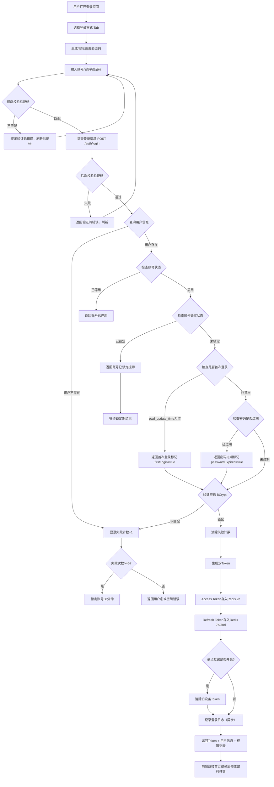
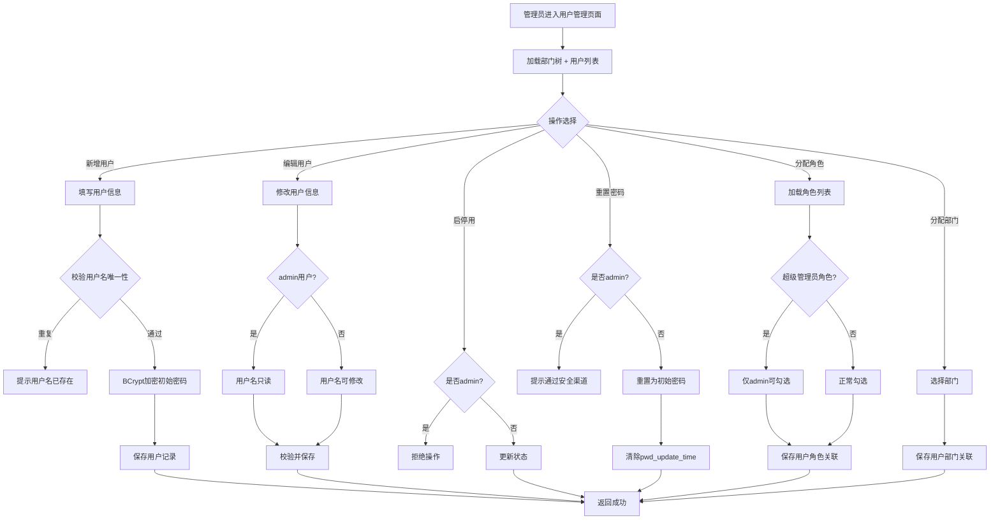
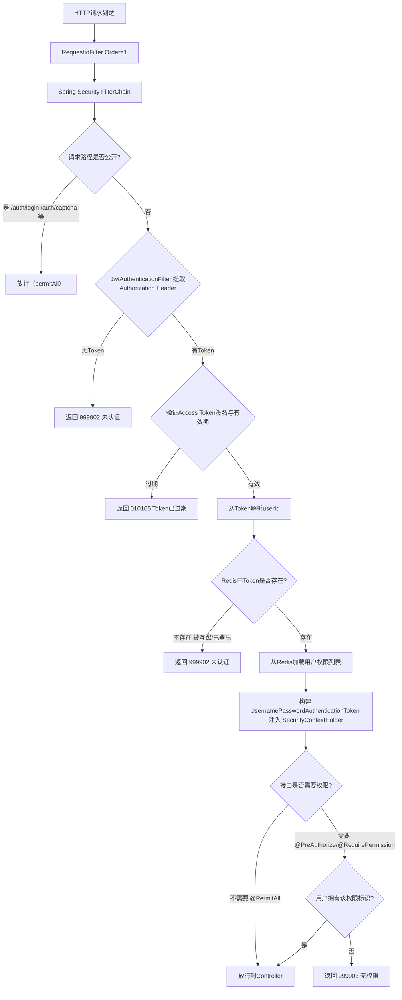
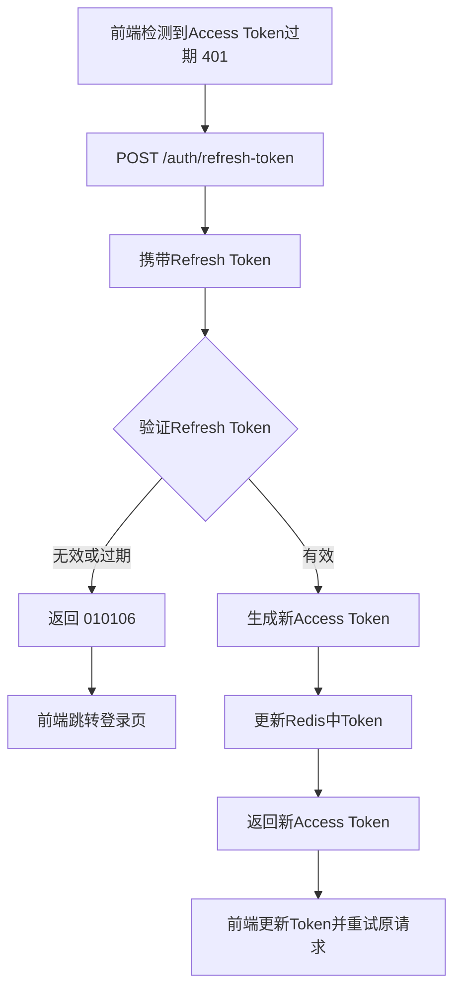
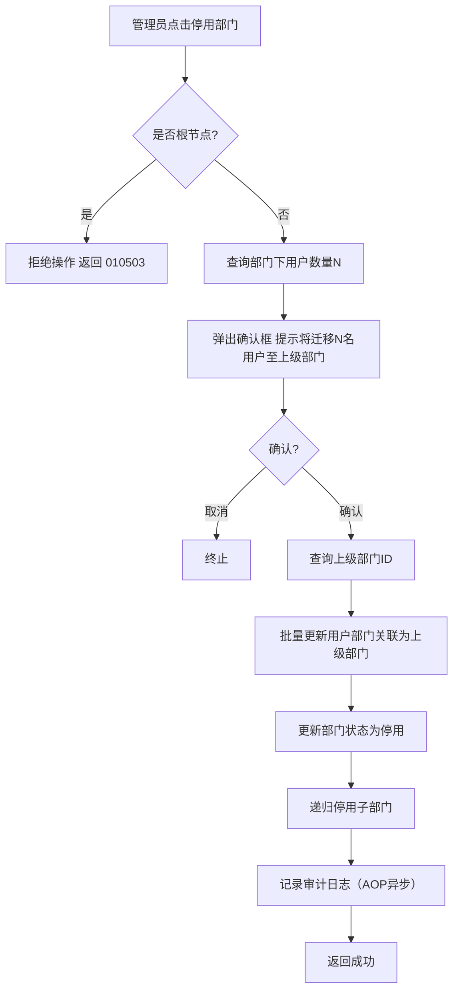
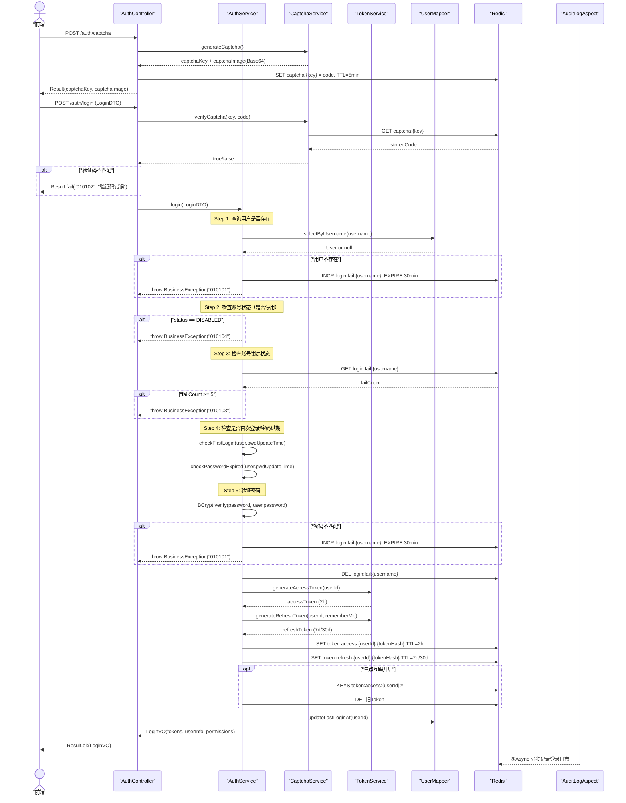
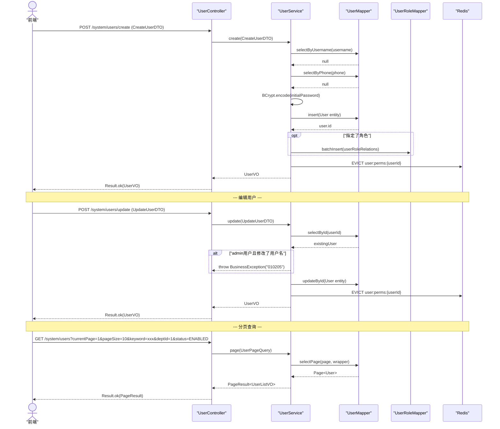
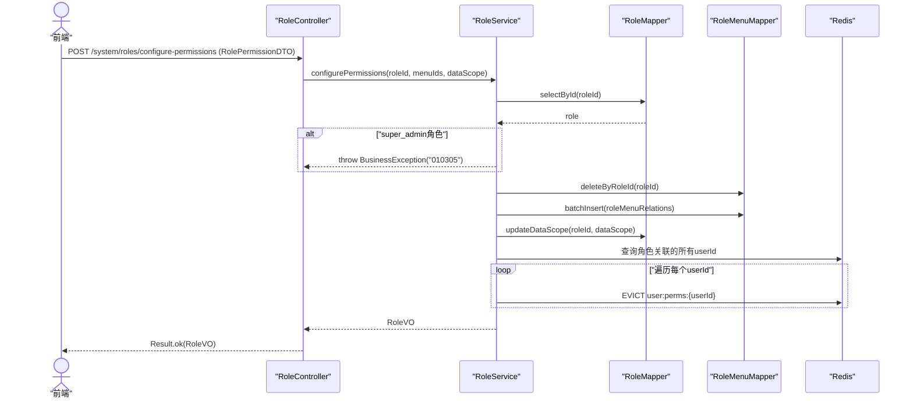
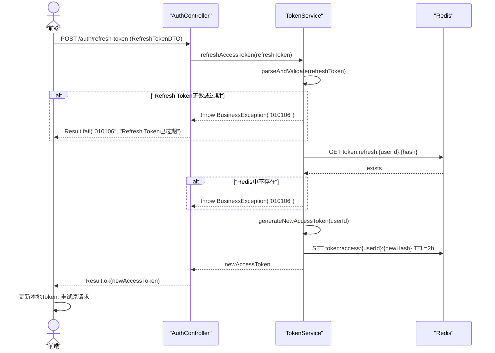
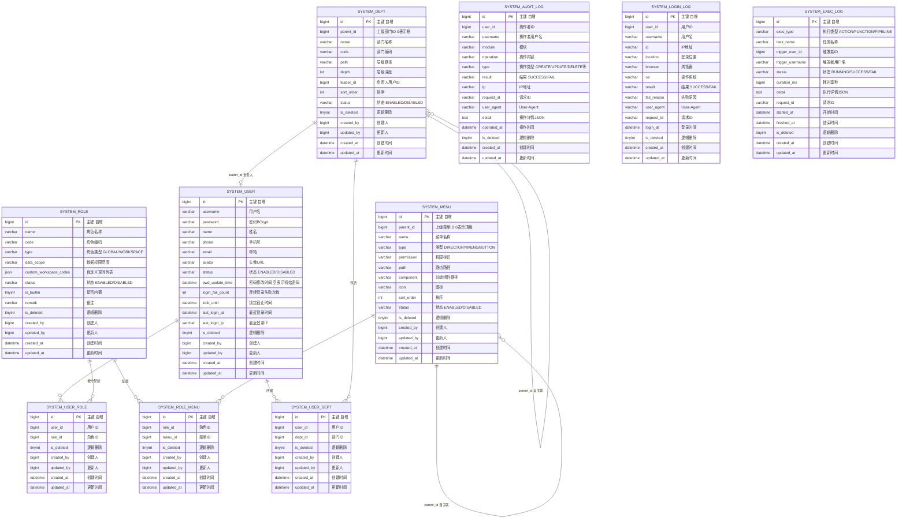

# 系统管理模块 -- 技术实现文档

| 项 | 内容 |
|---|---|
| 文档版本 | v1.1 |
| 编制日期 | 2026-09-29 |
| 配套 PRD | `docs/prd/system-需求设计.md` |
| 配套原型 | `docs/prototype/system/` |
| 所属服务 | prism-platform（端口 8100，URL 前缀 `/web/platform`） |
| 技术栈 | Java 21 + Spring Boot 3.5 + MyBatis-Plus 3.5 + MySQL 8.0 + Redis 7 + Spring Security Starter + JWT |

---

## 1. 概述

### 1.1 需求回顾

系统管理模块是 Prism 平台的平台级基础功能，提供：

- **登录认证**：用户名/手机号/邮箱 + 密码 + 图形验证码登录，双 Token 机制（Access Token 2h + Refresh Token 7d/30d），首次登录强制修改密码，登录失败 5 次锁定 30 分钟，单点登录互踢（可配置），忘记密码
- **用户管理**：CRUD、分配角色/部门、重置密码、批量导入/导出 Excel、用户自服务（修改密码/个人信息/头像）
- **角色管理**：CRUD、配置菜单 + 按钮权限、配置空间数据权限（5 种可见范围）、分配用户、超管角色保护
- **权限管理**：目录-菜单-按钮三级树、CRUD、启停用、菜单图标配置、权限标识唯一性校验、权限变更日志
- **部门管理**：无限层级树、CRUD、分配用户、设置负责人、启停用（用户自动迁移）、拖拽排序、部门转移
- **日志管理**：审计日志、登录日志、执行日志，多维筛选，保留天数可配

### 1.2 设计范围

本文档覆盖系统管理模块的后端技术实现设计，包括数据库设计、API 设计、核心业务流程、安全与权限设计。前端实现不在本文档范围内。

### 1.3 与现有模块的关系

| 现有组件 | 关系 |
|---|---|
| `prism-common` BaseEntity | 所有 Entity 继承 BaseEntity（id/createdAt/updatedAt/createdBy/updatedBy/deleted） |
| `prism-common` Result/PageResult/PageQuery | 所有 API 响应统一使用 Result 和 PageResult 包装 |
| `prism-common` ErrorCode/BusinessException | 错误码扩展系统管理模块专属编码 |
| `prism-common` RequestContextHolder | Spring Security 认证后同步注入 userId 和 requestId（与 SecurityContextHolder 并行使用） |
| `prism-common` MybatisPlusConfig | 复用分页插件、乐观锁插件、MetaObjectHandler 自动填充 |
| `prism-common` JacksonConfig | 复用全局 Long->String 序列化、java.time 格式化 |
| `prism-common` RequestIdFilter | 复用请求 ID 注入（注册在 Spring Security FilterChain 最前端） |
| `prism-common` GlobalExceptionHandler | 复用全局异常处理（含 Spring Security 异常转换） |

### 1.4 错误编码分配

系统管理模块编码前缀为 `01`（模块编码 2 位）。功能编码和错误编码分配如下：

| 功能域 | 功能编码 | 说明 |
|---|---|---|
| 认证登录 | 01 | 登录、登出、Token 刷新、验证码、忘记密码 |
| 用户管理 | 02 | 用户 CRUD、角色分配、部门分配、密码重置 |
| 角色管理 | 03 | 角色 CRUD、权限配置、用户分配 |
| 权限管理 | 04 | 菜单树 CRUD、启停用 |
| 部门管理 | 05 | 部门树 CRUD、用户分配、负责人设置 |
| 日志管理 | 06 | 审计日志、登录日志、执行日志查询与导出 |

**错误编码示例**：

| 错误码 | 含义 |
|---|---|
| `010101` | 用户名或密码错误 |
| `010102` | 验证码错误或已过期 |
| `010103` | 账号已被锁定 |
| `010104` | 账号已被停用 |
| `010105` | Access Token 已过期 |
| `010106` | Refresh Token 已过期 |
| `010107` | 首次登录须修改密码 |
| `010108` | 密码已过期须修改 |
| `010201` | 用户名已存在 |
| `010202` | 手机号已被使用 |
| `010203` | 邮箱已被使用 |
| `010204` | admin 账号不可停用 |
| `010205` | admin 用户名不可修改 |
| `010206` | 超级管理员角色仅可分配给 admin |
| `010301` | 角色名称已存在 |
| `010302` | 角色编码已存在 |
| `010303` | 内置角色不可修改 |
| `010304` | 内置角色不可停用 |
| `010305` | 超级管理员角色不可修改 |
| `010401` | 权限标识已存在 |
| `010402` | 存在下级节点不可删除 |
| `010403` | 菜单类型层级不合法 |
| `010501` | 部门名称在同级已存在 |
| `010502` | 部门编码已存在 |
| `010503` | 根节点不可操作 |
| `010504` | 上级部门不可为自身或下级 |
| `010601` | 日志导出失败 |

---

## 2. 系统架构图

```
┌─────────────────────────────────────────────────────────────────────────────┐
│                          前端 (React + Ant Design)                          │
│  · 登录页面（login.html）                                                    │
│  · 系统管理总览（system.html）                                                │
│  · 用户管理 / 角色管理 / 权限管理 / 部门管理 / 日志管理                         │
│  · 用户自服务（个人信息 / 修改密码）                                           │
└───────────────────────────────┬─────────────────────────────────────────────┘
                                │ HTTPS (JWT Bearer Token)
┌───────────────────────────────▼─────────────────────────────────────────────┐
│                    prism-platform 服务 (端口 8100)                           │
│                                                                             │
│  ┌──────────────────────────────────────────────────────────────────────┐   │
│  │              Spring Security FilterChain                              │   │
│  │  ┌─────────────┐  ┌──────────────────────┐  ┌────────────────────┐  │   │
│  │  │ RequestId   │→ │ JwtAuthentication     │→ │ RequestContextHolder│  │   │
│  │  │ Filter      │  │ Filter                │  │ Filter             │  │   │
│  │  │ (Order=1)   │  │ (Spring Security      │  │ (注入 userId 到   │  │   │
│  │  │             │  │  AbstractAuth...      │  │  SecurityContext)  │  │   │
│  │  │             │  │  ProcessingFilter)    │  │                    │  │   │
│  │  └─────────────┘  └──────────────────────┘  └────────────────────┘  │   │
│  └──────────────────────────────────────────────────────────────────────┘   │
│                                                                             │
│  ┌──────────────────────────────────────────────────────────────────────┐   │
│  │                         Controller 层                                │   │
│  │  AuthController · UserController · RoleController · MenuController   │   │
│  │  DeptController · LogController · ProfileController                  │   │
│  └──────────────────────────────┬───────────────────────────────────────┘   │
│                                 │                                           │
│  ┌──────────────────────────────▼───────────────────────────────────────┐   │
│  │                    AOP 层（审计日志切面）                              │   │
│  │  AuditLogAspect (@Around Controller/Service, @Async 异步写入)        │   │
│  └──────────────────────────────┬───────────────────────────────────────┘   │
│                                 │                                           │
│  ┌──────────────────────────────▼───────────────────────────────────────┐   │
│  │                         Service 层 (纯业务接口)                       │   │
│  │  AuthService · UserService · RoleService · MenuService                │   │
│  │  DeptService · LogService · CaptchaService · TokenService             │   │
│  └──────────────────────────────┬───────────────────────────────────────┘   │
│                                 │                                           │
│  ┌──────────────────────────────▼───────────────────────────────────────┐   │
│  │                         Mapper 层 (BaseMapper)                        │   │
│  │  UserMapper · RoleMapper · MenuMapper · DeptMapper                    │   │
│  │  UserRoleMapper · RoleMenuMapper · UserDeptMapper                     │   │
│  │  AuditLogMapper · LoginLogMapper · ExecLogMapper                      │   │
│  └──────────────────────────────┬───────────────────────────────────────┘   │
│                                 │                                           │
│  ┌──────────────────────────────▼───────────────────────────────────────┐   │
│  │                      Infrastructure 层                               │   │
│  │  Spring Security (PasswordEncoder + SecurityFilterChain)              │   │
│  │  JwtTokenProvider · CaptchaGenerator · ExcelImportExportHelper        │   │
│  └──────────────────────────────────────────────────────────────────────┘   │
└───────────┬──────────────────────────────────────┬──────────────────────────┘
            │                                      │
   ┌────────▼────────┐                    ┌────────▼────────┐
   │   MySQL 8.0+    │                    │   Redis 7       │
   │   (prism 库)    │                    │                 │
   │                 │                    │  · Token 存储    │
   │  system_user    │                    │  · 验证码缓存    │
   │  system_role    │                    │  · 登录失败计数  │
   │  system_menu    │                    │  · 用户权限缓存  │
   │  system_dept    │                    │  · 单点互踢标记  │
   │  system_xxx_rel │                    │                 │
   │  system_xxx_log │                    │                 │
   └─────────────────┘                    └─────────────────┘
```

---

## 3. 业务流程图

### 3.1 登录认证流程



### 3.2 用户管理核心流程



### 3.3 权限校验流程（接口级鉴权）



### 3.4 Token 刷新流程



### 3.5 部门停用与用户迁移流程



---

## 4. 时序图

### 4.1 登录认证时序



### 4.2 用户 CRUD 时序



### 4.3 角色权限分配时序



### 4.4 Token 刷新时序



---

## 5. ER 图



---

## 6. 核心类图

```plantuml
@startuml
skinparam classAttributeIconSize 0
skinparam defaultFontSize 11
skinparam packageStyle rectangle

package "entity" {
    class BaseEntity <<abstract>> {
        - Long id
        - LocalDateTime createdAt
        - LocalDateTime updatedAt
        - Long createdBy
        - Long updatedBy
        - Integer deleted
    }

    class SystemUser {
        - String username
        - String password
        - String name
        - String phone
        - String email
        - String avatar
        - String status
        - LocalDateTime pwdUpdateTime
        - Integer loginFailCount
        - LocalDateTime lockUntil
        - LocalDateTime lastLoginAt
        - String lastLoginIp
    }

    class SystemRole {
        - String name
        - String code
        - String type
        - String dataScope
        - String customWorkspaceCodes
        - String status
        - Boolean builtin
        - String remark
    }

    class SystemMenu {
        - Long parentId
        - String name
        - String type
        - String permission
        - String path
        - String component
        - String icon
        - Integer sortOrder
        - String status
    }

    class SystemDept {
        - Long parentId
        - String name
        - String code
        - String path
        - Integer depth
        - Long leaderId
        - Integer sortOrder
        - String status
    }

    class SystemUserRole {
        - Long userId
        - Long roleId
    }

    class SystemRoleMenu {
        - Long roleId
        - Long menuId
    }

    class SystemUserDept {
        - Long userId
        - Long deptId
    }

    class SystemAuditLog {
        - Long userId
        - String username
        - String module
        - String operation
        - String type
        - String result
        - String ip
        - String requestId
        - String userAgent
        - String detail
        - LocalDateTime operatedAt
    }

    class SystemLoginLog {
        - Long userId
        - String username
        - String ip
        - String location
        - String browser
        - String os
        - String result
        - String failReason
        - String userAgent
        - String requestId
        - LocalDateTime loginAt
    }

    class SystemExecLog {
        - String execType
        - String taskName
        - Long triggerUserId
        - String triggerUsername
        - String status
        - Long durationMs
        - String detail
        - String requestId
        - LocalDateTime startedAt
        - LocalDateTime finishedAt
    }

    BaseEntity <|-- SystemUser
    BaseEntity <|-- SystemRole
    BaseEntity <|-- SystemMenu
    BaseEntity <|-- SystemDept
    BaseEntity <|-- SystemUserRole
    BaseEntity <|-- SystemRoleMenu
    BaseEntity <|-- SystemUserDept
    BaseEntity <|-- SystemAuditLog
    BaseEntity <|-- SystemLoginLog
    BaseEntity <|-- SystemExecLog
}

package "dto" {
    class LoginDTO {
        - String loginType
        - String username
        - String phone
        - String email
        - String password
        - String captchaKey
        - String captchaCode
        - Boolean rememberMe
    }

    class ChangePasswordDTO {
        - String oldPassword
        - String newPassword
        - String confirmPassword
    }

    class CreateUserDTO {
        - String username
        - String name
        - String phone
        - String email
        - Long deptId
        - String status
    }

    class UpdateUserDTO {
        - Long id
        - String username
        - String name
        - String phone
        - String email
        - Long deptId
        - String status
    }

    class CreateRoleDTO {
        - String name
        - String code
        - String type
        - String remark
    }

    class RolePermissionDTO {
        - Long roleId
        - List<Long> menuIds
        - String dataScope
        - List<String> customWorkspaceCodes
    }

    class CreateMenuDTO {
        - Long parentId
        - String name
        - String type
        - String permission
        - String path
        - String component
        - String icon
        - Integer sortOrder
    }

    class CreateDeptDTO {
        - Long parentId
        - String name
        - String code
        - Long leaderId
        - Integer sortOrder
    }
}

package "vo" {
    class LoginVO {
        - String accessToken
        - String refreshToken
        - Boolean firstLogin
        - Boolean passwordExpired
        - UserInfoVO userInfo
        - List<String> permissions
    }

    class UserInfoVO {
        - Long id
        - String username
        - String name
        - String phone
        - String email
        - String avatar
        - List<String> roleNames
        - String deptName
    }

    class UserListVO {
        - Long id
        - String username
        - String name
        - String phone
        - String email
        - String avatar
        - String status
        - String deptName
        - List<String> roleNames
        - LocalDateTime lastLoginAt
    }

    class MenuTreeVO {
        - Long id
        - Long parentId
        - String name
        - String type
        - String permission
        - String path
        - String icon
        - Integer sortOrder
        - String status
        - List<MenuTreeVO> children
    }

    class DeptTreeVO {
        - Long id
        - Long parentId
        - String name
        - String code
        - Integer depth
        - String leaderName
        - Integer memberCount
        - Integer sortOrder
        - String status
        - List<DeptTreeVO> children
    }
}

package "mapper" {
    interface SystemUserMapper <<interface>> {
        + selectByUsername(username): SystemUser
        + selectByPhone(phone): SystemUser
        + selectByEmail(email): SystemUser
        + updateLoginInfo(id, ip, time): void
        + updateFailCount(id, count, lockUntil): void
    }

    interface SystemRoleMapper <<interface>> {
        + selectByCode(code): SystemRole
        + selectByUserId(userId): List<SystemRole>
    }

    interface SystemMenuMapper <<interface>> {
        + selectAll(): List<SystemMenu>
        + selectByPermission(permission): SystemMenu
        + selectByParentId(parentId): List<SystemMenu>
    }

    interface SystemDeptMapper <<interface>> {
        + selectByCode(code): SystemDept
        + selectByParentId(parentId): List<SystemDept>
        + selectChildrenById(id): List<SystemDept>
    }

    interface SystemUserRoleMapper <<interface>> {
        + selectByUserId(userId): List<SystemUserRole>
        + deleteByUserId(userId): int
        + batchInsert(list): int
    }

    interface SystemRoleMenuMapper <<interface>> {
        + selectByRoleId(roleId): List<SystemRoleMenu>
        + deleteByRoleId(roleId): int
        + batchInsert(list): int
    }

    interface SystemUserDeptMapper <<interface>> {
        + selectByUserId(userId): SystemUserDept
        + selectByDeptId(deptId): List<SystemUserDept>
        + deleteByUserId(userId): int
    }

    interface SystemAuditLogMapper <<interface>>
    interface SystemLoginLogMapper <<interface>>
    interface SystemExecLogMapper <<interface>>
}

package "service" {
    interface AuthService <<interface>> {
        + login(dto): LoginVO
        + logout(accessToken): void
        + refreshToken(refreshToken): String
        + getCaptcha(): CaptchaVO
        + forgotPassword(dto): void
    }

    interface UserService <<interface>> {
        + create(dto): UserVO
        + update(dto): UserVO
        + delete(id): void
        + getById(id): UserDetailVO
        + page(query): PageResult<UserListVO>
        + enableDisable(id, status): void
        + resetPassword(id): void
        + assignRoles(userId, roleIds): void
        + assignDept(userId, deptId): void
        + importUsers(file): ImportResultVO
        + exportUsers(query): byte[]
    }

    interface RoleService <<interface>> {
        + create(dto): RoleVO
        + update(dto): RoleVO
        + delete(id): void
        + getById(id): RoleDetailVO
        + page(query): PageResult<RoleListVO>
        + enableDisable(id, status): void
        + configurePermissions(dto): void
        + assignUsers(roleId, userIds): void
    }

    interface MenuService <<interface>> {
        + create(dto): MenuVO
        + update(dto): MenuVO
        + delete(id): void
        + tree(): List<MenuTreeVO>
        + enableDisable(id, status): void
        + getByPermission(perm): MenuVO
    }

    interface DeptService <<interface>> {
        + create(dto): DeptVO
        + update(dto): DeptVO
        + delete(id): void
        + tree(): List<DeptTreeVO>
        + enableDisable(id, status): void
        + assignUsers(deptId, userIds): void
        + setLeader(deptId, userId): void
        + transfer(id, targetParentId): void
        + updateSort(sortList): void
    }

    interface LogService <<interface>> {
        + pageAuditLogs(query): PageResult<AuditLogVO>
        + pageLoginLogs(query): PageResult<LoginLogVO>
        + pageExecLogs(query): PageResult<ExecLogVO>
        + exportLogs(type, query): byte[]
    }
    note right of LogService : "仅负责日志查询与导出\n日志写入由 AuditLogAspect 异步完成"

    interface TokenService <<interface>> {
        + generateAccessToken(userId): String
        + generateRefreshToken(userId, remember): String
        + validateAccessToken(token): TokenClaims
        + refreshAccessToken(refreshToken): String
        + revokeTokens(userId): void
    }

    interface ProfileService <<interface>> {
        + getProfile(): UserProfileVO
        + updateProfile(dto): void
        + changePassword(dto): void
        + uploadAvatar(file): String
    }
}

package "controller" {
    class AuthController {
        - AuthService authService
        + login(LoginDTO): Result<LoginVO>
        + logout(): Result<Void>
        + refreshToken(RefreshTokenDTO): Result<String>
        + getCaptcha(): Result<CaptchaVO>
        + forgotPassword(ForgotPasswordDTO): Result<Void>
        + changePasswordFirstTime(ChangePasswordDTO): Result<Void>
    }

    class UserController {
        - UserService userService
        + create(CreateUserDTO): Result<UserVO>
        + update(UpdateUserDTO): Result<UserVO>
        + delete(Long): Result<Void>
        + getById(Long): Result<UserDetailVO>
        + page(UserPageQuery): Result<PageResult<UserListVO>>
        + enableDisable(Long, String): Result<Void>
        + resetPassword(Long): Result<Void>
        + assignRoles(Long, List<Long>): Result<Void>
        + assignDept(Long, Long): Result<Void>
        + importUsers(MultipartFile): Result<ImportResultVO>
        + exportUsers(UserPageQuery): void
    }

    class RoleController {
        - RoleService roleService
        + create(CreateRoleDTO): Result<RoleVO>
        + update(UpdateRoleDTO): Result<RoleVO>
        + delete(Long): Result<Void>
        + getById(Long): Result<RoleDetailVO>
        + page(RolePageQuery): Result<PageResult<RoleListVO>>
        + enableDisable(Long, String): Result<Void>
        + configurePermissions(RolePermissionDTO): Result<Void>
        + assignUsers(Long, List<Long>): Result<Void>
    }

    class MenuController {
        - MenuService menuService
        + create(CreateMenuDTO): Result<MenuVO>
        + update(UpdateMenuDTO): Result<MenuVO>
        + delete(Long): Result<Void>
        + tree(): Result<List<MenuTreeVO>>
        + enableDisable(Long, String): Result<Void>
    }

    class DeptController {
        - DeptService deptService
        + create(CreateDeptDTO): Result<DeptVO>
        + update(UpdateDeptDTO): Result<DeptVO>
        + delete(Long): Result<Void>
        + tree(): Result<List<DeptTreeVO>>
        + enableDisable(Long, String): Result<Void>
        + assignUsers(Long, List<Long>): Result<Void>
        + setLeader(Long, Long): Result<Void>
        + transfer(Long, Long): Result<Void>
        + updateSort(List<SortDTO>): Result<Void>
    }

    class LogController {
        - LogService logService
        + pageAuditLogs(AuditLogQuery): Result<PageResult<AuditLogVO>>
        + pageLoginLogs(LoginLogQuery): Result<PageResult<LoginLogVO>>
        + pageExecLogs(ExecLogQuery): Result<PageResult<ExecLogVO>>
        + exportLogs(String, Object): void
    }

    class ProfileController {
        - ProfileService profileService
        + getProfile(): Result<UserProfileVO>
        + updateProfile(UpdateProfileDTO): Result<Void>
        + changePassword(ChangePasswordDTO): Result<Void>
        + uploadAvatar(MultipartFile): Result<String>
    }
}

package "infrastructure" {
    class TokenService <<interface>>
    class JwtTokenProvider <<implements TokenService>> {
        - String secretKey
        - int accessExpireHours
        - int refreshExpireDays
        - int rememberRefreshExpireDays
        + generateAccessToken(userId): String
        + generateRefreshToken(userId, remember): String
        + validateAccessToken(token): TokenClaims
        + refreshAccessToken(refreshToken): String
        + revokeTokens(userId): void
    }

    class CaptchaService {
        + generateCaptcha(): CaptchaVO
        + verifyCaptcha(key, code): boolean
    }

    class CaptchaGenerator {
        + generate(width, height): CaptchaData
    }

    class PasswordValidator {
        + validate(password): void
        + isInitialPassword(userId): boolean
    }
}

package "security (Spring Security)" {
    class SecurityConfig <<@Configuration>> {
        + securityFilterChain(HttpSecurity): SecurityFilterChain
        + passwordEncoder(): PasswordEncoder
        + authenticationManager(AuthenticationConfiguration): AuthenticationManager
    }

    class JwtAuthenticationFilter <<extends OncePerRequestFilter>> {
        - JwtTokenProvider jwtTokenProvider
        - UserDetailsService userDetailsService
        + doFilterInternal(request, response, chain): void
    }

    class CustomUserDetailsService <<implements UserDetailsService>> {
        - SystemUserMapper userMapper
        - SystemRoleMapper roleMapper
        - SystemMenuMapper menuMapper
        + loadUserByUsername(username): UserDetails
    }

    class SecurityUtils <<utility>> {
        + {static} getCurrentUserId(): Long
        + {static} getCurrentUsername(): String
        + {static} hasPermission(permission): boolean
    }
}

package "aspect" {
    class AuditLogAspect <<@Aspect @Component>> {
        - SystemAuditLogMapper auditLogMapper
        - SystemLoginLogMapper loginLogMapper
        + @Around("@annotation(AuditLog)") auditLog(ProceedingJoinPoint): Object
        + @AfterReturning("@annotation(LoginLog)") loginLog(JoinPoint, Object): void
        + @AfterThrowing("@annotation(LoginLog)") loginLogFail(JoinPoint, Exception): void
    }

    class AuditLog <<@interface>> {
        + String module()
        + String operation()
        + String type()
    }

    class LoginLog <<@interface>> {
        + String value()
    }
}

SystemUserMapper ..> SystemUser : "CRUD"
SystemRoleMapper ..> SystemRole : "CRUD"
SystemMenuMapper ..> SystemMenu : "CRUD"
SystemDeptMapper ..> SystemDept : "CRUD"
SystemUserRoleMapper ..> SystemUserRole : "CRUD"
SystemRoleMenuMapper ..> SystemRoleMenu : "CRUD"
SystemUserDeptMapper ..> SystemUserDept : "CRUD"

AuthService ..> SystemUserMapper : "uses"
AuthService ..> TokenService : "uses"
AuthService ..> CaptchaService : "uses"
UserService ..> SystemUserMapper : "uses"
UserService ..> SystemUserRoleMapper : "uses"
UserService ..> SystemUserDeptMapper : "uses"
RoleService ..> SystemRoleMapper : "uses"
RoleService ..> SystemRoleMenuMapper : "uses"
MenuService ..> SystemMenuMapper : "uses"
DeptService ..> SystemDeptMapper : "uses"
DeptService ..> SystemUserDeptMapper : "uses"

AuthController ..> AuthService : "delegates"
UserController ..> UserService : "delegates"
RoleController ..> RoleService : "delegates"
MenuController ..> MenuService : "delegates"
DeptController ..> DeptService : "delegates"
LogController ..> LogService : "delegates"
ProfileController ..> ProfileService : "delegates"

JwtAuthenticationFilter ..> JwtTokenProvider : "uses"
JwtAuthenticationFilter ..> CustomUserDetailsService : "uses"
CustomUserDetailsService ..> SystemUserMapper : "uses"
CustomUserDetailsService ..> SystemRoleMapper : "uses"
CustomUserDetailsService ..> SystemMenuMapper : "uses"
SecurityConfig ..> JwtAuthenticationFilter : "registers"

AuditLogAspect ..> SystemAuditLogMapper : "async insert"
AuditLogAspect ..> SystemLoginLogMapper : "async insert"

@enduml
```

---

## 7. 数据库设计

### 7.1 表清单

| 序号 | 表名 | 说明 | 是否有 workspace_code |
|---|---|---|---|
| 1 | system_user | 用户表 | 否（全局资源） |
| 2 | system_role | 角色表 | 否（全局资源） |
| 3 | system_menu | 菜单权限表 | 否（全局资源） |
| 4 | system_dept | 部门表 | 否（全局资源） |
| 5 | system_user_role | 用户角色关联表 | 否 |
| 6 | system_role_menu | 角色菜单关联表 | 否 |
| 7 | system_user_dept | 用户部门关联表 | 否 |
| 8 | system_audit_log | 审计日志表 | 否 |
| 9 | system_login_log | 登录日志表 | 否 |
| 10 | system_exec_log | 执行日志表 | 否 |

### 7.2 Flyway DDL 脚本

所有 DDL 合并为单个 `V1__init_system.sql` 文件，全部使用 `CREATE TABLE IF NOT EXISTS` 保证幂等。

#### V1__init_system.sql

```sql
-- ===== 系统管理模块初始化脚本（合并 V1~V11）=====
-- 文件路径：prism-platform/src/main/resources/db/migration/V1__init_system.sql

-- -----------------------------------------------------------
-- 1. 用户表
-- -----------------------------------------------------------
CREATE TABLE IF NOT EXISTS system_user (
    id              BIGINT          NOT NULL AUTO_INCREMENT COMMENT '主键（自增）',
    username        VARCHAR(32)     NOT NULL    COMMENT '用户名',
    password        VARCHAR(128)    NOT NULL    COMMENT '密码（BCrypt哈希）',
    name            VARCHAR(50)     NOT NULL    COMMENT '姓名',
    phone           VARCHAR(11)     NULL        COMMENT '手机号',
    email           VARCHAR(100)    NULL        COMMENT '邮箱',
    avatar          VARCHAR(500)    NULL        COMMENT '头像URL',
    status          VARCHAR(16)     NOT NULL    DEFAULT 'ENABLED' COMMENT '状态：ENABLED/DISABLED',
    pwd_update_time DATETIME        NULL        COMMENT '密码最后修改时间（空表示初始密码未修改）',
    login_fail_count INT            NOT NULL    DEFAULT 0 COMMENT '连续登录失败次数',
    lock_until      DATETIME        NULL        COMMENT '账号锁定截止时间',
    last_login_at   DATETIME        NULL        COMMENT '最近登录时间',
    last_login_ip   VARCHAR(64)     NULL        COMMENT '最近登录IP',
    is_deleted      TINYINT(1)      NOT NULL    DEFAULT 0 COMMENT '逻辑删除（0=未删除，1=已删除）',
    created_by      BIGINT          NULL        COMMENT '创建人ID',
    updated_by      BIGINT          NULL        COMMENT '更新人ID',
    created_at      DATETIME        NOT NULL    DEFAULT CURRENT_TIMESTAMP COMMENT '创建时间',
    updated_at      DATETIME        NOT NULL    DEFAULT CURRENT_TIMESTAMP ON UPDATE CURRENT_TIMESTAMP COMMENT '更新时间',
    PRIMARY KEY (id),
    INDEX idx_system_user_username (username, is_deleted),
    INDEX idx_system_user_phone (phone, is_deleted),
    INDEX idx_system_user_email (email, is_deleted),
    INDEX idx_system_user_status (status, is_deleted)
) ENGINE=InnoDB DEFAULT CHARSET=utf8mb4 COLLATE=utf8mb4_unicode_ci COMMENT='用户表';

-- -----------------------------------------------------------
-- 2. 角色表
-- -----------------------------------------------------------
CREATE TABLE IF NOT EXISTS system_role (
    id                      BIGINT          NOT NULL AUTO_INCREMENT COMMENT '主键（自增）',
    name                    VARCHAR(50)     NOT NULL    COMMENT '角色名称',
    code                    VARCHAR(50)     NOT NULL    COMMENT '角色编码',
    type                    VARCHAR(16)     NOT NULL    DEFAULT 'GLOBAL' COMMENT '角色类型：GLOBAL（全局）/WORKSPACE（空间级）',
    data_scope              VARCHAR(32)     NOT NULL    DEFAULT 'ALL' COMMENT '数据权限范围：ALL/DEPT_AND_CHILDREN/DEPT/SELF/CUSTOM',
    custom_workspace_codes  JSON            NULL        COMMENT '自定义可见空间编码列表（data_scope=CUSTOM时使用）',
    status                  VARCHAR(16)     NOT NULL    DEFAULT 'ENABLED' COMMENT '状态：ENABLED/DISABLED',
    is_builtin              TINYINT(1)      NOT NULL    DEFAULT 0 COMMENT '是否内置角色（0=否，1=是）',
    remark                  VARCHAR(200)    NULL        COMMENT '备注',
    is_deleted              TINYINT(1)      NOT NULL    DEFAULT 0 COMMENT '逻辑删除（0=未删除，1=已删除）',
    created_by              BIGINT          NULL        COMMENT '创建人ID',
    updated_by              BIGINT          NULL        COMMENT '更新人ID',
    created_at              DATETIME        NOT NULL    DEFAULT CURRENT_TIMESTAMP COMMENT '创建时间',
    updated_at              DATETIME        NOT NULL    DEFAULT CURRENT_TIMESTAMP ON UPDATE CURRENT_TIMESTAMP COMMENT '更新时间',
    PRIMARY KEY (id),
    INDEX idx_system_role_code (code, is_deleted),
    INDEX idx_system_role_status (status, is_deleted)
) ENGINE=InnoDB DEFAULT CHARSET=utf8mb4 COLLATE=utf8mb4_unicode_ci COMMENT='角色表';

-- -----------------------------------------------------------
-- 3. 菜单权限表
-- -----------------------------------------------------------
CREATE TABLE IF NOT EXISTS system_menu (
    id              BIGINT          NOT NULL AUTO_INCREMENT COMMENT '主键（自增）',
    parent_id       BIGINT          NOT NULL    DEFAULT 0 COMMENT '上级菜单ID（0表示顶级目录）',
    name            VARCHAR(50)     NOT NULL    COMMENT '菜单名称',
    type            VARCHAR(16)     NOT NULL    COMMENT '类型：DIRECTORY（目录）/MENU（菜单）/BUTTON（按钮）',
    permission      VARCHAR(100)    NULL        COMMENT '权限标识（如system:user:create）',
    path            VARCHAR(200)    NULL        COMMENT '前端路由路径',
    component       VARCHAR(200)    NULL        COMMENT '前端组件路径',
    icon            VARCHAR(50)     NULL        COMMENT '菜单图标',
    sort_order      INT             NOT NULL    DEFAULT 0 COMMENT '排序（数值越小越靠前）',
    status          VARCHAR(16)     NOT NULL    DEFAULT 'ENABLED' COMMENT '状态：ENABLED/DISABLED',
    is_deleted      TINYINT(1)      NOT NULL    DEFAULT 0 COMMENT '逻辑删除（0=未删除，1=已删除）',
    created_by      BIGINT          NULL        COMMENT '创建人ID',
    updated_by      BIGINT          NULL        COMMENT '更新人ID',
    created_at      DATETIME        NOT NULL    DEFAULT CURRENT_TIMESTAMP COMMENT '创建时间',
    updated_at      DATETIME        NOT NULL    DEFAULT CURRENT_TIMESTAMP ON UPDATE CURRENT_TIMESTAMP COMMENT '更新时间',
    PRIMARY KEY (id),
    INDEX idx_system_menu_parent_id (parent_id, is_deleted),
    INDEX idx_system_menu_permission (permission, is_deleted),
    INDEX idx_system_menu_type (type, is_deleted)
) ENGINE=InnoDB DEFAULT CHARSET=utf8mb4 COLLATE=utf8mb4_unicode_ci COMMENT='菜单权限表（目录-菜单-按钮三级）';

-- -----------------------------------------------------------
-- 4. 部门表
-- -----------------------------------------------------------
CREATE TABLE IF NOT EXISTS system_dept (
    id              BIGINT          NOT NULL AUTO_INCREMENT COMMENT '主键（自增）',
    parent_id       BIGINT          NOT NULL    DEFAULT 0 COMMENT '上级部门ID（0表示根节点）',
    name            VARCHAR(50)     NOT NULL    COMMENT '部门名称',
    code            VARCHAR(50)     NOT NULL    COMMENT '部门编码',
    path            VARCHAR(500)    NULL        COMMENT '层级路径（如/1/5/12/，用于快速查询子节点）',
    depth           INT             NOT NULL    DEFAULT 0 COMMENT '层级深度（根节点为0）',
    leader_id       BIGINT          NULL        COMMENT '负责人用户ID',
    sort_order      INT             NOT NULL    DEFAULT 0 COMMENT '排序（数值越小越靠前）',
    status          VARCHAR(16)     NOT NULL    DEFAULT 'ENABLED' COMMENT '状态：ENABLED/DISABLED',
    is_deleted      TINYINT(1)      NOT NULL    DEFAULT 0 COMMENT '逻辑删除（0=未删除，1=已删除）',
    created_by      BIGINT          NULL        COMMENT '创建人ID',
    updated_by      BIGINT          NULL        COMMENT '更新人ID',
    created_at      DATETIME        NOT NULL    DEFAULT CURRENT_TIMESTAMP COMMENT '创建时间',
    updated_at      DATETIME        NOT NULL    DEFAULT CURRENT_TIMESTAMP ON UPDATE CURRENT_TIMESTAMP COMMENT '更新时间',
    PRIMARY KEY (id),
    INDEX idx_system_dept_parent_id (parent_id, is_deleted),
    INDEX idx_system_dept_code (code, is_deleted),
    INDEX idx_system_dept_path (path)
) ENGINE=InnoDB DEFAULT CHARSET=utf8mb4 COLLATE=utf8mb4_unicode_ci COMMENT='部门表（无限层级树）';

-- -----------------------------------------------------------
-- 5. 用户角色关联表
-- -----------------------------------------------------------
CREATE TABLE IF NOT EXISTS system_user_role (
    id              BIGINT          NOT NULL AUTO_INCREMENT COMMENT '主键（自增）',
    user_id         BIGINT          NOT NULL    COMMENT '用户ID',
    role_id         BIGINT          NOT NULL    COMMENT '角色ID',
    is_deleted      TINYINT(1)      NOT NULL    DEFAULT 0 COMMENT '逻辑删除（0=未删除，1=已删除）',
    created_by      BIGINT          NULL        COMMENT '创建人ID',
    updated_by      BIGINT          NULL        COMMENT '更新人ID',
    created_at      DATETIME        NOT NULL    DEFAULT CURRENT_TIMESTAMP COMMENT '创建时间',
    updated_at      DATETIME        NOT NULL    DEFAULT CURRENT_TIMESTAMP ON UPDATE CURRENT_TIMESTAMP COMMENT '更新时间',
    PRIMARY KEY (id),
    INDEX idx_system_user_role_user_id (user_id, is_deleted),
    INDEX idx_system_user_role_role_id (role_id, is_deleted)
) ENGINE=InnoDB DEFAULT CHARSET=utf8mb4 COLLATE=utf8mb4_unicode_ci COMMENT='用户角色关联表';

-- -----------------------------------------------------------
-- 6. 角色菜单关联表
-- -----------------------------------------------------------
CREATE TABLE IF NOT EXISTS system_role_menu (
    id              BIGINT          NOT NULL AUTO_INCREMENT COMMENT '主键（自增）',
    role_id         BIGINT          NOT NULL    COMMENT '角色ID',
    menu_id         BIGINT          NOT NULL    COMMENT '菜单ID',
    is_deleted      TINYINT(1)      NOT NULL    DEFAULT 0 COMMENT '逻辑删除（0=未删除，1=已删除）',
    created_by      BIGINT          NULL        COMMENT '创建人ID',
    updated_by      BIGINT          NULL        COMMENT '更新人ID',
    created_at      DATETIME        NOT NULL    DEFAULT CURRENT_TIMESTAMP COMMENT '创建时间',
    updated_at      DATETIME        NOT NULL    DEFAULT CURRENT_TIMESTAMP ON UPDATE CURRENT_TIMESTAMP COMMENT '更新时间',
    PRIMARY KEY (id),
    INDEX idx_system_role_menu_role_id (role_id, is_deleted),
    INDEX idx_system_role_menu_menu_id (menu_id, is_deleted)
) ENGINE=InnoDB DEFAULT CHARSET=utf8mb4 COLLATE=utf8mb4_unicode_ci COMMENT='角色菜单关联表';

-- -----------------------------------------------------------
-- 7. 用户部门关联表
-- -----------------------------------------------------------
CREATE TABLE IF NOT EXISTS system_user_dept (
    id              BIGINT          NOT NULL AUTO_INCREMENT COMMENT '主键（自增）',
    user_id         BIGINT          NOT NULL    COMMENT '用户ID',
    dept_id         BIGINT          NOT NULL    COMMENT '部门ID',
    is_deleted      TINYINT(1)      NOT NULL    DEFAULT 0 COMMENT '逻辑删除（0=未删除，1=已删除）',
    created_by      BIGINT          NULL        COMMENT '创建人ID',
    updated_by      BIGINT          NULL        COMMENT '更新人ID',
    created_at      DATETIME        NOT NULL    DEFAULT CURRENT_TIMESTAMP COMMENT '创建时间',
    updated_at      DATETIME        NOT NULL    DEFAULT CURRENT_TIMESTAMP ON UPDATE CURRENT_TIMESTAMP COMMENT '更新时间',
    PRIMARY KEY (id),
    INDEX idx_system_user_dept_user_id (user_id, is_deleted),
    INDEX idx_system_user_dept_dept_id (dept_id, is_deleted)
) ENGINE=InnoDB DEFAULT CHARSET=utf8mb4 COLLATE=utf8mb4_unicode_ci COMMENT='用户部门关联表';

-- -----------------------------------------------------------
-- 8. 审计日志表
-- -----------------------------------------------------------
CREATE TABLE IF NOT EXISTS system_audit_log (
    id              BIGINT          NOT NULL AUTO_INCREMENT COMMENT '主键（自增）',
    user_id         BIGINT          NULL        COMMENT '操作者ID',
    username        VARCHAR(32)     NULL        COMMENT '操作者用户名',
    module          VARCHAR(32)     NOT NULL    COMMENT '模块（如system/ontology/data等）',
    operation       VARCHAR(200)    NOT NULL    COMMENT '操作内容描述',
    type            VARCHAR(32)     NOT NULL    COMMENT '操作类型：CREATE/UPDATE/DELETE/ENABLE/DISABLE/LOGIN等',
    result          VARCHAR(16)     NOT NULL    DEFAULT 'SUCCESS' COMMENT '结果：SUCCESS/FAIL',
    ip              VARCHAR(64)     NULL        COMMENT '操作者IP地址',
    request_id      VARCHAR(64)     NULL        COMMENT '请求追踪ID',
    user_agent      VARCHAR(500)    NULL        COMMENT 'User-Agent',
    detail          TEXT            NULL        COMMENT '操作详情（JSON格式）',
    operated_at     DATETIME        NOT NULL    COMMENT '操作时间',
    is_deleted      TINYINT(1)      NOT NULL    DEFAULT 0 COMMENT '逻辑删除（0=未删除，1=已删除）',
    created_at      DATETIME        NOT NULL    DEFAULT CURRENT_TIMESTAMP COMMENT '创建时间',
    updated_at      DATETIME        NOT NULL    DEFAULT CURRENT_TIMESTAMP ON UPDATE CURRENT_TIMESTAMP COMMENT '更新时间',
    PRIMARY KEY (id),
    INDEX idx_system_audit_log_user_id (user_id),
    INDEX idx_system_audit_log_module (module),
    INDEX idx_system_audit_log_operated_at (operated_at),
    INDEX idx_system_audit_log_type (type)
) ENGINE=InnoDB DEFAULT CHARSET=utf8mb4 COLLATE=utf8mb4_unicode_ci COMMENT='审计日志表';

-- -----------------------------------------------------------
-- 9. 登录日志表
-- -----------------------------------------------------------
CREATE TABLE IF NOT EXISTS system_login_log (
    id              BIGINT          NOT NULL AUTO_INCREMENT COMMENT '主键（自增）',
    user_id         BIGINT          NULL        COMMENT '用户ID（登录失败且用户不存在时可为空）',
    username        VARCHAR(32)     NOT NULL    COMMENT '登录使用的用户名',
    ip              VARCHAR(64)     NULL        COMMENT '登录IP地址',
    location        VARCHAR(128)    NULL        COMMENT '登录位置（通过IP解析）',
    browser         VARCHAR(64)     NULL        COMMENT '浏览器名称',
    os              VARCHAR(64)     NULL        COMMENT '操作系统名称',
    result          VARCHAR(16)     NOT NULL    DEFAULT 'SUCCESS' COMMENT '登录结果：SUCCESS/FAIL',
    fail_reason     VARCHAR(200)    NULL        COMMENT '失败原因',
    user_agent      VARCHAR(500)    NULL        COMMENT 'User-Agent',
    request_id      VARCHAR(64)     NULL        COMMENT '请求追踪ID',
    login_at        DATETIME        NOT NULL    COMMENT '登录时间',
    is_deleted      TINYINT(1)      NOT NULL    DEFAULT 0 COMMENT '逻辑删除（0=未删除，1=已删除）',
    created_at      DATETIME        NOT NULL    DEFAULT CURRENT_TIMESTAMP COMMENT '创建时间',
    updated_at      DATETIME        NOT NULL    DEFAULT CURRENT_TIMESTAMP ON UPDATE CURRENT_TIMESTAMP COMMENT '更新时间',
    PRIMARY KEY (id),
    INDEX idx_system_login_log_user_id (user_id),
    INDEX idx_system_login_log_username (username),
    INDEX idx_system_login_log_login_at (login_at),
    INDEX idx_system_login_log_result (result)
) ENGINE=InnoDB DEFAULT CHARSET=utf8mb4 COLLATE=utf8mb4_unicode_ci COMMENT='登录日志表';

-- -----------------------------------------------------------
-- 10. 执行日志表
-- -----------------------------------------------------------
CREATE TABLE IF NOT EXISTS system_exec_log (
    id              BIGINT          NOT NULL AUTO_INCREMENT COMMENT '主键（自增）',
    exec_type       VARCHAR(32)     NOT NULL    COMMENT '执行类型：ACTION/FUNCTION/PIPELINE',
    task_name       VARCHAR(200)    NOT NULL    COMMENT '任务名称',
    trigger_user_id BIGINT          NULL        COMMENT '触发者ID',
    trigger_username VARCHAR(32)    NULL        COMMENT '触发者用户名',
    status          VARCHAR(16)     NOT NULL    DEFAULT 'RUNNING' COMMENT '状态：RUNNING/SUCCESS/FAIL',
    duration_ms     BIGINT          NULL        COMMENT '执行耗时（毫秒）',
    detail          TEXT            NULL        COMMENT '执行详情（JSON格式）',
    request_id      VARCHAR(64)     NULL        COMMENT '请求追踪ID',
    started_at      DATETIME        NOT NULL    COMMENT '开始时间',
    finished_at     DATETIME        NULL        COMMENT '结束时间',
    is_deleted      TINYINT(1)      NOT NULL    DEFAULT 0 COMMENT '逻辑删除（0=未删除，1=已删除）',
    created_at      DATETIME        NOT NULL    DEFAULT CURRENT_TIMESTAMP COMMENT '创建时间',
    updated_at      DATETIME        NOT NULL    DEFAULT CURRENT_TIMESTAMP ON UPDATE CURRENT_TIMESTAMP COMMENT '更新时间',
    PRIMARY KEY (id),
    INDEX idx_system_exec_log_exec_type (exec_type),
    INDEX idx_system_exec_log_status (status),
    INDEX idx_system_exec_log_started_at (started_at),
    INDEX idx_system_exec_log_trigger_user_id (trigger_user_id)
) ENGINE=InnoDB DEFAULT CHARSET=utf8mb4 COLLATE=utf8mb4_unicode_ci COMMENT='执行日志表（Action/Function/Pipeline）';

-- ===== 初始化内置数据 =====

-- 根部门
INSERT INTO system_dept (id, parent_id, name, code, path, depth, sort_order, status, created_by, created_at, updated_at)
SELECT 1, 0, '集团', 'ROOT', '/1/', 0, 0, 'ENABLED', 1, NOW(), NOW()
FROM DUAL WHERE NOT EXISTS (SELECT 1 FROM system_dept WHERE id = 1);

-- 内置角色
INSERT INTO system_role (id, name, code, type, data_scope, status, is_builtin, remark, created_by, created_at, updated_at)
SELECT 1, '超级管理员', 'super_admin', 'GLOBAL', 'ALL', 'ENABLED', 1, '系统内置超级管理员角色，拥有全部权限', 1, NOW(), NOW()
FROM DUAL WHERE NOT EXISTS (SELECT 1 FROM system_role WHERE id = 1);

INSERT INTO system_role (id, name, code, type, data_scope, status, is_builtin, remark, created_by, created_at, updated_at)
SELECT 2, '系统运维', 'system_ops', 'GLOBAL', 'ALL', 'ENABLED', 1, '系统运维角色，管理平台用户与日志', 1, NOW(), NOW()
FROM DUAL WHERE NOT EXISTS (SELECT 1 FROM system_role WHERE id = 2);

INSERT INTO system_role (id, name, code, type, data_scope, status, is_builtin, remark, created_by, created_at, updated_at)
SELECT 3, '空间管理员', 'workspace_admin', 'WORKSPACE', 'ALL', 'ENABLED', 1, '空间管理员角色，管理空间内资源', 1, NOW(), NOW()
FROM DUAL WHERE NOT EXISTS (SELECT 1 FROM system_role WHERE id = 3);

-- 初始管理员用户（密码为 BCrypt("onto12345678!")）
INSERT INTO system_user (id, username, password, name, phone, email, status, created_by, created_at, updated_at)
SELECT 1, 'admin', '$2a$10$N.zmdr9k7uOCQb376NoUnuTJ8iAt6Z5EHsM8lE9lBOsl7iAt6Z5EH', '超级管理员', '13800000000', 'admin@prism.local', 'ENABLED', 1, NOW(), NOW()
FROM DUAL WHERE NOT EXISTS (SELECT 1 FROM system_user WHERE id = 1);

-- admin 关联超级管理员角色
INSERT INTO system_user_role (user_id, role_id, created_by, created_at, updated_at)
SELECT 1, 1, 1, NOW(), NOW()
FROM DUAL WHERE NOT EXISTS (SELECT 1 FROM system_user_role WHERE user_id = 1 AND role_id = 1);

-- admin 关联根部门
INSERT INTO system_user_dept (user_id, dept_id, created_by, created_at, updated_at)
SELECT 1, 1, 1, NOW(), NOW()
FROM DUAL WHERE NOT EXISTS (SELECT 1 FROM system_user_dept WHERE user_id = 1 AND dept_id = 1);

-- ===== 初始化系统管理菜单 =====

-- 一级目录：系统管理
INSERT INTO system_menu (id, parent_id, name, type, permission, path, component, icon, sort_order, status, created_by, created_at, updated_at)
SELECT 1, 0, '系统管理', 'DIRECTORY', NULL, '/system', NULL, 'SettingOutlined', 100, 'ENABLED', 1, NOW(), NOW()
FROM DUAL WHERE NOT EXISTS (SELECT 1 FROM system_menu WHERE id = 1);

-- 二级菜单
INSERT INTO system_menu (id, parent_id, name, type, permission, path, component, icon, sort_order, status, created_by, created_at, updated_at)
SELECT 2, 1, '用户管理', 'MENU', NULL, '/system/users', 'system/sys-users', 'UserOutlined', 1, 'ENABLED', 1, NOW(), NOW()
FROM DUAL WHERE NOT EXISTS (SELECT 1 FROM system_menu WHERE id = 2);

INSERT INTO system_menu (id, parent_id, name, type, permission, path, component, icon, sort_order, status, created_by, created_at, updated_at)
SELECT 3, 1, '角色管理', 'MENU', NULL, '/system/roles', 'system/sys-roles', 'TeamOutlined', 2, 'ENABLED', 1, NOW(), NOW()
FROM DUAL WHERE NOT EXISTS (SELECT 1 FROM system_menu WHERE id = 3);

INSERT INTO system_menu (id, parent_id, name, type, permission, path, component, icon, sort_order, status, created_by, created_at, updated_at)
SELECT 4, 1, '权限管理', 'MENU', NULL, '/system/permissions', 'system/sys-perms', 'SafetyCertificateOutlined', 3, 'ENABLED', 1, NOW(), NOW()
FROM DUAL WHERE NOT EXISTS (SELECT 1 FROM system_menu WHERE id = 4);

INSERT INTO system_menu (id, parent_id, name, type, permission, path, component, icon, sort_order, status, created_by, created_at, updated_at)
SELECT 5, 1, '部门管理', 'MENU', NULL, '/system/departments', 'system/sys-depts', 'ApartmentOutlined', 4, 'ENABLED', 1, NOW(), NOW()
FROM DUAL WHERE NOT EXISTS (SELECT 1 FROM system_menu WHERE id = 5);

INSERT INTO system_menu (id, parent_id, name, type, permission, path, component, icon, sort_order, status, created_by, created_at, updated_at)
SELECT 6, 1, '日志管理', 'MENU', NULL, '/system/logs', 'system/sys-logs', 'FileTextOutlined', 5, 'ENABLED', 1, NOW(), NOW()
FROM DUAL WHERE NOT EXISTS (SELECT 1 FROM system_menu WHERE id = 6);

-- 三级按钮权限：用户管理
INSERT INTO system_menu (id, parent_id, name, type, permission, path, component, icon, sort_order, status, created_by, created_at, updated_at)
SELECT 10, 2, '新增用户', 'BUTTON', 'system:user:create', NULL, NULL, NULL, 1, 'ENABLED', 1, NOW(), NOW()
FROM DUAL WHERE NOT EXISTS (SELECT 1 FROM system_menu WHERE id = 10);

INSERT INTO system_menu (id, parent_id, name, type, permission, path, component, icon, sort_order, status, created_by, created_at, updated_at)
SELECT 11, 2, '编辑用户', 'BUTTON', 'system:user:update', NULL, NULL, NULL, 2, 'ENABLED', 1, NOW(), NOW()
FROM DUAL WHERE NOT EXISTS (SELECT 1 FROM system_menu WHERE id = 11);

INSERT INTO system_menu (id, parent_id, name, type, permission, path, component, icon, sort_order, status, created_by, created_at, updated_at)
SELECT 12, 2, '删除用户', 'BUTTON', 'system:user:delete', NULL, NULL, NULL, 3, 'ENABLED', 1, NOW(), NOW()
FROM DUAL WHERE NOT EXISTS (SELECT 1 FROM system_menu WHERE id = 12);

INSERT INTO system_menu (id, parent_id, name, type, permission, path, component, icon, sort_order, status, created_by, created_at, updated_at)
SELECT 13, 2, '启停用用户', 'BUTTON', 'system:user:status', NULL, NULL, NULL, 4, 'ENABLED', 1, NOW(), NOW()
FROM DUAL WHERE NOT EXISTS (SELECT 1 FROM system_menu WHERE id = 13);

INSERT INTO system_menu (id, parent_id, name, type, permission, path, component, icon, sort_order, status, created_by, created_at, updated_at)
SELECT 14, 2, '重置密码', 'BUTTON', 'system:user:reset-pwd', NULL, NULL, NULL, 5, 'ENABLED', 1, NOW(), NOW()
FROM DUAL WHERE NOT EXISTS (SELECT 1 FROM system_menu WHERE id = 14);

INSERT INTO system_menu (id, parent_id, name, type, permission, path, component, icon, sort_order, status, created_by, created_at, updated_at)
SELECT 15, 2, '分配角色', 'BUTTON', 'system:user:assign-role', NULL, NULL, NULL, 6, 'ENABLED', 1, NOW(), NOW()
FROM DUAL WHERE NOT EXISTS (SELECT 1 FROM system_menu WHERE id = 15);

INSERT INTO system_menu (id, parent_id, name, type, permission, path, component, icon, sort_order, status, created_by, created_at, updated_at)
SELECT 16, 2, '分配部门', 'BUTTON', 'system:user:assign-dept', NULL, NULL, NULL, 7, 'ENABLED', 1, NOW(), NOW()
FROM DUAL WHERE NOT EXISTS (SELECT 1 FROM system_menu WHERE id = 16);

INSERT INTO system_menu (id, parent_id, name, type, permission, path, component, icon, sort_order, status, created_by, created_at, updated_at)
SELECT 17, 2, '导入用户', 'BUTTON', 'system:user:import', NULL, NULL, NULL, 8, 'ENABLED', 1, NOW(), NOW()
FROM DUAL WHERE NOT EXISTS (SELECT 1 FROM system_menu WHERE id = 17);

INSERT INTO system_menu (id, parent_id, name, type, permission, path, component, icon, sort_order, status, created_by, created_at, updated_at)
SELECT 18, 2, '导出用户', 'BUTTON', 'system:user:export', NULL, NULL, NULL, 9, 'ENABLED', 1, NOW(), NOW()
FROM DUAL WHERE NOT EXISTS (SELECT 1 FROM system_menu WHERE id = 18);

-- 三级按钮权限：角色管理
INSERT INTO system_menu (id, parent_id, name, type, permission, path, component, icon, sort_order, status, created_by, created_at, updated_at)
SELECT 20, 3, '新增角色', 'BUTTON', 'system:role:create', NULL, NULL, NULL, 1, 'ENABLED', 1, NOW(), NOW()
FROM DUAL WHERE NOT EXISTS (SELECT 1 FROM system_menu WHERE id = 20);

INSERT INTO system_menu (id, parent_id, name, type, permission, path, component, icon, sort_order, status, created_by, created_at, updated_at)
SELECT 21, 3, '编辑角色', 'BUTTON', 'system:role:update', NULL, NULL, NULL, 2, 'ENABLED', 1, NOW(), NOW()
FROM DUAL WHERE NOT EXISTS (SELECT 1 FROM system_menu WHERE id = 21);

INSERT INTO system_menu (id, parent_id, name, type, permission, path, component, icon, sort_order, status, created_by, created_at, updated_at)
SELECT 22, 3, '删除角色', 'BUTTON', 'system:role:delete', NULL, NULL, NULL, 3, 'ENABLED', 1, NOW(), NOW()
FROM DUAL WHERE NOT EXISTS (SELECT 1 FROM system_menu WHERE id = 22);

INSERT INTO system_menu (id, parent_id, name, type, permission, path, component, icon, sort_order, status, created_by, created_at, updated_at)
SELECT 23, 3, '启停用角色', 'BUTTON', 'system:role:status', NULL, NULL, NULL, 4, 'ENABLED', 1, NOW(), NOW()
FROM DUAL WHERE NOT EXISTS (SELECT 1 FROM system_menu WHERE id = 23);

INSERT INTO system_menu (id, parent_id, name, type, permission, path, component, icon, sort_order, status, created_by, created_at, updated_at)
SELECT 24, 3, '配置权限', 'BUTTON', 'system:role:config-perm', NULL, NULL, NULL, 5, 'ENABLED', 1, NOW(), NOW()
FROM DUAL WHERE NOT EXISTS (SELECT 1 FROM system_menu WHERE id = 24);

INSERT INTO system_menu (id, parent_id, name, type, permission, path, component, icon, sort_order, status, created_by, created_at, updated_at)
SELECT 25, 3, '分配用户', 'BUTTON', 'system:role:assign-user', NULL, NULL, NULL, 6, 'ENABLED', 1, NOW(), NOW()
FROM DUAL WHERE NOT EXISTS (SELECT 1 FROM system_menu WHERE id = 25);

-- 三级按钮权限：权限管理
INSERT INTO system_menu (id, parent_id, name, type, permission, path, component, icon, sort_order, status, created_by, created_at, updated_at)
SELECT 30, 4, '新增节点', 'BUTTON', 'system:menu:create', NULL, NULL, NULL, 1, 'ENABLED', 1, NOW(), NOW()
FROM DUAL WHERE NOT EXISTS (SELECT 1 FROM system_menu WHERE id = 30);

INSERT INTO system_menu (id, parent_id, name, type, permission, path, component, icon, sort_order, status, created_by, created_at, updated_at)
SELECT 31, 4, '编辑节点', 'BUTTON', 'system:menu:update', NULL, NULL, NULL, 2, 'ENABLED', 1, NOW(), NOW()
FROM DUAL WHERE NOT EXISTS (SELECT 1 FROM system_menu WHERE id = 31);

INSERT INTO system_menu (id, parent_id, name, type, permission, path, component, icon, sort_order, status, created_by, created_at, updated_at)
SELECT 32, 4, '删除节点', 'BUTTON', 'system:menu:delete', NULL, NULL, NULL, 3, 'ENABLED', 1, NOW(), NOW()
FROM DUAL WHERE NOT EXISTS (SELECT 1 FROM system_menu WHERE id = 32);

INSERT INTO system_menu (id, parent_id, name, type, permission, path, component, icon, sort_order, status, created_by, created_at, updated_at)
SELECT 33, 4, '启停用节点', 'BUTTON', 'system:menu:status', NULL, NULL, NULL, 4, 'ENABLED', 1, NOW(), NOW()
FROM DUAL WHERE NOT EXISTS (SELECT 1 FROM system_menu WHERE id = 33);

-- 三级按钮权限：部门管理
INSERT INTO system_menu (id, parent_id, name, type, permission, path, component, icon, sort_order, status, created_by, created_at, updated_at)
SELECT 40, 5, '新增部门', 'BUTTON', 'system:dept:create', NULL, NULL, NULL, 1, 'ENABLED', 1, NOW(), NOW()
FROM DUAL WHERE NOT EXISTS (SELECT 1 FROM system_menu WHERE id = 40);

INSERT INTO system_menu (id, parent_id, name, type, permission, path, component, icon, sort_order, status, created_by, created_at, updated_at)
SELECT 41, 5, '编辑部门', 'BUTTON', 'system:dept:update', NULL, NULL, NULL, 2, 'ENABLED', 1, NOW(), NOW()
FROM DUAL WHERE NOT EXISTS (SELECT 1 FROM system_menu WHERE id = 41);

INSERT INTO system_menu (id, parent_id, name, type, permission, path, component, icon, sort_order, status, created_by, created_at, updated_at)
SELECT 42, 5, '删除部门', 'BUTTON', 'system:dept:delete', NULL, NULL, NULL, 3, 'ENABLED', 1, NOW(), NOW()
FROM DUAL WHERE NOT EXISTS (SELECT 1 FROM system_menu WHERE id = 42);

INSERT INTO system_menu (id, parent_id, name, type, permission, path, component, icon, sort_order, status, created_by, created_at, updated_at)
SELECT 43, 5, '启停用部门', 'BUTTON', 'system:dept:status', NULL, NULL, NULL, 4, 'ENABLED', 1, NOW(), NOW()
FROM DUAL WHERE NOT EXISTS (SELECT 1 FROM system_menu WHERE id = 43);

INSERT INTO system_menu (id, parent_id, name, type, permission, path, component, icon, sort_order, status, created_by, created_at, updated_at)
SELECT 44, 5, '分配用户', 'BUTTON', 'system:dept:assign-user', NULL, NULL, NULL, 5, 'ENABLED', 1, NOW(), NOW()
FROM DUAL WHERE NOT EXISTS (SELECT 1 FROM system_menu WHERE id = 44);

INSERT INTO system_menu (id, parent_id, name, type, permission, path, component, icon, sort_order, status, created_by, created_at, updated_at)
SELECT 45, 5, '设置负责人', 'BUTTON', 'system:dept:set-leader', NULL, NULL, NULL, 6, 'ENABLED', 1, NOW(), NOW()
FROM DUAL WHERE NOT EXISTS (SELECT 1 FROM system_menu WHERE id = 45);

INSERT INTO system_menu (id, parent_id, name, type, permission, path, component, icon, sort_order, status, created_by, created_at, updated_at)
SELECT 46, 5, '部门转移', 'BUTTON', 'system:dept:transfer', NULL, NULL, NULL, 7, 'ENABLED', 1, NOW(), NOW()
FROM DUAL WHERE NOT EXISTS (SELECT 1 FROM system_menu WHERE id = 46);

-- 三级按钮权限：日志管理
INSERT INTO system_menu (id, parent_id, name, type, permission, path, component, icon, sort_order, status, created_by, created_at, updated_at)
SELECT 50, 6, '查看审计日志', 'BUTTON', 'system:log:audit', NULL, NULL, NULL, 1, 'ENABLED', 1, NOW(), NOW()
FROM DUAL WHERE NOT EXISTS (SELECT 1 FROM system_menu WHERE id = 50);

INSERT INTO system_menu (id, parent_id, name, type, permission, path, component, icon, sort_order, status, created_by, created_at, updated_at)
SELECT 51, 6, '查看登录日志', 'BUTTON', 'system:log:login', NULL, NULL, NULL, 2, 'ENABLED', 1, NOW(), NOW()
FROM DUAL WHERE NOT EXISTS (SELECT 1 FROM system_menu WHERE id = 51);

INSERT INTO system_menu (id, parent_id, name, type, permission, path, component, icon, sort_order, status, created_by, created_at, updated_at)
SELECT 52, 6, '查看执行日志', 'BUTTON', 'system:log:exec', NULL, NULL, NULL, 3, 'ENABLED', 1, NOW(), NOW()
FROM DUAL WHERE NOT EXISTS (SELECT 1 FROM system_menu WHERE id = 52);

INSERT INTO system_menu (id, parent_id, name, type, permission, path, component, icon, sort_order, status, created_by, created_at, updated_at)
SELECT 53, 6, '导出日志', 'BUTTON', 'system:log:export', NULL, NULL, NULL, 4, 'ENABLED', 1, NOW(), NOW()
FROM DUAL WHERE NOT EXISTS (SELECT 1 FROM system_menu WHERE id = 53);

-- 超级管理员角色关联全部菜单
INSERT INTO system_role_menu (role_id, menu_id, created_by, created_at, updated_at)
SELECT 1, id, 1, NOW(), NOW() FROM system_menu
WHERE NOT EXISTS (SELECT 1 FROM system_role_menu rm WHERE rm.role_id = 1 AND rm.menu_id = system_menu.id);
```

### 7.3 Redis Key 设计

| Key 格式 | 用途 | TTL | 说明 |
|---|---|---|---|
| `prism:captcha:{key}` | 图形验证码 | 5 分钟 | value = 验证码明文 |
| `prism:login:fail:{username}` | 登录失败计数 | 30 分钟 | value = 失败次数(int) |
| `prism:token:access:{userId}:{tokenHash}` | Access Token 存在标记 | 2 小时 | value = "1" |
| `prism:token:refresh:{userId}:{tokenHash}` | Refresh Token 存在标记 | 7/30 天 | value = "1" |
| `prism:user:perms:{userId}` | 用户权限标识缓存 | 2 小时 | value = Set<String> |
| `prism:user:info:{userId}` | 用户基本信息缓存 | 1 小时 | value = JSON |
| `prism:token:session:{userId}` | 单点登录当前 Token Hash | 2 小时 | value = tokenHash（互踢用） |

---

## 8. API 设计

> **认证说明**：所有标注"认证 | 需要"的接口由 Spring Security `SecurityFilterChain` 统一拦截，前端通过 `Authorization: Bearer {accessToken}` 请求头传递凭证。`JwtAuthenticationFilter` 负责 Token 解析、Redis 校验和 `SecurityContextHolder` 注入，业务代码通过 `SecurityContextHolder.getContext().getAuthentication()` 或 `SecurityUtils.getCurrentUserId()` 获取当前用户信息。

### 8.1 认证相关接口

#### 8.1.1 获取图形验证码

| 项 | 值 |
|---|---|
| URL | `GET /web/platform/auth/captcha` |
| 认证 | 不需要 |

**请求参数**：无

**响应**：

```json
{
    "code": "000000",
    "msg": "操作成功",
    "data": {
        "captchaKey": "uuid-xxx-xxx",
        "captchaImage": "data:image/png;base64,..."
    },
    "requestId": "xxx"
}
```

#### 8.1.2 登录

| 项 | 值 |
|---|---|
| URL | `POST /web/platform/auth/login` |
| 认证 | 不需要 |

**请求 DTO**：

```java
public class LoginDTO {
    @NotBlank(message = "登录类型不能为空")
    @Schema(description = "登录类型：USERNAME/PHONE/EMAIL")
    private String loginType;

    @Schema(description = "用户名（loginType=USERNAME时必填）")
    private String username;

    @Schema(description = "手机号（loginType=PHONE时必填）")
    @Pattern(regexp = "^1[3-9]\\d{9}$", message = "手机号格式不正确")
    private String phone;

    @Schema(description = "邮箱（loginType=EMAIL时必填）")
    @Email(message = "邮箱格式不正确")
    private String email;

    @NotBlank(message = "密码不能为空")
    @Size(max = 64)
    @Schema(description = "密码")
    private String password;

    @NotBlank(message = "验证码Key不能为空")
    private String captchaKey;

    @NotBlank(message = "验证码不能为空")
    @Size(min = 4, max = 4)
    private String captchaCode;

    @Schema(description = "是否记住我（默认false）")
    private Boolean rememberMe;
}
```

**响应**：

```json
{
    "code": "000000",
    "msg": "操作成功",
    "data": {
        "accessToken": "eyJhbGciOiJIUzI1NiJ9...",
        "refreshToken": "eyJhbGciOiJIUzI1NiJ9...",
        "firstLogin": false,
        "passwordExpired": false,
        "userInfo": {
            "id": "1",
            "username": "admin",
            "name": "超级管理员",
            "phone": "138****0000",
            "email": "admin@prism.local",
            "avatar": null,
            "roleNames": ["超级管理员"],
            "deptName": "集团"
        },
        "permissions": ["system:user:create", "system:user:update", "..."]
    },
    "requestId": "xxx"
}
```

**错误码**：

| 错误码 | 含义 |
|---|---|
| `010101` | 用户名或密码错误 |
| `010102` | 验证码错误或已过期 |
| `010103` | 账号已被锁定，请30分钟后重试 |
| `010104` | 账号已被停用，请联系管理员 |

#### 8.1.3 退出登录

| 项 | 值 |
|---|---|
| URL | `POST /web/platform/auth/logout` |
| 认证 | 需要 |

**请求 DTO**：无（从 Authorization Header 获取 Token）

**响应**：`Result.ok()`

#### 8.1.4 刷新 Token

| 项 | 值 |
|---|---|
| URL | `POST /web/platform/auth/refresh-token` |
| 认证 | 不需要（携带 refreshToken） |

**请求 DTO**：

```java
public class RefreshTokenDTO {
    @NotBlank(message = "Refresh Token不能为空")
    private String refreshToken;
}
```

**响应**：

```json
{
    "code": "000000",
    "msg": "操作成功",
    "data": {
        "accessToken": "eyJhbGciOiJIUzI1NiJ9..."
    },
    "requestId": "xxx"
}
```

**错误码**：`010106` Refresh Token 已过期，请重新登录

#### 8.1.5 首次登录强制修改密码

| 项 | 值 |
|---|---|
| URL | `POST /web/platform/auth/change-password-first` |
| 认证 | 需要（携带登录后的 accessToken） |

**请求 DTO**：

```java
public class ChangePasswordDTO {
    @NotBlank(message = "当前密码不能为空")
    private String oldPassword;

    @NotBlank(message = "新密码不能为空")
    @Size(min = 8, max = 20, message = "密码长度须为8-20位")
    private String newPassword;

    @NotBlank(message = "确认密码不能为空")
    private String confirmPassword;
}
```

**响应**：`Result.ok()`

**错误码**：

| 错误码 | 含义 |
|---|---|
| `010107` | 当前密码不正确 |
| `010109` | 新密码不符合复杂度要求 |
| `010110` | 两次输入的密码不一致 |
| `010111` | 新密码不可与当前密码相同 |

#### 8.1.6 忘记密码

| 项 | 值 |
|---|---|
| URL | `POST /web/platform/auth/forgot-password` |
| 认证 | 不需要 |

**请求 DTO**：

```java
public class ForgotPasswordDTO {
    @NotBlank(message = "验证方式不能为空")
    @Schema(description = "验证方式：PHONE/EMAIL")
    private String verifyType;

    @NotBlank(message = "手机号/邮箱不能为空")
    private String account;

    @NotBlank(message = "验证码不能为空")
    @Size(min = 6, max = 6)
    private String verifyCode;
}
```

**响应**：`Result.ok()`（密码重置为初始密码，提示用户首次登录时修改）

#### 8.1.7 发送验证码（忘记密码用）

| 项 | 值 |
|---|---|
| URL | `POST /web/platform/auth/send-verify-code` |
| 认证 | 不需要 |

**请求 DTO**：

```java
public class SendVerifyCodeDTO {
    @NotBlank(message = "验证方式不能为空")
    @Schema(description = "PHONE/EMAIL")
    private String type;

    @NotBlank(message = "手机号/邮箱不能为空")
    private String account;
}
```

**响应**：`Result.ok()`（60 秒内不可重复发送）

---

### 8.2 用户管理接口

#### 8.2.1 用户列表分页

| 项 | 值 |
|---|---|
| URL | `GET /web/platform/system/users` |
| 权限 | `system:user:list` |

**请求参数**（Query）：

| 参数 | 类型 | 必填 | 说明 |
|---|---|---|---|
| currentPage | int | 否 | 页码，默认 1 |
| pageSize | int | 否 | 每页条数，默认 10 |
| keyword | String | 否 | 按用户名/姓名/手机号/邮箱模糊搜索 |
| deptId | Long | 否 | 部门 ID 筛选 |
| status | String | 否 | 状态筛选 ENABLED/DISABLED |

**响应**：`Result<PageResult<UserListVO>>`

#### 8.2.2 用户详情

| 项 | 值 |
|---|---|
| URL | `GET /web/platform/system/users/{userId}` |
| 权限 | `system:user:detail` |

**响应**：`Result<UserDetailVO>`（含角色列表、部门信息、登录记录）

#### 8.2.3 新增用户

| 项 | 值 |
|---|---|
| URL | `POST /web/platform/system/users/create` |
| 权限 | `system:user:create` |

**请求 DTO**：

```java
public class CreateUserDTO {
    @NotBlank(message = "用户名不能为空")
    @Size(max = 32)
    @Pattern(regexp = "^[a-zA-Z0-9_]+$", message = "用户名仅允许字母、数字、下划线")
    private String username;

    @NotBlank(message = "姓名不能为空")
    @Size(max = 50)
    private String name;

    @Pattern(regexp = "^1[3-9]\\d{9}$", message = "手机号格式不正确")
    private String phone;

    @Email(message = "邮箱格式不正确")
    @Size(max = 100)
    private String email;

    private Long deptId;

    @NotBlank(message = "状态不能为空")
    private String status;
}
```

**响应**：`Result<UserVO>`

**错误码**：

| 错误码 | 含义 |
|---|---|
| `010201` | 用户名已存在 |
| `010202` | 手机号已被使用 |
| `010203` | 邮箱已被使用 |

#### 8.2.4 编辑用户

| 项 | 值 |
|---|---|
| URL | `POST /web/platform/system/users/update` |
| 权限 | `system:user:update` |

**请求 DTO**：

```java
public class UpdateUserDTO {
    @NotNull(message = "用户ID不能为空")
    private Long id;

    @Size(max = 32)
    @Pattern(regexp = "^[a-zA-Z0-9_]+$", message = "用户名仅允许字母、数字、下划线")
    private String username;

    @NotBlank(message = "姓名不能为空")
    @Size(max = 50)
    private String name;

    @Pattern(regexp = "^1[3-9]\\d{9}$", message = "手机号格式不正确")
    private String phone;

    @Email(message = "邮箱格式不正确")
    @Size(max = 100)
    private String email;

    private Long deptId;

    @NotBlank(message = "状态不能为空")
    private String status;
}
```

**响应**：`Result<UserVO>`

**错误码**：

| 错误码 | 含义 |
|---|---|
| `010205` | admin 用户名不可修改 |
| `010202` | 手机号已被使用 |
| `010203` | 邮箱已被使用 |

#### 8.2.5 删除用户

| 项 | 值 |
|---|---|
| URL | `POST /web/platform/system/users/delete` |
| 权限 | `system:user:delete` |

**请求 DTO**：

```java
public class DeleteDTO {
    @NotNull(message = "ID不能为空")
    private Long id;
}
```

**响应**：`Result.ok()`

**错误码**：`010204` admin 账号不可删除

#### 8.2.6 启停用用户

| 项 | 值 |
|---|---|
| URL | `POST /web/platform/system/users/enable-disable` |
| 权限 | `system:user:status` |

**请求 DTO**：

```java
public class EnableDisableDTO {
    @NotNull(message = "ID不能为空")
    private Long id;

    @NotBlank(message = "状态不能为空")
    private String status;
}
```

**响应**：`Result.ok()`

**错误码**：`010204` admin 账号不可停用

#### 8.2.7 重置密码

| 项 | 值 |
|---|---|
| URL | `POST /web/platform/system/users/reset-password` |
| 权限 | `system:user:reset-pwd` |

**请求 DTO**：

```java
public class ResetPasswordDTO {
    @NotNull(message = "用户ID不能为空")
    private Long userId;
}
```

**响应**：`Result.ok()`（密码重置为 `onto12345678!`，pwd_update_time 清空）

**错误码**：`010207` admin 密码请通过安全渠道重置

#### 8.2.8 分配角色

| 项 | 值 |
|---|---|
| URL | `POST /web/platform/system/users/assign-roles` |
| 权限 | `system:user:assign-role` |

**请求 DTO**：

```java
public class AssignRolesDTO {
    @NotNull(message = "用户ID不能为空")
    private Long userId;

    @NotNull(message = "角色列表不能为空")
    private List<Long> roleIds;
}
```

**响应**：`Result.ok()`

**错误码**：`010206` 超级管理员角色仅可分配给 admin

#### 8.2.9 分配部门

| 项 | 值 |
|---|---|
| URL | `POST /web/platform/system/users/assign-dept` |
| 权限 | `system:user:assign-dept` |

**请求 DTO**：

```java
public class AssignDeptDTO {
    @NotNull(message = "用户ID不能为空")
    private Long userId;

    @NotNull(message = "部门ID不能为空")
    private Long deptId;
}
```

**响应**：`Result.ok()`

#### 8.2.10 批量导入用户

| 项 | 值 |
|---|---|
| URL | `POST /web/platform/system/users/import` |
| 权限 | `system:user:import` |
| Content-Type | multipart/form-data |

**请求参数**：`MultipartFile file`（.xlsx，不超过 10MB）

**响应**：

```json
{
    "code": "000000",
    "msg": "操作成功",
    "data": {
        "totalCount": 50,
        "successCount": 45,
        "failCount": 5,
        "failDetails": [
            {"row": 3, "username": "user003", "reason": "用户名已存在"},
            {"row": 7, "username": "user007", "reason": "手机号格式错误"}
        ]
    },
    "requestId": "xxx"
}
```

#### 8.2.11 批量导出用户

| 项 | 值 |
|---|---|
| URL | `GET /web/platform/system/users/export` |
| 权限 | `system:user:export` |

**请求参数**：同用户列表查询参数

**响应**：Excel 文件流下载（Content-Type: application/vnd.openxmlformats-officedocument.spreadsheetml.sheet）

#### 8.2.12 下载导入模板

| 项 | 值 |
|---|---|
| URL | `GET /web/platform/system/users/import-template` |
| 权限 | `system:user:import` |

**响应**：Excel 模板文件流下载

---

### 8.3 角色管理接口

#### 8.3.1 角色列表分页

| 项 | 值 |
|---|---|
| URL | `GET /web/platform/system/roles` |
| 权限 | `system:role:list` |

**请求参数**：currentPage、pageSize、keyword

**响应**：`Result<PageResult<RoleListVO>>`

#### 8.3.2 角色详情

| 项 | 值 |
|---|---|
| URL | `GET /web/platform/system/roles/{roleId}` |
| 权限 | `system:role:detail` |

**响应**：`Result<RoleDetailVO>`（含关联菜单 ID 列表、数据权限范围、成员数）

#### 8.3.3 新增角色

| 项 | 值 |
|---|---|
| URL | `POST /web/platform/system/roles/create` |
| 权限 | `system:role:create` |

**请求 DTO**：

```java
public class CreateRoleDTO {
    @NotBlank(message = "角色名称不能为空")
    @Size(max = 50)
    private String name;

    @NotBlank(message = "角色编码不能为空")
    @Size(max = 50)
    @Pattern(regexp = "^[a-zA-Z0-9_]+$", message = "角色编码仅允许字母、数字、下划线")
    private String code;

    @NotBlank(message = "角色类型不能为空")
    @Schema(description = "GLOBAL/WORKSPACE")
    private String type;

    @Size(max = 200)
    private String remark;
}
```

**响应**：`Result<RoleVO>`

**错误码**：`010301` 角色名称已存在 / `010302` 角色编码已存在

#### 8.3.4 编辑角色

| 项 | 值 |
|---|---|
| URL | `POST /web/platform/system/roles/update` |
| 权限 | `system:role:update` |

**请求 DTO**：

```java
public class UpdateRoleDTO {
    @NotNull(message = "角色ID不能为空")
    private Long id;

    @NotBlank(message = "角色名称不能为空")
    @Size(max = 50)
    private String name;

    @NotBlank(message = "角色类型不能为空")
    private String type;

    @Size(max = 200)
    private String remark;
}
```

**响应**：`Result<RoleVO>`

**错误码**：`010303` 内置角色不可修改 / `010305` 超级管理员角色不可修改

#### 8.3.5 删除角色

| 项 | 值 |
|---|---|
| URL | `POST /web/platform/system/roles/delete` |
| 权限 | `system:role:delete` |

**请求 DTO**：`DeleteDTO { Long id }`

**响应**：`Result.ok()`

**错误码**：`010303` 内置角色不可删除

#### 8.3.6 启停用角色

| 项 | 值 |
|---|---|
| URL | `POST /web/platform/system/roles/enable-disable` |
| 权限 | `system:role:status` |

**请求 DTO**：`EnableDisableDTO { Long id, String status }`

**响应**：`Result.ok()`

**错误码**：`010304` 内置角色不可停用

#### 8.3.7 配置权限

| 项 | 值 |
|---|---|
| URL | `POST /web/platform/system/roles/configure-permissions` |
| 权限 | `system:role:config-perm` |

**请求 DTO**：

```java
public class RolePermissionDTO {
    @NotNull(message = "角色ID不能为空")
    private Long roleId;

    @NotNull(message = "菜单ID列表不能为空")
    private List<Long> menuIds;

    @NotBlank(message = "数据权限范围不能为空")
    @Schema(description = "ALL/DEPT_AND_CHILDREN/DEPT/SELF/CUSTOM")
    private String dataScope;

    @Schema(description = "自定义空间编码列表（dataScope=CUSTOM时）")
    private List<String> customWorkspaceCodes;
}
```

**响应**：`Result.ok()`

**错误码**：`010305` 超级管理员角色不可修改权限

#### 8.3.8 分配用户

| 项 | 值 |
|---|---|
| URL | `POST /web/platform/system/roles/assign-users` |
| 权限 | `system:role:assign-user` |

**请求 DTO**：

```java
public class AssignUsersDTO {
    @NotNull(message = "角色ID不能为空")
    private Long roleId;

    @NotNull(message = "用户ID列表不能为空")
    private List<Long> userIds;
}
```

**响应**：`Result.ok()`

**错误码**：`010206` 超级管理员角色仅可分配给 admin

#### 8.3.9 角色关联用户列表

| 项 | 值 |
|---|---|
| URL | `GET /web/platform/system/roles/{roleId}/users` |
| 权限 | `system:role:detail` |

**响应**：`Result<List<UserListVO>>`

---

### 8.4 权限管理接口

#### 8.4.1 菜单树

| 项 | 值 |
|---|---|
| URL | `GET /web/platform/system/menus/tree` |
| 权限 | `system:menu:list` |

**响应**：`Result<List<MenuTreeVO>>`（三级嵌套树结构）

#### 8.4.2 菜单详情

| 项 | 值 |
|---|---|
| URL | `GET /web/platform/system/menus/{menuId}` |
| 权限 | `system:menu:detail` |

**响应**：`Result<MenuDetailVO>`（含下级节点列表）

#### 8.4.3 新增菜单节点

| 项 | 值 |
|---|---|
| URL | `POST /web/platform/system/menus/create` |
| 权限 | `system:menu:create` |

**请求 DTO**：

```java
public class CreateMenuDTO {
    @NotNull(message = "上级菜单ID不能为空")
    private Long parentId;

    @NotBlank(message = "名称不能为空")
    @Size(max = 50)
    private String name;

    @NotBlank(message = "类型不能为空")
    @Schema(description = "DIRECTORY/MENU/BUTTON")
    private String type;

    @Size(max = 100)
    @Pattern(regexp = "^[a-z]+:[a-z]+:[a-z]+$", message = "权限标识格式：模块:资源:动作")
    private String permission;

    @Size(max = 200)
    private String path;

    @Size(max = 200)
    private String component;

    @Size(max = 50)
    private String icon;

    private Integer sortOrder;
}
```

**响应**：`Result<MenuVO>`

**错误码**：

| 错误码 | 含义 |
|---|---|
| `010401` | 权限标识已存在 |
| `010403` | 菜单类型层级不合法（按钮必须挂载到菜单下） |

#### 8.4.4 编辑菜单节点

| 项 | 值 |
|---|---|
| URL | `POST /web/platform/system/menus/update` |
| 权限 | `system:menu:update` |

**请求 DTO**：

```java
public class UpdateMenuDTO {
    @NotNull(message = "菜单ID不能为空")
    private Long id;

    @NotBlank(message = "名称不能为空")
    @Size(max = 50)
    private String name;

    @Size(max = 100)
    @Pattern(regexp = "^[a-z]+:[a-z]+:[a-z]+$", message = "权限标识格式：模块:资源:动作")
    private String permission;

    @Size(max = 200)
    private String path;

    @Size(max = 200)
    private String component;

    @Size(max = 50)
    private String icon;

    private Integer sortOrder;
}
```

**响应**：`Result<MenuVO>`

**错误码**：`010401` 权限标识已存在

#### 8.4.5 删除菜单节点

| 项 | 值 |
|---|---|
| URL | `POST /web/platform/system/menus/delete` |
| 权限 | `system:menu:delete` |

**请求 DTO**：`DeleteDTO { Long id }`

**响应**：`Result.ok()`

**错误码**：`010402` 存在下级节点，请先删除下级

#### 8.4.6 启停用菜单节点

| 项 | 值 |
|---|---|
| URL | `POST /web/platform/system/menus/enable-disable` |
| 权限 | `system:menu:status` |

**请求 DTO**：`EnableDisableDTO { Long id, String status }`

**响应**：`Result.ok()`

#### 8.4.7 校验权限标识唯一性

| 项 | 值 |
|---|---|
| URL | `GET /web/platform/system/menus/check-permission` |
| 权限 | `system:menu:create` 或 `system:menu:update` |

**请求参数**：`permission`（String）、`excludeId`（Long，编辑时排除自身）

**响应**：`Result<Boolean>`（true 表示可用，false 表示已存在）

---

### 8.5 部门管理接口

#### 8.5.1 部门树

| 项 | 值 |
|---|---|
| URL | `GET /web/platform/system/depts/tree` |
| 权限 | `system:dept:list` |

**响应**：`Result<List<DeptTreeVO>>`

#### 8.5.2 部门详情

| 项 | 值 |
|---|---|
| URL | `GET /web/platform/system/depts/{deptId}` |
| 权限 | `system:dept:detail` |

**响应**：`Result<DeptDetailVO>`（含直属成员列表）

#### 8.5.3 新增部门

| 项 | 值 |
|---|---|
| URL | `POST /web/platform/system/depts/create` |
| 权限 | `system:dept:create` |

**请求 DTO**：

```java
public class CreateDeptDTO {
    @NotNull(message = "上级部门ID不能为空")
    private Long parentId;

    @NotBlank(message = "部门名称不能为空")
    @Size(max = 50)
    private String name;

    @NotBlank(message = "部门编码不能为空")
    @Size(max = 50)
    @Pattern(regexp = "^[a-zA-Z0-9_]+$", message = "部门编码仅允许字母、数字、下划线")
    private String code;

    private Long leaderId;

    private Integer sortOrder;
}
```

**响应**：`Result<DeptVO>`

**错误码**：

| 错误码 | 含义 |
|---|---|
| `010501` | 同级部门名称已存在 |
| `010502` | 部门编码已存在 |
| `010504` | 上级部门不可为自身或下级 |

#### 8.5.4 编辑部门

| 项 | 值 |
|---|---|
| URL | `POST /web/platform/system/depts/update` |
| 权限 | `system:dept:update` |

**请求 DTO**：

```java
public class UpdateDeptDTO {
    @NotNull(message = "部门ID不能为空")
    private Long id;

    @NotBlank(message = "部门名称不能为空")
    @Size(max = 50)
    private String name;

    private Long parentId;

    private Long leaderId;

    private Integer sortOrder;
}
```

**响应**：`Result<DeptVO>`

**错误码**：`010503` 根节点不可编辑

#### 8.5.5 删除部门

| 项 | 值 |
|---|---|
| URL | `POST /web/platform/system/depts/delete` |
| 权限 | `system:dept:delete` |

**请求 DTO**：`DeleteDTO { Long id }`

**响应**：`Result.ok()`

**错误码**：`010503` 根节点不可删除 / `010505` 部门下存在子部门或用户

#### 8.5.6 启停用部门

| 项 | 值 |
|---|---|
| URL | `POST /web/platform/system/depts/enable-disable` |
| 权限 | `system:dept:status` |

**请求 DTO**：`EnableDisableDTO { Long id, String status }`

**响应**：`Result.ok()`（停用时自动将用户迁移至上级部门）

**错误码**：`010503` 根节点不可停用

#### 8.5.7 分配用户

| 项 | 值 |
|---|---|
| URL | `POST /web/platform/system/depts/assign-users` |
| 权限 | `system:dept:assign-user` |

**请求 DTO**：

```java
public class DeptAssignUsersDTO {
    @NotNull(message = "部门ID不能为空")
    private Long deptId;

    @NotNull(message = "用户ID列表不能为空")
    private List<Long> userIds;
}
```

**响应**：`Result.ok()`

#### 8.5.8 设置负责人

| 项 | 值 |
|---|---|
| URL | `POST /web/platform/system/depts/set-leader` |
| 权限 | `system:dept:set-leader` |

**请求 DTO**：

```java
public class SetLeaderDTO {
    @NotNull(message = "部门ID不能为空")
    private Long deptId;

    @NotNull(message = "负责人ID不能为空")
    private Long leaderId;
}
```

**响应**：`Result.ok()`

**错误码**：`010506` 负责人须为该部门已有成员

#### 8.5.9 部门转移

| 项 | 值 |
|---|---|
| URL | `POST /web/platform/system/depts/transfer` |
| 权限 | `system:dept:transfer` |

**请求 DTO**：

```java
public class TransferDeptDTO {
    @NotNull(message = "部门ID不能为空")
    private Long deptId;

    @NotNull(message = "目标上级部门ID不能为空")
    private Long targetParentId;
}
```

**响应**：`Result.ok()`

**错误码**：`010504` 不可转移到自身或下级部门

#### 8.5.10 部门排序

| 项 | 值 |
|---|---|
| URL | `POST /web/platform/system/depts/update-sort` |
| 权限 | `system:dept:update` |

**请求 DTO**：

```java
public class UpdateSortDTO {
    @NotEmpty(message = "排序列表不能为空")
    private List<SortItem> items;

    @Data
    public static class SortItem {
        @NotNull private Long id;
        @NotNull private Integer sortOrder;
    }
}
```

**响应**：`Result.ok()`

---

### 8.6 日志管理接口

#### 8.6.1 审计日志分页

| 项 | 值 |
|---|---|
| URL | `GET /web/platform/system/logs/audit` |
| 权限 | `system:log:audit` |

**请求参数**：

| 参数 | 类型 | 说明 |
|---|---|---|
| currentPage | int | 页码 |
| pageSize | int | 每页条数 |
| keyword | String | 关键词搜索 |
| module | String | 模块筛选 |
| type | String | 操作类型筛选 |
| startTime | String | 开始时间 yyyy-MM-dd HH:mm:ss |
| endTime | String | 结束时间 yyyy-MM-dd HH:mm:ss |

**响应**：`Result<PageResult<AuditLogVO>>`

#### 8.6.2 登录日志分页

| 项 | 值 |
|---|---|
| URL | `GET /web/platform/system/logs/login` |
| 权限 | `system:log:login` |

**请求参数**：currentPage、pageSize、keyword、result、startTime、endTime

**响应**：`Result<PageResult<LoginLogVO>>`

#### 8.6.3 执行日志分页

| 项 | 值 |
|---|---|
| URL | `GET /web/platform/system/logs/exec` |
| 权限 | `system:log:exec` |

**请求参数**：currentPage、pageSize、keyword、execType、status、startTime、endTime

**响应**：`Result<PageResult<ExecLogVO>>`

#### 8.6.4 日志详情

| 项 | 值 |
|---|---|
| URL | `GET /web/platform/system/logs/{logType}/{logId}` |
| 权限 | `system:log:audit` / `system:log:login` / `system:log:exec` |

**响应**：`Result<LogDetailVO>`

#### 8.6.5 日志导出

| 项 | 值 |
|---|---|
| URL | `GET /web/platform/system/logs/export` |
| 权限 | `system:log:export` |

**请求参数**：logType（audit/login/exec）+ 同对应列表查询的筛选参数

**响应**：CSV 文件流下载

---

### 8.7 用户自服务接口

#### 8.7.1 获取个人信息

| 项 | 值 |
|---|---|
| URL | `GET /web/platform/system/profile` |
| 认证 | 需要（当前登录用户） |

**响应**：`Result<UserProfileVO>`（含用户名、姓名、手机号、邮箱、头像、角色、部门）

#### 8.7.2 修改个人信息

| 项 | 值 |
|---|---|
| URL | `POST /web/platform/system/profile/update` |
| 认证 | 需要 |

**请求 DTO**：

```java
public class UpdateProfileDTO {
    @Pattern(regexp = "^1[3-9]\\d{9}$", message = "手机号格式不正确")
    private String phone;

    @Email(message = "邮箱格式不正确")
    @Size(max = 100)
    private String email;
}
```

**响应**：`Result.ok()`

**错误码**：`010202` 手机号已被使用 / `010203` 邮箱已被使用

#### 8.7.3 修改密码

| 项 | 值 |
|---|---|
| URL | `POST /web/platform/system/profile/change-password` |
| 认证 | 需要 |

**请求 DTO**：`ChangePasswordDTO`（同 8.1.5）

**响应**：`Result.ok()`

#### 8.7.4 上传头像

| 项 | 值 |
|---|---|
| URL | `POST /web/platform/system/profile/upload-avatar` |
| 认证 | 需要 |
| Content-Type | multipart/form-data |

**请求参数**：`MultipartFile file`（JPG/PNG，不超过 2MB）

**响应**：`Result<String>`（返回头像 URL）

---

## 9. 安全与权限设计

### 9.1 JWT 双 Token 方案

```
Access Token:
  - 有效期：2 小时（可配置 prism.security.jwt.access-expire-hours）
  - 载荷：userId, username, jti(token唯一标识), iat, exp
  - 签名算法：HS256，密钥存储在 application.yml（生产环境建议使用 Vault）
  - 存储：Redis 中存储 token hash（SHA256），用于主动吊销和互踢

Refresh Token:
  - 有效期：7 天 / 30 天（勾选"记住我"时）
  - 载荷：userId, jti, iat, exp（不含敏感信息）
  - 仅用于换取新的 Access Token，不可直接访问业务 API
  - 使用后立即刷新（Rotate），旧 Refresh Token 失效
```

**Token 流转**：

```
登录成功 → 发放 Access Token + Refresh Token
        → Redis 存储两个 Token 的 hash

Access Token 过期 → 前端拦截 401
                 → 自动 POST /auth/refresh-token
                 → 获取新 Access Token
                 → 重试原请求

Refresh Token 过期 → 返回 010106
                  → 前端跳转登录页

退出登录 → 删除 Redis 中该用户的所有 Token hash
```

### 9.2 RBAC 权限模型

```
用户(User) —— N:N —— 角色(Role) —— N:N —— 菜单(Menu)
                         |
                    数据权限(DataScope)
                         |
              ALL / DEPT_AND_CHILDREN / DEPT / SELF / CUSTOM
```

**权限校验链路**：

1. 请求到达 Spring Security FilterChain，JwtAuthenticationFilter 拦截
2. 从 Authorization Header 提取 Bearer Token，验证签名与有效期
3. 从 Redis 加载用户权限标识列表（首次加载后缓存 2 小时），构建 `GrantedAuthority` 列表
4. 创建 `UsernamePasswordAuthenticationToken` 注入 `SecurityContextHolder`
5. Controller 方法使用 Spring Security 原生 `@PreAuthorize("hasAuthority('system:user:create')")` 或自定义 `@RequirePermission("system:user:create")`
6. Spring Security 的 `MethodSecurityInterceptor` 或自定义 AOP 拦截器检查权限
7. 超级管理员（角色编码 `super_admin`）跳过权限检查，拥有全部权限

**自定义注解**（兼容 Spring Security 原生注解）：

```java
/**
 * 自定义权限校验注解，底层委托 Spring Security 的 PermissionEvaluator。
 * 可直接使用 Spring Security 原生 @PreAuthorize("hasAuthority('xxx')") 替代。
 */
@Target(ElementType.METHOD)
@Retention(RetentionPolicy.RUNTIME)
@PreAuthorize("hasAuthority(#value)")  // 需开启 @EnableMethodSecurity
public @interface RequirePermission {
    String value();
}

/**
 * 公开接口，无需认证。也可直接配置在 SecurityFilterChain 的 permitAll 路径中。
 */
@Target({ElementType.METHOD, ElementType.TYPE})
@Retention(RetentionPolicy.RUNTIME)
public @interface PermitAll {
}
```

### 9.3 密码安全

| 措施 | 实现 |
|---|---|
| 存储 | BCrypt 加盐哈希（strength=10），使用 Spring Security `PasswordEncoder` Bean |
| 复杂度 | 8-20 位，必须包含大写、小写、数字、特殊字符（前后端双重校验） |
| 初始密码 | `onto12345678!`，统一用于新增用户、重置密码、忘记密码 |
| 首次登录检测 | `pwd_update_time` 为空则判定为初始密码，强制修改 |
| 密码过期 | 可配置 `prism.security.password.expire-days`，默认关闭（0） |
| 防暴力 | 登录失败 5 次锁定 30 分钟（Redis 计数） |

### 9.4 图形验证码方案

| 项 | 说明 |
|---|---|
| 生成 | 服务端使用 Java2D 绘制 4 位随机字母+数字，叠加干扰线和噪点 |
| 传输 | Base64 编码图片返回前端，captchaKey 为 UUID |
| 存储 | Redis 存储 `prism:captcha:{key}` = 验证码明文，TTL 5 分钟 |
| 校验 | 不区分大小写，校验后立即从 Redis 删除（一次性） |
| 刷新 | 点击验证码图片或切换登录方式时重新生成 |

### 9.5 登录锁定机制

```
登录失败 → Redis INCR prism:login:fail:{username}
        → 设置 TTL 30 分钟（首次失败时）
        → 达到 5 次 → 设置 lock_until = now + 30min

登录检查 → 先检查 lock_until 是否 > now
        → 是 → 返回"账号已锁定"
        → 否 → 正常验证

登录成功 → DEL prism:login:fail:{username}
        → 清除 lock_until
```

### 9.6 单点登录互踢

```yaml
prism:
  security:
    login:
      single-session: false  # 默认关闭
```

**开启后的流程**：

1. 新设备登录成功 → 生成新 Token
2. Redis 写入 `prism:token:session:{userId}` = 新 tokenHash
3. 扫描 `prism:token:access:{userId}:*`，删除旧 Token
4. 旧设备下次请求收到 401 → 前端检测到"Token 已被注销" → 跳转登录页

### 9.7 数据权限

角色的 `data_scope` 字段控制可见的工作空间范围：

| data_scope | 含义 | 实现 |
|---|---|---|
| `ALL` | 全部空间 | 不追加过滤条件 |
| `DEPT_AND_CHILDREN` | 本部门及子部门可见的空间 | 查询用户部门 path，关联空间负责人/成员 |
| `DEPT` | 仅本部门 | 仅查询本部门关联的空间 |
| `SELF` | 仅自己创建的 | 追加 `created_by = currentUserId` |
| `CUSTOM` | 自定义 | 读取 `custom_workspace_codes` JSON 字段 |

数据权限通过 MyBatis-Plus 拦截器在 SQL 层面自动注入，业务代码无需感知。

### 9.8 Spring Security 过滤器链配置

```java
@Configuration
@EnableWebSecurity
@EnableMethodSecurity(prePostEnabled = true)
@RequiredArgsConstructor
public class SecurityConfig {

    private final JwtAuthenticationFilter jwtAuthenticationFilter;

    @Bean
    public SecurityFilterChain securityFilterChain(HttpSecurity http) throws Exception {
        return http
            .csrf(csrf -> csrf.disable())
            .sessionManagement(session -> session.sessionCreationPolicy(STATELESS))
            .authorizeHttpRequests(auth -> auth
                // 公开路径白名单
                .requestMatchers(
                    "/web/platform/auth/captcha",
                    "/web/platform/auth/login",
                    "/web/platform/auth/refresh-token",
                    "/web/platform/auth/forgot-password",
                    "/web/platform/auth/send-verify-code",
                    "/web/platform/health",
                    "/v3/api-docs/**",
                    "/doc.html/**"
                ).permitAll()
                .anyRequest().authenticated()
            )
            // 在 UsernamePasswordAuthenticationFilter 之前注册 JWT 过滤器
            .addFilterBefore(jwtAuthenticationFilter,
                UsernamePasswordAuthenticationFilter.class)
            // 在 SecurityFilterChain 最前面注入 RequestIdFilter
            .addFilterBefore(new RequestIdFilter(), JwtAuthenticationFilter.class)
            .exceptionHandling(ex -> ex
                .authenticationEntryPoint((req, resp, e) -> {
                    resp.setContentType("application/json;charset=UTF-8");
                    resp.getWriter().write("{\"code\":\"999902\",\"msg\":\"未认证\"}");
                })
                .accessDeniedHandler((req, resp, e) -> {
                    resp.setContentType("application/json;charset=UTF-8");
                    resp.getWriter().write("{\"code\":\"999903\",\"msg\":\"无权限\"}");
                })
            )
            .build();
    }

    @Bean
    public PasswordEncoder passwordEncoder() {
        return new BCryptPasswordEncoder(10);
    }

    @Bean
    public AuthenticationManager authenticationManager(
            AuthenticationConfiguration config) throws Exception {
        return config.getAuthenticationManager();
    }
}
```

**JwtAuthenticationFilter 核心逻辑**：

```java
@Component
@RequiredArgsConstructor
public class JwtAuthenticationFilter extends OncePerRequestFilter {

    private final JwtTokenProvider jwtTokenProvider;
    private final UserDetailsService userDetailsService;

    @Override
    protected void doFilterInternal(HttpServletRequest request,
            HttpServletResponse response, FilterChain chain)
            throws ServletException, IOException {

        String token = extractBearerToken(request);
        if (token != null) {
            TokenClaims claims = jwtTokenProvider.validateAccessToken(token);
            if (claims != null && isTokenInRedis(claims)) {
                UserDetails userDetails = userDetailsService
                    .loadUserByUsername(claims.getUsername());
                var authentication = new UsernamePasswordAuthenticationToken(
                    userDetails, null, userDetails.getAuthorities());
                SecurityContextHolder.getContext()
                    .setAuthentication(authentication);
                // 同时注入 RequestContextHolder 以保持向后兼容
                RequestContextHolder.set(claims.getUserId(), claims.getRequestId());
            }
        }
        chain.doFilter(request, response);
    }
}
```

**公开路径白名单**（在 SecurityFilterChain 中配置 permitAll）：

```
/web/platform/auth/captcha
/web/platform/auth/login
/web/platform/auth/refresh-token
/web/platform/auth/forgot-password
/web/platform/auth/send-verify-code
/web/platform/health
/v3/api-docs/**
/doc.html/**
```

---

## 10. 补充

### 10.1 技术决策与权衡

#### 10.1.1 引入 Spring Security 完整框架

**决策**：引入 Spring Security Starter，配置 `SecurityFilterChain`，使用 Spring Security 标准认证/授权机制（`JwtAuthenticationFilter`、`UserDetailsService`、`SecurityContextHolder`、`@PreAuthorize`），同时通过 `PasswordEncoder` Bean 提供 BCrypt 密码哈希。

**理由**：
- Spring Security 提供成熟的认证/授权抽象，降低安全风险（如 Session 管理、CSRF 防护、异常处理等开箱即用）
- `@EnableMethodSecurity` + `@PreAuthorize` 提供声明式方法级权限校验，无需自定义 AOP 拦截器
- `SecurityFilterChain` 统一管理公开路径白名单和认证路径，配置集中且易维护
- Spring Security 的 `AuthenticationEntryPoint` 和 `AccessDeniedHandler` 标准化 401/403 响应
- 与 Spring Cloud 生态（如 Spring Cloud Gateway、OAuth2 Resource Server）天然兼容，便于未来扩展 Open API 鉴权
- 自定义 `JwtAuthenticationFilter` 继承 `OncePerRequestFilter`，在 Spring Security 体系内灵活扩展 JWT 逻辑
- `RequestContextHolder` 保留向后兼容，同时 `SecurityContextHolder` 作为主认证上下文

#### 10.1.2 部门树使用 path 字段加速子节点查询

**决策**：`system_dept` 表增加 `path` 字段存储层级路径（如 `/1/5/12/`）。

**理由**：
- 查询某部门下所有子部门：`WHERE path LIKE '/1/5/%'`，利用索引前缀匹配
- 避免递归查询或 CTE（MySQL 8.0 CTE 性能不如路径匹配）
- 部门转移时批量更新 path 前缀即可

#### 10.1.3 用户-部门使用独立关联表而非用户表外键

**决策**：使用 `system_user_dept` 关联表，而非在 `system_user` 表中加 `dept_id` 字段。

**理由**：
- PRD 中用户管理页面展示"部门"列，语义上用户属于一个部门
- 但关联表设计更灵活，未来可扩展一个用户属于多个部门的场景
- 查询用户所属部门时 JOIN 成本可接受（关联表数据量小）

#### 10.1.4 审计日志 AOP 切面 + 异步写入

**决策**：使用 Spring AOP 切面 `AuditLogAspect` 拦截 Controller/Service 层操作，通过自定义注解 `@AuditLog` / `@LoginLog` 标记需要审计的方法，切面在 `@AfterReturning` / `@AfterThrowing` 阶段收集操作信息，配合 `@Async` + 虚拟线程 Executor 异步写入数据库。

**实现要点**：
- `@Around` 拦截标注 `@AuditLog` 的方法，记录操作耗时、入参、出参
- `@AfterReturning` 记录成功操作日志，`@AfterThrowing` 记录失败操作日志
- 登录日志通过 `@LoginLog` 注解标记 AuthService.login 方法，切面自动记录
- 异步写入使用 `CompletableFuture.runAsync()` + 虚拟线程 Executor，不阻塞主业务流程
- 操作者信息从 `SecurityContextHolder` 获取，无需业务方法显式传递
- 执行日志（Action/Function/Pipeline）由各业务模块异步发送到 Kafka，日志服务消费写入

**理由**：
- 消除业务代码中显式调用 LogService 的侵入性，日志记录与业务逻辑解耦
- AOP 切面统一处理日志格式和字段采集，避免遗漏和不一致
- `@Async` 异步写入保证日志不影响主流程响应时间（主流程 0 延迟）
- 虚拟线程 Executor 适配高并发场景，线程创建成本极低

#### 10.1.5 权限缓存策略

**决策**：用户权限标识列表缓存在 Redis，TTL 2 小时，权限变更时主动清除。

**理由**：
- 每次请求查库获取权限列表性能不可接受
- 权限变更频率低（日级别），缓存命中率高
- 变更时清除关联用户的缓存，保证最终一致性
- 极端情况下用户权限变更最多 2 小时后生效（可接受）

#### 10.1.6 JWT 密钥管理

**决策**：v1 阶段 JWT 密钥存储在 `application.yml`，生产环境通过 Nacos 或环境变量注入。v2 阶段接入 Vault。

**理由**：
- v1 阶段优先保证功能交付
- 技术选型报告已规划 Vault 作为密钥管理方案
- 密钥轮换机制在 v2 实现

### 10.2 性能考虑

| 场景 | 方案 | 目标 |
|---|---|---|
| 用户列表 1000 条 | MySQL 分页 + 合理索引（username/status/deleted） | < 200ms |
| 权限树 100 节点 | 一次查询全部菜单，Java 内存构建树 | < 100ms |
| 日志查询 180 天 | 按 operated_at/login_at/started_at 建立索引，分页查询 | < 2s |
| 登录验证 | BCrypt 验证 + Redis 计数器 | < 500ms |
| 权限校验 | Redis 缓存权限列表，AOP 内存比对 | < 5ms |
| 日志写入 | AuditLogAspect AOP 切面 + @Async 虚拟线程异步写入，不阻塞主流程 | 主流程 0 延迟 |
| 部门树查询 | path 前缀匹配 + 内存构建树 | < 100ms |

### 10.3 日志保留定时任务

```java
@Scheduled(cron = "0 0 3 * * ?")  // 每日凌晨 3 点
public void cleanExpiredLogs() {
    int retentionDays = config.getLogRetentionDays(); // 默认 180
    if (retentionDays <= 0) return; // 0 表示不清理

    LocalDateTime cutoff = LocalDateTime.now().minusDays(retentionDays);
    auditLogMapper.deleteByOperatedAtBefore(cutoff);   // 逻辑删除
    loginLogMapper.deleteByLoginAtBefore(cutoff);       // 逻辑删除
    execLogMapper.deleteByStartedAtBefore(cutoff);      // 逻辑删除
}
```

### 10.4 Excel 导入导出

| 项 | 说明 |
|---|---|
| 库 | EasyExcel（阿里开源，低内存消耗） |
| 导入 | 读取 .xlsx，逐行校验（用户名唯一性、手机号格式、邮箱格式、部门存在性），返回导入结果 VO |
| 导出 | 按当前筛选条件查询全量数据，流式写入 xlsx，设置 Content-Disposition 头触发下载 |
| 模板 | 预置 xlsx 模板文件在 resources 中，提供下载接口 |

### 10.5 规范符合性自检

| 规范 | 检查项 | 结论 |
|---|---|---|
| api-spec | URL 前缀 `/web/platform` | 符合 |
| api-spec | 仅使用 GET/POST | 符合 |
| api-spec | 统一响应 Result（code/msg/data/requestId） | 符合 |
| api-spec | 分页使用 PageResult | 符合 |
| api-spec | DTO 绑定校验注解 | 符合 |
| api-spec | 6 位错误编码（模块 01） | 符合 |
| api-spec | Swagger @Tag/@Operation/@Schema | 符合 |
| database-spec | 表名 `system_{entity}`，无 oo_ 前缀 | 符合 |
| database-spec | 自增主键 BIGINT AUTO_INCREMENT | 符合 |
| database-spec | 仅普通索引，无 UNIQUE/FOREIGN KEY/CHECK | 符合 |
| database-spec | 全局资源无 workspace_code | 符合 |
| database-spec | Flyway DDL 管理 | 符合（V1__init_system.sql 单文件，CREATE TABLE IF NOT EXISTS） |
| database-spec | 表和字段均有 COMMENT | 符合 |
| database-spec | 字符集 utf8mb4_unicode_ci | 符合 |
| mybatis-plus-spec | Entity 继承 BaseEntity | 符合 |
| mybatis-plus-spec | Mapper 继承 BaseMapper | 符合 |
| mybatis-plus-spec | Service 纯业务接口，禁止 IService/ServiceImpl | 符合 |
| mybatis-plus-spec | LambdaQueryWrapper | 符合 |
| mybatis-plus-spec | 禁止物理删除 | 符合 |
| jackson-spec | 全局 camelCase + NON_NULL | 符合 |
| jackson-spec | Long ID 序列化 String | 符合（JacksonConfig 已配置） |
| jackson-spec | java.time 统一 | 符合 |
| lombok-spec | @RequiredArgsConstructor + private final | 符合 |
| lombok-spec | 禁止 @Autowired | 符合 |
| lombok-spec | 子类 @Data 加 @EqualsAndHashCode(callSuper=true) | 符合 |
| java21-spec | 虚拟线程已启用（application.yml） | 符合 |
| java21-spec | 禁止 synchronized 改用 ReentrantLock | 符合 |
| java21-spec | Record 用于不可变传输（如 CaptchaData） | 符合 |

---

**文档路径**：`docs/design/system-技术实现文档.md`

**图表清单**：

| 类型 | 主题 |
|---|---|
| ASCII 架构图 | 系统管理模块整体架构（含 Spring Security FilterChain + AuditLogAspect） |
| Mermaid flowchart | 登录认证流程（优化后流程：验证码 -> 用户查询 -> 状态检查 -> 锁定检查 -> 首次登录 -> 密码验证） |
| Mermaid flowchart | 用户管理核心流程 |
| Mermaid flowchart | 权限校验流程（Spring Security SecurityFilterChain） |
| Mermaid flowchart | Token 刷新流程 |
| Mermaid flowchart | 部门停用与用户迁移流程 |
| Mermaid sequenceDiagram | 登录认证时序（优化后顺序 + AuditLogAspect 异步日志） |
| Mermaid sequenceDiagram | 用户 CRUD 时序 |
| Mermaid sequenceDiagram | 角色权限分配时序 |
| Mermaid sequenceDiagram | Token 刷新时序 |
| Mermaid erDiagram | 全实体关系图（10 张表） |
| PlantUML | 核心类图（Entity/DTO/VO/Mapper/Service/Controller/Infrastructure/Security/Aspect） |

**表清单**：

| 序号 | 表名 | 说明 |
|---|---|---|
| 1 | system_user | 用户表 |
| 2 | system_role | 角色表 |
| 3 | system_menu | 菜单权限表 |
| 4 | system_dept | 部门表 |
| 5 | system_user_role | 用户角色关联表 |
| 6 | system_role_menu | 角色菜单关联表 |
| 7 | system_user_dept | 用户部门关联表 |
| 8 | system_audit_log | 审计日志表 |
| 9 | system_login_log | 登录日志表 |
| 10 | system_exec_log | 执行日志表 |

**接口清单**：

| 序号 | 接口 | Method | URL |
|---|---|---|---|
| 1 | 获取验证码 | GET | /web/platform/auth/captcha |
| 2 | 登录 | POST | /web/platform/auth/login |
| 3 | 退出登录 | POST | /web/platform/auth/logout |
| 4 | 刷新Token | POST | /web/platform/auth/refresh-token |
| 5 | 首次修改密码 | POST | /web/platform/auth/change-password-first |
| 6 | 忘记密码 | POST | /web/platform/auth/forgot-password |
| 7 | 发送验证码 | POST | /web/platform/auth/send-verify-code |
| 8 | 用户列表 | GET | /web/platform/system/users |
| 9 | 用户详情 | GET | /web/platform/system/users/{userId} |
| 10 | 新增用户 | POST | /web/platform/system/users/create |
| 11 | 编辑用户 | POST | /web/platform/system/users/update |
| 12 | 删除用户 | POST | /web/platform/system/users/delete |
| 13 | 启停用用户 | POST | /web/platform/system/users/enable-disable |
| 14 | 重置密码 | POST | /web/platform/system/users/reset-password |
| 15 | 分配角色 | POST | /web/platform/system/users/assign-roles |
| 16 | 分配部门 | POST | /web/platform/system/users/assign-dept |
| 17 | 导入用户 | POST | /web/platform/system/users/import |
| 18 | 导出用户 | GET | /web/platform/system/users/export |
| 19 | 下载导入模板 | GET | /web/platform/system/users/import-template |
| 20 | 角色列表 | GET | /web/platform/system/roles |
| 21 | 角色详情 | GET | /web/platform/system/roles/{roleId} |
| 22 | 新增角色 | POST | /web/platform/system/roles/create |
| 23 | 编辑角色 | POST | /web/platform/system/roles/update |
| 24 | 删除角色 | POST | /web/platform/system/roles/delete |
| 25 | 启停用角色 | POST | /web/platform/system/roles/enable-disable |
| 26 | 配置权限 | POST | /web/platform/system/roles/configure-permissions |
| 27 | 分配用户 | POST | /web/platform/system/roles/assign-users |
| 28 | 角色用户列表 | GET | /web/platform/system/roles/{roleId}/users |
| 29 | 菜单树 | GET | /web/platform/system/menus/tree |
| 30 | 菜单详情 | GET | /web/platform/system/menus/{menuId} |
| 31 | 新增菜单 | POST | /web/platform/system/menus/create |
| 32 | 编辑菜单 | POST | /web/platform/system/menus/update |
| 33 | 删除菜单 | POST | /web/platform/system/menus/delete |
| 34 | 启停用菜单 | POST | /web/platform/system/menus/enable-disable |
| 35 | 校验权限标识 | GET | /web/platform/system/menus/check-permission |
| 36 | 部门树 | GET | /web/platform/system/depts/tree |
| 37 | 部门详情 | GET | /web/platform/system/depts/{deptId} |
| 38 | 新增部门 | POST | /web/platform/system/depts/create |
| 39 | 编辑部门 | POST | /web/platform/system/depts/update |
| 40 | 删除部门 | POST | /web/platform/system/depts/delete |
| 41 | 启停用部门 | POST | /web/platform/system/depts/enable-disable |
| 42 | 分配用户 | POST | /web/platform/system/depts/assign-users |
| 43 | 设置负责人 | POST | /web/platform/system/depts/set-leader |
| 44 | 部门转移 | POST | /web/platform/system/depts/transfer |
| 45 | 部门排序 | POST | /web/platform/system/depts/update-sort |
| 46 | 审计日志 | GET | /web/platform/system/logs/audit |
| 47 | 登录日志 | GET | /web/platform/system/logs/login |
| 48 | 执行日志 | GET | /web/platform/system/logs/exec |
| 49 | 日志详情 | GET | /web/platform/system/logs/{logType}/{logId} |
| 50 | 日志导出 | GET | /web/platform/system/logs/export |
| 51 | 个人信息 | GET | /web/platform/system/profile |
| 52 | 修改个人信息 | POST | /web/platform/system/profile/update |
| 53 | 修改密码 | POST | /web/platform/system/profile/change-password |
| 54 | 上传头像 | POST | /web/platform/system/profile/upload-avatar |

**关键设计决策**：

1. 不引入 Spring Security 全家桶，使用自定义 Filter + AOP 实现鉴权（轻量可控）
2. 部门树使用 path 字段存储层级路径，加速子节点查询
3. 用户-部门使用独立关联表，兼顾当前单部门语义和未来多部门扩展
4. 日志异步写入，不阻塞主业务流程
5. 权限标识缓存在 Redis（TTL 2h），变更时主动清除
6. JWT 密钥 v1 存配置中心，v2 接入 Vault
