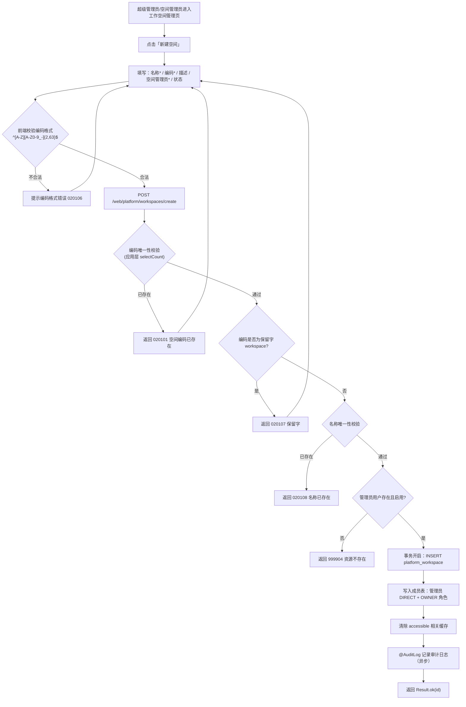
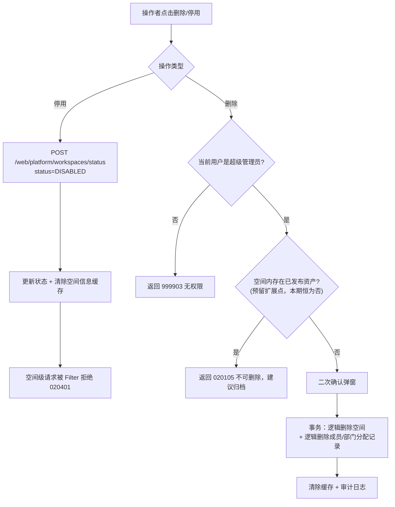
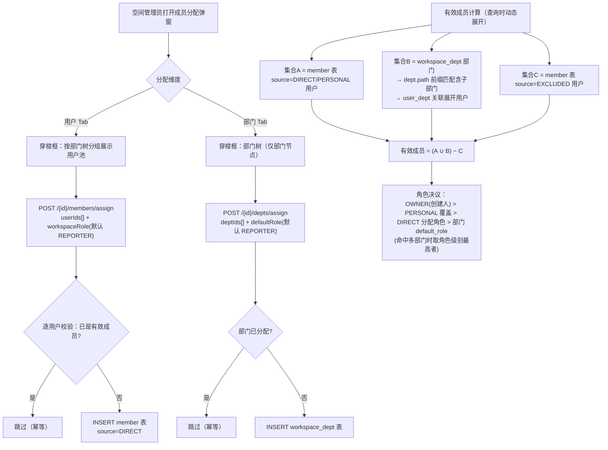
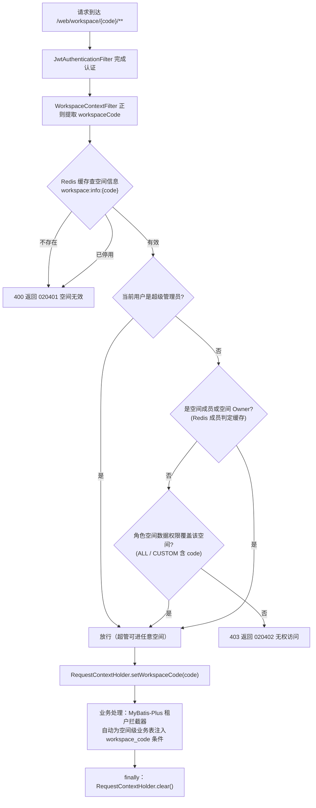
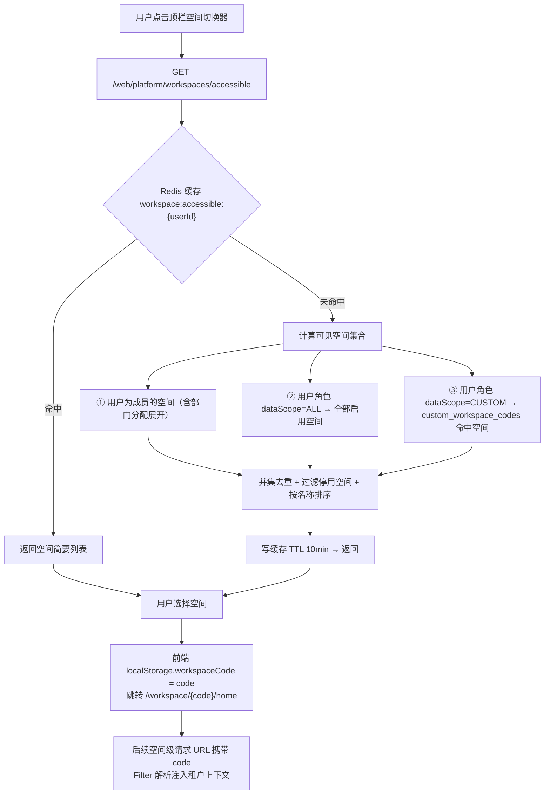
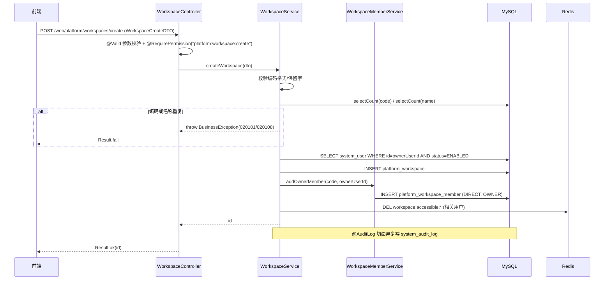
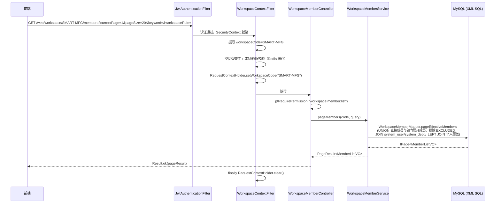
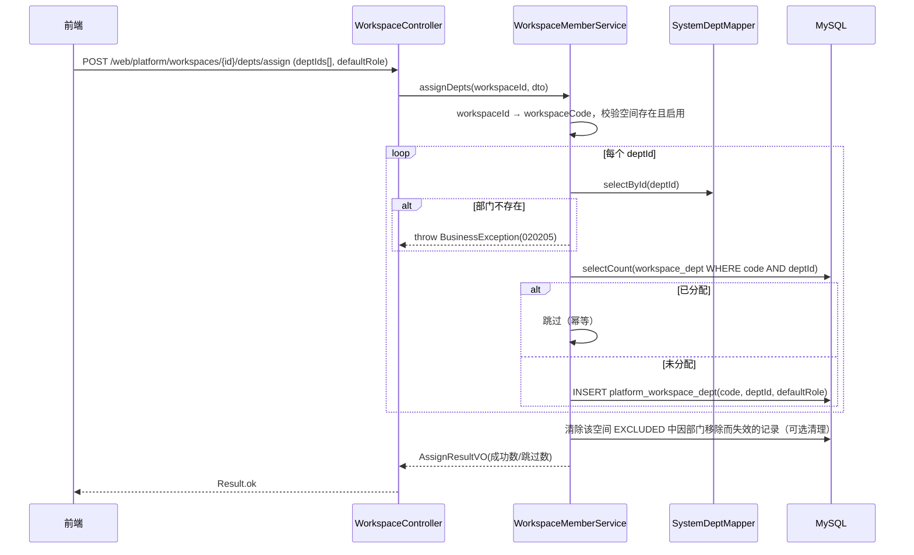
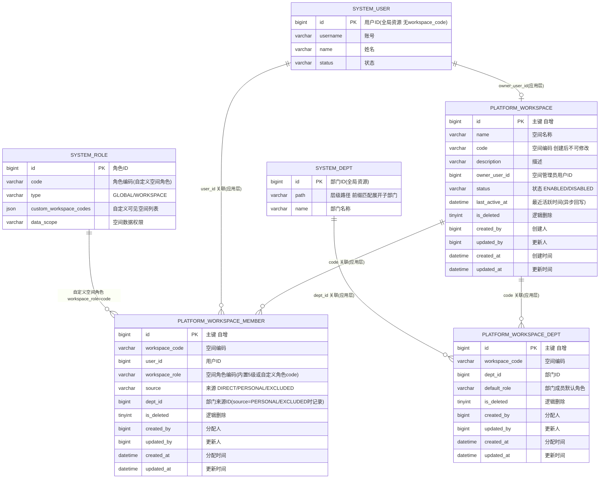
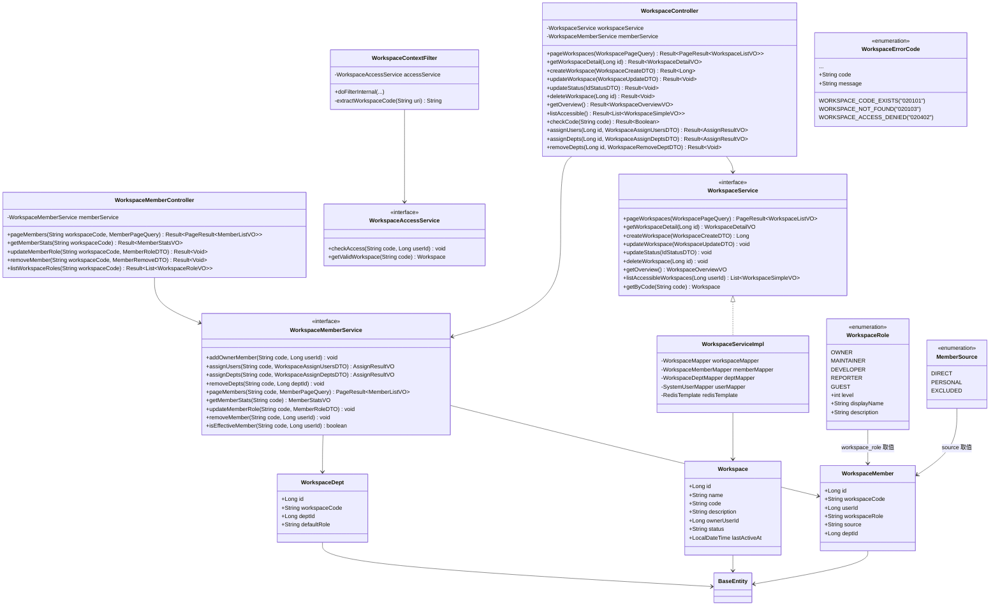

# 工作空间管理模块 -- 技术实现文档

| 项 | 内容 |
|---|---|
| 文档版本 | v1.0 |
| 编制日期 | 2026-10-16 |
| 配套 PRD | `docs/prd/产品功能设计.md` §3.1 工作空间管理 |
| 配套原型 | `docs/prototype/platform/workspace.html`、`docs/prototype/workspace/home.html`、`docs/prototype/workspace/member-assign.html` |
| 所属服务 | prism-platform（端口 8100，URL 前缀 `/web`） |
| 技术栈 | Java 21 + Spring Boot 3.5 + MyBatis-Plus 3.5 + MySQL 8.0 + Redis 7 + Spring Security + JWT |

---

## 1. 概述

### 1.1 需求回顾

工作空间（Workspace）是 Prism 平台**资源与权限的顶层隔离单元**，本体资产、数据资产、安全策略、应用资产与审计数据均归属于某个工作空间，跨空间数据默认不可互访。本模块提供：

- **空间 CRUD**：新建（名称、唯一编码、描述、空间管理员、启用状态）、编辑、启停用、删除（二次确认，仅超级管理员）；**空间编码创建后不可修改**；仅超级管理员 / 空间管理员可创建
- **成员分配**：支持「用户 / 部门」两个维度批量分配（穿梭框）；部门分配自动包含子部门成员；成员可被个人角色覆盖或单独排除
- **空间角色**：内置 5 级空间角色（参考 GitLab 权限模型）：`Owner / Maintainer / Developer / Reporter / Guest`；支持空间级自定义角色（复用 `system_role`，`type=WORKSPACE`）
- **空间概览**：空间总数、成员总数、本体资产总数、活跃空间（30 天）统计卡片
- **空间切换**：顶栏空间切换器，仅展示当前用户**有权访问**的空间；切换后空间内所有页面数据按当前空间过滤（多租户拦截）
- **空间上下文链路**：从 `/web/workspace/{workspaceCode}/**` 路径解析空间编码，注入 `RequestContextHolder`，激活 MyBatis-Plus 多租户拦截器 —— 这是后续所有空间级业务模块（本体 / 数据 / 安全 / 应用 / 审计）的公共基础设施

原型关键语义（`member-assign.html`）：

- 成员默认角色 `Developer`；部门分配引入的成员默认 `Developer`，可被**个人角色覆盖**，清除覆盖后恢复部门默认
- 分配记录双来源：直接分配（逐条）+ 部门分配（**动态展开**为部门及其子部门所有成员，部门人员变动实时生效）
- 列表列：用户账号 / 姓名 / 部门 / 空间角色 / 分配人 / 分配时间 / 来源 / 操作（分配角色、移除）；统计卡片：成员总数 / 直接分配 / 部门分配 / Owner 数

### 1.2 设计范围

本文档覆盖工作空间管理模块的后端技术实现设计（数据库、API、业务流程、空间上下文与租户链路、权限设计），并给出前端对接要点（§10.3）。原型中的「空间首页统计」依赖本体 / 数据等资产模块，本期仅落地成员维度统计，资产统计预留扩展点。

### 1.3 与现有模块的关系

| 现有组件 | 关系 |
|---|---|
| `prism-common` BaseEntity | 所有新 Entity 继承（id/createdAt/updatedAt/createdBy/updatedBy/deleted） |
| `prism-common` Result/PageResult/PageQuery | 统一响应与分页包装 |
| `prism-common` RequestContextHolder | 已定义 `workspaceCode` ThreadLocal，**本模块首次真正写入**（WorkspaceContextFilter） |
| `prism-common` MybatisPlusConfig | 多租户拦截器（租户列 `workspace_code`）已就位；本模块补充 `prism.tenant.ignore-tables` 配置，使全局表跳过租户注入 |
| `prism-common` SecurityUtils / @RequirePermission | 接口级鉴权复用；空间级接口叠加「空间成员校验」 |
| `prism-common` @AuditLog | 空间创建 / 编辑 / 删除 / 成员分配等操作全部纳入审计切面 |
| `prism-platform` SystemUser / SystemDept / SystemRole | 成员分配的用户池、部门树复用系统管理数据；自定义空间角色复用 `system_role`（`type=WORKSPACE` + `custom_workspace_codes`） |
| `prism-platform` SystemErrorCode | 新增 `WorkspaceErrorCode`，模块编码 `02`（`01` 已被系统管理占用） |
| 后续空间级模块（本体/数据/安全/应用/审计） | 依赖本模块的 WorkspaceContextFilter + 租户拦截链路；其业务表含 `workspace_code` 列且不进 ignore-tables，自动获得空间隔离 |

### 1.4 错误编码分配

工作空间模块编码前缀为 `02`。功能编码分配：

| 功能域 | 功能编码 | 说明 |
|---|---|---|
| 空间管理 | 01 | 空间 CRUD、启停用、编码校验 |
| 成员分配 | 02 | 用户 / 部门分配、角色覆盖、移除、排除 |
| 空间角色 | 03 | 内置角色、自定义空间角色 |
| 空间上下文 | 04 | 空间解析、空间访问校验 |

**错误编码清单**：

| 错误码 | 枚举名 | 含义 |
|---|---|---|
| `020101` | WORKSPACE_CODE_EXISTS | 空间编码已存在 |
| `020102` | WORKSPACE_CODE_READONLY | 空间编码创建后不可修改 |
| `020103` | WORKSPACE_NOT_FOUND | 工作空间不存在 |
| `020104` | WORKSPACE_DISABLED | 工作空间已停用 |
| `020105` | WORKSPACE_HAS_PUBLISHED_ASSETS | 空间内存在已发布资产，不可删除 |
| `020106` | WORKSPACE_CODE_INVALID | 空间编码格式不合法 |
| `020107` | WORKSPACE_CODE_RESERVED | 空间编码为系统保留字 |
| `020108` | WORKSPACE_NAME_EXISTS | 空间名称已存在 |
| `020201` | MEMBER_ALREADY_EXISTS | 用户已是空间成员 |
| `020202` | MEMBER_NOT_FOUND | 成员不在该空间中 |
| `020203` | LAST_OWNER_CANNOT_REMOVE | 空间须保留至少一名 Owner |
| `020204` | DEPT_ALREADY_ASSIGNED | 部门已分配至该空间 |
| `020205` | DEPT_NOT_FOUND | 部门不存在 |
| `020206` | OWNER_ROLE_CANNOT_OVERRIDE | 空间 Owner 角色不可覆盖或降级 |
| `020301` | WORKSPACE_ROLE_NOT_FOUND | 空间角色不存在 |
| `020302` | BUILTIN_WORKSPACE_ROLE_READONLY | 内置空间角色不可修改 |
| `020401` | WORKSPACE_CONTEXT_INVALID | 请求路径中的工作空间无效或已停用 |
| `020402` | WORKSPACE_ACCESS_DENIED | 无权访问该工作空间 |

---

## 2. 系统架构图

```
┌─────────────────────────────────────────────────────────────────────────────┐
│                          前端 (React + Ant Design)                          │
│  · 平台级：工作空间管理页（卡片列表 + 创建/编辑弹窗 + 成员分配穿梭框）           │
│  · 顶栏空间切换器（accessible 接口 + localStorage 记忆当前空间）               │
│  · 空间级：空间首页（统计卡片）、成员管理 → 分配记录                           │
└───────────────────────────────┬─────────────────────────────────────────────┘
                                │ HTTPS (JWT Bearer Token)
┌───────────────────────────────▼─────────────────────────────────────────────┐
│                    prism-platform 服务 (端口 8100)                           │
│                                                                             │
│  ┌──────────────────────────────────────────────────────────────────────┐   │
│  │                        Filter 链                                      │   │
│  │  RequestIdFilter → JwtAuthenticationFilter → RequestContextFilter     │   │
│  │  (requestId)       (SecurityContext)         (注入 userId)            │   │
│  │                                        → WorkspaceContextFilter       │   │
│  │                     匹配 /web/workspace/{code}/** ：解析空间编码        │   │
│  │                     → 校验空间有效（Redis 缓存）→ 校验用户为空间成员     │   │
│  │                     → RequestContextHolder.setWorkspaceCode(code)     │   │
│  └──────────────────────────────────────────────────────────────────────┘   │
│                                                                             │
│  ┌──────────────────────────────────────────────────────────────────────┐   │
│  │                         Controller 层                                │   │
│  │  WorkspaceController        (/web/platform/workspaces/**)  平台级     │   │
│  │  WorkspaceMemberController  (/web/workspace/{code}/members/**) 空间级 │   │
│  │  WorkspaceHomeController    (/web/workspace/{code}/home/**)   空间级  │   │
│  └──────────────────────────────┬───────────────────────────────────────┘   │
│                                 │                                           │
│  ┌──────────────────────────────▼───────────────────────────────────────┐   │
│  │              AOP 层（@AuditLog 审计切面 · @RequirePermission 鉴权）     │   │
│  └──────────────────────────────┬───────────────────────────────────────┘   │
│                                 │                                           │
│  ┌──────────────────────────────▼───────────────────────────────────────┐   │
│  │                         Service 层 (纯业务接口，构造注入 Mapper)       │   │
│  │  WorkspaceService        空间 CRUD / 概览 / accessible / 编码校验     │   │
│  │  WorkspaceMemberService  用户与部门分配 / 有效成员计算 / 角色覆盖      │   │
│  │  WorkspaceAccessService  空间访问判定（Filter 与切换器共用）           │   │
│  └──────────────────────────────┬───────────────────────────────────────┘   │
│                                 │                                           │
│  ┌──────────────────────────────▼───────────────────────────────────────┐   │
│  │                    Mapper 层 (BaseMapper + XML 自定义 SQL)            │   │
│  │  WorkspaceMapper · WorkspaceMemberMapper(有效成员 UNION 分页)         │   │
│  │  WorkspaceDeptMapper                                                  │   │
│  │  复用：SystemUserMapper · SystemDeptMapper · SystemRoleMapper          │   │
│  └──────────────────────────────┬───────────────────────────────────────┘   │
│                                 │                                           │
│  ┌──────────────────────────────▼───────────────────────────────────────┐   │
│  │        MybatisPlusInterceptor（TenantLine → Pagination → 乐观锁）     │   │
│  │        租户列 workspace_code；ignore-tables：system_* / platform_*    │   │
│  └──────────────────────────────────────────────────────────────────────┘   │
└───────────┬──────────────────────────────────────┬──────────────────────────┘
            │                                      │
   ┌────────▼────────┐                    ┌────────▼────────┐
   │   MySQL 8.0+    │                    │   Redis 7       │
   │   (prism 库)    │                    │                 │
   │                 │                    │ · 空间信息缓存   │
   │ platform_       │                    │ · 可访问空间缓存 │
   │   workspace     │                    │ · 成员判定缓存   │
   │   workspace_    │                    │ · 概览统计缓存   │
   │     member      │                    │                 │
   │   workspace_    │                    │                 │
   │     dept        │                    │                 │
   └─────────────────┘                    └─────────────────┘
```

---

## 3. 业务流程图

### 3.1 空间创建流程



### 3.2 空间删除 / 停用流程



### 3.3 成员分配与有效成员计算流程



### 3.4 空间上下文解析流程（WorkspaceContextFilter）



### 3.5 空间切换器流程



---

## 4. 时序图

### 4.1 创建空间时序



### 4.2 空间级成员分配记录分页查询时序



### 4.3 部门批量分配时序



---

## 5. ER 图



> 注：按 `database-spec.md` 禁止外键，所有关联均由应用层保证；图中关系仅表达逻辑关联。空间实体间关联统一使用 **`workspace_code`（编码）而非 ID**，与租户拦截器口径一致。

---

## 6. 核心类图



> 包结构：`com.prism.platform` 下新增 `controller/Workspace*Controller`、`service/Workspace*Service` + `service/impl/Workspace*ServiceImpl`、`mapper/Workspace*Mapper`、`entity/Workspace*`、`dto/Workspace*DTO / Member*DTO`、`vo/Workspace*VO / Member*VO`；枚举 `WorkspaceRole / MemberSource` 放 `prism-common` 的 `enums` 包（后续空间级模块均需使用）；`WorkspaceErrorCode` 放 `com.prism.platform.exception`；`WorkspaceContextFilter` 放 `com.prism.platform.config`（与 RequestIdFilter 同级）。

---

## 7. 数据库设计

### 7.1 表清单

| 表名 | 说明 | 租户列 | 进 ignore-tables |
|---|---|---|---|
| `platform_workspace` | 工作空间主表（全局资源） | 无 | 是 |
| `platform_workspace_member` | 空间成员记录表（直接分配 / 个人角色覆盖 / 排除） | `workspace_code` | 是（Service 显式过滤） |
| `platform_workspace_dept` | 空间部门分配表（动态展开） | `workspace_code` | 是（Service 显式过滤） |

设计要点：

- 三张表均加入 `prism.tenant.ignore-tables`，**由 Service 层显式 `.eq(workspaceCode)` 过滤**（与 `mybatis-plus-spec.md` 空间级查询示例一致），避免租户拦截器与管理端跨空间查询互相干扰；未来 `ontology_*`、`data_*` 等业务表**不进** ignore-tables，由拦截器自动隔离
- `(workspace_code, user_id)`、`(workspace_code, dept_id)`、`code` 的唯一性由**应用层**校验（规范禁止 UNIQUE KEY）
- 部门展开依赖既有 `system_dept.path`（如 `/1/5/12/`）前缀匹配，符合「LIKE 仅前缀匹配」规范

### 7.2 Flyway DDL 脚本

#### V5__init_workspace.sql

```sql
-- ===========================================================
-- V5__init_workspace.sql
-- 工作空间管理模块：空间表 / 成员表 / 部门分配表
-- ===========================================================

-- -----------------------------------------------------------
-- 1. 工作空间表（全局资源，不含 workspace_code）
-- -----------------------------------------------------------
CREATE TABLE IF NOT EXISTS platform_workspace (
    id              BIGINT          NOT NULL AUTO_INCREMENT COMMENT '主键（自增）',
    name            VARCHAR(128)    NOT NULL    COMMENT '空间名称',
    code            VARCHAR(64)     NOT NULL    COMMENT '空间编码（大写字母开头，大写字母/数字/中划线/下划线，创建后不可修改，全平台唯一）',
    description     VARCHAR(512)    NULL        COMMENT '空间描述',
    owner_user_id   BIGINT          NOT NULL    COMMENT '空间管理员用户ID（system_user.id）',
    status          VARCHAR(16)     NOT NULL    DEFAULT 'ENABLED' COMMENT '状态：ENABLED/DISABLED',
    last_active_at  DATETIME        NULL        COMMENT '最近活跃时间（空间级请求异步回写，用于活跃空间统计）',
    is_deleted      TINYINT(1)      NOT NULL    DEFAULT 0 COMMENT '逻辑删除（0=未删除，1=已删除）',
    created_by      BIGINT          NULL        COMMENT '创建人ID',
    updated_by      BIGINT          NULL        COMMENT '更新人ID',
    created_at      DATETIME        NOT NULL    DEFAULT CURRENT_TIMESTAMP COMMENT '创建时间',
    updated_at      DATETIME        NOT NULL    DEFAULT CURRENT_TIMESTAMP ON UPDATE CURRENT_TIMESTAMP COMMENT '更新时间',
    PRIMARY KEY (id),
    INDEX idx_platform_workspace_code (code, is_deleted),
    INDEX idx_platform_workspace_status (status, is_deleted),
    INDEX idx_platform_workspace_owner (owner_user_id)
) ENGINE=InnoDB DEFAULT CHARSET=utf8mb4 COLLATE=utf8mb4_unicode_ci COMMENT='工作空间表';

-- -----------------------------------------------------------
-- 2. 空间成员记录表
--    source=DIRECT   直接分配的成员
--    source=PERSONAL 部门来源成员的个人角色覆盖记录
--    source=EXCLUDED 部门来源成员的排除记录
--    应用层保证 (workspace_code, user_id) 至多一条有效记录
-- -----------------------------------------------------------
CREATE TABLE IF NOT EXISTS platform_workspace_member (
    id              BIGINT          NOT NULL AUTO_INCREMENT COMMENT '主键（自增）',
    workspace_code  VARCHAR(64)     NOT NULL    COMMENT '空间编码',
    user_id         BIGINT          NOT NULL    COMMENT '用户ID（system_user.id）',
    workspace_role  VARCHAR(32)     NOT NULL    COMMENT '空间角色编码（内置：OWNER/MAINTAINER/DEVELOPER/REPORTER/GUEST；或自定义空间角色 system_role.code）',
    source          VARCHAR(16)     NOT NULL    COMMENT '来源：DIRECT=直接分配 / PERSONAL=个人角色覆盖 / EXCLUDED=部门来源已排除',
    dept_id         BIGINT          NULL        COMMENT '部门来源ID（source=PERSONAL/EXCLUDED 时记录来自哪个分配部门）',
    is_deleted      TINYINT(1)      NOT NULL    DEFAULT 0 COMMENT '逻辑删除（0=未删除，1=已删除）',
    created_by      BIGINT          NULL        COMMENT '分配人ID',
    updated_by      BIGINT          NULL        COMMENT '更新人ID',
    created_at      DATETIME        NOT NULL    DEFAULT CURRENT_TIMESTAMP COMMENT '分配时间',
    updated_at      DATETIME        NOT NULL    DEFAULT CURRENT_TIMESTAMP ON UPDATE CURRENT_TIMESTAMP COMMENT '更新时间',
    PRIMARY KEY (id),
    INDEX idx_pw_member_ws_user (workspace_code, user_id),
    INDEX idx_pw_member_user (user_id, is_deleted),
    INDEX idx_pw_member_ws_role (workspace_code, workspace_role)
) ENGINE=InnoDB DEFAULT CHARSET=utf8mb4 COLLATE=utf8mb4_unicode_ci COMMENT='空间成员记录表';

-- -----------------------------------------------------------
-- 3. 空间部门分配表（成员查询时按 dept.path 动态展开含子部门）
-- -----------------------------------------------------------
CREATE TABLE IF NOT EXISTS platform_workspace_dept (
    id              BIGINT          NOT NULL AUTO_INCREMENT COMMENT '主键（自增）',
    workspace_code  VARCHAR(64)     NOT NULL    COMMENT '空间编码',
    dept_id         BIGINT          NOT NULL    COMMENT '部门ID（system_dept.id）',
    default_role    VARCHAR(32)     NOT NULL    DEFAULT 'REPORTER' COMMENT '部门成员默认空间角色编码',
    is_deleted      TINYINT(1)      NOT NULL    DEFAULT 0 COMMENT '逻辑删除（0=未删除，1=已删除）',
    created_by      BIGINT          NULL        COMMENT '分配人ID',
    updated_by      BIGINT          NULL        COMMENT '更新人ID',
    created_at      DATETIME        NOT NULL    DEFAULT CURRENT_TIMESTAMP COMMENT '分配时间',
    updated_at      DATETIME        NOT NULL    DEFAULT CURRENT_TIMESTAMP ON UPDATE CURRENT_TIMESTAMP COMMENT '更新时间',
    PRIMARY KEY (id),
    INDEX idx_pw_dept_ws (workspace_code, dept_id),
    INDEX idx_pw_dept_dept (dept_id, is_deleted)
) ENGINE=InnoDB DEFAULT CHARSET=utf8mb4 COLLATE=utf8mb4_unicode_ci COMMENT='空间部门分配表';
```

#### V6__workspace_menu.sql（菜单与权限种子）

```sql
-- ===========================================================
-- V6__workspace_menu.sql
-- 工作空间管理菜单 + 按钮权限种子（id 段：100-129，避开既有 1-67）
-- ===========================================================

-- 平台级菜单：工作空间（GLOBAL_NAV 已有入口，path 对应前端路由 /platform/workspaces）
INSERT INTO system_menu (id, parent_id, name, type, permission, path, component, icon, sort_order, status, created_by, created_at, updated_at)
VALUES (100, 0, '工作空间', 'MENU', 'platform:workspace:list', '/platform/workspaces', 'platform/workspaces', 'appstore', 2, 'ENABLED', 1, NOW(), NOW());

-- 平台级按钮权限
INSERT INTO system_menu (id, parent_id, name, type, permission, path, component, icon, sort_order, status, created_by, created_at, updated_at)
VALUES
(101, 100, '空间详情',   'BUTTON', 'platform:workspace:detail',  NULL, NULL, NULL, 1, 'ENABLED', 1, NOW(), NOW()),
(102, 100, '创建空间',   'BUTTON', 'platform:workspace:create',  NULL, NULL, NULL, 2, 'ENABLED', 1, NOW(), NOW()),
(103, 100, '编辑空间',   'BUTTON', 'platform:workspace:update',  NULL, NULL, NULL, 3, 'ENABLED', 1, NOW(), NOW()),
(104, 100, '删除空间',   'BUTTON', 'platform:workspace:delete',  NULL, NULL, NULL, 4, 'ENABLED', 1, NOW(), NOW()),
(105, 100, '启停用空间', 'BUTTON', 'platform:workspace:status',  NULL, NULL, NULL, 5, 'ENABLED', 1, NOW(), NOW()),
(106, 100, '成员分配',   'BUTTON', 'platform:workspace:assign',  NULL, NULL, NULL, 6, 'ENABLED', 1, NOW(), NOW());

-- 空间级菜单：成员管理 → 分配记录（挂载于空间内布局，parent_id=0 由前端按空间上下文渲染）
INSERT INTO system_menu (id, parent_id, name, type, permission, path, component, icon, sort_order, status, created_by, created_at, updated_at)
VALUES (110, 0, '成员管理', 'DIRECTORY', NULL, NULL, NULL, 'team', 90, 'ENABLED', 1, NOW(), NOW());

INSERT INTO system_menu (id, parent_id, name, type, permission, path, component, icon, sort_order, status, created_by, created_at, updated_at)
VALUES (111, 110, '分配记录', 'MENU', 'workspace:member:list', 'members', 'workspace/members', NULL, 1, 'ENABLED', 1, NOW(), NOW());

INSERT INTO system_menu (id, parent_id, name, type, permission, path, component, icon, sort_order, status, created_by, created_at, updated_at)
VALUES
(112, 111, '分配角色', 'BUTTON', 'workspace:member:role',   NULL, NULL, NULL, 1, 'ENABLED', 1, NOW(), NOW()),
(113, 111, '移除成员', 'BUTTON', 'workspace:member:remove', NULL, NULL, NULL, 2, 'ENABLED', 1, NOW(), NOW()),
(114, 111, '分配成员', 'BUTTON', 'workspace:member:assign', NULL, NULL, NULL, 3, 'ENABLED', 1, NOW(), NOW());

-- 授权给超级管理员角色（role_id=1，与 V1 内置 super_admin 一致）
INSERT INTO system_role_menu (role_id, menu_id, created_at, updated_at)
SELECT 1, m.id, NOW(), NOW() FROM system_menu m
WHERE m.id BETWEEN 100 AND 129
  AND NOT EXISTS (SELECT 1 FROM system_role_menu rm WHERE rm.role_id = 1 AND rm.menu_id = m.id);
```

> 说明：`system_role_menu` 若无 `created_at/updated_at` 列则去掉对应字段，以实际 V1 DDL 为准；执行前需核对 id 段无冲突。

### 7.3 Redis Key 设计

| Key | 类型 | 内容 | TTL | 失效策略 |
|---|---|---|---|---|
| `workspace:info:{code}` | String(JSON) | 空间基本信息（id/name/code/status/ownerUserId） | 30 min | 空间编辑 / 启停用 / 删除时 DEL |
| `workspace:accessible:{userId}` | String(JSON) | 用户可访问空间简要列表 | 10 min | 空间状态变更、成员分配变更时按受影响用户 DEL（批量场景直接前缀清除） |
| `workspace:member:{code}:{userId}` | String | 成员判定缓存（角色编码或 `DEPT`/`NONE`） | 10 min | 成员分配 / 移除 / 角色变更时 DEL 对应键 |
| `workspace:overview` | String(JSON) | 平台概览统计卡片 | 60 s | 自然过期 |
| `workspace:active:{code}` | String | 当日活跃标记（SETNX），定时任务汇总回写 `last_active_at` | 24 h | 自然过期 |

### 7.4 租户配置（application.yml）

```yaml
prism:
  tenant:
    enabled: true
    column: workspace_code
    ignore-tables:
      # 系统管理全局表
      - system_user
      - system_role
      - system_menu
      - system_dept
      - system_user_role
      - system_role_menu
      - system_user_dept
      - system_audit_log
      - system_login_log
      - system_exec_log
      # 工作空间管理表（Service 层显式按 workspace_code 过滤）
      - platform_workspace
      - platform_workspace_member
      - platform_workspace_dept
```

---

## 8. API 设计

通用约定（遵循 `spec/backend/api-spec.md`）：仅 GET / POST；统一响应 `{code, msg, data, requestId}`；写操作后缀 `/create` `/update` `/delete`；分页 DTO 继承 `PageQuery`；Long ID 序列化为 String；空间编码走**路径变量**（空间级接口）。

### 8.1 平台级接口（/web/platform/workspaces）

#### 8.1.1 空间列表分页

- **URL**：`GET /web/platform/workspaces`
- **权限**：`platform:workspace:list`
- **请求参数**（`WorkspacePageQuery extends PageQuery`）：

| 参数 | 类型 | 必填 | 说明 |
|---|---|---|---|
| currentPage / pageSize / keyword | - | 否 | 继承 PageQuery；keyword 模糊匹配名称/编码/描述（前缀 LIKE） |
| status | String | 否 | ENABLED / DISABLED |

- **响应**：`Result<PageResult<WorkspaceListVO>>`

```json
{
  "code": "000000",
  "msg": "success",
  "data": {
    "data": [
      {
        "id": "1",
        "name": "智能制造空间",
        "code": "SMART-MFG",
        "description": "面向智能制造场景的本体建模空间",
        "ownerUserId": "2",
        "ownerUserName": "张三",
        "status": "ENABLED",
        "memberCount": 12,
        "assetCount": 86,
        "lastActiveAt": "2026-10-16 09:32:00",
        "createdAt": "2026-09-01 10:00:00"
      }
    ],
    "pageInfo": { "currentPage": 1, "pageSize": 20, "total": 3, "totalPages": 1, "hasNext": false, "hasPrevious": false }
  },
  "requestId": "..."
}
```

> `memberCount` 为有效成员数（动态展开，列表页允许用 Redis 短缓存或批量 count SQL）；`assetCount` 本期恒为 0，待本体模块上线后由资产统计扩展点填充。

#### 8.1.2 空间详情

- **URL**：`GET /web/platform/workspaces/{id}`
- **权限**：`platform:workspace:detail`
- **响应**：`Result<WorkspaceDetailVO>`（在 ListVO 基础上追加 `ownerUserDeptName`、部门分配列表 `depts[]`、统计信息）

#### 8.1.3 创建空间

- **URL**：`POST /web/platform/workspaces/create`
- **权限**：`platform:workspace:create`（仅超级管理员 / 空间管理员角色持有）
- **请求体**（`WorkspaceCreateDTO`）：

| 字段 | 类型 | 校验 | 说明 |
|---|---|---|---|
| name | String | `@NotBlank @Size(max=128)` | 空间名称，应用层唯一 |
| code | String | `@NotBlank @Pattern(regexp="^[A-Z][A-Z0-9_-]{2,63}$")` | 空间编码，创建后不可修改；保留字 `WORKSPACE` 拒绝 |
| description | String | `@Size(max=512)` | 描述 |
| ownerUserId | Long | `@NotNull` | 空间管理员用户 ID，须存在且启用 |
| status | String | `@Pattern(ENABLED|DISABLED)` | 默认 ENABLED |

- **响应**：`Result<Long>`（新空间 ID）
- **业务规则**：编码 / 名称应用层唯一校验（`020101` / `020108`）；创建成功后同事务写入 owner 成员记录（`source=DIRECT, workspaceRole=OWNER`）

#### 8.1.4 编辑空间

- **URL**：`POST /web/platform/workspaces/update`
- **权限**：`platform:workspace:update`
- **请求体**（`WorkspaceUpdateDTO`）：`id`（`@NotNull`）、`name`、`description`、`ownerUserId`。**不接受 code 字段**；若请求体携带且与原值不同返回 `020102`
- **业务规则**：变更 `ownerUserId` 时，旧 Owner 降级为 `MAINTAINER`（若其 source=DIRECT），新 Owner 写入 / 覆盖为 `OWNER` 角色记录；`020203` 保护：空间必须始终有至少一名 Owner

#### 8.1.5 启停用空间

- **URL**：`POST /web/platform/workspaces/status`
- **权限**：`platform:workspace:status`
- **请求体**：`IdStatusDTO`（复用系统管理 DTO：`id` + `status`）
- **业务规则**：停用后该空间所有空间级请求被 WorkspaceContextFilter 拒绝（`020401`）；DEL `workspace:info:{code}` 与 accessible 缓存

#### 8.1.6 删除空间

- **URL**：`POST /web/platform/workspaces/delete`
- **权限**：`platform:workspace:delete`（仅授予超级管理员）
- **请求体**：`{ "id": "1" }`
- **业务规则**：校验空间内无已发布资产（本期预留扩展点，恒通过；本体模块上线后接入 `020105` 校验）；逻辑删除空间 + 成员 + 部门分配记录（同事务）

#### 8.1.7 平台概览统计

- **URL**：`GET /web/platform/workspaces/overview`
- **权限**：`platform:workspace:list`
- **响应**：`Result<WorkspaceOverviewVO>`

```json
{
  "code": "000000",
  "data": { "totalSpaces": 8, "totalMembers": 156, "totalAssets": 0, "activeSpaces30d": 5 }
}
```

> `activeSpaces30d` = `last_active_at` 在 30 天内的启用空间数；`totalAssets` 为跨模块统计扩展点（本期 0）。结果缓存 `workspace:overview` 60s。

#### 8.1.8 可访问空间列表（空间切换器）

- **URL**：`GET /web/platform/workspaces/accessible`
- **权限**：登录即可（无权限码）
- **响应**：`Result<List<WorkspaceSimpleVO>>`：`[{ "code": "SMART-MFG", "name": "智能制造空间", "workspaceRole": "OWNER" }]`
- **业务规则**：见 §3.5 流程 —— 成员空间 ∪ dataScope=ALL ∪ dataScope=CUSTOM 命中空间，过滤停用；`workspaceRole` 返回用户在该空间的最高角色，供前端展示

#### 8.1.9 空间编码唯一性校验

- **URL**：`GET /web/platform/workspaces/code/check?code=SMART-MFG`
- **权限**：`platform:workspace:create`
- **响应**：`Result<Boolean>`（true=可用）

#### 8.1.10 批量分配用户

- **URL**：`POST /web/platform/workspaces/{id}/members/assign`
- **权限**：`platform:workspace:assign`
- **请求体**（`WorkspaceAssignUsersDTO`）：

| 字段 | 类型 | 校验 | 说明 |
|---|---|---|---|
| userIds | List\<Long\> | `@NotEmpty @Size(max=200)` | 用户 ID 列表（穿梭框右侧） |
| workspaceRole | String | 可空，默认 `REPORTER` | 内置角色编码或自定义空间角色 code |

- **响应**：`Result<AssignResultVO>`（`successCount` / `skipCount`）
- **业务规则**：已是有效成员则跳过（幂等）；若该用户存在 EXCLUDED 记录，则将其改写为 DIRECT（直接分配优先于排除）；空间须为启用状态（`020104`）

#### 8.1.11 批量分配部门

- **URL**：`POST /web/platform/workspaces/{id}/depts/assign`
- **权限**：`platform:workspace:assign`
- **请求体**（`WorkspaceAssignDeptsDTO`）：`deptIds`（`@NotEmpty`）、`defaultRole`（默认 `REPORTER`）
- **响应**：`Result<AssignResultVO>`
- **业务规则**：已分配部门跳过（幂等，`020204` 仅用于日志提示不报错）；部门成员**动态展开**不落库；已分配子部门再分配父部门时保留两条记录（展开时 DISTINCT 去重）

#### 8.1.12 移除分配部门

- **URL**：`POST /web/platform/workspaces/{id}/depts/remove`
- **权限**：`platform:workspace:assign`
- **请求体**：`{ "deptId": "5" }`
- **业务规则**：逻辑删除 `platform_workspace_dept` 记录，同时清理该部门来源的 PERSONAL / EXCLUDED 记录（`dept_id` 命中且用户不再被其他分配部门覆盖时）

### 8.2 空间级接口（/web/workspace/{workspaceCode}）

所有空间级接口经 WorkspaceContextFilter 校验：空间有效（`020401`）+ 用户有权访问（`020402`），`workspaceCode` 一律取**路径变量**。

#### 8.2.1 分配记录分页

- **URL**：`GET /web/workspace/{workspaceCode}/members`
- **权限**：`workspace:member:list`
- **请求参数**（`MemberPageQuery extends PageQuery`）：

| 参数 | 类型 | 必填 | 说明 |
|---|---|---|---|
| keyword | String | 否 | 用户账号 / 姓名模糊（前缀 LIKE） |
| workspaceRole | String | 否 | 空间角色过滤 |
| source | String | 否 | 来源过滤：DIRECT（直接分配）/ DEPT（部门分配，含 PERSONAL 覆盖与纯部门展开） |

- **响应**：`Result<PageResult<MemberListVO>>`

```json
{
  "code": "000000",
  "data": {
    "data": [
      {
        "userId": "2",
        "username": "zhangsan",
        "name": "张三",
        "deptName": "研发部/平台组",
        "workspaceRole": "OWNER",
        "roleDisplayName": "Owner",
        "isPersonalRole": false,
        "source": "DIRECT",
        "assignedBy": "admin",
        "assignedAt": "2026-09-01 10:00:00"
      },
      {
        "userId": "8",
        "username": "lisi",
        "name": "李四",
        "deptName": "数据部",
        "workspaceRole": "DEVELOPER",
        "roleDisplayName": "Developer",
        "isPersonalRole": true,
        "source": "DEPT",
        "assignedBy": "admin",
        "assignedAt": "2026-09-10 14:20:00"
      }
    ],
    "pageInfo": { "currentPage": 1, "pageSize": 20, "total": 12, "totalPages": 1, "hasNext": false, "hasPrevious": false }
  }
}
```

- **核心 SQL**（`WorkspaceMemberMapper.xml`，动态展开 + 排除 + 角色决议）：

```xml
<select id="pageEffectiveMembers" resultType="com.prism.platform.vo.MemberListVO">
    SELECT t.user_id, u.username, u.name,
           t.workspace_role, t.source, t.is_personal_role,
           t.assigned_by, t.assigned_at
    FROM (
        /* ① 直接成员（DIRECT / PERSONAL 覆盖记录本身就是直接关系） */
        SELECT m.user_id, m.workspace_role, 'DIRECT' AS source, 0 AS is_personal_role,
               m.created_by AS assigned_by, m.created_at AS assigned_at,
               #{rolePriority} AS priority
        FROM platform_workspace_member m
        WHERE m.workspace_code = #{workspaceCode} AND m.is_deleted = 0
          AND m.source IN ('DIRECT')
        UNION ALL
        /* ② 部门展开成员（含子部门），排除 EXCLUDED，PERSONAL 覆盖优先 */
        SELECT ud.user_id,
               COALESCE(p.workspace_role, d.default_role) AS workspace_role,
               'DEPT' AS source,
               IF(p.id IS NULL, 0, 1) AS is_personal_role,
               COALESCE(p.created_by, d.created_by) AS assigned_by,
               COALESCE(p.created_at, d.created_at) AS assigned_at,
               IF(p.id IS NULL, 0, 1) AS priority
        FROM platform_workspace_dept wd
        JOIN system_dept d2 ON d2.path LIKE CONCAT(
             (SELECT d3.path FROM system_dept d3 WHERE d3.id = wd.dept_id), '%') AND d2.is_deleted = 0
        JOIN system_user_dept ud ON ud.dept_id = d2.id AND ud.is_deleted = 0
        LEFT JOIN platform_workspace_member p
               ON p.workspace_code = wd.workspace_code AND p.user_id = ud.user_id
              AND p.source = 'PERSONAL' AND p.is_deleted = 0
        JOIN platform_workspace_dept d ON d.id = wd.id
        WHERE wd.workspace_code = #{workspaceCode} AND wd.is_deleted = 0
          AND NOT EXISTS (SELECT 1 FROM platform_workspace_member e
                          WHERE e.workspace_code = wd.workspace_code AND e.user_id = ud.user_id
                            AND e.source = 'EXCLUDED' AND e.is_deleted = 0)
    ) t
    JOIN system_user u ON u.id = t.user_id AND u.is_deleted = 0 AND u.status = 'ENABLED'
    /* 同一用户命中多来源时取 priority 高者，再按角色级别取最高 */
    WHERE NOT EXISTS (
        SELECT 1 FROM (...同构子查询...) t2
        WHERE t2.user_id = t.user_id AND (t2.priority > t.priority)
    )
    <if test="keyword != null and keyword != ''">
        AND (u.username LIKE CONCAT(#{keyword}, '%') OR u.name LIKE CONCAT(#{keyword}, '%'))
    </if>
    <if test="workspaceRole != null"> AND t.workspace_role = #{workspaceRole} </if>
    <if test="source != null"> AND t.source = #{source} </if>
    ORDER BY t.workspace_role, t.assigned_at DESC
</select>
```

> SQL 为设计示意，实现时可将「去重取最高优先级」改为窗口函数 `ROW_NUMBER() OVER (PARTITION BY user_id ORDER BY priority DESC, role_level DESC)`（MySQL 8.0 支持），XML 内以 `<sql>` 片段复用子查询；角色级别排序通过 `FIELD(workspace_role,'OWNER','MAINTAINER','DEVELOPER','REPORTER','GUEST')` 实现。

#### 8.2.2 成员统计

- **URL**：`GET /web/workspace/{workspaceCode}/members/stats`
- **权限**：`workspace:member:list`
- **响应**：`Result<MemberStatsVO>`：`{ "totalMembers": 12, "directCount": 5, "deptCount": 7, "ownerCount": 2 }`

#### 8.2.3 分配 / 覆盖成员角色

- **URL**：`POST /web/workspace/{workspaceCode}/members/role`
- **权限**：`workspace:member:role`
- **请求体**（`MemberRoleDTO`）：

| 字段 | 类型 | 校验 | 说明 |
|---|---|---|---|
| userId | Long | `@NotNull` | 目标用户 |
| workspaceRole | String | 可空 | 新角色编码；**传 null / 空 = 清除个人覆盖，恢复部门默认**（仅对部门来源成员有效） |

- **业务规则**：
  - 目标必须是有效成员（`020202`）
  - 空间创建人（`owner_user_id`）的 OWNER 角色不可覆盖或降级（`020206`）
  - 直接成员（DIRECT）：直接 UPDATE 其 `workspace_role`
  - 部门来源成员：写入 / 更新 `source=PERSONAL` 覆盖记录；清除覆盖时逻辑删除 PERSONAL 记录
  - 变更后 DEL `workspace:member:{code}:{userId}` 缓存
- **响应**：`Result<Void>`

#### 8.2.4 移除成员

- **URL**：`POST /web/workspace/{workspaceCode}/members/remove`
- **权限**：`workspace:member:remove`
- **请求体**：`{ "userId": "8" }`
- **业务规则**：
  - 直接成员：逻辑删除 DIRECT 记录
  - 部门来源成员：写入 `source=EXCLUDED` 排除记录（保留 PERSONAL 一并逻辑删除）；后续部门人员变动不影响排除语义
  - 最后一名 Owner 不可移除（`020203`）；不可移除自己为 Owner 时的自身（前端引导转让，`ownerUserId` 变更走 8.1.4）
- **响应**：`Result<Void>`

#### 8.2.5 空间角色列表

- **URL**：`GET /web/workspace/{workspaceCode}/roles`
- **权限**：`workspace:member:list`
- **响应**：`Result<List<WorkspaceRoleVO>>`：内置 5 级角色（枚举生成，含 `code/displayName/description/level/builtin=true`）+ 该空间的自定义角色（`system_role` 中 `type=WORKSPACE` 且 `custom_workspace_codes` 包含当前空间编码，`builtin=false`）

#### 8.2.6 空间首页统计

- **URL**：`GET /web/workspace/{workspaceCode}/home/stats`
- **权限**：空间成员即可（Filter 已校验）
- **响应**：`Result<WorkspaceHomeStatsVO>`

```json
{
  "code": "000000",
  "data": { "memberCount": 12, "ontologyAssetCount": 0, "datasetCount": 0, "pipelineCount": 0, "apiCallToday": 0 }
}
```

> 资产 / API 维度为跨模块统计扩展点：定义 `WorkspaceStatsContributor` SPI 接口（`String module(); Map<String, Long> stats(String workspaceCode);`），本体 / 数据 / 应用模块上线后各自注册实现，HomeService 聚合；未注册模块返回 0。

---

## 9. 安全与权限设计

### 9.1 内置空间角色权限矩阵

| 能力（空间级） | Owner | Maintainer | Developer | Reporter | Guest |
|---|---|---|---|---|---|
| 空间设置 / 删除空间 | ✔ | ✘ | ✘ | ✘ | ✘ |
| 成员分配 / 移除 / 角色调整 | ✔ | ✔ | ✘ | ✘ | ✘ |
| 资产发布审批 | ✔ | ✔ | ✘ | ✘ | ✘ |
| 资产创建 / 编辑（本体、数据、应用） | ✔ | ✔ | ✔ | ✘ | ✘ |
| 资产查看 | ✔ | ✔ | ✔ | ✔ | ✔(仅公开) |
| 审计日志查看 | ✔ | ✔ | ✘ | ✘ | ✘ |

- 内置角色以枚举 `WorkspaceRole` 定义（code、displayName、level、内置权限集合），**不落库**；level 用于「多来源取最高角色」决议：OWNER(5) > MAINTAINER(4) > DEVELOPER(3) > REPORTER(2) > GUEST(1)
- 空间级接口鉴权 = `@RequirePermission`（功能权限，来自用户全局角色的菜单权限）**+** 内置空间角色矩阵校验（`WorkspaceRoleChecker` 组件，基于 `RequestContextHolder.getWorkspaceCode()` + 成员角色缓存判定）
- 超级管理员（`super_admin`）绕过空间角色矩阵

### 9.2 自定义空间角色

复用系统管理角色体系，不新建表：

- `system_role.type = WORKSPACE` + `custom_workspace_codes = ["SMART-MFG"]` 表示该角色是某空间的自定义角色
- 成员的 `workspace_role` 字段直接存自定义角色 `code`；角色按钮级权限走既有 `system_role_menu`
- 角色决议时自定义角色 level 视为 DEVELOPER(3)（可配置扩展字段，后续在 `system_role` 增加 `workspace_role_level` 列时再升级）
- 管理入口：空间设置页 →「空间角色」Tab，调用既有 `/web/system/roles` 接口（`type=WORKSPACE` 过滤），本期仅做列表与绑定，自定义角色的完整 CRUD 权限配置界面随角色模块迭代

### 9.3 WorkspaceContextFilter（空间上下文过滤器）

```java
// 注册位置：SecurityFilterChain 中 JwtAuthenticationFilter 之后（需已认证 userId）
public class WorkspaceContextFilter extends OncePerRequestFilter {

    private static final Pattern WS_PATTERN =
        Pattern.compile("^/web/workspace/([A-Z][A-Z0-9_-]{2,63})(/.*)?$");

    @Override
    protected void doFilterInternal(HttpServletRequest request, ...) {
        String uri = request.getRequestURI();
        Matcher m = WS_PATTERN.matcher(uri);
        if (!m.matches()) { chain.doFilter(request, response); return; }  // 非空间级请求直接放行
        String code = m.group(1);
        try {
            Long userId = RequestContextHolder.getUserId();
            accessService.checkAccess(code, userId);            // 020401 / 020402
            RequestContextHolder.setWorkspaceCode(code);
            activityRecorder.markActive(code);                  // 异步 SETNX 活跃标记
            chain.doFilter(request, response);
        } finally {
            RequestContextHolder.setWorkspaceCode(null);        // 仅清 workspaceCode，
        }                                                       // 完整 clear() 由最外层 Filter 负责
    }
}
```

要点：

- **匹配即校验**：路径声明了空间编码，就必须是有效空间且用户有权访问，否则分别返回 `020401` / `020402`（经 `GlobalExceptionHandler` 风格直接写 JSON 响应）
- **checkAccess 判定顺序**（全部走 Redis 缓存，未命中回源 DB）：① 空间存在且 ENABLED；② 超级管理员放行；③ 是有效成员（member 判定缓存）放行；④ 用户任一启用角色 `dataScope=ALL`，或 `dataScope=CUSTOM` 且 `custom_workspace_codes` 含该 code，放行
- **ThreadLocal 与虚拟线程**：Tomcat 平台线程模型下 ThreadLocal 安全；`@Async` 异步任务不继承上下文，涉及空间数据的异步任务必须显式传 `workspaceCode` 参数（符合 java21-spec「禁止 ThreadLocal 存大对象 / 跨线程传递依赖」）
- 空间级 URL 保留段规则：空间编码禁止取 `WORKSPACE`（保留字校验 `020107`），避免与 `/web/workspace/workspace/...` 歧义

### 9.4 多租户拦截边界

| 表类别 | 租户拦截 | 过滤方式 |
|---|---|---|
| `system_*`（全局资源） | 跳过（ignore-tables） | 无需过滤 |
| `platform_workspace*`（管理表） | 跳过（ignore-tables） | Service 层显式 `.eq(workspaceCode)` |
| 未来 `ontology_* / data_* / security_* / application_* / audit_*` | **生效** | 拦截器自动注入 `workspace_code = RequestContextHolder.getWorkspaceCode()` |

平台级管理页（`/web/platform/workspaces/**`）不经过 WorkspaceContextFilter，`RequestContextHolder.getWorkspaceCode()` 为 null —— 因此管理表必须进 ignore-tables，否则拦截器会注入 `workspace_code = ''` 导致查询为空（当前 `MybatisPlusConfig.getTenantId()` 对 null 返回空串，此行为已在设计中兜底）。

### 9.5 权限码汇总

| 权限码 | 说明 | 授予对象 |
|---|---|---|
| `platform:workspace:list` | 空间列表 / 概览 | super_admin、workspace_admin |
| `platform:workspace:detail` | 空间详情 | super_admin、workspace_admin |
| `platform:workspace:create` | 创建空间 / 编码校验 | super_admin、workspace_admin |
| `platform:workspace:update` | 编辑空间 | super_admin、workspace_admin |
| `platform:workspace:delete` | 删除空间 | super_admin |
| `platform:workspace:status` | 启停用 | super_admin |
| `platform:workspace:assign` | 用户 / 部门分配 | super_admin、workspace_admin |
| `workspace:member:list` | 分配记录 / 统计 / 空间角色列表 | 空间 Owner / Maintainer（+自定义角色按需） |
| `workspace:member:role` | 分配 / 覆盖角色 | 空间 Owner / Maintainer |
| `workspace:member:remove` | 移除成员 | 空间 Owner / Maintainer |
| `workspace:member:assign` | 空间内追加分配 | 空间 Owner / Maintainer |

> 空间级权限码通过 V6 种子挂到菜单树，自定义空间角色在「配置权限」界面勾选；内置空间角色矩阵（§9.1）由代码硬编码，二者叠加生效（先功能权限码、再角色矩阵）。

---

## 10. 补充

### 10.1 技术决策与权衡

#### 10.1.1 部门成员「动态展开」而非「物化落库」

- **决策**：部门分配只存 `(workspace_code, dept_id)`，成员查询时经 `dept.path` 前缀匹配实时展开
- **理由**：与原型语义一致（部门人员变动实时生效，无需同步任务）；避免物化方案的双写一致性问题和部门调动时的补偿逻辑
- **代价**：成员分页 SQL 较复杂（UNION + 窗口函数去重），依赖 `system_dept.path` 与 `system_user_dept` 索引；单空间成员规模预期 ≤ 数千，可接受
- **兜底**：若未来单空间成员量级过大，可增加物化视图式缓存表 + 部门变更事件刷新，Service 接口不变

#### 10.1.2 单成员表承载三种语义（DIRECT / PERSONAL / EXCLUDED）

- **决策**：`platform_workspace_member` 以 `source` 区分直接分配、个人角色覆盖、部门来源排除，`(workspace_code, user_id)` 应用层保证唯一
- **理由**：三张表方案（成员表 + 覆盖表 + 排除表）JOIN 更重且事务边界分散；单表 + source 语义清晰，覆盖「清除恢复默认」「移除部门成员」两个原型交互
- **权衡点**：EXCLUDED 记录使「移除部门来源成员」可审计、可恢复（重新直接分配即覆盖排除）

#### 10.1.3 内置空间角色用枚举，不落库

- **决策**：5 级内置角色定义在 `WorkspaceRole` 枚举（prism-common），自定义空间角色复用 `system_role(type=WORKSPACE)`
- **理由**：内置角色是产品级常量（对照 GitLab 模型），落库会带来初始化 / 防篡改成本；枚举天然支持 level 比较与权限矩阵静态映射
- **约束**：成员表 `workspace_role` 为 VARCHAR(32)，同时容纳枚举 code 与自定义角色 code；校验时先查枚举、再查 `system_role`（`020301`）

#### 10.1.4 空间管理表加入租户 ignore-tables

- **决策**：`platform_workspace*` 三表跳过租户拦截器，由 Service 显式过滤
- **理由**：平台级管理页需要跨空间查询（空间列表、概览），拦截器会误注入空 `workspace_code`；显式过滤与 `mybatis-plus-spec.md` 的空间级查询示例一致
- **红线**：未来所有**业务资产表**（ontology_* 等）一律不进 ignore-tables，必须接受拦截器自动隔离，防止人为遗漏

#### 10.1.5 活跃空间统计用 Redis SETNX + 定时回写

- **决策**：空间级请求经 Filter 时 `SETNX workspace:active:{code}`（TTL 24h），每日定时任务扫描回写 `platform_workspace.last_active_at`
- **理由**：避免每请求 UPDATE 数据库；30 天活跃口径只需要日粒度

### 10.2 性能考虑

- 成员分页 SQL 命中索引：`idx_pw_member_ws_user`、`idx_pw_dept_ws`、`system_dept(path)`、`system_user_dept(dept_id)`；EXPLAIN 验证 UNION 两侧均走索引
- `memberCount`（空间列表页）批量统计：一次 GROUP BY 查询 + 部门展开 count，避免 N+1；列表页允许 60s 缓存
- accessible / 空间信息 / 成员判定三类缓存支撑空间切换器与 Filter 高频调用，Filter 路径**零 DB 查询**（缓存全命中时）
- 批量分配上限 200（DTO `@Size` 校验），单事务批量 INSERT 使用 `foreach` XML 写法（遵循 mybatis-plus-spec 禁用 BaseMapper 集合批量方法）

### 10.3 前端对接要点（React + AntD + @umijs/max）

| 项 | 设计 |
|---|---|
| 路由 | 平台级：`/platform/workspaces`（卡片列表页，非 ProTable，对齐原型卡片网格）；空间级：`/workspace/:workspaceCode/home`、`/workspace/:workspaceCode/members`，空间级路由外层包 `WorkspaceLayout`（对应原型 SPACE_NAV 侧边栏 + 空间首页固定项） |
| access.ts | 新增 `canWorkspaces: hasModulePerm('platform:workspace:')`；空间级页面守卫读取当前空间角色（accessible 接口返回的 `workspaceRole`） |
| services/workspace.ts | 按 user.ts 范式定义 `WorkspaceListVO / WorkspaceDetailVO / MemberListVO ...`（id 均 string），封装 §8 全部接口 |
| 空间切换器 | 顶栏组件挂 accessible 接口；选择后 `setWorkspaceCode(code)`（`utils/request.ts` 已有）+ localStorage 记忆 + 跳转空间首页；刷新时校验缓存 code 仍在 accessible 列表内，否则清空 |
| request.ts 适配 | 现 `getWorkspaceCode()` 从 `/^\/web\/([^\/]+)/` 提取 —— 与空间级路由 `/workspace/{code}/...` 不匹配，需调整为从 `/^\/workspace\/([^\/]+)/` 提取；空间级请求 URL 统一拼 `/web/workspace/${code}/...` |
| 成员分配弹窗 | Tabs「用户 / 部门」双穿梭框（AntD Transfer，用户侧按部门树分组可用 TreeTransfer 模式）；提示文案对齐原型 |
| 分配记录页 | ProTable + 统计卡片（Statistic ×4）；「分配角色」用 Modal + Select（数据源 8.2.5），含「清除个人角色」选项；来源列 Tag 渲染（直接分配 / 部门分配 + 个人角色标记） |

### 10.4 三处同步检查（CLAUDE.md 硬约束）

本模块原型与 PRD 均已存在（`platform/workspace.html`、`workspace/home.html`、`workspace/member-assign.html`、PRD §3.1 及映射表），无需新增原型页面。若实现过程中调整交互（如自定义空间角色入口），须同步更新 `docs/prototype/assets/app.js` 菜单配置、对应 HTML 与 PRD 章节。

### 10.5 规范符合性自检

| 规范 | 检查项 | 结论 |
|---|---|---|
| api-spec | 仅 GET/POST；写操作 /create /update /delete 后缀；空间编码走路径变量；`/web/workspace` 保留段不与平台级路径冲突（平台级用 `/web/platform/workspaces`） | ✔ |
| api-spec | 统一 Result/PageResult；data 强类型 VO 禁止 Map；6 位错误码（模块段 02 新分配） | ✔ |
| database-spec | 表名 `{模块}_{实体}`（platform_ 前缀）；无 UNIQUE/FK/CHECK；单表索引 ≤5；LIKE 仅前缀；公共字段齐全；COMMENT 齐全；utf8mb4_unicode_ci；Flyway V5/V6 | ✔ |
| database-spec | 空间级资源含 `workspace_code VARCHAR(64) NOT NULL`；全局资源（platform_workspace）不含 | ✔ |
| mybatis-plus-spec | Entity 继承 BaseEntity + @TableId(AUTO)；Mapper 继承 BaseMapper；Service 纯接口构造注入；LambdaQueryWrapper；自定义 SQL 写 XML（有效成员分页） | ✔ |
| jackson-spec | Long ID → String；camelCase；NON_NULL | ✔（复用全局 JacksonConfig） |
| lombok-spec | @RequiredArgsConstructor + private final；DTO 无继承用 @Data，PageQuery 子类 @EqualsAndHashCode(callSuper=true) | ✔ |
| java21-spec | Filter 用 try/finally 清理 ThreadLocal；异步任务显式传参不依赖上下文；无 synchronized 热点 | ✔ |
| unit-test-spec | 计划覆盖率 ≥80%：Service 层（唯一性校验 / 角色决议 / 有效成员计算 / 排除与覆盖语义）用 Mockito 单测；有效成员 SQL 用 Testcontainers(MySQL) 集成测试；Controller 用 MockMvc + 空间上下文注入 | ✔（实现阶段执行） |

### 10.6 实施顺序建议

1. **V5/V6 迁移脚本** + Entity / Mapper / 枚举（prism-common：WorkspaceRole、MemberSource）
2. **空间 CRUD**（Controller/Service/DTO/VO + 唯一性校验 + 审计注解）+ 单测
3. **成员分配**（用户/部门分配、有效成员 XML SQL、角色覆盖/移除、统计）+ Testcontainers 集成测试
4. **WorkspaceContextFilter + WorkspaceAccessService + ignore-tables 配置**（打通租户链路，回归验证系统管理接口不受影响）
5. **概览 / accessible / 空间切换器接口** + Redis 缓存
6. **前端**：平台级空间管理页 → 空间切换器 → 空间级布局与分配记录页
