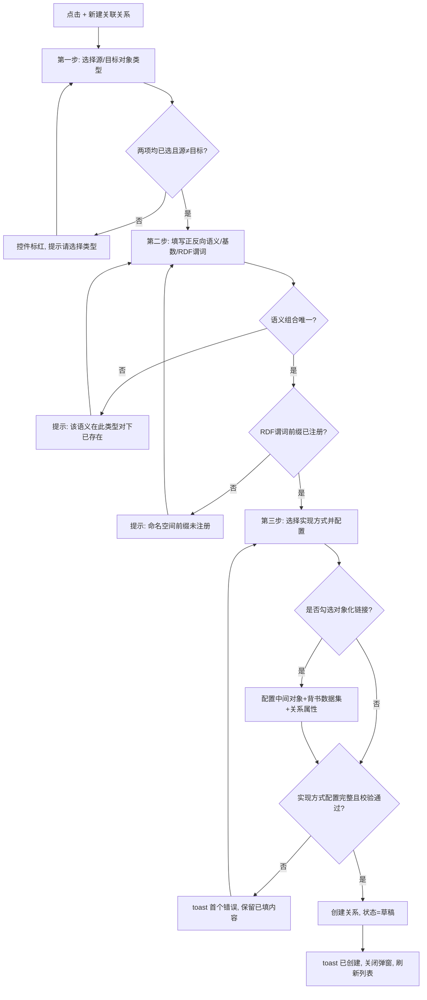
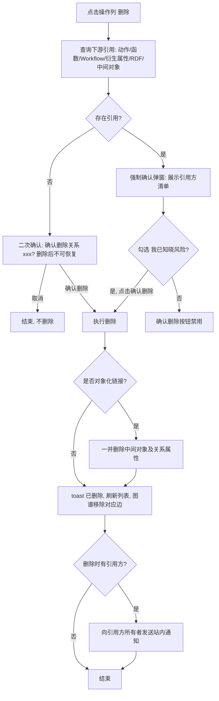
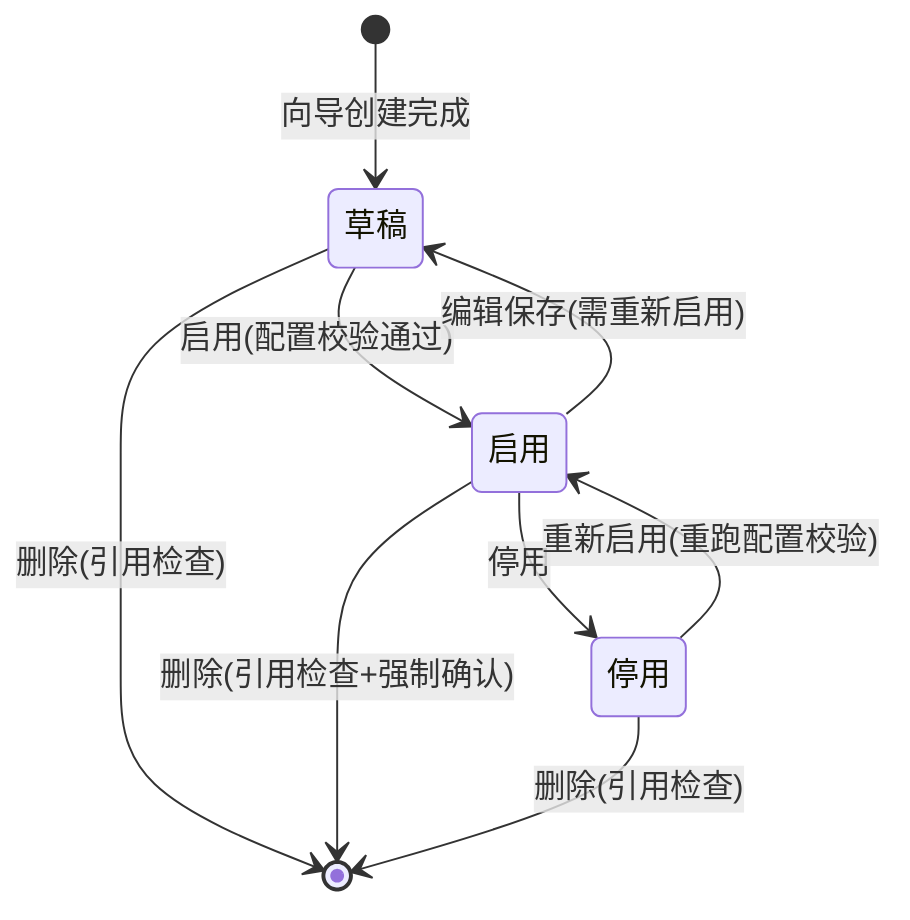
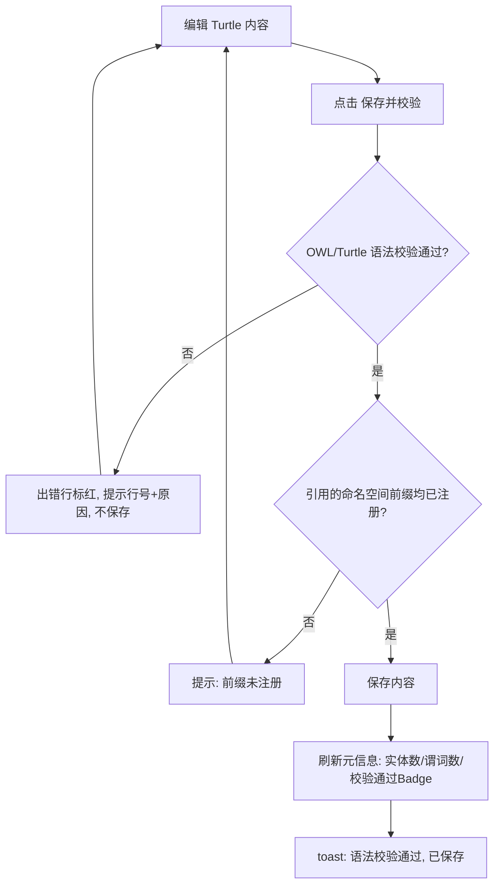

# PRD：关联关系（Link Types）

> 所属模块：本体资产管理 → 关联关系
> 原型页面：@docs/prototype/ontology/ontology-relations.html
> 上游文档：[产品功能设计.md](./产品功能设计.md) § 4.2
> 设计对标：Palantir Foundry Link Types / Object-backed Links / Interface Link Types

---

## 1. 引言/概述

关联关系页面用于维护工作空间内**对象类型之间的语义关系（Link Type）**与 **RDF 语义定义**。本体图谱页面解决"有哪些对象"，本页面解决"对象之间如何连接"：

- 定义源/目标对象类型、正反向语义（如 `uses / used_by`）、基数（1..1、1..n、0..n）与实现方式（外键、关联表、图边、衍生）。
- 当关系自身需要携带元数据（开始日期、分配比例等）时，通过**对象化链接（Object-backed Link）**引入中间对象承载关系属性。
- 通过**接口链接约束（Interface Link Type）**定义"抽象对抽象"的关系约束，并检查各实现类的满足情况。
- 通过 **RDF 维护** Tab 管理命名空间与 Turtle 三元组定义，使本体可导出为标准语义网格式。

## 2. 目标

- 用户可通过三步向导在 3 分钟内完成一条关联关系的创建（含语义、基数、实现方式）。
- 关系列表支持按名称/语义模糊搜索与按实现方式精确筛选，1000 条内列表查询响应 < 1s。
- 对象化链接、接口链接约束均可在本页完成管理（创建/编辑/删除/满足情况检查），无需跳转到其他页面。
- RDF Turtle 编辑保存前必须通过 OWL 语法校验，校验失败时给出行级错误定位。
- 删除关系前必须检查下游引用（动作/函数/Workflow/衍生属性/RDF 三元组），杜绝悬空引用。

## 3. 用户故事

### US-001：关系列表浏览与筛选
**描述：** 作为本体建模员，我希望在一个列表中查看所有关联关系并按关键字/类型筛选，以便快速定位要维护的关系。

**验收标准：**
- [ ] 列表展示列：关系名称、语义（正向/反向）、对象类型对、基数、实现方式、RDF 谓词、状态、操作
- [ ] 搜索框输入关键字后（回车或点击查询），按关系名称/语义标识/对象类型 API 名称模糊过滤
- [ ] 类型下拉筛选（全部/外键关联/多对多关联表/图边/衍生关联）为精确匹配，可与关键字叠加
- [ ] 实现方式列以蓝色 Badge 展示，状态列启用=绿色 Badge、草稿=橙色 Badge
- [ ] 列表默认按创建时间倒序，分页默认每页 20 条
- [ ] 使用 dev-browser 技能在浏览器中验证

### US-002：新建向导 · 第一步选择对象类型
**描述：** 作为本体建模员，我希望先选定源/目标对象类型再定义语义，以便系统能基于类型给出后续步骤的候选（主键、数据集字段、接口）。

**验收标准：**
- [ ] 页面右上角「+ 新建关联关系」按钮打开三步向导弹窗，顶部 Steps 显示：1 选择对象类型 → 2 定义语义与基数 → 3 配置外键/映射
- [ ] 源对象类型下拉仅列出空间内**类（Object Type，可实例化）**，接口与枚举类不可作为源
- [ ] 目标对象类型下拉列出**类与接口**，接口选项带 «接口» 前缀标识
- [ ] 源与目标均必选；未选完点击「下一步」时对应控件标红并提示"请选择源/目标对象类型"
- [ ] 点击「下一步」进入第二步，Steps 第一步标记为完成态
- [ ] 使用 dev-browser 技能在浏览器中验证

### US-003：新建向导 · 第二步定义语义与基数
**描述：** 作为本体建模员，我希望为关系定义正反向语义与基数，以便下游查询与图谱展示使用统一的关系语义。

**验收标准：**
- [ ] 正向语义必填、反向语义选填；输入规则见 § 4.4（snake_case 标识 + 可选中文说明）
- [ ] 同一空间内「源类型 + 目标类型 + 正向语义标识」组合唯一，失焦时查重，重复提示"该语义在此类型对下已存在"
- [ ] 源基数/目标基数为下拉单选（0..n / 1..1 / 1..n），默认 0..n
- [ ] 当目标为接口时，展示提示"目标为接口：任意实现类均可作为链接目标（Interface Link Type）"
- [ ] 「上一步」返回第一步且保留已填内容；「下一步」校验通过后进入第三步
- [ ] 使用 dev-browser 技能在浏览器中验证

### US-004：新建向导 · 第三步实现方式与完成创建
**描述：** 作为本体建模员，我希望选择关系的物理实现方式并完成外键/映射配置，以便关系可以真正落库查询。

**验收标准：**
- [ ] 关系类型下拉四选一：外键关联（FK）/ 多对多关联表 / 图边（NebulaGraph）/ 衍生关联（函数计算）
- [ ] 按所选实现方式动态展示对应配置区（FK：源字段→目标主键；关联表：选择/新建关联表及两个外键字段；图边：NebulaGraph Edge Type；衍生：选择函数），详见 § 4.1.2
- [ ] RDF 谓词选填；填写时格式必须为 `前缀:本地名`，前缀必须已在「RDF 维护 → 命名空间」注册，否则提示"命名空间前缀未注册"
- [ ] 点击「完成」：全部校验通过后创建关系，状态为**草稿**，toast"关联关系已创建"，关闭弹窗并刷新列表
- [ ] 使用 dev-browser 技能在浏览器中验证

### US-005：对象化链接（Object-backed Link）配置
**描述：** 作为本体建模员，我希望在关系需要携带自身属性时勾选"对象化链接"并维护中间对象与关系属性，以便对标 Palantir 的 Object-backed Link 建模。

**验收标准：**
- [ ] 向导中勾选「对象化链接」复选框后展开配置区：中间对象类型、背书数据集、关系属性子表、「+ 添加关系属性」按钮
- [ ] 中间对象类型名默认自动生成 `{源API名}{目标API名}Rel`（PascalCase），允许修改且空间内唯一
- [ ] 开启对象化链接时背书数据集必填；关系属性每行含：属性显示名（必填）、API 名称（必填，snake_case）、类型（必填）、是否必填（开关）
- [ ] 页面「对象化链接」卡片列出全部对象化链接（关系、中间对象、关系属性、状态），支持点击进入编辑、删除
- [ ] 卡片右侧展示建模规范说明（何时用对象化链接、反模式提示）
- [ ] 使用 dev-browser 技能在浏览器中验证

### US-006：编辑关联关系
**描述：** 作为本体建模员，我希望编辑已有关系的语义、基数、实现方式与 RDF 谓词，以便响应业务建模变化。

**验收标准：**
- [ ] 列表操作列「编辑」打开与新建相同的三步向导，数据完整回显，标题为"编辑关联关系"
- [ ] 源/目标对象类型在关系**已启用且存在实例数据**时只读（下拉禁用并提示"已启用关系不可变更类型对"）；草稿状态可修改
- [ ] 编辑已启用关系并保存后，状态回到草稿，需重新启用；toast"变更已保存为草稿"
- [ ] 使用 dev-browser 技能在浏览器中验证

### US-007：删除关联关系（引用检查 + 强制确认）
**描述：** 作为本体建模员，我希望删除关系前系统检查下游引用，以便避免动作/函数/Workflow 出现悬空引用。

**验收标准：**
- [ ] 点击「删除」先发起引用检查；无引用时弹二次确认："确认删除关系「设备 → 工艺（uses）」吗？删除后不可恢复。"
- [ ] 有引用时弹强制确认弹窗，列出引用方清单（类型 + 名称，如 动作 · 转移工艺、Workflow · 排产流程），需勾选"我已知晓风险"后「确认删除」按钮才可点击
- [ ] 对象化链接的关系删除时，额外提示"中间对象 {名称} 将一并删除"
- [ ] 删除成功后 toast、刷新列表；RDF 维护中对应三元组标记为失效（待人工清理）
- [ ] 使用 dev-browser 技能在浏览器中验证

### US-008：图谱定位与关系图预览
**描述：** 作为本体建模员，我希望从关系列表一键在图谱中高亮该关系，并在本页查看关系图预览，以便直观确认建模结果。

**验收标准：**
- [ ] 操作列「图谱定位」跳转到本体图谱页面的图谱视图，并高亮该关系对应的边与两端节点
- [ ] 页面「关系图预览」卡片以 SVG 展示选中关系（源节点 → 中间关联表/边 → 目标节点），点击列表行切换预览内容
- [ ] 使用 dev-browser 技能在浏览器中验证

### US-009：接口链接约束管理
**描述：** 作为本体建模员，我希望维护"接口 → 接口/类"的抽象链接约束并查看各实现类的满足情况，以便保证抽象层建模的一致性。

**验收标准：**
- [ ] 「接口链接约束」卡片列表展示：约束来源（接口）、链接、目标（抽象）、基数、必需/可选、实现类满足情况（✓/✗ 逐类列出）
- [ ] 支持新增约束：约束来源仅可选接口；目标可选接口或类；必需约束创建/变更时触发**全部实现类满足情况检查**，存在 ✗ 时弹出检查结果清单并阻止直接启用（保存为草稿）
- [ ] 支持编辑、删除约束；将可选约束改为"必需"属 Breaking Change，需二次确认并展示受影响实现类清单
- [ ] 使用 dev-browser 技能在浏览器中验证

### US-010：RDF 命名空间管理
**描述：** 作为本体建模员，我希望维护 RDF 命名空间前缀与 URI，以便谓词引用与 Turtle 导出有统一的命名空间。

**验收标准：**
- [ ] 命名空间表展示：前缀、URI、操作（编辑）；「+ 添加」打开表单弹窗
- [ ] 前缀必填、空间内唯一、格式：2~20 字符，仅小写字母/数字/`-`/`_`；URI 必填、合法 URI 格式、空间内唯一
- [ ] 编辑时前缀只读（已被谓词引用的前缀修改会破坏既有三元组），仅 URI 可改
- [ ] 删除（或停用）被 RDF 谓词引用的命名空间时，走引用检查 + 强制确认流程
- [ ] 使用 dev-browser 技能在浏览器中验证

### US-011：Turtle 三元组编辑与校验
**描述：** 作为本体建模员，我希望在代码编辑器中直接维护 Turtle 格式三元组并在保存时做 OWL 语法校验，以便与标准语义网工具互通。

**验收标准：**
- [ ] 「RDF 维护」Tab 右侧为 Turtle 代码编辑器，支持等宽字体与关键字/字符串/注释高亮
- [ ] 点击「保存并校验」：先语法校验，失败时编辑器对应行标红并提示具体错误（如"第 12 行：缺少分号"），不保存
- [ ] 校验通过后保存成功，底部元信息刷新：实体数、谓词数、"OWL 语法校验通过" 绿色 Badge
- [ ] 编辑器内容已修改未保存时切换 Tab/离开页面，弹出拦截提示"当前修改尚未保存，确认离开吗？"
- [ ] 使用 dev-browser 技能在浏览器中验证

## 4. 业务逻辑说明

### 4.1 业务流程文字说明

#### 4.1.1 新建关联关系（三步向导）

1. 用户点击页面右上角「+ 新建关联关系」，系统打开向导弹窗，定位到第一步"选择对象类型"，Steps 控件显示三步进度。
2. **第一步**：用户选择源对象类型与目标对象类型。
   - 候选加载：源=空间内全部"类"；目标=空间内全部"类 + 接口"。空间内无可用类时，下拉为空并提示"请先在本体图谱中创建对象类型"。
   - 校验：两项均必选；源与目标不允许为同一类型（自关联需勾选"允许自关联"高级选项，本期不支持，见非目标）。未通过 → 控件标红 + 提示，停留在第一步。
3. **第二步**：用户填写正向语义（必填）、反向语义（选填）、源/目标基数、（可选）RDF 谓词。
   - 语义标识失焦时执行组合唯一性查重（源类型 + 目标类型 + 正向语义标识，忽略大小写）→ 重复：提示"该语义在此类型对下已存在，请直接编辑既有关系"。
   - 若填写了反向语义，系统同时查重反向组合（目标 + 源 + 反向标识）。
   - RDF 谓词若填写，校验前缀已注册 → 未注册：提示"命名空间前缀 {p} 未注册，请先在 RDF 维护中添加"。
   - 目标为接口时，界面提示"目标为接口：任意实现类均可作为链接目标（Interface Link Type）"，该关系创建后会同时出现在「接口链接约束」卡片。
4. **第三步**：用户选择关系类型（实现方式），系统按选择动态渲染配置区（见 4.1.2）；用户可勾选"对象化链接"并维护中间对象与关系属性（见 4.1.3）。
5. 点击「完成」，系统执行整体校验：
   - 必填项齐全；实现方式对应配置完整（如 FK 方式必须选定源字段与目标主键）。
   - 对象化链接开启时：中间对象名唯一、背书数据集必填、关系属性行的显示名/API 名称/类型必填且 API 名称在中间对象内唯一。
   - 任一失败 → toast 首个错误信息，弹窗不关闭，保留已填内容。
6. 校验全部通过 → 创建关系，状态=**草稿**；若配置了审批流（发布审批范围暂不含 Link Type，见待解决问题）则直接进入草稿。toast"关联关系已创建"，关闭弹窗，列表刷新并将新关系置于首行。
7. 「上一步」在任意步骤可回退且保留已填内容；点击遮罩/×关闭弹窗时，若已有输入则弹"当前修改尚未保存，确认离开吗？"。

#### 4.1.2 第三步按实现方式的配置分支

| 关系类型 | 配置内容 | 校验 |
|---|---|---|
| 外键关联（FK） | 选择源对象主数据集中的字段（下拉，来自源类型已映射字段），目标主键自动带出（目标类型的 PK 属性） | 源字段必选；源字段类型须与目标 PK 类型兼容，不兼容时提示"字段类型不匹配：{源字段类型} → {目标PK类型}" |
| 多对多关联表 | 选择已有关联表数据集或新建（表名必填，格式 `库.表`）；指定表中"源外键字段"与"目标外键字段" | 关联表与两个外键字段必选；基数为 1..1/1..n 时禁用此选项（提示"多对多关联表仅适用于 0..n ↔ 0..n"） |
| 图边（NebulaGraph Edge） | 选择 NebulaGraph 数据源中的 Edge Type（下拉） | Edge Type 必选；空间内无 NebulaGraph 数据源时该项置灰并提示 |
| 衍生关联（函数计算） | 选择空间内已有函数（下拉，函数返回类型须为关系/引用类型） | 函数必选；无可用函数时提示"请先在函数页面创建返回链接的函数" |

#### 4.1.3 对象化链接（Object-backed Link）分支

1. 用户在第三步勾选「对象化链接」复选框 → 展开配置区；取消勾选 → 收起并清空校验（已填内容保留在会话内，重新勾选可恢复）。
2. 中间对象类型名默认自动生成 `{源API名}{目标API名}Rel`（如 `EquipmentProcessRel`），用户可修改；失焦查重（空间内对象类型 API 名称唯一，含本体图谱中的类）→ 重复：提示"对象类型「{name}」已存在"。
3. 背书数据集必填（关系属性数据的来源表）；可点击「+ 添加关系属性」增加行，每行：显示名（必填，1~50 字符）、API 名称（必填，snake_case，中间对象内唯一）、类型（必填，下拉：string/integer/long/double/decimal/boolean/date/timestamp）、必填（开关，默认关）。行尾提供「删除」移除该行（需二次确认，仅当行有已填内容时）。
4. 创建成功后，中间对象作为一个特殊"类"注册进本体（不在本体图谱类列表中单独展示，仅在对象化链接卡片可见——见待解决问题），关系属性支持动作写入、权限管控与衍生属性（对标 Palantir）。
5. 建模规范（页面卡片右侧常驻展示）：
   - 关系需要携带自身元数据（日期/角色/数量）时 → 对象化链接；
   - 仅因共享外键而建链是反模式，应保留为简单 Link Type；
   - 对象化链接的中间对象同样支持动作写入、权限管控与衍生属性。

#### 4.1.4 启用 / 停用（状态机）

1. 关系状态：**草稿 → 启用 → 停用**（停用后可重新启用）。
2. 草稿：可编辑全部字段、可直接删除。
3. 启用：出现在图谱视图与对象数据查询的链接遍历中；编辑保存后回到草稿（toast"变更已保存为草稿，需重新启用"）；删除需引用检查。
4. 停用：不参与新的链接遍历，历史数据保留；重新启用前系统重跑实现方式配置校验（如 FK 源字段已被删除 → 阻止启用并提示原因）。
5. 启用入口：列表操作列「启用/停用」（原型待补充该按钮）。

#### 4.1.5 删除关联关系（引用检查）

1. 用户点击操作列「删除」，系统先查询该关系的下游引用：动作（参数/副作用中使用该 Link）、函数、Workflow、衍生属性（衍生关联依赖）、RDF 三元组（谓词引用）、对象化链接中间对象。
2. **无引用** → 普通二次确认弹窗："确认删除关系「{关系名称}（{正向语义}）」吗？删除后不可恢复。"按钮：「取消」/「确认删除」（红色）。确认后删除，toast"关联关系已删除"，刷新列表。
3. **有引用** → 强制确认弹窗：展示引用方清单（分组：类型 · 名称），文案"该关系被以下资源引用：{清单}。强制删除将导致引用失效，请确认是否强制删除？"；「确认删除」按钮默认禁用，勾选"我已知晓风险"后可点击。确认后删除并向引用方所有者发送站内通知。
4. 对象化链接的关系删除时，确认弹窗额外提示"中间对象「{name}」及其关系属性将一并删除"。
5. 删除已启用的关系时，同步在图谱视图中移除对应边。

#### 4.1.6 接口链接约束

1. 「接口链接约束」卡片列出全部目标或来源为接口的链接约束：约束来源（接口）、链接、目标（抽象）、基数、必需/可选、实现类满足情况。
2. **满足情况计算**：对约束来源接口的每个实现类，检查其是否具备满足该链接的定义（存在对应 Link Type 或可映射字段）；✓=满足、✗=待补。实现类新增/删除时自动重算。
3. 新增/编辑"必需"约束：保存前强制跑一次全量满足检查；存在 ✗ 时弹出检查结果清单（哪些实现类不满足、缺什么），只能保存为草稿，全部 ✓ 后才可启用。
4. 将既有"可选"约束改为"必需"：属 Breaking Change，二次确认弹窗展示受影响实现类清单（当前 ✗ 的类），确认后保存为草稿。
5. 删除约束：普通二次确认；若有实现类正依赖该约束产生链接数据，走引用检查 + 强制确认流程（同 4.1.5）。

#### 4.1.7 RDF 命名空间管理

1. 「+ 添加」打开弹窗：前缀（必填，2~20 字符，小写字母/数字/`-`/`_`，字母开头，空间内唯一，失焦查重）、URI（必填，合法 URI，以 `#` 或 `/` 结尾建议但不强制，空间内唯一）。
2. 编辑：前缀只读（被谓词引用后不可变更），仅 URI 可改；修改 URI 时提示"修改后既有三元组的解析地址将变化"。
3. 删除：检查是否被关系的 RDF 谓词或 Turtle 内容引用 → 有引用走强制确认流程；内置命名空间（rdf/rdfs/owl）不可删除、不可编辑，操作列置灰并提示"内置命名空间"。

#### 4.1.8 Turtle 三元组编辑与校验

1. 用户在代码编辑器中修改 Turtle 内容，点击「保存并校验」。
2. 系统执行 OWL/Turtle 语法校验：
   - **失败** → 不保存；编辑器出错行标红，底部提示具体错误（行号 + 原因，如"第 12 行：预期 ';' 或 '.'"）；用户修正后可重试。
   - **通过** → 保存内容；刷新底部元信息：实体数、谓词数、"OWL 语法校验通过"绿色 Badge；toast"语法校验通过，已保存"。
3. 校验同时检查内容中引用的命名空间前缀均已注册 → 未注册：提示"前缀 {p} 未在命名空间中注册"，不保存。
4. 内容已修改未保存时：切换 Tab、切换页面、关闭浏览器均触发拦截提示"当前修改尚未保存，确认离开吗？"（确认丢弃 / 取消留下）。
5. 从关系向导中填写的 RDF 谓词会体现在 Turtle 内容的 ObjectProperty 定义中（系统生成的部分以注释标记，人工编辑覆盖后以人工内容为准——冲突策略见待解决问题）。

### 4.2 业务流程图

#### 4.2.1 新建关联关系主流程

#### 4.2.2 删除关系（引用检查）流程

#### 4.2.3 关系状态机

#### 4.2.4 Turtle 保存校验流程

### 4.3 原型图

@docs/prototype/ontology/ontology-relations.html

页面结构：
- 页头：面包屑（智能制造空间 / 本体资产管理 / 关联关系）、标题、描述、右上角「+ 新建关联关系」主按钮。
- Tab 1「对象关系」：关系列表卡片（搜索 + 类型筛选 + 表格）→ 对象化链接卡片 → 接口链接约束卡片 → 关系图预览卡片。
- Tab 2「RDF 维护」：左侧命名空间卡片（表格 + 添加按钮），右侧 Turtle 编辑器卡片（保存并校验按钮 + 元信息）。
- 弹窗：新建/编辑关联关系三步向导（lg 宽度）、命名空间添加/编辑（sm 宽度）、各类确认弹窗。

> 原型待补充项：① 列表操作列的「启用/停用」按钮；② 向导第三步按实现方式动态渲染的配置区（当前原型步骤内容为第二步示意）；③ 接口链接约束的「新增约束」按钮与表单。

### 4.4 原型图字段与交互说明

#### （a）新建/编辑关联关系向导 · 字段说明

**第一步：选择对象类型**

| 字段名 | 控件类型 | 是否必填 | 校验规则 | 默认值 | 备注 |
|--------|---------|---------|---------|--------|------|
| 源对象类型 | 下拉框 Select（单选，可搜索） | 是 | 候选=空间内全部"类"；编辑已启用关系时禁用 | 空 | 选项展示"显示名 API名称"，如 `设备 Equipment` |
| 目标对象类型 | 下拉框 Select（单选，可搜索） | 是 | 候选=类+接口；接口带 «接口» 前缀；不可与源相同（本期） | 空 | 选接口时下方出现 Interface Link 提示 |

**第二步：定义语义与基数**

| 字段名 | 控件类型 | 是否必填 | 校验规则 | 默认值 | 备注 |
|--------|---------|---------|---------|--------|------|
| 正向语义（源→目标） | 输入框 Input | 是 | 格式 `标识` 或 `标识（中文名）`；标识 2~64 字符，小写字母开头，仅小写字母/数字/下划线（snake_case），大小写不敏感查重；组合唯一（源+目标+标识），失焦查重。正例：`uses（使用）`、`belongs_to`；反例：`Uses`、`used-by`、`使用` | 按类型对自动生成建议值（如 `uses`） | 错误提示："语义标识只能包含小写字母、数字和下划线" |
| 反向语义（目标→源） | 输入框 Input | 否 | 同正向规则；填写时查重（目标+源+标识） | 正向标识 + `_by` 建议（如 `used_by`） | — |
| 源基数 | 下拉框 Select | 是 | 枚举：`0..n（多）` / `1..1（单）` / `1..n` | `0..n（多）` | — |
| 目标基数 | 下拉框 Select | 是 | 同上 | `0..n（多）` | — |
| RDF 谓词 | 输入框 Input | 否 | 格式 `前缀:本地名`；前缀须已注册命名空间；本地名 2~64 字符，字母/数字/`-`/`_`。正例 `oo:uses`；反例 `oo:`、`uses` | 空 | placeholder `oo:uses` |

**第三步：配置外键 / 映射**

| 字段名 | 控件类型 | 是否必填 | 校验规则 | 默认值 | 备注 |
|--------|---------|---------|---------|--------|------|
| 关系类型 | 下拉框 Select | 是 | 枚举：外键关联（FK）/ 多对多关联表 / 图边（NebulaGraph Edge）/ 衍生关联（函数计算） | 外键关联（FK） | 切换时动态渲染下方配置区 |
| 源关联字段 | 下拉框 Select | FK 时必填 | 候选=源类型已映射的数据集字段；类型须与目标 PK 兼容 | 空 | 仅 FK 方式展示 |
| 关联表数据集 | 下拉框 Select（可新建） | 关联表方式必填 | 新建时表名格式 `库.表`（小写字母/数字/下划线/点） | 空 | 基数含 1..1/1..n 时该选项禁用 |
| 源/目标外键字段 | 下拉框 Select ×2 | 关联表方式必填 | 候选=关联表字段 | 空 | — |
| Edge Type | 下拉框 Select | 图边方式必填 | 候选=NebulaGraph 数据源 Edge Type | 空 | 无 Nebula 数据源时置灰 |
| 衍生函数 | 下拉框 Select | 衍生方式必填 | 候选=返回链接的函数 | 空 | — |
| 对象化链接 | 复选框 Checkbox | 否 | 勾选后展开中间对象配置区 | 不勾选 | 附建模说明 tip |
| 中间对象类型 | 输入框 Input | 勾选对象化链接时必填 | PascalCase，2~64 字符，字母开头，仅字母/数字；空间内唯一（与全部对象类型一起查重），失焦查重 | `{源API}{目标API}Rel` 自动生成 | 正例 `EquipmentProcessRel`；反例 `equipment-process-rel` |
| 背书数据集 | 输入框 Input | 勾选对象化链接时必填 | 格式 `库.表`，小写字母/数字/下划线/点 | `doris.{中间对象小写}` 建议 | placeholder 提示格式 |
| 关系属性 · 显示名 | 输入框 Input（子表行内） | 是 | 1~50 字符，不允许纯空格 | 空 | — |
| 关系属性 · API 名称 | 输入框 Input（子表行内） | 是 | snake_case，2~64 字符；中间对象内唯一 | 空 | 正例 `start_date`；反例 `StartDate` |
| 关系属性 · 类型 | 下拉框 Select（子表行内） | 是 | string/integer/long/double/decimal/boolean/date/timestamp | string | decimal 可带精度如 `Decimal(5,2)` |
| 关系属性 · 必填 | 开关 Switch（子表行内） | — | — | 关 | — |

**布局说明**：弹窗宽度 lg（约 720px）；顶部 Steps 三步进度条；表单两列栅格（form-row）为主，关系类型/对象化链接/RDF 谓词为整行；底部按钮右对齐：「上一步」（次按钮，第一步时显示「取消」）｜「完成」（主按钮，第一/二步时显示「下一步」）。

#### （b）命名空间 新增/编辑表单

| 字段名 | 控件类型 | 是否必填 | 校验规则 | 默认值 | 备注 |
|--------|---------|---------|---------|--------|------|
| 前缀 | 输入框 Input | 是 | 2~20 字符，小写字母开头，仅小写字母/数字/`-`/`_`；空间内唯一（失焦查重）。正例 `oo`；反例 `OO`、`oo:` | 空 | 编辑时只读；内置 rdf/rdfs/owl 不可编辑 |
| URI | 输入框 Input | 是 | 合法 URI（`http://` 或 `https://` 开头），1~500 字符；空间内唯一 | 空 | 建议以 `#` 或 `/` 结尾，不强制 |

#### （c）对象关系列表页说明

| 列名 | 字段来源 | 展示形式 | 排序 | 备注 |
|------|---------|---------|------|------|
| 关系名称 | name | 加粗文本（如 `设备 → 工艺`） | — | 超长省略，hover 显示全称 |
| 语义（正向/反向） | forward / reverse | 等宽字体 `uses / used_by` | — | — |
| 对象类型对 | sourceApi / targetApi | 等宽字体 `Equipment → Process` | — | 目标为接口时带 «接口» 前缀 |
| 基数 | cardinality | 等宽字体 `0..n → 0..n` | — | — |
| 实现方式 | implType | 蓝色 Badge（外键关联/多对多关联表/图边/衍生关联） | — | — |
| RDF 谓词 | rdfPredicate | 等宽字体 | — | 未配置显示 `—` |
| 状态 | status | Badge：启用=绿 / 草稿=橙 / 停用=灰 | — | — |
| 操作 | — | 编辑 / 启用（停用）/ 图谱定位 / 删除 | — | 权限点控制显隐；启用中关系"删除"红色警示 |

**操作列权限与禁用条件**：
- 「编辑」：需 `ontology:link:edit` 权限；已启用关系的编辑保存后回草稿。
- 「启用/停用」：需 `ontology:link:publish` 权限；启用前重跑配置校验，失败则 toast 原因。
- 「图谱定位」：只读权限即可；跳转本体图谱页图谱视图并高亮。
- 「删除」：需 `ontology:link:delete` 权限；走 4.1.5 引用检查流程。

**展示形态**：本页不提供卡片/列表视图切换。理由：关系数据字段多（8 列）、以精确维护为主，表格信息密度更优；图形化诉求由「关系图预览」卡片与本体图谱页的图谱视图承接。

#### （d）对象化链接卡片列表

| 列名 | 展示形式 | 备注 |
|------|---------|------|
| 关系 | 等宽 `Equipment ↔ Process` | 双向箭头表示对象化链接 |
| 中间对象 | 等宽 `EquipmentProcessRel` | 点击进入编辑向导（定位第三步） |
| 关系属性 | 等宽 `start_date · allocation` | 超过 3 个显示 `… +N` |
| 状态 | Badge 启用/草稿 | — |
| 操作 | 编辑 / 删除 | 删除走引用检查 + "中间对象一并删除"提示 |

#### （e）接口链接约束卡片列表

| 列名 | 展示形式 | 备注 |
|------|---------|------|
| 约束来源 | 等宽 `Asset（接口）` | 仅接口 |
| 链接 | 等宽 `located_in` | — |
| 目标（抽象） | 等宽 `«接口» Location` | 接口或类 |
| 基数 | 等宽 `0..n → 1..n` | — |
| 必需 | Badge：必需=红 / 可选=灰 | 可选改必需走 Breaking Change 确认 |
| 实现类满足情况 | `Equipment ✓ · Material ✓ · Supplier ✗（待补）` | ✗ 红色；点击展开明细 |
| 操作 | 编辑 / 删除 | — |

#### （f）搜索条件说明

| 搜索项 | 控件 | 搜索方式 | 说明 |
|--------|------|---------|------|
| 关系关键字 | 输入框 | 模糊搜索（LIKE） | 匹配关系名称、正/反向语义标识、对象类型显示名与 API 名称 |
| 实现方式 | 下拉框 | 精确搜索（=） | 全部类型 / 外键关联 / 多对多关联表 / 图边 / 衍生关联 |

搜索区交互：回车或输入防抖 300ms 触发过滤；筛选变更立即生效；「重置」清空条件并重新查询；分页默认每页 20 条。

#### （g）RDF 维护 Tab

| 区域 | 内容与交互 |
|------|-----------|
| 命名空间表 | 列：前缀（等宽）、URI（等宽小字）、操作（编辑；内置项置灰）；右上「+ 添加」；删除入口在编辑弹窗内（走引用检查） |
| Turtle 编辑器 | 等宽代码区，注释灰/关键字蓝/字符串绿高亮；右上「保存并校验」主按钮 |
| 编辑器元信息 | 实体数、谓词数、校验状态 Badge（通过=绿 / 失败=红 + 行号错误） |

### 4.5 交互提示说明

| 触发操作 | 提示类型 | 提示内容 | 后续动作 |
|---------|---------|---------|---------|
| 向导第一步未选类型点下一步 | 表单校验提示 | 控件标红 + "请选择源对象类型 / 目标对象类型" | 停留当前步骤 |
| 语义组合重复（失焦查重） | 错误 toast | "该语义在此类型对下已存在，请直接编辑既有关系" | 停留第二步，保留输入 |
| RDF 谓词前缀未注册 | 错误 toast | "命名空间前缀 {p} 未注册，请先在 RDF 维护中添加" | 停留当前步骤 |
| FK 源字段类型与目标 PK 不兼容 | 错误 toast | "字段类型不匹配：{源类型} → {目标PK类型}" | 停留第三步 |
| 向导已有输入时点遮罩/×关闭 | 拦截确认弹窗 | "当前修改尚未保存，确认离开吗？"（确认丢弃 / 取消） | 确认则关闭并丢弃 |
| 点击「完成」创建成功 | 成功 toast | "关联关系已创建" | 关闭弹窗，刷新列表 |
| 点击列表「删除」（无引用） | 二次确认弹窗 | "确认删除关系「{名称}（{语义}）」吗？删除后不可恢复。"（取消 / 确认删除·红） | 确认后删除 + toast + 刷新 |
| 点击列表「删除」（有引用） | 强制确认弹窗 | "该关系被以下资源引用：{类型·名称清单}。强制删除将导致引用失效，请确认是否强制删除？" + 勾选"我已知晓风险" | 勾选后「确认删除」可点击；删除后通知引用方所有者 |
| 删除对象化链接关系 | 二次确认弹窗（附加行） | 附加提示："中间对象「{name}」及其关系属性将一并删除" | 同上 |
| 编辑已启用关系并保存 | 成功 toast | "变更已保存为草稿，需重新启用" | 状态徽标变为草稿 |
| 启用关系但配置校验失败 | 错误 toast | "启用失败：{原因，如 FK 源字段已删除}" | 状态不变 |
| 可选约束改为必需 | Breaking Change 确认弹窗 | "此变更为 Breaking Change，以下实现类当前不满足：{清单}。确认保存为草稿？" | 确认后保存草稿 |
| 必需约束存在 ✗ 实现类时点启用 | 检查结果弹窗 | "以下实现类未满足该约束：{清单}，无法启用" | 仅可保存草稿 |
| Turtle 保存校验失败 | 编辑器行内错误 + 错误 toast | "第 {N} 行：{错误原因}" | 不保存，出错行标红 |
| Turtle 未保存离开（切 Tab/路由） | 拦截确认弹窗 | "当前修改尚未保存，确认离开吗？" | 确认丢弃 / 取消留下 |
| 删除被引用命名空间 | 强制确认弹窗 | "该命名空间被 {N} 个谓词引用：{清单}。删除后相关三元组失效，确认删除？" + 风险勾选 | 同强制删除流程 |
| 空间内无可用对象类型 | 空态提示 | 下拉空态："请先在本体图谱中创建对象类型"，附跳转链接 | — |

## 5. 功能需求

按页面功能清单组织（A~F 六个功能块）：

**A. 对象关系列表**
- FR-1：系统必须以表格分页展示空间内全部关联关系，列包含：关系名称、语义（正向/反向）、对象类型对、基数、实现方式（Badge）、RDF 谓词、状态（Badge：启用绿/草稿橙/停用灰）、操作。
- FR-2：系统必须支持关键字模糊搜索（关系名称、语义标识、对象类型显示名/API 名称）与实现方式精确筛选，两者可叠加；默认按创建时间倒序，每页 20 条。
- FR-3：操作列必须提供：编辑、启用/停用、图谱定位、删除，按权限点（`ontology:link:edit` / `ontology:link:publish` / `ontology:link:delete`）控制显隐。
- FR-4：点击「图谱定位」必须跳转本体图谱页图谱视图并高亮该关系对应的边与两端节点。
- FR-5：本页不提供卡片/列表双视图切换（表格信息密度优先，图形诉求由关系图预览与图谱视图承接）。

**B. 新建/编辑向导（三步）**
- FR-6：点击「+ 新建关联关系」必须打开三步向导弹窗（选择对象类型 → 定义语义与基数 → 配置外键/映射），每步校验通过后方可进入下一步，「上一步」回退保留已填内容。
- FR-7：源对象类型候选必须仅为空间内"类"；目标候选为"类 + 接口"（接口带 «接口» 标识）；源与目标不可相同。
- FR-8：正向语义必填、反向语义选填，命名规则为 snake_case（2~64 字符，小写字母开头，仅小写字母/数字/下划线）；「源+目标+正向标识」组合空间内唯一，失焦查重。
- FR-9：源/目标基数必须为下拉单选（0..n / 1..1 / 1..n），默认 0..n。
- FR-10：关系类型必须支持四种实现方式并按选择动态渲染配置区：FK（源字段→目标 PK，类型兼容校验）、多对多关联表（选择/新建关联表 + 双外键字段，1..1/1..n 基数时禁用）、图边（NebulaGraph Edge Type，无数据源置灰）、衍生关联（选择返回链接的函数）。
- FR-11：RDF 谓词选填，格式 `前缀:本地名`，前缀必须已在命名空间注册，否则拒绝进入下一步并提示。
- FR-12：点击「完成」必须整体校验全部步骤；通过后创建关系（状态=草稿）、toast 提示、关闭弹窗、刷新列表；失败则 toast 首个错误且保留已填内容。
- FR-13：编辑必须复用同一向导并完整回显；源/目标类型对在关系已启用且存在实例数据时只读；编辑已启用关系保存后状态回草稿。

**C. 对象化链接（Object-backed Link）**
- FR-14：向导第三步必须提供「对象化链接」复选框；勾选后展开：中间对象类型（默认 `{源API}{目标API}Rel`，PascalCase，空间内唯一，可修改）、背书数据集（必填，格式 `库.表`）、关系属性子表（显示名/API 名称 snake_case/类型/必填开关）与「+ 添加关系属性」按钮。
- FR-15：关系属性 API 名称在中间对象内必须唯一；行删除在有已填内容时需二次确认。
- FR-16：页面必须提供「对象化链接」卡片，列出全部对象化链接（关系、中间对象、关系属性摘要、状态），支持编辑（定位向导第三步）与删除（提示中间对象一并删除）。
- FR-17：卡片右侧必须常驻展示建模规范说明（何时对象化、共享外键反模式、中间对象支持动作/权限/衍生属性）。

**D. 接口链接约束（Interface Link Types）**
- FR-18：页面必须提供「接口链接约束」卡片，列出：约束来源（接口）、链接、目标（抽象）、基数、必需/可选、实现类满足情况（逐类 ✓/✗）。
- FR-19：系统必须支持新增/编辑/删除约束；约束来源仅可选接口，目标可选接口或类。
- FR-20：保存"必需"约束前必须对来源接口的全部实现类执行满足情况检查；存在 ✗ 时展示明细清单且只能保存为草稿，不可启用。
- FR-21：将"可选"约束改为"必需"必须视为 Breaking Change：二次确认并展示当前不满足的实现类清单。
- FR-22：实现类集合变化（新增/删除实现类）时，系统必须自动重算相关约束的满足情况。

**E. 关系图预览**
- FR-23：页面必须提供「关系图预览」卡片，以 SVG 展示选中关系的"源 → 中间载体（关联表/边）→ 目标"结构；点击列表行切换预览对象；默认展示第一条关系。

**F. RDF 维护**
- FR-24：系统必须提供命名空间管理：列表（前缀、URI、操作）、添加（前缀 2~20 字符小写/数字/`-`/`_` 且唯一；URI 合法且唯一）、编辑（前缀只读，仅 URI 可改）、删除（引用检查 + 强制确认）；内置 rdf/rdfs/owl 不可编辑删除。
- FR-25：系统必须提供 Turtle 代码编辑器（语法高亮），「保存并校验」先做 OWL/Turtle 语法校验与命名空间前缀注册校验；失败不保存并给出行号级错误提示；成功则保存并刷新元信息（实体数、谓词数、校验通过 Badge）。
- FR-26：编辑器内容已修改未保存时，切换 Tab/离开页面必须触发"未保存拦截"确认。
- FR-27：关系删除后，RDF 维护中对应三元组必须标记为失效待清理（不自动删除人工内容）。

**状态与启用**
- FR-28：关系状态机必须为：草稿 →（启用）→ 启用 →（停用）→ 停用 →（重新启用）→ 启用；编辑启用中的关系保存后回草稿；启用/重新启用前必须重跑实现方式配置校验，失败则阻止并提示原因。

## 6. 非目标（范围外）

- **自关联（源=目标）关系**：本期不支持，后续版本评估。
- **Link Type 发布审批流**：审批中心当前范围仅覆盖对象类型/共享属性/值约束规则/动作/函数五类，关联关系启用不走审批（见待解决问题）。
- **关系实例数据的写入与 ETL**：本页仅定义关系元数据；实例级链接数据的生成由数据管理（Pipeline）与动作模块承接。
- **图谱视图的完整交互**（拖拽布局、缩放导出等）：属本体图谱页面职责，本页仅提供预览与定位跳转。
- **OWL/RDF 文件导入导出**（上传 owl 文件、下载 Turtle 全量）：本期仅在线编辑，导入导出在本体图谱页「导入」能力中统一规划。
- **三元组级 SPARQL 查询**：不提供查询语言入口。
- **跨空间的关系定义**：关系仅在当前工作空间内有效。
- **关系级细粒度权限（行级）**：控制属性权限模型不延伸至链接遍历权限，后续安全模块统一设计。

## 7. 设计考量

- 复用 `docs/prototype/assets/` 现有组件约定：`App.mount()`、tabs、table、badge、modal（sm/lg）、steps、switch、toast、二次确认弹窗。
- 向导 Steps、表格、Badge、代码编辑器样式均已有原型/样式基础（`.steps`、`.table`、`.badge`、`.code-editor`），前端实现优先复用 antd Steps/Table/Modal 对应组件。
- 「图谱定位」跳转需与本体图谱页约定高亮参数（关系标识），两页联动。
- 删除/强制删除确认弹窗与平台其他模块（共享属性、值约束规则）保持一致的交互模式：清单展示 + 风险勾选 + 红色确认按钮。

## 8. 技术考量

- 实现方式依赖多存储：FK/关联表 → Doris；图边 → NebulaGraph Edge Type 元数据；衍生关联 → 函数模块。向导第三步的候选加载依赖数据管理与函数模块的元数据能力。
- Turtle/OWL 语法校验需引入 RDF 解析库（前端或后端校验，建议后端统一校验保证一致性——具体归技术设计文档）。
- 接口链接约束的"实现类满足情况"需在本体元数据变更（新增实现类、修改属性/链接）时触发重算，注意事件解耦。
- 关系删除的引用检查横跨动作/函数/Workflow/衍生属性/RDF 多个模块，需要统一的引用登记或聚合查询机制（归技术设计文档）。
- 列表查询在关系数 1000 内响应 < 1s；满足情况重算允许异步（列表显示"计算中"状态）。

## 9. 成功指标

- 新建一条标准 FK 关系（不含对象化链接）全程 ≤ 3 分钟、≤ 3 次页面跳转。
- 删除关系时 100% 触发引用检查；有引用场景下强制确认勾选率 100%（不允许绕过）。
- Turtle 保存的语法错误 100% 在保存前被拦截，且错误提示含行号。
- 上线一个月内，空间内 ≥ 80% 的"关系需携带元数据"场景使用对象化链接而非冗余外键（建模规范采纳率）。

## 10. 待解决问题

1. Link Type 的"启用"是否纳入审批中心范围？（当前五类资源不含关联关系；若纳入需同步审批中心 PRD）
2. 对象化链接的中间对象是否需要在「本体图谱」类列表中可见（当前设计：仅在对象化链接卡片维护，避免建模噪音）？
3. 系统根据关系向导自动生成的 RDF 谓词定义与人工编辑的 Turtle 内容冲突时的合并策略（覆盖 / 分区管理 / 只读生成区）？
4. 是否支持一条关系配置多个实现方式（如 FK + 图边双写）以兼顾查询性能与图遍历？
5. 关系图预览的展示范围：仅选中关系，还是支持展开该关系两端的相邻关系（1 跳子图）？
6. 衍生关联所选函数的返回类型契约（如何声明"返回链接"）需与函数模块 PRD 对齐。
