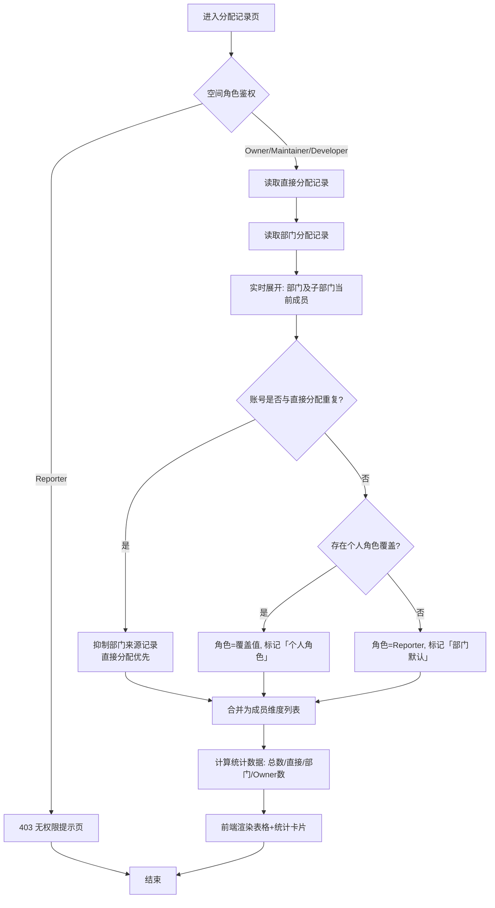
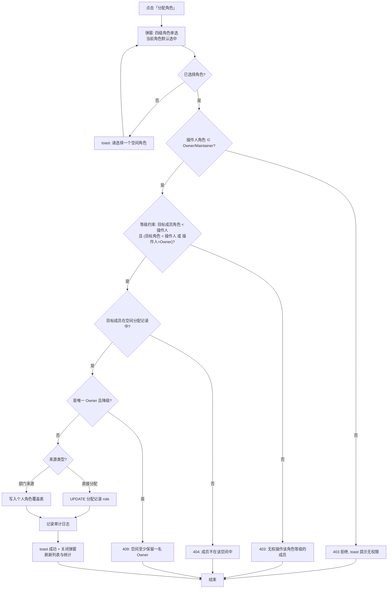
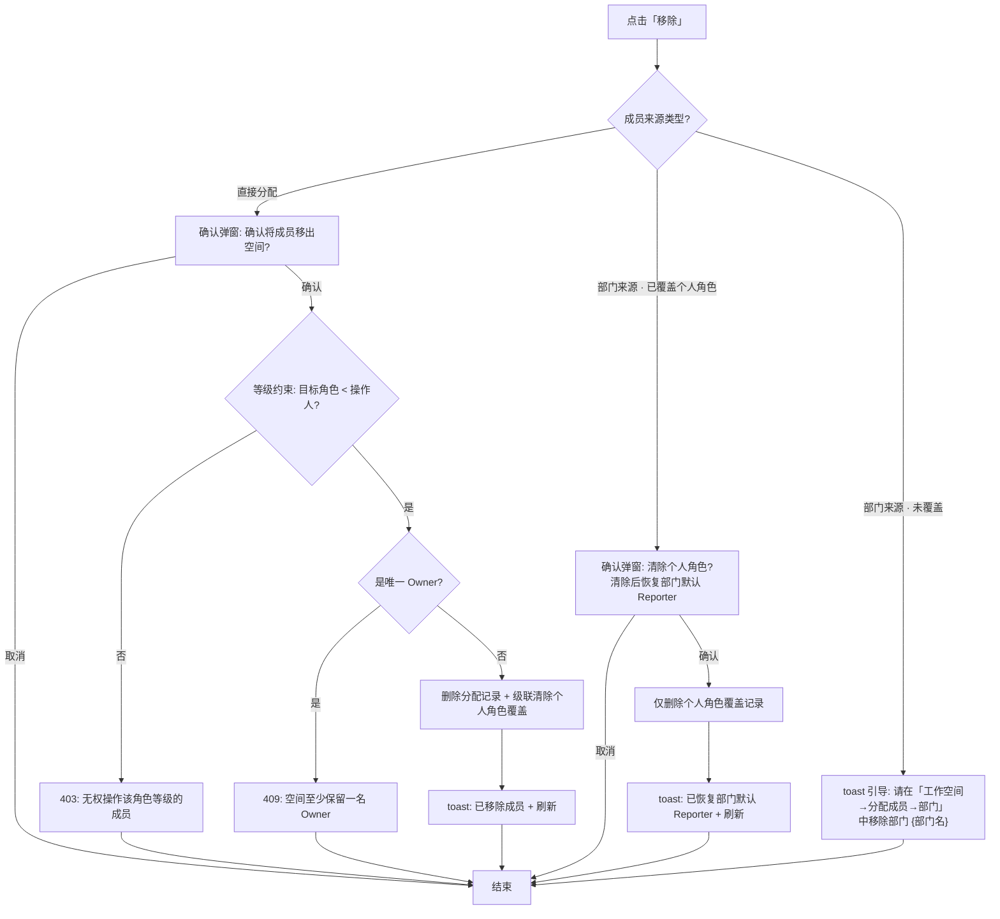
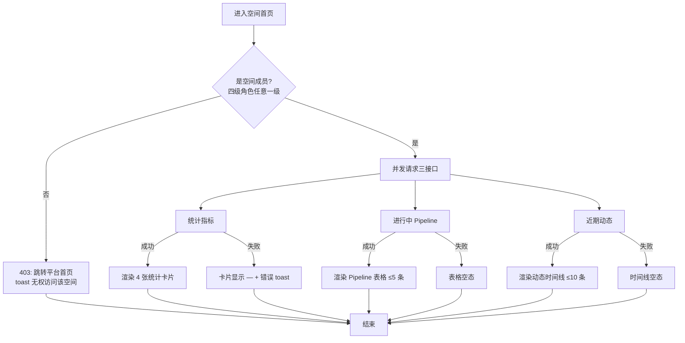

# PRD：工作空间管理（空间首页 · 成员分配）

> 版本：v1.0 ｜ 日期：2026-10-20 ｜ 状态：评审中
>
> 范围：以空间级两个页面为核心 —— **空间首页**（`workspace/home.html`）与 **成员分配记录**（`workspace/member-assign.html`）。平台级空间 CRUD（`system/sys-workspaces.html`，见《产品功能设计.md》3.1 节）作为上下游能力仅简述，不在本 PRD 展开。
>
> 关联上游文档：《产品功能设计.md》第 2 章（角色权限模型）、3.1 节（工作空间管理）。

---

## 1. 引言 / 概述

工作空间（Workspace）是 Prism 平台中本体资产、数据、应用与安全策略的**顶层隔离单元**，跨空间数据默认不可互访。用户从平台首页进入某个空间后，需要两个核心能力：

1. **空间首页**：进入空间后的统一概览页，一眼看清空间的成员规模、本体资产量、数据链路运行状态（Pipeline）、API 调用情况与近期动态，并提供通往空间内五大功能模块（本体资产 / 数据 / 安全 / 应用 / 审计）的快捷入口。
2. **成员分配记录**：以**成员维度**统一展示"谁在这个空间里、什么角色、谁分配的、什么时候分配的、通过什么来源（直接分配 / 部门分配）进来的"，并支持为成员调整空间角色、移除成员。

本 PRD 定义上述两个页面的完整功能需求，包括空间四级角色权限模型（参考 GitLab）、部门分配动态展开规则、个人角色覆盖机制、默认角色判定规则。

**术语表**（面向初级开发者）：

| 术语 | 含义 |
|---|---|
| 空间角色 | 用户在**某个工作空间内**的角色（Owner/Maintainer/Developer/Reporter），各空间独立，与平台级"系统角色"（超级管理员/空间管理员/普通成员）是两套体系 |
| 系统角色 | 平台级角色，由「系统管理 → 角色管理」维护，影响默认空间角色的判定 |
| 直接分配 | 把某个用户单独拉入空间并指定角色，逐条记录 |
| 部门分配 | 把整个部门拉入空间；该部门**及其子部门**下的所有成员动态获得空间访问权，默认角色 Reporter |
| 动态展开 | 部门分配不逐个落库成员，而是渲染时实时计算部门当前成员名单；部门人员变动时空间成员自动同步 |
| 个人角色覆盖 | 部门来源的成员被单独分配角色后，其个人角色覆盖部门默认 Reporter，标记为「个人角色」 |
| 部门 leader | 部门负责人，参与默认角色判定 |

---

## 2. 目标

- 用户进入空间后 **1 个页面**内看到空间核心指标（成员数、本体资产数、数据集/Pipeline 数、今日 API 调用）与运行态势（进行中 Pipeline、近期动态时间线）。
- 空间内五大功能模块从首页 **1 次点击**可达。
- 成员分配记录以成员维度统一呈现直接分配与部门分配两类来源，来源可辨识、可筛选、可搜索。
- 部门分配实现**动态展开**：部门/子部门人员变化时，空间成员名单自动同步，无需人工维护。
- 角色调整（含部门成员的个人角色覆盖）**2 次点击**内完成，变更立即生效并记录分配人/时间。
- 移除成员有明确的分级处理：直接分配成员可移除；部门默认成员引导到部门维度移除；已覆盖个人角色的部门成员支持"清除个人角色、恢复部门默认"。
- 默认角色判定规则系统化：空间创建人/负责人若为部门 leader 或系统角色为超级管理员/空间管理员，默认 Owner；否则默认 Maintainer；其余被拉入成员默认 Reporter。

---

## 3. 用户故事

### US-001：空间首页指标概览
**描述：** 作为空间成员，我希望进入空间后看到统计卡片（空间成员、本体资产、数据集/Pipeline、今日 API 调用），以便快速掌握空间规模与活跃度。

**验收标准：**
- [ ] 页面顶部展示 4 张统计卡片：空间成员、本体资产、数据集 / Pipeline、今日 API 调用
- [ ] 卡片数值来自后端实时统计接口，加载中显示骨架屏/占位符
- [ ] 有环比变化的指标显示 ▲/▼ 增减标记（如"▲ +2"、"▲ 8.2%"）
- [ ] 接口失败时卡片显示"—"并给出错误 toast，不阻塞页面其余部分渲染
- [ ] 使用 dev-browser 技能在浏览器中验证

### US-002：模块快捷入口
**描述：** 作为空间成员，我希望首页有五大模块的快捷入口卡片，以便直达我要使用的功能。

**验收标准：**
- [ ] 展示 5 张模块卡片：本体资产管理、数据管理、安全管理、应用管理、审计管理
- [ ] 每张卡片含图标、模块名、一句话描述、子功能列表、"→"箭头
- [ ] 点击卡片跳转到该模块的**第一个子功能页面**（如本体资产管理 → 本体图谱）
- [ ] hover 时卡片上浮 2px 并加深阴影，箭头变主题色
- [ ] 卡片顶部色条按模块区分颜色（紫/青/红/绿/橙）
- [ ] 屏幕宽度 ≤1100px 时由 3 列布局降级为单列
- [ ] 使用 dev-browser 技能在浏览器中验证

### US-003：进行中 Pipeline 与近期动态
**描述：** 作为空间维护者，我希望首页展示进行中的 Pipeline 列表和近期动态时间线，以便及时发现运行异常和团队成员的操作。

**验收标准：**
- [ ] "进行中的 Pipeline"表格展示：Pipeline 名称、状态徽标（运行中=蓝/成功=绿/重试中=橙/排队=灰）、进度百分比、开始时间
- [ ] 卡片头部有"全部 →"按钮，跳转 Pipeline 管理页
- [ ] "近期动态"时间线展示：时间、操作人+动作标题、补充描述；异常事件（如 Pipeline 重试）用警示样式区分
- [ ] 两卡片左右并排布局，窄屏时纵向堆叠
- [ ] 使用 dev-browser 技能在浏览器中验证

### US-004：分配记录列表（成员维度）
**描述：** 作为空间管理员，我希望以成员维度看到空间内所有人的分配记录，以便统一管理成员与角色。

**验收标准：**
- [ ] 列表列：用户账号、用户名字、部门、空间角色、分配人、分配时间、来源、操作
- [ ] 直接分配的成员逐条展示，来源徽标为"直接分配"
- [ ] 部门分配的成员**动态展开**为该部门及其子部门下所有成员，来源徽标为"部门分配 · {部门名}"
- [ ] 同一用户同时命中直接分配与部门分配时，**直接分配优先**，只出现一条记录
- [ ] 空间角色列显示四级角色彩色徽标（Owner=紫/Maintainer=蓝/Developer=绿/Reporter=青）
- [ ] 部门来源成员的角色旁标注"部门默认"或"个人角色"辅助文字
- [ ] 页面顶部显示 4 张统计卡片：空间成员总数、直接分配成员数、部门分配数（N 个部门）、Owner 数量，与列表数据联动
- [ ] 列表为空或无匹配时显示空态"未找到匹配的分配记录"
- [ ] 使用 dev-browser 技能在浏览器中验证

### US-005：搜索与角色筛选
**描述：** 作为空间管理员，我希望按关键词搜索和按角色筛选分配记录，以便在成员较多时快速定位目标成员。

**验收标准：**
- [ ] 搜索框支持按**账号 / 姓名 / 部门**模糊匹配，输入即时过滤（无需点查询按钮）
- [ ] 角色下拉筛选：全部角色 / owner / maintainer / developer / reporter，精确匹配
- [ ] 搜索与筛选条件可叠加生效
- [ ] 清空搜索框后列表恢复全量
- [ ] 使用 dev-browser 技能在浏览器中验证

### US-006：为成员分配/调整角色
**描述：** 作为空间 Owner 或 Maintainer，我希望为任意成员调整空间角色，以便匹配其实际职责。

**验收标准：**
- [ ] 每行操作列有"分配角色"按钮，点击弹出「分配空间角色」弹窗
- [ ] 弹窗标题显示目标成员姓名与账号；正文为四级角色单选列表，每项含角色徽标 + 权限说明
- [ ] 当前角色默认选中
- [ ] 部门来源成员的弹窗提示文案为："该成员由部门分配引入，默认 Reporter；分配角色后即为个人角色，覆盖部门默认。"；直接分配成员为："直接分配的成员，修改后立即覆盖默认角色。"
- [ ] 保存后：直接分配成员更新其分配记录的角色；部门来源成员写入**个人角色覆盖**，列表中角色旁标注变为"个人角色"
- [ ] 未选择角色点确定时 toast 提示"请选择一个空间角色"，弹窗不关闭
- [ ] 保存成功 toast 提示新角色名，弹窗关闭，列表与统计卡片刷新
- [ ] 无权限用户（Developer/Reporter）不显示"分配角色"按钮（后端同样鉴权）
- [ ] 角色等级约束：弹窗中仅可选等级低于操作人的角色，「Owner」选项仅 Owner 操作人可见
- [ ] 目标成员角色等级不低于操作人时（如 Maintainer 面对 Owner/Maintainer 成员），"分配角色"按钮隐藏或置灰，后端返回 403
- [ ] 使用 dev-browser 技能在浏览器中验证

### US-007：移除成员（分级处理）
**描述：** 作为空间 Owner 或 Maintainer，我希望移除不再需要访问空间的成员，同时不破坏部门分配的整体性。

**验收标准：**
- [ ] 直接分配成员：点"移除"弹二次确认"确认将成员「{姓名}」移出空间？"，确认后删除记录、清除其个人角色数据、toast 提示、刷新列表
- [ ] 部门来源且已覆盖个人角色的成员：点"移除"弹确认"清除「{姓名}」的个人角色？清除后恢复部门默认 Reporter。"，确认后仅清除覆盖，角色恢复 Reporter，来源仍为部门分配
- [ ] 部门来源且未覆盖个人角色的成员：点"移除"toast 引导"该成员由部门分配引入，请在「工作空间 → 分配成员 → 部门」中移除部门 {部门名}"，**不执行删除**
- [ ] 空间最后一名 Owner 不可被移除也不可降级（按钮置灰或后端拦截，提示"空间至少保留一名 Owner"）
- [ ] 角色等级约束同样适用于移除：不可移除角色等级不低于自己的成员（前端按钮隐藏/置灰，后端 403）
- [ ] 使用 dev-browser 技能在浏览器中验证

### US-008：默认角色判定
**描述：** 作为平台系统，我希望新成员进入空间时按规则自动赋予默认角色，以便减少人工配置。

**验收标准：**
- [ ] 空间创建人/负责人：若为部门 leader，或系统角色为超级管理员/空间管理员 → 默认 **Owner**；否则默认 **Maintainer**
- [ ] 其余直接分配成员：分配时由操作人显式选择角色，未选择时默认 Reporter
- [ ] 部门分配引入的成员：默认 **Reporter**
- [ ] 页面顶部提示区完整展示上述默认角色规则（与原型 tip 文案一致）
- [ ] 空间创建时系统自动为创建人写入一条直接分配记录（角色按上述默认角色规则判定），确保创建人所在部门后续被整体分配进空间时仍按「直接分配优先」保留创建人角色
- [ ] 默认角色判定逻辑有单元测试覆盖（leader 与否 × 三种系统角色的组合）

---

## 4. 业务逻辑说明

### 4.0 空间角色权限模型（四级，参考 GitLab）

| 角色 | 编码 | 徽标颜色 | 权限说明 |
|---|---|---|---|
| Owner | `owner` | 紫 | 空间所有者：空间内全部权限，含成员分配、角色赋予与删除空间 |
| Maintainer | `maintainer` | 蓝 | 维护者：本体建模与发布、数据与应用管理、成员分配（不含删除空间） |
| Developer | `developer` | 绿 | 开发者：本体建模、数据源 / 数据集 / Pipeline 等开发操作 |
| Reporter | `reporter` | 青 | 报告者：只读访问 + 数据探查、导出与分析报告 |

**能力矩阵（页面级）：**

| 能力 | Owner | Maintainer | Developer | Reporter |
|---|:-:|:-:|:-:|:-:|
| 查看空间首页 | ✔ | ✔ | ✔ | ✔ |
| 查看分配记录列表 | ✔ | ✔ | ✔（仅查看） | ✘ |
| 分配/调整成员角色 | ✔ | ✔ | ✘ | ✘ |
| 移除成员 | ✔ | ✔ | ✘ | ✘ |
| 删除空间 | ✔ | ✘ | ✘ | ✘ |

> 矩阵中的 ✔/✘ 为页面级能力；具体到单个成员的操作还受下方「角色操作等级约束」限制。

**角色操作等级约束：** 角色等级从高到低为 Owner > Maintainer > Developer > Reporter。角色操作（分配/调整角色、移除成员、清除个人角色）只能作用于**角色等级严格低于操作人**的成员；**Owner 角色仅能由 Owner 授予**（Maintainer 不能授予 Owner，也不能操作任何 Owner 成员）。该约束在前端（按钮显隐、弹窗角色选项）与后端（违规返回 403）双重校验。

### 4.1 业务流程文字说明

#### 流程 A：分配记录列表加载（成员维度组装）

1. 用户从空间侧边栏「成员管理 → 分配记录」进入页面，前端携带当前空间 ID 请求成员分配记录接口。
2. 后端鉴权：校验用户在该空间的角色 → 角色为 Reporter：返回 403，前端展示无权限提示页。
3. 后端读取该空间的**直接分配记录**（用户粒度，含角色、分配人、时间）。
4. 后端读取该空间的**部门分配记录**（部门粒度，含分配人、时间）。
5. 对每条部门分配记录，**实时展开**：取该部门及其全部子部门（递归）下当前在职成员名单。
6. 合并去重：同一账号若同时存在直接分配与部门分配，**直接分配优先**，部门来源的记录被抑制。
7. 部门来源成员的角色计算：存在个人角色覆盖 → 取覆盖值并标记 `overridden=true`；否则取默认值 `reporter`。
8. 返回成员维度列表 + 统计数据（总数、直接分配数、部门数、Owner 数），前端渲染表格与统计卡片。
9. 失败处理：任一环节异常返回统一错误结构，前端 toast 展示后端业务错误信息，表格显示空态。

> **动态性说明**：步骤 5 为实时计算而非落库快照，因此部门新增/移除成员、子部门调整时，空间成员名单**自动同步**，无需任何人工操作。
>
> **创建人记录说明**：空间创建时，系统自动为创建人写入一条**直接分配记录**（角色按默认角色判定规则，见 FR-19/FR-23）。因此即使创建人所在部门后续被整体分配进该空间，按步骤 6「直接分配优先」规则，创建人仍保留其创建时角色，不会退化为部门默认 Reporter。

#### 流程 B：为成员分配角色（含个人角色覆盖）

1. 操作人（须为 Owner/Maintainer）点击某行"分配角色"，前端请求该成员当前记录并弹出角色单选弹窗。
2. 操作人选择目标角色，点击"确定"。
3. 前端校验：未选中任何角色 → toast"请选择一个空间角色"，流程中止，弹窗保留。
4. 后端鉴权：校验操作人在该空间的角色 ∈ {Owner, Maintainer} → 否则 403。
5. **角色等级约束校验**：目标成员当前角色等级必须**严格低于**操作人；目标角色等级须低于操作人，或操作人为 Owner（即仅 Owner 可授予 Owner）→ 不满足：返回 403"无权操作角色等级不低于自己的成员"。
6. 后端业务校验：
   - 目标成员必须存在于该空间的分配记录中（直接或部门来源）→ 不存在：返回 404"成员不在该空间中"。
   - 目标角色必须是四级枚举之一 → 非法值：返回 400。
   - **最后一名 Owner 保护**：若目标成员是当前空间唯一 Owner，且新角色 ≠ Owner → 返回 409"空间至少保留一名 Owner"。
7. 分支执行：
   - **直接分配成员**：直接更新其分配记录的角色。
   - **部门来源成员**：写入/更新其**个人角色覆盖记录**，不动部门分配记录本身。
8. 记录操作审计日志（操作人、目标成员、旧角色、新角色、时间、来源类型）。
9. 返回成功；前端 toast"已调整角色为 {角色名}"（直接分配）或"已分配个人角色 {角色名}"（部门来源），关闭弹窗，刷新列表与统计。
10. 失败处理：后端返回业务错误时，前端 toast 展示错误信息，弹窗保留已选状态，用户可修正后重试。

#### 流程 C：移除成员（三分支）

1. 操作人点击某行"移除"，前端根据该成员的来源类型走不同分支：
2. **分支 1 —— 直接分配成员**：
   - 弹二次确认："确认将成员「{姓名}」移出空间？"（按钮：确认移除 / 取消）。
   - 确认后执行移除；后端校验操作人权限（Owner/Maintainer）、角色等级约束（目标成员角色等级须低于操作人 → 否则 403）及"最后一名 Owner 保护"（是 → 409 拒绝）。
   - 通过则删除直接分配记录，并级联清除该成员在此空间的个人角色覆盖数据。
   - 前端 toast"已移除成员：{姓名}"，刷新列表与统计。
3. **分支 2 —— 部门来源且已覆盖个人角色**：
   - 弹二次确认："清除「{姓名}」的个人角色？清除后恢复部门默认 Reporter。"（按钮：确认清除 / 取消）。
   - 确认后调"清除个人角色"接口，删除覆盖记录；成员仍通过部门保留在空间中，角色回落 Reporter。
   - 前端 toast"已清除个人角色，恢复部门默认 Reporter"，刷新列表。
4. **分支 3 —— 部门来源且未覆盖个人角色**：
   - 不调接口，仅 toast 引导："该成员由部门分配引入，请在「工作空间 → 分配成员 → 部门」中移除部门 {部门名}"。
   - 成员记录保持不变（避免误操作把单个成员从部门语义中摘出造成数据不一致）。
5. 所有删除/清除操作均写审计日志。

#### 流程 D：空间首页加载

1. 用户从平台首页点击某空间卡片，或顶栏空间切换器选择空间，进入空间首页。
2. 前端以当前空间 ID 并发请求：统计指标接口、进行中 Pipeline 接口、近期动态接口。
3. 后端对每个接口校验用户是否为该空间成员（四级角色任意一级即可读首页）→ 非成员：403，前端跳转平台首页并提示"无权访问该空间"。
4. 统计接口聚合返回：空间成员数（口径 = 流程 A 的合并去重结果）、本体资产数、数据集数、Pipeline 数、今日 API 调用量，及可用环比数据。
5. Pipeline 接口返回运行中/重试中/排队/最近成功的 Pipeline（名称、状态、进度、开始时间），按开始时间倒序，最多 5 条。
6. 动态接口返回近期操作事件（时间、操作人、标题、描述、是否警示），按时间倒序，最多 10 条。
7. 三块数据独立渲染，任一接口失败仅该区块降级（卡片显示"—"/表格显示空态），不阻塞整页。
8. 用户点击模块卡片 → 跳转对应模块首个子页面；点击"返回平台首页"→ 回到平台级首页。

### 4.2 业务流程图（Mermaid）

#### 图 1：分配记录列表加载（流程 A）

#### 图 2：分配角色（流程 B）

#### 图 3：移除成员三分支（流程 C）

#### 图 4：空间首页加载（流程 D）

### 4.3 原型图（HTML @引用）

| 页面 | 原型文件 | 入口 |
|---|---|---|
| 空间首页 | @docs/prototype/workspace/home.html | 平台首页点击空间卡片 / 顶栏空间切换器 / 侧边栏"空间首页" |
| 分配记录 | @docs/prototype/workspace/member-assign.html | 空间侧边栏「成员管理 → 分配记录」 |

> 两个原型页面均已产出，遵循 `docs/prototype/assets/app.js` 的 `App.mount()` 挂载约定，菜单配置位于 `SPACE_NAV`（`ws-home` 与「成员管理」分组）。

### 4.4 原型图字段与交互说明

#### （a）空间首页（home.html）

**统计卡片区（4 张）：**

| 卡片 | 数据来源 | 展示形式 | 备注 |
|---|---|---|---|
| 空间成员 | 成员分配合并去重总数 | 数值 + 环比增减（▲ +N） | 口径与分配记录页 statTotal 一致 |
| 本体资产 | 空间内类/属性/关系/规则/动作/函数总数 | 数值 + 环比增减 | — |
| 数据集 / Pipeline | 两个计数合并展示 | "45 / 18" 形式 | 无环比 |
| 今日 API 调用 | 当日 0 点至此刻调用量 | 千分位数值 + 环比百分比 | — |

**模块快捷入口卡片（5 张）：**

| 模块 | 顶部色条 | 描述文案 | 子功能列表 | 跳转目标 |
|---|---|---|---|---|
| 本体资产管理 | 紫 | 类 / 属性 / 关系 / 规则 / 动作 / 函数 | 本体图谱、关联关系（含 RDF）、共享属性 · 枚举类 · 值约束规则、动作 · 函数 | ontology/ontology-graph.html |
| 数据管理 | 青 | 数据源 / 数据集 / Pipeline / 探查 | 数据源管理、数据集管理、Pipeline 管理、数据探查 | data/data-sources.html |
| 安全管理 | 红 | 标记 / 数据权限 / 加密 / 脱敏 | 标记管理、数据权限、加密 · 脱敏 | security/sec-marks.html |
| 应用管理 | 绿 | API Key / Workflow / Skills | API Key、Workflow 编排、Skills | application/app-apikeys.html |
| 审计管理 | 橙 | 日志 / 资产统计 / 运行与调用 | 审计日志、本体资产统计、Pipeline 运行 · 应用调用 | audit/audit-logs.html |

**进行中 Pipeline 表格：**

| 列名 | 展示形式 | 备注 |
|---|---|---|
| Pipeline | 加粗文本 | 点击可跳 Pipeline 详情（二期） |
| 状态 | 徽标：运行中=蓝 / 成功=绿 / 重试中=橙 / 排队=灰 | — |
| 进度 | 百分比文本，排队显示"—" | — |
| 开始时间 | HH:mm 灰字，排队显示"—" | — |

**近期动态时间线：** 每条含时间（HH:mm 或"昨天 HH:mm"）、标题（操作人 + 动作）、描述；警示类事件（如 Pipeline 重试）使用 warn 样式（左侧橙色标记）。

**页面级按钮：** 页头"⌂ 返回平台首页"（跳 ../index.html）；Pipeline 卡片头"全部 →"（跳 data-pipeline.html）。

#### （b）分配记录页（member-assign.html）

**顶部提示区（tip）：** 完整展示默认角色规则文案（创建人/负责人为部门 leader 或系统角色为超级管理员/空间管理员 → Owner；否则 Maintainer；其余成员及部门分配成员默认 Reporter，可调整个人角色）。

**统计卡片区（4 张）：**

| 卡片 | 字段来源 | 备注 |
|---|---|---|
| 空间成员总数 | 合并去重后的成员数 | 随操作实时刷新 |
| 直接分配成员 | 直接分配记录条数 | — |
| 部门分配 | "N 个部门"（部门分配记录条数） | — |
| Owner 数量 | 成员列表中角色=owner 的数量 | 含个人角色覆盖后的 Owner |

**成员列表（主表格）：**

| 列名 | 字段来源 | 展示形式 | 排序 | 备注 |
|---|---|---|---|---|
| 用户账号 | account | 等宽字体文本 | — | — |
| 用户名字 | name | 加粗文本 | — | — |
| 部门 | dept | 灰字文本 | — | 部门来源成员显示其真实所属部门（可能是子部门），非分配的父部门 |
| 空间角色 | role | 彩色徽标（Owner=紫/Maintainer=蓝/Developer=绿/Reporter=青）+ 辅助文字 | — | 辅助文字：部门来源未覆盖="部门默认"，已覆盖="个人角色"，直接分配=无 |
| 分配人 | by | 灰字文本 | — | 部门来源显示部门分配的执行人 |
| 分配时间 | time | 等宽字体 YYYY-MM-DD HH:mm | 默认倒序 | 部门来源成员统一为部门分配的执行时间 |
| 来源 | source | 灰色徽标："直接分配" / "部门分配 · {部门名}" | — | — |
| 操作 | — | 链接按钮：分配角色 / 移除 | — | 仅 Owner/Maintainer 可见，且受角色等级约束（目标成员等级须低于操作人，否则按钮隐藏/置灰） |

**搜索条件：**

| 搜索项 | 控件 | 搜索方式 | 说明 |
|---|---|---|---|
| 关键词 | 输入框 | 模糊搜索（LIKE），账号 / 姓名 / 部门三字段 OR | 输入即时过滤（oninput），placeholder"搜索：账号 / 姓名 / 部门…" |
| 空间角色 | 下拉框（单选） | 精确搜索（=） | 选项：全部角色 / owner / maintainer / developer / reporter |

搜索区交互：关键词即时生效无查询按钮；下拉切换立即生效；两条件 AND 叠加；分页默认每页 20 条（原型为前端过滤，正式版须支持分页）。

**「分配空间角色」弹窗（模态，宽约 520px）：**

| 字段名 | 控件类型 | 是否必填 | 校验规则 | 默认值 | 备注 |
|---|---|---|---|---|---|
| 目标角色 | 单选 Radio（纵向列表，每行=角色徽标+权限说明文字） | 是 | 枚举五选一；未选点确定 → toast"请选择一个空间角色" | 该成员当前角色选中 | 行内可点整行选中 |

弹窗布局：标题"分配空间角色 · {姓名}（{账号}）"；正文首行为灰色提示文案（按来源类型区分，见流程 B）；底部按钮右对齐"取消 | 确定"，确定为主色按钮；右上角 × 关闭，点遮罩关闭。

**弹窗提示文案对照：**

| 成员来源 | 提示文案 |
|---|---|
| 直接分配 | 直接分配的成员，修改后立即覆盖默认角色。 |
| 部门分配 | 该成员由部门分配引入，默认 Reporter；分配角色后即为个人角色，覆盖部门默认。 |

**列表底部说明文字：** "部门分配来源的成员为动态展开：部门及其子部门下的成员变化时，记录自动同步；「个人角色」标记表示已单独分配角色并覆盖部门默认。"

### 4.5 交互提示说明

| 触发操作 | 提示类型 | 提示内容 | 后续动作 |
|---|---|---|---|
| 移除直接分配成员 | 二次确认弹窗（按钮：确认移除 / 取消） | "确认将成员「{姓名}」移出空间？" | 确认后调删除接口，成功 toast"已移除成员：{姓名}"，刷新列表与统计 |
| 清除部门成员个人角色 | 二次确认弹窗（按钮：确认清除 / 取消） | "清除「{姓名}」的个人角色？清除后恢复部门默认 Reporter。" | 确认后删除覆盖记录，toast"已清除个人角色，恢复部门默认 Reporter"，刷新 |
| 移除部门默认成员（未覆盖角色） | toast 引导（不弹确认框、不调接口） | "该成员由部门分配引入，请在「工作空间 → 分配成员 → 部门」中移除部门 {部门名}" | 无数据变更 |
| 移除/降级唯一 Owner | 错误提示（后端 409） | "空间至少保留一名 Owner" | 停留当前页，数据不变 |
| 操作角色等级不低于自己的成员（调整角色 / 移除 / 清除个人角色） | 错误提示（后端 403），前端按钮隐藏/置灰 | "无权操作角色等级不低于自己的成员" | 停留当前页，数据不变 |
| 分配角色未选择 | toast | "请选择一个空间角色" | 弹窗保留 |
| 分配角色成功（直接分配） | toast | "已调整角色为 {角色名}" | 关闭弹窗，刷新列表与统计 |
| 分配角色成功（部门来源） | toast | "已分配个人角色 {角色名}（覆盖部门默认）" | 关闭弹窗，刷新列表与统计 |
| 无权限访问分配记录页 | 页面级 403 提示 | "无权访问：需要 Developer 及以上空间角色" | 提供返回空间首页链接 |
| 非空间成员访问空间首页 | 403 + 跳转 | "无权访问该空间" | 跳转平台首页 |
| 首页某统计/Pipeline/动态接口失败 | 区块降级 + 错误 toast | 展示后端业务错误信息 | 该区块显示"—"或空态，其余区块正常 |
| 列表搜索无结果 | 表格空态 | "未找到匹配的分配记录" | — |

---

## 5. 功能需求

### 空间首页

- FR-1：系统必须在空间首页顶部展示 4 张统计卡片：空间成员、本体资产、数据集 / Pipeline、今日 API 调用；数值为当前空间实时统计。
- FR-2：系统必须展示 5 张模块快捷入口卡片（本体资产 / 数据 / 安全 / 应用 / 审计），点击跳转到对应模块首个子功能页面。
- FR-3：系统必须展示"进行中的 Pipeline"表格（名称、状态徽标、进度、开始时间），最多 5 条，并提供"全部 →"跳转 Pipeline 管理页。
- FR-4：系统必须展示"近期动态"时间线（时间、操作人+动作、描述），最多 10 条，异常事件使用警示样式。
- FR-5：首页三个数据区块（统计 / Pipeline / 动态）必须独立加载，任一失败仅降级对应区块，不阻塞整页。
- FR-6：非当前空间成员访问空间首页时，系统必须返回 403 并引导回平台首页。
- FR-7：空间首页必须提供"返回平台首页"入口。

### 分配记录

- FR-8：系统必须以成员维度展示分配记录，列包含：用户账号、用户名字、部门、空间角色、分配人、分配时间、来源、操作。
- FR-9：直接分配记录必须逐条展示，来源标记为"直接分配"。
- FR-10：部门分配记录必须**动态展开**为该部门及其全部子部门（递归）下的当前成员，来源标记为"部门分配 · {部门名}"；部门人员变动时列表自动同步，无需人工维护。
- FR-11：同一账号同时命中直接分配与部门分配时，系统必须仅保留直接分配记录（直接分配优先）。
- FR-12：部门来源成员的空间角色必须按以下规则计算：存在个人角色覆盖 → 取覆盖值并标注"个人角色"；否则 → Reporter 并标注"部门默认"。
- FR-13：系统必须在页面顶部展示 4 张统计卡片（空间成员总数 / 直接分配成员 / 部门分配 N 个部门 / Owner 数量），且与列表数据实时联动。
- FR-14：系统必须支持按关键词（账号 / 姓名 / 部门，模糊 OR）与空间角色（精确）组合筛选与分页（默认每页 20 条）。
- FR-15：Owner 与 Maintainer 必须能为角色等级低于自己的成员分配/调整空间角色；Developer 仅可查看列表；Reporter 无权访问该页面（前端与后端双重校验）。
- FR-16：为部门来源成员分配角色时，系统必须写入个人角色覆盖记录（不修改部门分配记录本身），并在列表中将该成员标注为"个人角色"。
- FR-17：移除操作必须按来源分级处理：直接分配 → 二次确认后删除记录并级联清除个人角色覆盖；部门来源已覆盖 → 二次确认后仅清除覆盖、角色恢复 Reporter；部门来源未覆盖 → 不执行删除，toast 引导至部门维度移除。
- FR-18：系统必须保证每个空间**至少一名 Owner**：对唯一 Owner 的移除与降级请求返回 409 并提示。
- FR-19：默认角色判定必须实现为：空间创建人/负责人若为部门 leader，或系统角色 ∈ {超级管理员, 空间管理员} → Owner；否则 → Maintainer。
- FR-20：分配角色、移除成员、清除个人角色操作必须写入审计日志（操作人、目标成员、动作、旧值、新值、时间、来源类型）。
- FR-21：分配角色弹窗必须展示四级角色的名称徽标与权限说明，当前角色默认选中，未选择时禁止提交。
- FR-22：角色操作（分配/调整角色、移除成员、清除个人角色）必须执行角色等级约束：仅能作用于角色等级**严格低于**操作人的成员；**Owner 角色仅能由 Owner 授予**；违规请求返回 403。
- FR-23：空间创建时，系统必须自动为创建人写入一条直接分配记录，角色按 FR-19 默认角色规则判定；该记录保证创建人所在部门后续被分配进空间时，仍按 FR-11「直接分配优先」保留创建人角色。

---

## 6. 功能清单

> 本 PRD 只描述功能，不做接口设计与数据模型设计（相关内容在技术设计文档中定义）。

### 6.1 空间首页

| 功能 | 说明 |
|---|---|
| 统计指标概览 | 4 张统计卡片：空间成员、本体资产、数据集 / Pipeline、今日 API 调用，含环比增减标记 |
| 模块快捷入口 | 5 张模块卡片（本体资产 / 数据 / 安全 / 应用 / 审计），点击跳转对应模块首个子功能页面 |
| 进行中 Pipeline | 表格展示 ≤5 条：名称、状态徽标、进度、开始时间；卡片头提供"全部 →"跳转 Pipeline 管理页 |
| 近期动态 | 时间线展示 ≤10 条：时间、操作人+动作、描述；异常事件使用警示样式 |
| 返回平台首页 | 页头入口按钮 |

### 6.2 成员分配记录

| 功能 | 说明 |
|---|---|
| 分页查询 | 成员维度列表；查询条件：关键词（账号 / 姓名 / 部门，模糊 OR）+ 空间角色（精确，可空）；默认按分配时间倒序，每页 20 条 |
| 列表展示字段 | 用户账号、用户名字、部门、空间角色（彩色徽标 + "部门默认/个人角色"辅助文字）、分配人、分配时间、来源（直接分配 / 部门分配 · {部门名}）、操作 |
| 统计卡片 | 空间成员总数、直接分配成员数、部门分配（N 个部门）、Owner 数量，与列表数据实时联动 |
| 分配角色 | 弹窗四级角色单选（当前角色默认选中）；直接分配成员更新其记录角色，部门来源成员写入个人角色覆盖；受角色等级约束（FR-22） |
| 移除成员 | 按来源三分支：直接分配 → 确认后移除；部门来源已覆盖 → 确认后清除覆盖恢复 Reporter；部门来源未覆盖 → toast 引导至部门维度移除 |
| 权限控制 | Owner/Maintainer 可操作（且仅能操作等级低于自己的成员）；Developer 只读；Reporter 不可访问 |
| 展示形态 | 仅表格列表展示，不提供卡片视图切换（成员管理为高频操作场景，表格信息密度更优） |

---

## 7. 非目标（范围外）

- **平台级空间 CRUD**（新建/编辑/停用/删除空间、空间列表）：属《产品功能设计.md》3.1 节 `system/sys-workspaces.html`，本 PRD 不重复定义。
- **分配成员入口页**（穿梭框批量选择用户/部门）：位于平台级工作空间管理页；本 PRD 的分配记录页仅承担"记录查看 + 角色调整 + 移除"，不提供"新增成员"入口。
- **自定义空间角色**：本期仅内置四级角色，不支持空间内自建角色与按钮级权限配置。
- **角色 × 功能点的细粒度权限矩阵落地**：本期角色鉴权只到"页面/接口"两级，本体建模、Pipeline 操作等模块内按钮级权限由各模块 PRD 定义。
- **跨空间成员批量操作**（如一次把某用户加入多个空间）。
- **成员邀请流程**（邮件/链接邀请外部用户注册入空间）。
- **空间首页数据的时间范围自选**（本期固定"今日"与"近期"口径）。
- **审批流**：角色分配与移除即时生效，不接入审批中心。

---

## 8. 设计考量

- 两个页面原型已产出并遵循平台统一布局（`App.mount()`、侧边栏 `SPACE_NAV`、面包屑、统计卡片/表格/徽标样式复用 `assets/style.css`），实现时前端直接对照原型像素级还原。
- 角色徽标颜色全站统一：Owner=紫、Maintainer=蓝、Developer=绿、Reporter=青，与平台级角色徽标风格一致。
- 模块卡片 3 列栅格，≤1100px 降级单列；首页双卡片行（Pipeline + 动态）窄屏纵向堆叠。
- 破坏性操作确认弹窗统一使用平台 Modal 规范（标题 + 正文 + 取消/主色确认按钮，右上角 ×，遮罩可关闭——但**破坏性确认弹窗遮罩点击不关闭**，防误触）。
- Ant Design 映射：统计卡片 → Card + Statistic；列表 → Table（分页）；角色弹窗 → Modal + Radio.Group；toast → message；确认 → Modal.confirm。

## 9. 技术考量

- 后端落在 `prism-platform` 模块（端口 8100，前缀 `/web`），Controller 按现有 `UserController` 风格实现；遵循 `spec/backend-coding-spec.md` 全部规范。
- 部门展开（流程 A 步骤 5）需递归查询子部门：部门树规模小（原型 4 个一级部门），可一次查全树后内存递归；部门分配数据须支持按空间维度快速检索。
- 成员合并去重的优先级逻辑（直接分配 > 部门分配）在 Service 层实现，避免 SQL 复杂 JOIN；分页在合并后的结果集上进行。
- "今日 API 调用"统计依赖网关/调用日志聚合（Doris），接口须做超时降级（>2s 返回空值），不拖慢首页。
- 空间角色鉴权做成统一拦截器/AOP（读取 `RequestContextHolder` 中当前空间上下文），避免每个 Controller 手写校验。
- 唯一 Owner 保护须在事务内以 `SELECT ... FOR UPDATE` 或乐观锁实现，防止并发把两名 Owner 同时降级。
- 前端（React 18 + Ant Design 5 + UmiJS 4）新增两个路由页面，代理 `/web` 至 8100。

## 10. 成功指标

- 空间首页首屏（三区块）加载完成 P95 < 2s。
- 用户从进入分配记录页到完成一次角色调整 ≤ 2 次点击（点"分配角色"→ 选角色确定）。
- 部门人员变动后，空间成员名单同步延迟为 0（实时展开，无缓存脏读）。
- 唯一 Owner 保护在并发场景下 100% 生效（集成测试覆盖）。
- 分配记录页搜索响应 P95 < 500ms（1000 成员规模）。

## 11. 待解决问题

1. Developer 角色是否允许查看分配记录列表（当前能力矩阵定为"仅查看"，原型未体现只读态的操作列隐藏）？需与权限模型对齐后确认操作列对 Developer 的展示策略。
2. 部门来源成员的"分配时间"统一显示部门分配执行时间，是否需要额外展示"个人角色覆盖时间"？
3. 空间成员数统计口径包含全部四级角色（Owner/Maintainer/Developer/Reporter）。
4. 平台级"分配成员"入口（穿梭框）与本 PRD 分配记录页的功能边界：新增直接分配成员能力归属哪个页面？建议在平台级空间管理 PRD 中统一。
5. 近期动态的事件源范围（是否含安全策略变更、API Key 创建等全模块事件）与保留时长，需与审计管理模块对齐。
