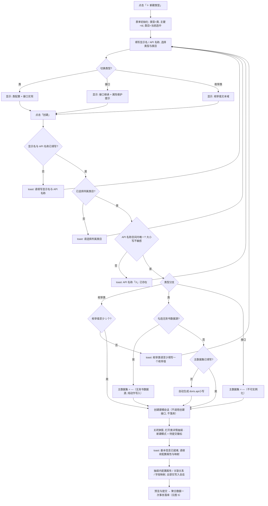
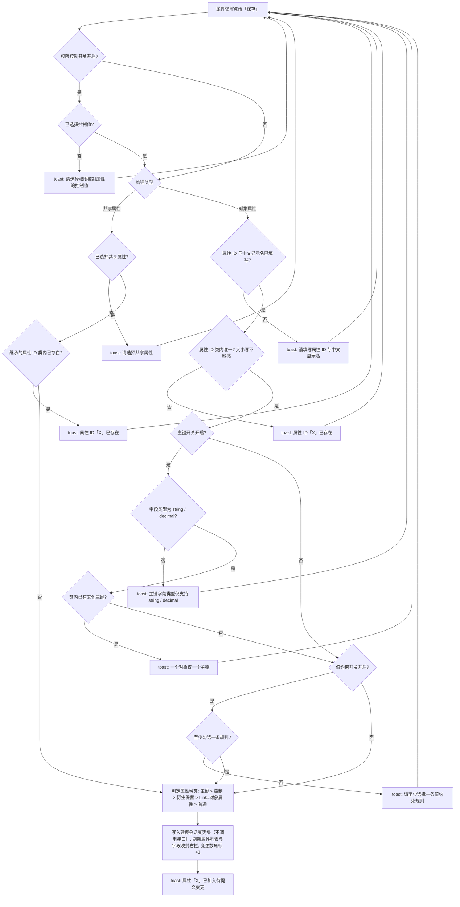
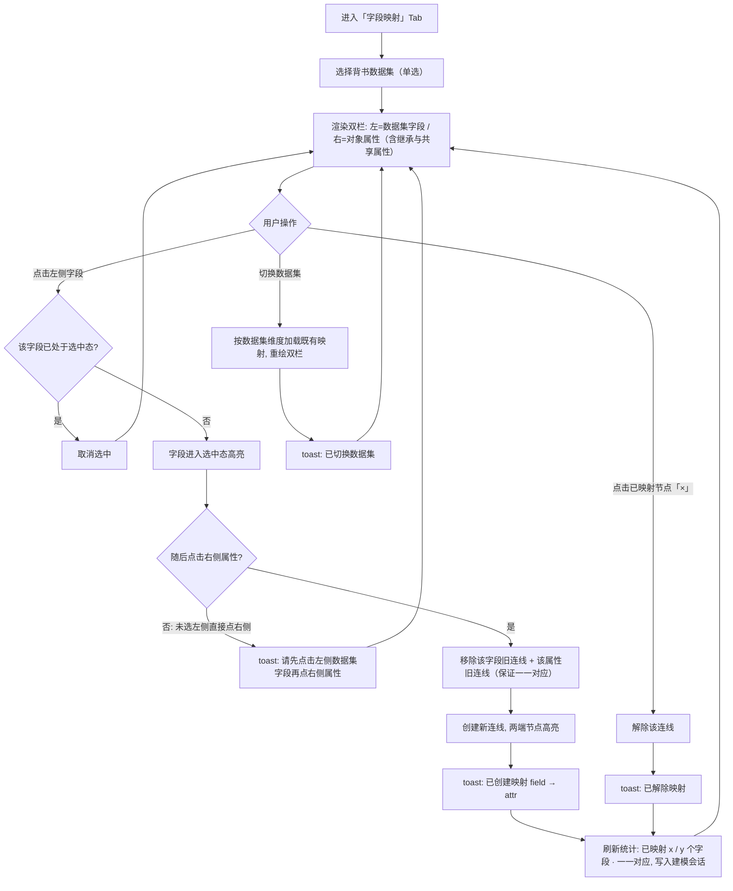
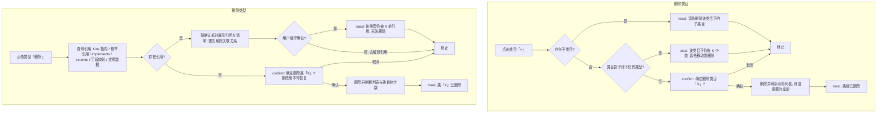
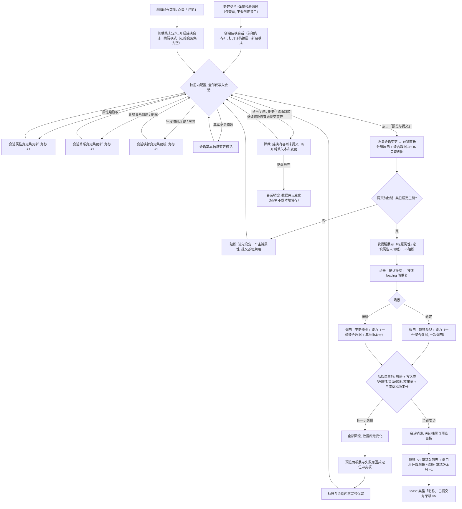

# PRD：本体图谱（类 / 接口 / 枚举类建模）

> 版本：v1.1 ｜ 日期：2026-11-04 ｜ 状态：评审中
>
> 范围：本体资产管理核心页面 **本体图谱**（`ontology/ontology-graph.html`）整页全覆盖，包含功能块：**类目树管理**、**类型列表（列表 / 图谱双视图）**、**新建类型**、**类详情抽屉（基本信息 / 属性管理 / 关联关系配置 / 字段映射 / 对象数据查询）**、**预览与统一提交**。
>
> **保存模型（v1.1 核心口径）**：新建 / 编辑类型**不即时调用接口落库**。创建基本信息后进入**建模会话**（前端内存态），用户在类详情抽屉中继续配置属性、关联关系、字段映射，所有变更仅累积在前端；最终通过「预览与提交」组装为**一份聚合数据**，一次性调用「新建类型」（新建场景）或「更新类型」（编辑场景）能力，后端在**一个事务**内完成全部落库（要么全部成功、要么全部回滚）。
>
> 功能深度口径：**MVP 最小可用版本**。导入（OWL / JSON）、版本发布审批流、图谱视图高级交互（缩放 / 导出 PNG / 节点拖拽）等列入「非目标」。
>
> 关联上游文档：《产品功能设计.md》第 4 章（本体资产管理，4.1 节为本页面概述）。

---

## 1. 引言 / 概述

本体图谱是 Prism 平台本体建模的核心工作台。用户在此页面完成三件事：

1. **定义本体类型**：按业务域类目组织，创建与维护三种类型 —— **类（Object Type，可实例化）**、**接口（Interface，不可实例化，供类 implements / 接口 extends 复用）**、**枚举类（Enum，取值集合）**。对标 Palantir Foundry：**类与类之间不继承，抽象复用仅通过接口实现**。
2. **定义类型的属性**：在类详情抽屉中维护属性（对象属性 / 共享属性两种构建类型），支持值约束规则、权限控制属性、主键设定。
3. **打通数据**：通过「字段映射」将对象属性与背书数据集字段一一连线；通过「对象数据查询」在线验证映射后的实例数据。
4. **一次事务提交**：以上配置全程作为前端**建模会话**中的变更累积，中间步骤不调用任何写入接口；最后通过「预览与提交」组装成一份聚合数据一次性提交，后端在单事务内保证落库的原子性，不产生"类型已建但属性未存"之类的中间状态。

**术语表**（面向初级开发者）：

| 术语 | 含义 |
|---|---|
| 类（Object Type） | 可实例化的本体类型，如「设备 Equipment」，每条实例数据即一个对象 |
| 接口（Interface） | 不可实例化的抽象定义，只含属性契约；类可「实现（implements）」接口、接口可「继承（extends）」接口，从而复用属性 |
| 枚举类（Enum） | 取值受限的字典类型，如「设备类型 EquipmentType：CNC / 注塑机 / SMT」 |
| 类目 | 类型的业务域分组（树形，如 生产域 / 质量域 / 资产域 / 基础类型），仅用于组织与筛选 |
| API 名称 | 类型的英文编程标识（PascalCase），空间内唯一，创建后不可修改 |
| 属性 ID | 属性的英文编程标识，类内唯一（查重时大小写不敏感） |
| 共享属性 | 空间级复用的属性定义（Shared Property Type，见 4.3 节共享属性页），类引用后其属性 ID / 显示名 / 字段类型全部继承、不可改 |
| 背书数据集 | 为对象类提供实例数据的**唯一**数据集；一个类只能选择一个 |
| 字段映射 | 数据集字段 ↔ 对象属性的**一一对应**连线关系 |
| 值约束规则 | 引用自「值约束规则」页（4.5 节）的校验规则，多条规则按 AND 逻辑校验属性取值 |
| 控制属性 | 标记为权限管控的属性（Mandatory Control Property），配置用户范围 + 控制值，查询时统一生效 |
| 主键属性 | 对象唯一标识属性，一个类**仅允许一个**，字段类型仅支持 string / decimal |
| 草稿 / 已发布 | 类型与属性变更的版本状态；MVP 中统一提交成功后生成草稿版本，发布审批流不在本期范围 |
| 建模会话 | 从「新建类型弹窗创建」或「打开已有类型详情」开始，到「提交成功」或「放弃关闭」为止的前端临时变更集合，包含类型基本信息、属性增删改、关联关系增删、字段映射；**仅存于前端内存，中间步骤不调用写入接口**；页面刷新 / 关闭抽屉即丢弃（有拦截提示，MVP 不做本地暂存恢复） |
| 统一提交（单事务） | 将会话内全部变更组装成一份聚合数据，一次性调用「新建类型」（新建场景）或「更新类型」（编辑场景）能力；后端在**同一个事务**内写入类型、属性、关联关系、字段映射、枚举值并生成草稿版本号，任一步失败则整体回滚 |

---

## 2. 目标

- 用户可在一个页面内完成「建类目 → 建类型 → 建属性 → 做映射 → 查数据」的本体建模全链路，无需跳转其他页面。
- 类型创建 **1 次弹窗填写基本信息**后即进入建模会话（不落库），在详情抽屉内一站式完成属性 / 关联关系 / 字段映射配置；API 名称空间内唯一（创建时仅调用查重，不调用创建接口）且创建后不可修改。
- **中间步骤零写入接口调用**：一次建模会话的全部变更在前端累积，最终「预览与提交」一次性提交；后端单事务落库，失败整体回滚且会话内容不丢失。
- 类目树支持两级组织（顶级 + 子类目），节点实时显示该类目（含子孙）下的类型数量；删除类目有严格的前置校验（先清空子类目与类型）。
- 属性管理覆盖 5 种属性种类（普通 / 对象 / 主键 / 控制 / 衍生）与 3 种属性来源（对象自有 / 接口继承 / 共享属性），来源可辨识（徽标区分）。
- 字段映射以**双栏连线**交互完成，一一对应约束由系统自动保证（重复映射自动替换旧连线），已映射进度实时统计。
- 对象数据查询支持按类 + 过滤条件 + Limit 在线查询，返回条数、耗时与数据来源透明可见。
- 所有破坏性操作（删除类型 / 属性 / 类目、解除映射）均有二次确认或前置校验提示。

---

## 3. 用户故事

### US-001：类目树管理
**描述：** 作为本体建模人员，我希望按业务域类目组织类型（新增 / 编辑 / 删除类目），以便在类型数量增多后快速定位。

**验收标准：**
- [ ] 左侧类目树顶部有「＋ 新增类目」入口；每个类目节点 hover 时显示「＋（新增子类目）/ ✎（编辑）/ ×（删除）」操作
- [ ] 类目树首节点为「◈ 全部（N）」，N = 空间内类型总数；各类目节点显示「◆ 名称（N）」，N 含子孙类目下的类型数
- [ ] 点击类目节点即筛选右侧类型列表（选中态高亮）；点击「全部」清除类目筛选
- [ ] 新增 / 编辑弹窗：类目名称必填、同级内名称唯一（重名 toast「类目名称已存在」）；编辑含子类目的类目时「上级类目」下拉禁用并提示「该类目包含子类目，上级不可修改。」
- [ ] 删除类目：存在子类目时 toast「请先删除该类目下的子类目」；类目（含子孙）下仍有类型时 toast「该类目下仍有 N 个类，请先移动或删除」；均满足时弹 confirm「确定删除类目「X」？」
- [ ] 使用 dev-browser 技能在浏览器中验证

### US-002：类型列表与筛选
**描述：** 作为本体建模人员，我希望以表格查看全部类型并按关键字 / 类型 / 状态筛选，以便快速找到目标类型。

**验收标准：**
- [ ] 列表列：显示名、API 名称（等宽字体）、类型（徽标：类=蓝 / 接口=紫 / 枚举类=橙）、所属类目、属性数、状态（草稿=橙 / 已发布=绿）、主数据集、操作
- [ ] 搜索框按「显示名 / API 名称」模糊匹配；类型下拉（全部 / 类 / 接口 / 枚举类）与状态下拉（全部 / 已发布 / 草稿）精确筛选；类目树筛选与三者叠加生效
- [ ] 操作列：详情（打开类详情抽屉）/ 查看图谱（切换至图谱视图并定位该类型）/ 删除（danger 样式）
- [ ] 无结果时显示「暂无符合条件的类」空态行；底部显示「共 N 个类」与分页控件（默认每页 20 条）
- [ ] 使用 dev-browser 技能在浏览器中验证

### US-003：图谱视图
**描述：** 作为本体建模人员，我希望以关系图形式查看类型之间的链接与接口实现关系，以便理解本体全貌。

**验收标准：**
- [ ] 页面右上角「列表视图 / 图谱视图」按钮组切换，默认列表视图，切换状态互斥高亮
- [ ] 图谱视图以 SVG 渲染：实线边 = 对象链接（边上标注关系名与基数，如 `belongs_to 1..n`）、虚线边 = implements / extends、虚线框节点 = 接口（`«interface»` 前缀）、橙色节点 = 枚举类（`«enum»` 前缀）
- [ ] 节点副标题显示「N 属性 · vN」或枚举值摘要
- [ ] MVP 为只读静态布局；缩放 / 导出 PNG / 节点拖拽不实现（按钮点击仅 toast 占位）
- [ ] 使用 dev-browser 技能在浏览器中验证

### US-004：新建类型（进入建模会话）
**描述：** 作为本体建模人员，我希望在弹窗中完成类型基本信息后**不立即落库**，而是直接进入详情抽屉继续建模，以便一次性完成一个类型的全部配置再统一提交。

**验收标准：**
- [ ] 弹窗按「类型」选择动态显隐分区：类 → 显示「类配置」+「接口实现」；接口 → 显示「接口继承」+ 接口属性提示；枚举类 → 显示「枚举配置」
- [ ] 必填校验：显示名、API 名称、类型、所属类目；API 名称空间内唯一（大小写不敏感查重，重名 toast「API 名称「X」已存在」）
- [ ] 枚举类至少填写一个枚举值，否则 toast「枚举类请至少填写一个枚举值」
- [ ] 主数据集留空时自动生成 `doris.{api 名称小写}`；勾选「无背书数据源（纯动作写入）」后主数据集输入框禁用，列表主数据集列显示「—（无背书数据源，纯动作写入）」
- [ ] 接口 / 枚举类不可实例化，主数据集固定显示「—（接口不可实例化）」/「—（内置枚举）」
- [ ] 点击「创建」校验通过后**不调用创建接口**：前端创建**建模会话**，关闭弹窗并直接打开类详情抽屉（新建模式，标题带「待提交」徽标），toast「基本信息已就绪，请继续配置属性与映射」；API 名称查重是此步骤唯一的后端交互
- [ ] 提交前：新类型不出现在类型列表、类目树计数不变化
- [ ] 统一提交成功后（见 US-013）：新类型以「v1 草稿」入列表，类目树计数刷新并定位到所属类目
- [ ] 使用 dev-browser 技能在浏览器中验证

### US-005：类型详情抽屉（建模工作台）
**描述：** 作为本体建模人员，我希望详情抽屉同时承担「查看定义」与「建模工作台」两个角色（步骤引导 + 5 Tab），以便在一次会话内完成全部配置后统一提交。

**验收标准：**
- [ ] 抽屉标题显示「类详情 · {显示名}」+ 类型徽标（如「类 (Object Type)」）
- [ ] 基本信息以描述列表展示：显示名、API 名称（等宽字体）、类型、继承（接口徽标 + implements/extends 标注）、主键属性、标题属性、主数据集、版本（当前已发布版本 + 草稿版本号 + 状态徽标）、描述
- [ ] 抽屉含 5 个 Tab：基本信息 / 属性管理（带待提交变更角标）/ 关联关系配置 / 字段映射 / 对象数据查询；顶部步骤引导条「① 基本信息 → ② 属性配置 → ③ 关联关系 → ④ 字段映射 → ⑤ 预览提交」，步骤可点击自由跳转，已配置完成的步骤显示 ✓
- [ ] 底部按钮：「关闭」「预览与提交」；存在未提交变更时提交按钮带变更数角标（如「预览与提交（7 处变更）」），无变更时置灰（tooltip「暂无待提交变更」）
- [ ] 新建场景（会话未提交）下「对象数据查询」Tab 禁用，tooltip「提交后可用」；编辑场景可查询线上版本数据
- [ ] 点击「预览与提交」打开预览面板（见 US-013）；提交成功后 toast「类型「{名称}」已提交为草稿 vN」
- [ ] 使用 dev-browser 技能在浏览器中验证

### US-006：属性管理列表
**描述：** 作为本体建模人员，我希望在类详情抽屉中查看、搜索、筛选该类全部属性（含继承与共享属性），以便掌握属性全貌。

**验收标准：**
- [ ] 属性列表列：属性标识（等宽字体）、属性名称、属性种类（徽标：普通=灰 / 对象=蓝 / 主键=橙 / 控制=红 / 衍生=紫）、属性来源（徽标：对象=灰 / 接口 · {来源接口}=蓝 / 共享属性 · {来源}=紫）、数据类型、必填（是=绿 / 否=灰）、主键（是=橙 / 否=灰）、操作
- [ ] 搜索框按「属性名称 / 属性 ID / 属性种类」模糊匹配；种类下拉（全部 / 普通属性 / 对象属性 / 主键属性 / 控制属性 / 衍生属性）精确筛选
- [ ] 操作列：编辑 / 删除（danger）/ 查看；「＋ 新建属性」按钮位于筛选行右侧
- [ ] 列表底部统计：「共 N 个属性 · 主键 n · 控制 n · 衍生 n · 对象属性 n」
- [ ] 无结果时显示「暂无符合条件的属性」空态行
- [ ] 使用 dev-browser 技能在浏览器中验证

### US-007：新建 / 编辑 / 查看属性
**描述：** 作为本体建模人员，我希望通过弹窗为类创建对象属性或引用共享属性，并配置值约束、权限控制与主键，以便精确表达业务语义。

**验收标准：**
- [ ] 构建类型以两张卡片单选（对象属性 / 共享属性）：选「共享属性」时隐藏对象属性表单区，显示共享属性下拉；选中具体共享属性后，其属性 ID / 中文显示名 / 字段类型自动回填且**始终只读**
- [ ] 对象属性表单：属性 ID、中文显示名必填；属性 ID 类内唯一（大小写不敏感，重复 toast「属性 ID「X」已存在」）
- [ ] 属性类型三选一联动字段类型候选：原始属性 → 8 种基础类型；对象属性（Link）→ 空间内对象类候选；枚举属性 → 空间内枚举类候选
- [ ] 主键开关开启时：字段类型候选收窄为 string / decimal；若类内已存在主键属性，保存时 toast「一个对象仅一个主键，请先关闭现有主键属性」
- [ ] 值约束开关开启时：展示与字段类型一致的规则多选列表，保存时至少勾选一条，否则 toast「请至少选择一条值约束规则」；多条规则按 AND 逻辑校验
- [ ] 权限控制开关开启时：用户范围（用户名/账号、用户组、角色）与控制值必填，未选控制值 toast「请选择权限控制属性的控制值」；保存后属性种类标记为「控制属性」
- [ ] 查看模式：全部控件禁用、卡片与开关不可点击、隐藏「保存」按钮，标题为「查看属性」
- [ ] 保存成功：属性写入**建模会话**变更集（新增 / 修改 / 删除标记，**不调用属性接口**），列表与字段映射右栏同步刷新，抽屉底部待提交变更数角标 +1，toast「属性「X」已加入待提交变更」
- [ ] 使用 dev-browser 技能在浏览器中验证

### US-008：删除属性
**描述：** 作为本体建模人员，我希望删除不再需要的属性，并在删除前得到明确确认，以便避免误操作。

**验收标准：**
- [ ] 点击「删除」弹出 confirm「确定删除属性「{名称}」（{属性 ID}）？」
- [ ] 确认后属性从列表移除，字段映射中该属性的既有连线同步移除，toast「属性「X」已删除」
- [ ] 删除仅写入**建模会话**变更集（本会话新增的属性直接移出会话；线上已有属性标记「待删除」），提交后在同一事务内生效
- [ ] 接口继承 / 共享属性来源的属性删除语义为「解除引用」，主键属性删除前 toast 提示「请先在编辑中将主键转移至其他属性」（MVP 不允许直接删除主键属性）
- [ ] 使用 dev-browser 技能在浏览器中验证

### US-009：字段映射
**描述：** 作为本体建模人员，我希望为类选择唯一背书数据集，并将数据集字段与对象属性逐一连线，以便对象实例数据有明确来源。

**验收标准：**
- [ ] 数据集下拉为**单选**，旁有提示「仅可选择一个数据集作为当前对象的背书数据集」；切换数据集时重绘双栏与连线，toast「已切换数据集：X」
- [ ] 左栏「数据集字段（N）」显示字段名 + 字段类型；右栏「对象属性（含继承）（N）」显示属性名称 + 属性 ID，接口继承属性带「继承 · {接口}」标签、共享属性带「共享属性」标签
- [ ] 交互：先点击左侧字段（选中态高亮），再点击右侧属性即创建贝塞尔连线；顺序颠倒（未选左侧先点右侧）toast「请先点击左侧数据集字段，再点击右侧对象属性创建映射」
- [ ] 一一对应约束：同一字段或同一属性上的旧连线在创建新连线时自动移除
- [ ] 已映射节点高亮且 hover 显示「×」，点击解除映射（toast「已解除映射」）
- [ ] 顶部实时统计「已映射 x / y 个字段 · 一一对应」；Tab 切换与窗口 resize 后连线正确重绘
- [ ] 映射变更仅写入**建模会话**（不调用映射接口），随统一提交在同一事务内落库；编辑场景下进入 Tab 时加载线上既有映射作为会话初始状态
- [ ] 使用 dev-browser 技能在浏览器中验证

### US-010：对象数据查询
**描述：** 作为本体建模人员，我希望在线查询类的实例数据，以便验证字段映射与数据质量。

**验收标准：**
- [ ] 查询条件行：类选择下拉（仅可实例化的类，接口 / 枚举类不出现在候选中）、过滤条件输入框（placeholder 示例 `status = "运行中"`）、Limit 下拉（50 / 100 / 1000 条）、「执行查询」按钮
- [ ] 结果表格列 = 该类主键属性 + 标题属性 + 已映射的普通属性（等宽字体列头显示属性 ID）
- [ ] 结果底部元信息：「返回 x / N 条」「耗时 xx ms」「数据来源：{数据源名}」
- [ ] 查询失败（语法错误 / 数据源不可达）时表格区显示错误提示，不白屏
- [ ] 新建场景（会话未提交）下本 Tab 禁用并提示「提交后可用」；编辑场景查询基于**线上版本**数据，不含会话内未提交变更
- [ ] 使用 dev-browser 技能在浏览器中验证

### US-011：类型删除
**描述：** 作为空间建模负责人，我希望删除废弃类型时系统先检查引用关系，以便避免破坏其他类型的定义。

**验收标准：**
- [ ] 点击「删除」先查询该类型的引用关系（被其他类的 Link 属性指向、被枚举属性引用、被接口 implements / extends、存在字段映射）
- [ ] 存在引用时弹确认框：「删除类「X」需先解除其关联关系，确定继续？」并列出引用方清单；MVP 口径为**必须解除全部引用后方可删除**
- [ ] 无引用时 confirm「确定删除类「X」？删除后不可恢复。」
- [ ] 删除成功后列表与类目树计数刷新，toast「类「X」已删除」
- [ ] 使用 dev-browser 技能在浏览器中验证

### US-012：关联关系配置（抽屉内联创建）
**描述：** 作为本体建模人员，我希望在抽屉「关联关系配置」Tab 中内联创建涉及本类型的关联关系（Link Type），以便建模类型的同时建立关系，且随统一提交在同一事务内落库。

**验收标准：**
- [ ] Tab 内表格展示涉及本类型的关联关系：关系名称（正向 / 反向语义，等宽字体）、对端类型、基数（源 / 目标）、实现方式、来源徽标（待提交=橙 / 已保存=灰 / 待删除=红删除线）、操作
- [ ] 「＋ 新建关系」打开简化创建弹窗：目标类型（单选，类或接口）、正向语义 / 反向语义（snake_case，组合查重）、源 / 目标基数（1..1 / 1..n / 0..n）、实现方式（外键关联 / 多对多关联表 / 图边 / 衍生关联）；完整字段口径复用《关联关系》PRD
- [ ] 实现方式为外键关联时：源字段候选 = **会话当前属性列表（含本次新增未提交的属性）**，目标字段固定为对端类型主键；类型不兼容 toast「外键字段类型与目标主键不兼容」
- [ ] 点击「确定」校验通过后关系仅写入**建模会话**（不调用关系接口），列表新增「待提交」行，变更数角标 +1，toast「关系「{X}」已加入待提交变更」
- [ ] 会话内新增的关系可编辑 / 删除（直接移出会话，无需确认）；删除**已保存**的关系需二次确认「删除关系「{X}」将随本次变更一并提交生效」，确认后标记「待删除」
- [ ] 关系随「预览与提交」与类型 / 属性 / 映射一并组装进聚合数据，同一事务落库
- [ ] 使用 dev-browser 技能在浏览器中验证

### US-013：预览与统一提交（单事务落库）
**描述：** 作为本体建模人员，我希望提交前集中预览本次会话的全部变更，并以一个事务一次性落库，以便类型定义完整一致、不产生中间状态。

**验收标准：**
- [ ] 点击「预览与提交」打开预览面板：按「类型基本信息 / 属性（新增 n · 修改 n · 删除 n）/ 关联关系（新增 n · 删除 n）/ 字段映射（n 组）/ 枚举值」分组展示全部变更，逐条带操作类型标记（新增=绿 / 修改=蓝 / 删除=红）
- [ ] 提供可折叠的「聚合数据（JSON）」只读代码块，展示将要提交的完整数据，便于审查与排障
- [ ] 提交前校验：类必须已设定主键属性（**阻断**，提示「请先在属性管理中设定一个主键属性」）；未设标题属性、必填属性未映射为**软提醒**（黄色提示，不阻断）
- [ ] 点击「确认提交」：新建场景调用「新建类型」能力、编辑场景调用「更新类型」能力，均为**一份聚合数据、一次调用**；按钮进入 loading 态防重复提交
- [ ] 后端在**一个事务**内完成：类型基本信息、属性集、关联关系、字段映射、枚举值写入与草稿版本号生成；任一步失败**全部回滚**，不产生部分落库
- [ ] 提交成功：关闭抽屉与预览面板；新建场景新类型以「v1 草稿」入列表、类目树计数刷新并定位所属类目；编辑场景草稿版本号 +1；toast「类型「{名称}」已提交为草稿 vN」
- [ ] 提交失败（校验不过 / 唯一性冲突 / 版本冲突 / 系统错误）：事务回滚，预览面板展示失败原因并**定位到具体冲突项**（如「API 名称 Supplier 已存在」「该类型已被他人更新，请刷新比对后重新提交」）；抽屉与会话内容完整保留，可修改后重新提交
- [ ] 会话存在未提交变更时关闭抽屉 / 刷新 / 路由跳转：拦截提示「建模内容尚未提交，离开将丢失本次变更」（MVP 无本地暂存，丢弃后不可恢复）
- [ ] 使用 dev-browser 技能在浏览器中验证

---

## 4. 业务逻辑说明

### 4.1 业务流程文字说明

#### 流程 A：新建类型（进入建模会话，不调用创建接口）

1. 用户点击页面右上角「＋ 新建类型」→ 打开弹窗，表单初始化：类型默认「类」，主键属性默认 `id`，所属类目默认取当前类目树选中项（无选中则取第一个类目；空间内无类目时下拉显示「请先创建类目」且无法提交），implements / extends 候选来自空间内全部接口。
2. 用户填写显示名、API 名称，选择类型（类 / 接口 / 枚举类）与所属类目；切换类型时表单分区动态显隐（类 → 类配置 + 接口实现；接口 → 接口继承 + 提示文案「接口属性可在创建后于接口详情的属性管理中维护」；枚举类 → 枚举值文本域）。
3. 用户点击「创建」，系统按顺序校验（其中 API 名称唯一性为后端**查重**交互，是本流程唯一的后端调用；**不调用创建接口**）：
   - 显示名 / API 名称为空 → toast「请填写显示名与 API 名称」，停留弹窗；
   - 所属类目为空 → toast「请选择所属类目」，停留弹窗；
   - API 名称与空间内既有类型重复（**大小写不敏感**）→ toast「API 名称「X」已存在」，停留弹窗；
   - 类型为枚举类且枚举值文本域为空 → toast「枚举类请至少填写一个枚举值」，停留弹窗。
4. 校验通过后按类型分支处理主数据集：
   - 类：勾选「无背书数据源」→ 主数据集记为「—（无背书数据源，纯动作写入）」；未勾选 → 取用户输入，留空自动生成 `doris.{api 小写}`；
   - 接口：固定「—（不可实例化）」；枚举类：固定「—（内置枚举）」。
5. 校验通过：**不调用创建接口、不落库**。前端创建**建模会话**（内存态），会话初始内容 = 刚填写的基本信息（含 implements / extends、枚举值、主数据集）；弹窗关闭，直接打开类详情抽屉（新建模式：标题「新建{类型} · {显示名}」+「待提交」徽标），toast「基本信息已就绪，请继续配置属性与映射」。
6. 提交前：新类型不出现在类型列表，类目树计数不变；用户在抽屉内按步骤引导条继续配置属性（流程 B）、关联关系（流程 G）、字段映射（流程 C），全部变更只写入会话。
7. 用户完成配置后点击「预览与提交」走流程 H：聚合数据一次性调用「新建类型」能力，后端单事务落库，成功后新类型以「v1 草稿」入列表、类目树计数刷新、类目筛选定位到所属类目。

#### 流程 B：创建 / 编辑属性（弹窗保存）

1. 用户在类详情抽屉「属性管理」Tab 点击「＋ 新建属性」（或行内「编辑」）→ 打开属性弹窗；编辑时全部既有配置回显；「查看」入口打开只读模式（控件禁用、隐藏保存按钮）。
2. 用户选择构建类型：
   - **对象属性**（默认）：显示属性 ID / 中文显示名 / 属性类型 / 字段类型 / 默认值 / 必填 / 值约束 / 主键 / 备注等全部对象属性表单区；
   - **共享属性**：隐藏对象属性表单区，显示共享属性下拉；选中后属性 ID、中文显示名、字段类型自动继承展示且只读；切换回对象属性时值约束与主键开关自动复位为关。
3. 用户切换「属性类型」→ 字段类型候选联动：原始属性 → string / integer / long / double / decimal / boolean / date / timestamp（若主键开关开启则收窄为 string / decimal）；对象属性（Link）→ 空间内对象类列表；枚举属性 → 空间内枚举类列表。
4. 用户点击「保存」，系统按顺序校验：
   - 权限控制开关开启但未选控制值 → toast「请选择权限控制属性的控制值」；
   - 构建类型 = 共享属性：未选择共享属性 → toast「请选择共享属性」；共享属性对应的属性 ID 已存在于本类 → toast「属性 ID「X」已存在」；
   - 构建类型 = 对象属性：属性 ID / 中文显示名为空 → toast「请填写属性 ID 与中文显示名」；属性 ID 类内重复（大小写不敏感）→ toast「属性 ID「X」已存在」；主键开关开启且字段类型不属于 string / decimal → toast「主键字段类型仅支持 string / decimal」；主键开关开启且类内已有其他主键 → toast「一个对象仅一个主键，请先关闭现有主键属性」；值约束开关开启但未勾选任何规则 → toast「请至少选择一条值约束规则」。
5. 校验通过：属性种类自动判定（主键开 → 主键属性；权限控制开 → 控制属性；Link → 对象属性；编辑时保留原衍生属性标记；否则普通属性）；属性来源保留（接口继承属性编辑后仍标记接口来源）。
6. 保存成功：写入**建模会话**的属性变更集（带新增 / 修改 / 删除标记，**不调用属性接口**），弹窗关闭，属性列表与字段映射右栏同步刷新，抽屉底部待提交变更数角标更新，toast「属性「X」已加入待提交变更」。属性 ID 类内查重、Link 目标类 / 枚举类候选、共享属性候选、值约束规则候选等**只读查询**仍正常调用后端。

#### 流程 C：字段映射（连线 / 解除）

1. 用户进入类详情抽屉「字段映射」Tab：数据集下拉回显当前背书数据集（单选，候选来自数据资产模块已接入的数据集）；左栏渲染该数据集全部字段（字段名 + 类型），右栏渲染该类全部属性（含接口继承与共享属性，带来源标签）。
2. 用户切换数据集：既有映射按数据集维度独立保存（切换不清空其他数据集的映射；编辑场景初始加载线上映射进入会话，新建场景初始为空），双栏与连线重绘，toast「已切换数据集：X」。
3. 创建映射：用户点击左侧字段 → 该节点进入选中态（再次点击取消选中）→ 点击右侧属性 → 系统先移除「该字段已有的旧连线」与「该属性已有的旧连线」（保证一一对应）→ 创建新连线，两端节点高亮为已映射态，toast「已创建映射：{字段} → {属性}」。
4. 顺序颠倒：未选中左侧字段直接点击右侧属性 → toast「请先点击左侧数据集字段，再点击右侧对象属性创建映射」，不产生连线。
5. 解除映射：hover 已映射节点显示「×」，点击即移除对应连线（从左栏或右栏点击效果一致），toast「已解除映射」。
6. 每次连线变化后：顶部统计刷新「已映射 x / y 个字段 · 一一对应」；映射关系写入**建模会话**（**不调用映射接口**），变更数角标更新。
7. Tab 激活、窗口 resize 时 SVG 连线按节点实际位置重绘。

#### 流程 D：删除类目

1. 用户 hover 类目节点点击「×」。
2. 校验一：该类目存在子类目 → toast「请先删除该类目下的子类目」，流程终止。
3. 校验二：该类目（含子孙类目）下仍有类型 → toast「该类目下仍有 N 个类，请先移动或删除」，流程终止。
4. 校验通过：弹 confirm「确定删除类目「X」？」→ 确认后删除，若当前类目筛选正指向该类目则重置为「全部」，类目树与列表刷新，toast「类目已删除」。

#### 流程 E：删除类型

1. 用户点击类型行「删除」→ 系统先查询该类型的引用关系（被 Link 属性指向 / 被枚举属性引用 / 被接口 implements 或 extends / 存在字段映射 / 存在对象实例数据）。
2. 存在引用 → 弹确认框「删除类「X」需先解除其关联关系，确定继续？」并展示引用方清单；MVP 口径：用户必须先逐一解除引用（或迁移主键 / 修改引用属性）后方可删除，强行确认时仍拦截并 toast「该类型仍被 N 处引用，无法删除」。
3. 无引用 → confirm「确定删除类「X」？删除后不可恢复。」→ 确认后删除，列表与类目树计数刷新，toast「类「X」已删除」。

#### 流程 F：对象数据查询

1. 用户在「对象数据查询」Tab 选择类（候选仅含可实例化的类，默认当前抽屉类）、输入过滤条件（简单表达式，如 `status = "运行中"`，可为空 = 不过滤）、选择 Limit（默认 50 条）。
2. 点击「执行查询」→ 校验过滤条件表达式语法 → 语法错误：结果区显示错误提示「过滤条件语法错误：{原因}」，不发起查询。
3. 语法正确 → 按该类的背书数据集与字段映射翻译查询 → 数据源不可达 / 超时：结果区显示「查询失败：{原因}」+「重试」按钮。
4. 查询成功 → 表格渲染结果行（枚举值属性以彩色徽标展示），底部元信息展示「返回 x / N 条」「耗时 xx ms」「数据来源：{数据源名}」。
5. 控制属性按当前用户权限过滤列（无权限的列不展示，MVP 仅做列级隐藏）。
6. **新建场景（会话未提交）本 Tab 禁用**，点击提示「提交后可用」；编辑场景查询结果基于线上版本数据，不含会话内未提交变更。

#### 流程 G：关联关系配置（抽屉内联创建）

1. 用户进入「关联关系配置」Tab：列表展示涉及本类型的关联关系（编辑场景加载已保存关系，来源徽标「已保存」；会话内新增的关系徽标「待提交」；标记删除的徽标「待删除」+ 删除线）。
2. 点击「＋ 新建关系」→ 简化创建弹窗：目标类型（单选，类或接口；源类型固定为当前类型）、正向语义 / 反向语义（snake_case，「源类型 + 正向语义」组合查重，复用《关联关系》PRD 字段口径）、源 / 目标基数（1..1 / 1..n / 0..n）、实现方式（外键关联 / 多对多关联表 / 图边 / 衍生关联）。
3. 实现方式 = 外键关联：源字段候选 = **会话当前属性列表（含本次新增未提交的属性）**；目标字段固定为对端类型主键；类型不兼容 → toast「外键字段类型与目标主键不兼容」。
4. 点击「确定」：校验通过后关系写入**建模会话**（**不调用关系接口**），列表新增「待提交」行，变更数角标 +1，toast「关系「{X}」已加入待提交变更」。
5. 会话内新增的关系可编辑 / 删除（直接移出会话，无需确认）；删除已保存关系需二次确认「删除关系「{X}」将随本次变更一并提交生效」，确认后标记「待删除」变更。
6. 关系随流程 H 与类型 / 属性 / 映射一并组装进聚合数据，同一事务落库。

#### 流程 H：预览与统一提交（聚合数据 · 单事务）

1. 用户点击抽屉底部「预览与提交」→ 前端收集会话全部变更，打开预览面板：按「类型基本信息 / 属性（新增 n · 修改 n · 删除 n）/ 关联关系（新增 n · 删除 n）/ 字段映射（n 组）/ 枚举值」分组展示，每条变更带操作类型色标（新增=绿 / 修改=蓝 / 删除=红，修改项可展开原值 → 新值对比）；提供可折叠的「聚合数据（JSON）」只读代码块。
2. 提交前校验（前端）：
   - 类未设定主键属性 → **阻断**，预览面板顶部红色提示「请先在属性管理中设定一个主键属性」，「确认提交」按钮禁用；
   - 未设标题属性、必填属性未建立字段映射 → 黄色软提醒，不阻断提交。
3. 用户点击「确认提交」→ 按钮进入 loading 态（防重复提交）：
   - 新建场景：组装聚合数据调用「新建类型」能力；
   - 编辑场景：组装聚合数据（含变更标记与基准版本号）调用「更新类型」能力。
4. 后端在**一个事务**内执行：服务端校验（唯一性 / 引用完整性 / 外键兼容性 / 版本一致性）→ 写入类型基本信息、属性集、关联关系、字段映射、枚举值 → 生成草稿版本号；**任一步失败全部回滚**，返回可定位到具体条目的错误信息。
5. 提交成功：关闭抽屉与预览面板、会话销毁；新建场景 → 新类型以「v1 草稿」入列表、类目树计数刷新、类目筛选定位到所属类目；编辑场景 → 草稿版本号 +1；toast「类型「{名称}」已提交为草稿 vN」。
6. 提交失败：事务回滚，数据库无任何变化；预览面板展示失败原因并定位冲突项（如「API 名称 Supplier 已存在」「关系 uses 与既有定义冲突」「该类型已被他人更新，请刷新比对后重新提交」）；**抽屉与会话内容完整保留**，用户修改后可重新提交。
7. 会话存在未提交变更时：点击「关闭」/ 刷新页面 / 路由跳转 → 拦截提示「建模内容尚未提交，离开将丢失本次变更，确认放弃吗？」（按钮：放弃变更 / 继续编辑）；MVP 不做本地暂存，放弃后不可恢复。

#### 流程 I：编辑已有类型（与新建同一套会话模型）

1. 用户点击类型行「详情」→ 系统加载该类型线上定义（基本信息 / 属性 / 关系 / 映射），打开抽屉（编辑模式），同时开启**建模会话**：会话初始状态 = 线上定义，变更集为空，「预览与提交」按钮置灰。
2. 用户修改基本信息、增删改属性、增删关系、调整映射 → 全部只写入会话变更集（带新增 / 修改 / 删除标记），**不逐条调用接口**；提交按钮角标实时显示变更数。
3. 「预览与提交」面板仅展示相对线上版本的**变更差异**；确认后调用「更新类型」能力单事务落库（流程 H）。
4. 提交时后端校验版本一致性：若该类型已被他人提交新版本 → 返回冲突错误，会话保留，提示「该类型已被他人更新，请刷新比对后重新提交」。
5. 放弃变更：点击「关闭」并确认放弃 → 会话销毁，线上数据不变。

### 4.2 业务流程图（Mermaid）

#### 图 1：新建类型校验流程（对应 4.1 流程 A）

#### 图 2：创建 / 编辑属性校验流程（对应 4.1 流程 B）

#### 图 3：字段映射连线流程（对应 4.1 流程 C）

#### 图 4：删除类目 / 删除类型校验流程（对应 4.1 流程 D / E）

#### 图 5：建模会话与统一提交流程（对应 4.1 流程 A / G / H / I）

### 4.3 原型图

@docs/prototype/ontology/ontology-graph.html

原型已产出，为本 PRD 的视觉基准。**⚠️ 原型与 v1.1 保存模型存在差异，需同步更新**（详见「待解决问题」#7）：

| 差异点 | 原型现状 | v1.1 目标 |
|--------|---------|----------|
| 新建类型弹窗「创建」 | 前端数据直接入列表 | 不调用创建接口，进入建模会话并打开详情抽屉（新建模式） |
| 抽屉 Tab | 4 个（基本信息 / 属性管理 / 字段映射 / 对象数据查询） | 5 个（新增「关联关系配置」）+ 顶部步骤引导条 |
| 抽屉底部按钮 | 「关闭」「保存变更」 | 「关闭」「预览与提交（n 处变更）」 |
| 预览与提交面板 | 无 | 新增（变更分组 + 聚合数据 JSON 只读视图 + 确认提交） |
| 属性 / 映射操作 toast | 「已保存为草稿变更」 | 「已加入待提交变更」 |

页面结构：

- 页面头：面包屑「智能制造空间 / 本体资产管理 / 本体图谱」+ 标题描述 + 操作区（列表 / 图谱视图切换按钮组、「导入」按钮（MVP 占位）、「＋ 新建类型」主按钮）。
- 列表视图：左「类目树」卡片（宽 250px）+ 右「类型列表」卡片（搜索 / 筛选 / 表格 / 分页）。
- 图谱视图：SVG 关系图卡片（只读）。
- 类详情抽屉（右侧滑出，建模工作台）：步骤引导条 + 5 Tab（基本信息 / 属性管理 / 关联关系配置 / 字段映射 / 对象数据查询）+ 底部「关闭」「预览与提交（n 处变更）」。
- 弹窗：类目新增 / 编辑（小弹窗）、新建类型（560px）、属性新建 / 编辑 / 查看（大弹窗）、新建关系（中弹窗）、预览与提交（大面板）。

### 4.4 原型字段与交互说明

#### （a）新建类型弹窗（560px，分区：基本信息 → 类配置 / 枚举配置 / 接口实现 / 接口继承 → 描述）

| 字段名 | 控件类型 | 是否必填 | 校验规则 | 默认值 | 备注 |
|--------|---------|---------|---------|--------|------|
| 显示名 | 输入框 Input | 是 | 长度 1~50 字符；不允许纯空格 | 空 | placeholder「如：供应商」 |
| API 名称 | 输入框 Input | 是 | **PascalCase**：大写字母开头，仅允许大小写字母与数字，不允许 `-`、`_`、`.`、空格与中文；长度 2~64；空间内唯一（大小写不敏感，失焦 / 提交时查重）；**创建后不可修改**；错误提示「API 名称只能包含字母和数字，且以大写字母开头」。正例：`Supplier`、`QualityReport`；反例：`supplier`、`Quality_Report`、`供应商` | 空 | 提示文案「PascalCase，空间内唯一，创建后不可修改」 |
| 类型 | 下拉框 Select | 是 | 单选：类 / 接口 / 枚举类；切换时动态显隐下方分区 | 类 | — |
| 所属类目 | 下拉框 Select | 是 | 单选；候选 = 顶级类目 + 缩进（全角空格）显示的子类目；空间内无类目时显示「请先创建类目」且提交拦截 | 当前类目树选中项 | — |
| 主键属性 | 输入框 Input | 否 | 类的属性 API 名称；创建时可先占位，后续在属性管理中通过主键开关落地 | `id` | 仅「类」显示 |
| 标题属性 | 输入框 Input | 否 | 类的属性 API 名称，如 `name` | 空 | 仅「类」显示 |
| 主数据集 | 输入框 Input | 否 | 留空自动生成 `doris.{api 小写}`；勾选「无背书数据源」时禁用 | 空 | 提示「可在详情『数据映射』中调整」；仅「类」显示 |
| 无背书数据源 | 复选框 Checkbox | 否 | 勾选后主数据集输入框禁用，类型标记为「纯动作写入」 | 不勾选 | 仅「类」显示 |
| 枚举值 | 文本域 Textarea | 是（枚举类） | 每行一个值；至少 1 个；行间自动去重、去除首尾空格；单值长度 ≤ 64 | 空 | placeholder 示例 CNC / 注塑机 / SMT；仅「枚举类」显示 |
| 实现接口（implements） | 下拉框 Select | 否 | 单选；候选 = 空间内全部接口；首项「— 不实现接口 —」 | 不实现 | 仅「类」显示 |
| 继承接口（extends） | 下拉框 Select | 否 | 单选；候选 = 空间内全部接口；首项「— 不继承接口 —」 | 不继承 | 仅「接口」显示 |
| 描述 | 文本域 Textarea | 否 | 最大 500 字符 | 空 | placeholder「类的业务含义说明」 |

按钮：底部右对齐「取消 ｜ 创建」。「创建」校验通过后**不调用创建接口**，创建建模会话并直接打开类详情抽屉（新建模式，见流程 A / H）。取消 / 点击遮罩关闭时若已填写内容，弹拦截提示（见 4.5）。

#### （b）类目新增 / 编辑弹窗（小弹窗）

| 字段名 | 控件类型 | 是否必填 | 校验规则 | 默认值 | 备注 |
|--------|---------|---------|---------|--------|------|
| 类目名称 | 输入框 Input | 是 | 长度 1~30 字符；不允许纯空格；同级内唯一（重名 toast「类目名称已存在」） | 空（编辑时回显） | placeholder「如：供应链域」 |
| 上级类目 | 下拉框 Select | 否 | 单选：顶级类目 / 各顶级类目；候选中排除自身（防环） | 顶级类目（从节点「＋」进入时预选该节点且禁用） | **编辑含子类目的类目时禁用**，下方提示「该类目包含子类目，上级不可修改。」 |

按钮：底部右对齐「取消 ｜ 确定」。

#### （c）属性新建 / 编辑 / 查看弹窗（大弹窗）

| 字段名 | 控件类型 | 是否必填 | 校验规则 | 默认值 | 备注 |
|--------|---------|---------|---------|--------|------|
| 构建类型 | 卡片单选（2 张） | 是 | 对象属性 / 共享属性；切换时联动显隐表单区，切至共享属性时值约束与主键开关自动复位为关 | 对象属性 | 卡片含名称 + 副标题说明 |
| 共享属性 | 下拉框 Select（可搜索） | 是（共享属性时） | 单选；候选 = 空间内共享属性定义；选中后属性 ID / 中文显示名 / 字段类型自动继承展示且**始终只读** | 空 | 提示「选择后属性 ID、中文显示名等参数将继承共享属性定义，仅作展示不可编辑」 |
| 属性 ID | 输入框 Input | 是（对象属性时） | 小写字母开头，仅允许小写字母 / 数字 / 下划线（snake_case），**大小写不敏感查重**、类内唯一；长度 2~64；不允许中文、`-`、`.`、空格；错误提示「属性 ID 只能包含小写字母、数字和下划线」。正例：`equipment_id`、`order_no`；反例：`Equipment-Id`、`订单号` | 空 | placeholder「例如：orderNo」按 snake_case 规范收敛为 `order_no`；**编辑时只读** |
| 中文显示名 | 输入框 Input | 是（对象属性时） | 长度 1~50 字符；不允许纯空格 | 空 | placeholder「例如：订单编号」 |
| 属性类型 | 下拉框 Select | 是（对象属性时） | 单选：原始属性 / 对象属性（Link）/ 枚举属性；切换联动字段类型候选 | 原始属性 | — |
| 字段类型 | 下拉框 Select | 是（对象属性时） | 原始属性 → string / integer / long / double / decimal / boolean / date / timestamp；Link → 空间内对象类；枚举 → 空间内枚举类；主键开关开启时收窄为 string / decimal | string | — |
| 默认值 | 输入框 Input | 否 | 需与字段类型兼容（不兼容时提交 toast「默认值与字段类型不匹配」） | 空 | — |
| 是否必填 | 复选框 Checkbox | 否 | — | 不勾选 | — |
| 值约束规则 | 开关 Switch + 规则多选列表 | 开关开启后至少选 1 条 | 候选仅展示与字段类型一致的规则（引用「值约束规则」页定义）；多条规则按 AND 逻辑校验 | 关 | 列表项 = 规则名 + 规则编号（等宽字体） |
| 权限控制属性 | 开关 Switch + 用户范围 / 控制值 | 开关开启后两项必填 | 用户范围单选：用户名/账号、用户组、角色；控制值候选随范围联动 | 关 | 开启后属性种类标记为「控制属性」 |
| 设定为主键 | 开关 Switch | 否 | 开启后字段类型仅 string / decimal；一个类仅允许一个主键（冲突时保存拦截） | 关 | 提示文案见原型 |
| 备注 | 文本域 Textarea | 否 | 最大 500 字符 | 空 | — |

查看模式：标题「查看属性」，全部控件禁用、卡片与开关不可点击、隐藏「保存」按钮（继承参数在任何模式下均只读）。按钮：底部右对齐「取消 ｜ 保存」（查看模式仅「取消」→「关闭」）。

#### （d）类型列表页说明

| 列名 | 字段来源 | 展示形式 | 排序 | 备注 |
|------|---------|---------|------|------|
| 显示名 | name | 加粗文本 | — | — |
| API 名称 | apiName | 等宽字体文本 | — | — |
| 类型 | kind | 徽标 Badge（类=蓝 / 接口=紫 / 枚举类=橙） | — | — |
| 所属类目 | category | 文本（类目名） | — | — |
| 属性数 | propCount | 数字 | — | 含继承与共享属性 |
| 状态 | status | 徽标 Badge（vN 已发布=绿 / vN 草稿=橙） | — | — |
| 主数据集 | dataset | 等宽字体小字号 | — | 接口 / 枚举类显示「—（不可实例化）」等占位文案 |
| 操作 | — | 详情 / 查看图谱 / 删除 | — | 删除为 danger 样式；按空间角色权限显隐（Reporter 只读） |

搜索条件：

| 搜索项 | 控件 | 搜索方式 | 说明 |
|--------|------|---------|------|
| 显示名 / API 名称 | 输入框 | 模糊搜索（LIKE，不区分大小写） | 单框同时匹配两个字段 |
| 类型 | 下拉框 | 精确搜索（=） | 全部 / 类 / 接口 / 枚举类 |
| 状态 | 下拉框 | 精确搜索（包含匹配版本号文案） | 全部 / 已发布 / 草稿 |
| 所属类目 | 左侧类目树点选 | 子树 IN 查询 | 选中类目含其全部子孙类目；「全部」清除 |

搜索区交互：关键字输入即时过滤；下拉切换即时生效；分页默认每页 20 条，底部显示「共 N 个类」。

**展示形态说明**：本页提供「列表视图 / 图谱视图」切换（右上角按钮组，默认列表视图）。列表视图 = 上述表格；图谱视图 = SVG 关系图（节点：类型卡片，显示名 + API 名称 + 「N 属性 · vN」副标题；边：对象链接实线 + 关系名与基数标注、implements / extends 虚线；接口节点虚线框、枚举类节点橙色）。图谱视图为**关系拓扑展示**而非卡片列表，故不再提供「卡片视图」——类型管理为高频表格操作场景，表格信息密度更优。

#### （e）属性管理列表说明（抽屉 Tab）

| 列名 | 字段来源 | 展示形式 | 备注 |
|------|---------|---------|------|
| 属性标识 | apiName | 等宽字体 | — |
| 属性名称 | name | 加粗文本 | — |
| 属性种类 | kind | 徽标（普通=灰 / 对象=蓝 / 主键=橙 / 控制=红 / 衍生=紫） | — |
| 属性来源 | source | 徽标（对象=灰 /「接口 · Asset」=蓝 /「共享属性 · assetNo」=紫） | 继承与共享来源标注出处 |
| 数据类型 | type | 等宽小字号（如 `String`、`Enum: RunStatus`、`Link → Process[]`） | — |
| 必填 | required | 徽标（是=绿 / 否=灰） | — |
| 主键 | pk | 徽标（是=橙 / 否=灰） | — |
| 操作 | — | 编辑 / 删除 / 查看 | 主键属性「删除」置灰（tooltip「请先转移主键」） |

搜索条件：关键字输入框（属性名称 / 属性 ID / 属性种类，模糊）+ 属性种类下拉（精确）。底部统计行：「共 N 个属性 · 主键 n · 控制 n · 衍生 n · 对象属性 n」。

#### （f）字段映射说明（抽屉 Tab）

- 顶部工具行：数据集单选下拉（宽 280px）+ 提示「仅可选择一个数据集作为当前对象的背书数据集」+ 右侧统计「已映射 x / y 个字段 · 一一对应」。
- 双栏布局（左右各一栏，中缝 110px 用于绘制 SVG 贝塞尔连线）：
  - 左栏「数据集字段（N）」：节点 = 字段名（等宽）+ 字段类型；
  - 右栏「对象属性（含继承）（N）」：节点 = 属性名称（加粗）+ 属性 ID（等宽）+ 来源标签（「继承 · {接口}」紫色小标 / 「共享属性」小标）。
- 节点状态：默认 / 选中（蓝框 + 光晕）/ 已映射（蓝框 + 浅蓝底 + hover 显示「×」）。
- 底部操作说明文案：「先点击左侧数据集字段，再点击右侧对象属性，即创建一一对应的映射连线；点击已映射节点上的『×』可解除映射。」

#### （g）对象数据查询说明（抽屉 Tab）

| 控件 / 列 | 类型 | 规则 |
|--------|------|------|
| 类选择 | 下拉框 | 候选仅含可实例化的类；默认当前抽屉类 |
| 过滤条件 | 输入框 | 简单表达式（如 `status = "运行中"`）；可为空；语法错误时结果区提示 |
| Limit | 下拉框 | 50 / 100 / 1000 条，默认 50 |
| 执行查询 | 主按钮 | 点击后按钮进入 loading 态直至返回 |
| 结果表格 | 表格 | 列 = 主键 + 标题 + 已映射属性（列头等宽字体显示属性 ID）；枚举值以彩色徽标展示；控制属性按权限隐藏列 |
| 元信息 | 文本行 | 「返回 x / N 条」「耗时 xx ms」「数据来源：{数据源名}」 |

新建场景（会话未提交）本 Tab 整体禁用，点击提示「提交后可用」；编辑场景查询基于线上版本数据，不含会话内未提交变更。

#### （h）关联关系配置说明（抽屉 Tab）

- 列表列：关系名称（正向 / 反向语义，等宽字体，如 `uses / used_by`）、对端类型（类型徽标 + 显示名）、基数（源 / 目标，如 `1..n / 0..n`）、实现方式（外键关联 / 关联表 / 图边 / 衍生关联）、来源徽标（**待提交**=橙 / **已保存**=灰 / **待删除**=红 + 删除线）、操作。
- 「＋ 新建关系」弹窗字段（简化版，完整能力见《关联关系》PRD）：

| 字段名 | 控件类型 | 是否必填 | 校验规则 | 默认值 | 备注 |
|--------|---------|---------|---------|--------|------|
| 源类型 | 只读文本 | — | 固定为当前抽屉类型 | 当前类型 | 不可修改 |
| 目标类型 | 下拉框 Select（可搜索） | 是 | 单选；候选 = 空间内其他类与接口（新建场景含"本次会话尚未提交的类型"以外的全部已保存类型） | 空 | — |
| 正向语义 | 输入框 Input | 是 | **snake_case**：小写字母开头，仅小写字母 / 数字 / 下划线，长度 2~64；「源类型 + 正向语义」组合空间内查重；正例 `belongs_to`，反例 `Belongs-To`、`belongs to` | 空 | 如 `uses` |
| 反向语义 | 输入框 Input | 是 | 同正向语义规则；不可与正向语义相同 | 空 | 如 `used_by` |
| 源基数 / 目标基数 | 下拉框 Select × 2 | 是 | 单选：1..1 / 1..n / 0..n | 1..n / 0..n | — |
| 实现方式 | 单选卡片 | 是 | 外键关联 / 多对多关联表 / 图边 / 衍生关联 | 外键关联 | — |
| 源字段 | 下拉框 Select | 是（外键关联时） | 候选 = **会话当前属性列表（含本次新增未提交属性）**；须与对端类型主键类型兼容，不兼容 toast「外键字段类型与目标主键不兼容」 | 空 | 目标字段固定为对端主键，只读展示 |

- 操作列：待提交关系 →「编辑 / 删除」（直接移出会话，无需确认）；已保存关系 →「查看 / 删除」（二次确认，标记「待删除」变更）。
- 弹窗按钮：底部右对齐「取消 ｜ 确定」；确定后写入会话，toast「关系「{X}」已加入待提交变更」。

#### （i）预览与提交面板说明

- 形态：大弹窗 / 全屏面板，标题「预览与提交 · {类型显示名}」+ 场景徽标（新建=橙「待提交」/ 编辑=蓝「变更提交」）。
- 变更分组区（按序）：① 类型基本信息（字段级 原值 → 新值 对比）② 属性（小计「新增 n · 修改 n · 删除 n」+ 行级清单）③ 关联关系（新增 n · 删除 n）④ 字段映射（n 组，字段 → 属性 摘要两栏）⑤ 枚举值（枚举类场景）。
- 每行变更标记：新增=绿徽标 / 修改=蓝徽标（可展开原值 → 新值）/ 删除=红徽标 + 删除线。
- 校验提示区：阻断项（红色，如「缺少主键属性」，同时禁用提交按钮）；软提醒（黄色，如「未设置标题属性」「必填属性 x 未建立字段映射」，不阻断）。
- 折叠区「聚合数据（JSON）」：只读代码块，展示将提交的完整聚合数据（含变更标记），默认收起。
- 底部按钮：右对齐「返回继续编辑 ｜ 确认提交」（主按钮，点击后 loading「提交中…」并禁用）。

### 4.5 交互提示说明

| 触发操作 | 提示类型 | 提示内容 | 后续动作 |
|---------|---------|---------|---------|
| 点击类型行「删除」（存在引用） | 强制确认弹窗 | 「删除类「X」需先解除其关联关系，确定继续？」+ 引用方清单（Link 属性 / 枚举引用 / 接口实现 / 字段映射） | MVP：必须解除全部引用；强行确认时 toast「该类型仍被 N 处引用，无法删除」 |
| 点击类型行「删除」（无引用） | 二次确认弹窗 | 「确定删除类「X」？删除后不可恢复。」（按钮：确认删除 / 取消） | 确认后删除，toast「类「X」已删除」，刷新列表与类目树 |
| 点击属性行「删除」 | 二次确认弹窗 | 「确定删除属性「{名称}」（{属性 ID}）？」 | 确认后删除，同步移除字段映射连线，toast「属性「X」已删除」 |
| 删除主键属性 | 拦截 toast | 「请先在编辑中将主键转移至其他属性」 | 不执行删除（操作列「删除」同时置灰） |
| 删除含子类目的类目 | 拦截 toast | 「请先删除该类目下的子类目」 | 不执行删除 |
| 删除仍含类型的类目 | 拦截 toast | 「该类目下仍有 N 个类，请先移动或删除」 | 不执行删除 |
| 删除空类目 | 二次确认弹窗 | 「确定删除类目「X」？」 | 确认后删除，筛选重置为「全部」 |
| 未选左侧字段直接点击右侧属性 | 引导 toast | 「请先点击左侧数据集字段，再点击右侧对象属性创建映射」 | 不创建连线 |
| 创建映射成功 | 成功 toast | 「已创建映射：{字段} → {属性}」 | 连线渲染，统计刷新 |
| 解除映射 | 成功 toast | 「已解除映射」 | 连线移除，统计刷新 |
| 切换背书数据集 | 成功 toast | 「已切换数据集：X」 | 双栏与连线重绘 |
| 弹窗（新建类型 / 类目 / 属性）已填写内容后点击取消 / 遮罩 / × | 拦截提示 | 「当前修改尚未保存，确认离开吗？」（按钮：确认丢弃 / 继续编辑） | 确认丢弃则关闭弹窗并清空表单 |
| 属性保存成功（弹窗内） | 成功 toast | 「属性「X」已加入待提交变更」 | 写入会话，列表刷新，变更数角标 +1 |
| 新建关系成功（弹窗内） | 成功 toast | 「关系「X」已加入待提交变更」 | 写入会话，关系列表新增「待提交」行 |
| 删除已保存的关联关系 | 二次确认弹窗 | 「删除关系「X」将随本次变更一并提交生效」（按钮：确认删除 / 取消） | 确认后标记「待删除」变更，提交后生效 |
| 抽屉内有待提交变更时点击「关闭」/ 刷新 / 路由跳转 | 拦截提示 | 「建模内容尚未提交，离开将丢失本次变更，确认放弃吗？」（按钮：放弃变更 / 继续编辑） | 确认放弃则会话销毁、数据库无变化；MVP 无本地暂存，不可恢复 |
| 点击「预览与提交」但类缺少主键属性 | 阻断提示（预览面板红色） | 「请先在属性管理中设定一个主键属性」 | 「确认提交」按钮禁用，返回继续配置 |
| 点击「确认提交」 | Loading | 按钮 loading「提交中…」并禁用（防重复提交） | 成功：关闭抽屉，刷新列表，toast「类型「X」已提交为草稿 vN」 |
| 「确认提交」失败（单事务回滚） | 预览面板错误展示 | 展示失败原因并定位冲突项（如「API 名称 Supplier 已存在」「该类型已被他人更新，请刷新比对后重新提交」） | 事务回滚、数据库无变化；抽屉与会话完整保留，可修改后重新提交 |
| 编辑场景会话无任何变更 | 按钮置灰 | 「预览与提交」禁用，tooltip「暂无待提交变更」 | — |
| 保存 / 提交失败（后端业务错误） | 错误 toast | 展示后端返回的业务错误信息 | 停留当前弹窗，保留已填内容 |
| 执行对象数据查询 | Loading + 结果 | 按钮 loading「查询中…」；失败时结果区显示「查询失败：{原因}」+ 重试按钮 | 成功后渲染表格与元信息 |
| 点击「导入」按钮（MVP） | 占位 toast | 「导入本体定义（OWL / JSON）」 | 不执行实际导入 |
| 图谱视图点击 ＋ / － / 导出（MVP） | 占位 toast | 「放大」/「缩小」/「导出 PNG」 | 不执行实际操作 |

---

## 5. 功能需求

**类目树**

- FR-1：系统必须在页面左侧展示类目树，首节点为「◈ 全部（N）」，N 为空间内类型总数；各类目节点显示名称与（含子孙的）类型计数。
- FR-2：系统必须支持新增顶级类目（卡片头「＋ 新增类目」）与新增子类目（节点 hover「＋」）；类目名称必填、1~30 字符、同级内唯一。
- FR-3：系统必须支持编辑类目名称与上级类目；**含子类目的类目其上级不可修改**（下拉禁用 + 提示文案）。
- FR-4：删除类目时系统必须依次校验：存在子类目 → 拦截；类目（含子孙）下存在类型 → 拦截并提示数量；均为空 → 二次确认后删除。
- FR-5：点击类目节点必须联动筛选右侧类型列表（含子孙类目下的类型）；点击「全部」清除类目筛选。

**类型列表 / 图谱视图**

- FR-6：系统必须以表格展示类型：显示名、API 名称、类型徽标、所属类目、属性数、状态徽标、主数据集、操作列（详情 / 查看图谱 / 删除）。
- FR-7：系统必须支持组合筛选：关键字（显示名 / API 名称，模糊、不区分大小写）+ 类型（精确）+ 状态（精确）+ 类目树（子树）；分页默认每页 20 条，底部显示总数。
- FR-8：系统必须提供「列表视图 / 图谱视图」切换按钮组，默认列表视图；图谱视图以 SVG 展示类型节点与关系边（实线=对象链接含关系名与基数、虚线=implements/extends、虚线框=接口、橙色=枚举类）。
- FR-9：「查看图谱」操作必须切换至图谱视图并定位（居中 + 高亮）该类型节点。
- FR-10：MVP 图谱视图为只读静态布局；缩放 / 导出 PNG 按钮仅 toast 占位，「导入」按钮仅 toast 占位。

**新建 / 编辑 / 删除类型**

- FR-11：新建类型弹窗必须包含：显示名（必填）、API 名称（必填，PascalCase，空间内唯一、大小写不敏感查重，创建后不可修改）、类型（类 / 接口 / 枚举类，默认类）、所属类目（必填）、描述（可选，≤500 字符）。
- FR-12：类型切换必须联动表单分区：类 → 类配置（主键属性默认 `id`、标题属性、主数据集、无背书数据源勾选）+ 接口实现（implements 单选）；接口 → 接口继承（extends 单选）+ 提示「接口属性可在创建后于接口详情的属性管理中维护」；枚举类 → 枚举值文本域（每行一个、至少 1 个、自动去重去首尾空格）。
- FR-13：主数据集留空时系统必须自动生成 `doris.{api 名称小写}`；勾选「无背书数据源」后主数据集禁用并标记「—（无背书数据源，纯动作写入）」；接口 / 枚举类主数据集固定为占位文案。
- FR-14：新建类型弹窗点击「创建」校验通过后，系统必须**不调用创建接口**，而是创建前端建模会话并直接打开类详情抽屉（新建模式）；API 名称唯一性查重是本步骤唯一的后端交互；提交前新类型不得出现在类型列表，类目树计数不得变化。提交成功后新类型必须以「v1 草稿」状态入列表，刷新类目树计数，并将类目筛选定位到所属类目。
- FR-15：编辑类型时 API 名称必须只读；显示名、所属类目、标题属性、主数据集、描述可修改；所有修改仅写入建模会话，统一提交时生效。
- FR-16：删除类型前系统必须查询引用关系（被 Link 属性指向 / 被枚举属性引用 / 被 implements / extends / 存在字段映射 / 存在实例数据）；存在引用时弹窗展示引用方清单且**必须解除全部引用后方可删除**；无引用时二次确认后删除。

**类详情抽屉**

- FR-17：点击「详情」（编辑模式）或新建弹窗「创建」（新建模式）必须打开右侧抽屉（建模工作台）：标题「类详情 · {显示名}」/「新建{类型} · {显示名}」+ 类型徽标（新建模式加「待提交」徽标），顶部步骤引导条（① 基本信息 → ② 属性配置 → ③ 关联关系 → ④ 字段映射 → ⑤ 预览提交，可点击自由跳转，已完成步骤显示 ✓），含 5 个 Tab（基本信息 / 属性管理（带待提交变更角标）/ 关联关系配置 / 字段映射 / 对象数据查询）与底部「关闭」「预览与提交（n 处变更）」按钮。
- FR-18：基本信息 Tab 必须以描述列表展示：显示名、API 名称、类型（含可否实例化）、继承（接口徽标 + implements / extends）、主键属性、标题属性、主数据集、版本（已发布版本 + 草稿版本 + 状态徽标）、描述。
- FR-19：抽屉内存在待提交变更时，点击「关闭」/ 刷新页面 / 路由跳转必须弹拦截提示「建模内容尚未提交，离开将丢失本次变更」（MVP 不做本地暂存，放弃即丢失）；「预览与提交」成功后 toast「类型「{名称}」已提交为草稿 vN」。

**属性管理**

- FR-20：属性列表必须展示：属性标识、属性名称、属性种类徽标（普通 / 对象 / 主键 / 控制 / 衍生）、属性来源徽标（对象 / 接口 · X / 共享属性 · X）、数据类型、必填、主键、操作（编辑 / 删除 / 查看）。
- FR-21：系统必须支持属性关键字搜索（名称 / 属性 ID / 种类，模糊）与种类下拉精确筛选；底部展示统计行「共 N 个属性 · 主键 n · 控制 n · 衍生 n · 对象属性 n」。
- FR-22：属性弹窗必须提供构建类型卡片单选（对象属性 / 共享属性）；共享属性模式下属性 ID / 中文显示名 / 字段类型继承共享属性定义且只读，仅可配置权限控制；切换构建类型时值约束与主键开关必须自动复位。
- FR-23：对象属性模式下：属性 ID（必填，小写字母开头，仅小写字母 / 数字 / 下划线，类内唯一、大小写不敏感查重，编辑时只读）、中文显示名（必填，1~50 字符）、属性类型（原始属性 / 对象属性（Link）/ 枚举属性）、字段类型（随属性类型与主键开关联动候选）、默认值（可选，须与字段类型兼容）、是否必填（可选）、备注（可选，≤500 字符）。
- FR-24：值约束开关开启后必须展示与字段类型一致的规则多选列表（引用「值约束规则」页定义），保存时至少勾选一条；多条规则按 AND 逻辑校验实例写入值。
- FR-25：权限控制开关开启后必须配置用户范围（用户名/账号、用户组、角色）与控制值（随范围联动候选），二者必填；保存后属性种类标记为「控制属性」。
- FR-26：主键开关开启后字段类型候选必须收窄为 string / decimal；一个类仅允许一个主键，冲突时保存拦截并提示。
- FR-27：属性保存成功后必须写入建模会话变更集（**不调用属性写入接口**），属性列表与字段映射右栏同步刷新，待提交变更数角标更新，并 toast「属性「X」已加入待提交变更」。
- FR-28：查看模式必须禁用全部控件并隐藏保存按钮；继承参数（共享属性 ID / 显示名 / 字段类型）在任何模式下只读。
- FR-29：删除属性必须二次确认；删除后同步移除字段映射中该属性的连线；主键属性不允许直接删除（操作置灰 + toast「请先在编辑中将主键转移至其他属性」）；接口继承 / 共享属性来源的属性删除语义为解除引用。删除仅写入建模会话（本会话新增的属性直接移出会话；线上已有属性标记「待删除」），统一提交时在事务内生效。

**字段映射**

- FR-30：每个类必须且仅能选择**一个**背书数据集（下拉单选）；映射关系按数据集维度独立保存，切换数据集不清空其他数据集的既有映射。
- FR-31：映射交互必须为「先点左侧数据集字段（选中态）→ 再点右侧对象属性」创建连线；顺序颠倒时 toast 引导且不创建。
- FR-32：系统必须保证字段与属性**一一对应**：创建新连线时自动移除同一字段 / 同一属性上的旧连线。
- FR-33：已映射节点必须高亮显示，hover 出现「×」可解除映射；顶部实时统计「已映射 x / y 个字段 · 一一对应」。
- FR-34：右栏必须包含接口继承属性与共享属性（带来源标签）；SVG 连线在 Tab 激活与窗口 resize 后必须按节点实际位置重绘。
- FR-35：映射变更必须仅写入建模会话（**不调用映射写入接口**）；编辑场景进入 Tab 时加载线上既有映射作为会话初始状态；提交时与类型 / 属性 / 关系在同一事务内落库。

**对象数据查询**

- FR-36：查询条件必须包含：类选择（仅可实例化的类，默认当前抽屉类）、过滤条件（简单表达式，可为空）、Limit（50 / 100 / 1000，默认 50）。新建场景（会话未提交）本 Tab 必须禁用并提示「提交后可用」；编辑场景查询基于线上版本数据，不含会话内未提交变更。
- FR-37：查询结果必须以表格展示（列 = 主键 + 标题 + 已映射属性，列头为属性 ID 等宽字体；枚举值以彩色徽标展示），底部展示「返回 x / N 条」「耗时 xx ms」「数据来源：{数据源名}」。
- FR-38：过滤条件语法错误必须在结果区提示且不发起查询；数据源不可达 / 超时必须显示失败原因与「重试」按钮。
- FR-39：控制属性必须按当前用户权限做**列级隐藏**（无权限的列不展示）。

**建模会话与统一提交（v1.1 新增）**

- FR-40：类型新建与编辑过程中的全部中间变更（基本信息、属性增删改、关联关系增删、字段映射连线 / 解除、枚举值调整）必须仅累积于前端建模会话，**不得逐条调用写入接口**；会话期间允许调用的后端能力仅限只读查询：唯一性查重、类目 / 数据集与字段元数据、接口 / 共享属性 / 值约束规则 / 目标类型等下拉候选、对象数据查询（编辑场景）。
- FR-41：抽屉必须提供「关联关系配置」Tab，支持内联创建涉及本类型的关联关系（目标类型、正向 / 反向语义 snake_case 组合查重、源 / 目标基数、实现方式、外键关联源字段），字段口径与《关联关系》PRD 对齐；创建后仅写入会话并标记「待提交」；已保存关系的删除为「待删除」变更，同样随提交生效。
- FR-42：外键关联的源字段候选必须包含本次会话新增且未提交的属性；源字段与对端类型主键必须做类型兼容校验。
- FR-43：「预览与提交」面板必须分组展示会话全部变更（基本信息 / 属性 / 关联关系 / 字段映射 / 枚举值），逐条标记操作类型（新增 / 修改 / 删除，修改项支持原值 → 新值对比），并提供聚合数据 JSON 只读视图。
- FR-44：提交前校验必须包含：类缺少主键属性 → 阻断提交并禁用「确认提交」按钮；未设标题属性、必填属性未建立字段映射 → 软提醒不阻断。
- FR-45：「确认提交」必须将会话全部变更组装为**一份聚合数据**：新建场景调用「新建类型」能力、编辑场景调用「更新类型」能力（携带基准版本号），一次调用完成；按钮必须进入 loading 态防重复提交；会话无变更时按钮禁用。
- FR-46：后端必须在**一个事务**内完成聚合数据的全部写入（类型基本信息、属性集、关联关系、字段映射、枚举值、草稿版本号生成）；任一步失败必须整体回滚，且返回可定位到具体冲突条目的错误信息。
- FR-47：提交失败时前端必须保留抽屉与会话全部内容，在预览面板展示失败原因（定位冲突项），支持修改后重新提交；提交成功时会话销毁、抽屉关闭、类型列表与类目树刷新。
- FR-48：编辑场景提交时后端必须做版本一致性校验（乐观锁）：类型已被他人更新 → 返回冲突错误，提示「该类型已被他人更新，请刷新比对后重新提交」，会话保留。
- FR-49：提交接口必须支持幂等（客户端请求编号），网络重试不得产生重复创建 / 重复变更。

---

## 6. 非目标（范围外）

- **导入 / 导出本体定义**（OWL / JSON / RDF）：按钮仅 toast 占位。
- **版本管理与发布审批流**：MVP 统一提交成功后生成草稿版本（vN 草稿）；提交发布、审批联动、版本对比与回滚不在本期（依赖审批中心，见《产品功能设计.md》3.x）。
- **抽象类（Abstract）**：对标 Palantir，类间不继承，抽象复用仅通过接口（implements / extends）实现；不提供第四种类型。
- **类与类之间的继承**：明确不做。
- **多数据集 / Join 映射**：一个类仅一个背书数据集、字段与属性一一对应；多源合并、字段转换表达式、映射校验向导不在本期。
- **图谱视图高级交互**：节点拖拽布局、缩放 / 平移、导出 PNG、按类目着色过滤等（MVP 为只读静态 SVG，按钮占位）。
- **衍生属性的计算定义**：衍生属性由函数（Functions）计算生成，其定义入口在「函数」页面，本页仅展示种类标记。
- **关联关系的完整生命周期管理**：抽屉「关联关系配置」Tab 仅支持**内联创建 / 删除涉及本类型的关系**（简化字段，见 4.4（h））；对象化链接（Object-backed Link）、接口链接约束、关系状态机（草稿 / 启用 / 停用）、RDF 维护等完整能力仍在「关联关系」页承担（见《关联关系.md》）。
- **未提交会话的本地暂存与恢复**：MVP 会话仅存于前端内存，刷新 / 关闭即丢失（有拦截提示）；localStorage 暂存、重进页面恢复未提交草稿不在本期。
- **分步 / 分条提交与后端草稿暂存**：不提供「先保存属性、后保存映射」的分段持久化；所有变更必须经「预览与提交」一次性单事务提交。
- **共享属性定义本身的 CRUD**：在「共享属性」页（4.3 节）维护，本页仅引用。
- **对象实例数据的写入 / 编辑**：本页查询为只读；数据写入通过数据链路（Pipeline）与动作（Action）完成。
- **控制属性的行级数据权限执行**：MVP 仅做查询列级隐藏；完整数据权限策略在「安全策略」模块。

---

## 7. 设计考量

- 视觉基准：`docs/prototype/ontology/ontology-graph.html`（本 PRD 引用的唯一原型），复用 `assets/style.css` 既有组件（徽标 badge、树 tree、抽屉 drawer、弹窗 modal、开关 switch、表格 table）。
- 徽标色彩语义全页统一：类型（类=蓝 / 接口=紫 / 枚举类=橙）、属性种类（普通=灰 / 对象=蓝 / 主键=橙 / 控制=红 / 衍生=紫）、状态（草稿=橙 / 已发布=绿）。
- 前端实现建议复用 React + Ant Design 5 组件（Drawer / Modal / Tree / Table / Switch / Select），映射连线可用 SVG 自绘或引入轻量连线库；图谱视图可评估 AntV G6 / X6。
- 破坏性操作按钮统一 danger 样式；所有 toast 文案以本 PRD 4.5 节为准，不得自行改写。

## 8. 技术考量

- 依赖数据资产模块：字段映射的数据集与字段元数据（含字段类型）来自数据源 / 数据集管理；对象数据查询需按背书数据集类型路由（Doris / NebulaGraph 等，见《技术选型报告》存储矩阵）。
- 依赖本体其他页面：值约束规则列表（4.5 节页面）、共享属性定义（4.3 节页面）、接口清单（本页产生）为属性弹窗的候选数据来源。
- 唯一性校验（API 名称空间级、属性 ID 类级、类目名称同级）需要后端提供查重能力，前端在失焦与操作确认时各校验一次；**最终提交时后端必须在事务内二次校验**，防止会话期间被他人抢占命名。
- **事务边界**：聚合提交涉及类型、属性、关联关系、字段映射、枚举值等多实体写入，MVP 要求在单个数据库事务内完成；若未来实体拆分至不同服务 / 存储，需评估分布式事务或补偿方案（届时另出技术设计）。
- **聚合数据结构**：按「类型基本信息 + 属性集（带操作标记）+ 关系集（带操作标记）+ 映射对集 + 枚举值」组织；需与后端约定载荷大小上限（建议单类型属性数 ≤ 200、关系数 ≤ 50）。具体报文结构属技术设计文档范畴，本 PRD 不做接口设计。
- **幂等与防重复提交**：提交按钮点击即禁用 + loading；后端按客户端请求编号做幂等处理，网络重试不产生重复创建。
- **并发冲突**：编辑场景提交携带基准版本号做乐观锁校验，冲突时返回最新版本信息供用户比对（会话保留）。
- 查询性能：对象数据查询必须强制 Limit（最大 1000），并在元信息中透出耗时，避免全表扫描拖垮页面。
- 权限：页面操作按空间角色控制（Reporter 只读，Developer 及以上可编辑，删除类型建议 Maintainer 及以上）；控制属性列级隐藏依据当前用户的数据权限。

## 9. 成功指标

- 建模全链路（建类目 → 建类型基本信息 → 建 3 个属性 → 建关系 → 完成映射 → 统一提交 → 查询验证）可在本页一站式完成，无跨页跳转。
- 新建类型从打开弹窗到进入建模会话 ≤ 3 次输入交互（显示名、API 名称、创建）。
- 一次建模会话期间**写入接口调用次数 = 0**（查重与下拉候选等只读查询除外），最终仅 1 次统一提交；单事务提交成功率 ≥ 99.9%（业务校验失败除外），不存在部分落库的中间状态。
- 提交失败后会话内容保留率 100%（用户建模工作零丢失）。
- 字段映射创建一条连线 ≤ 2 次点击；一一对应约束违例率为 0（系统自动保证）。
- 全部破坏性操作 100% 有二次确认或前置拦截；删除类型时引用检查覆盖率 100%（不存在漏检导致的悬空引用）。
- 对象数据查询 P95 响应 ≤ 3s（Limit 50）。

## 10. 待解决问题

1. 「查看图谱」定位高亮的具体交互（居中动画 / 高亮时长 / 关联边是否淡化）需视觉细化。
2. 属性 ID 命名规范最终口径：原型 placeholder 为 camelCase（`orderNo`）而既有示例数据为 snake_case（`equipment_id`），本 PRD 暂按 **snake_case** 收敛，需评审确认。
3. 一个类是否允许实现（implements）**多个**接口：原型为单选，Palantir 支持多实现，MVP 暂按单选，需评审确认。
4. 字段类型 `Struct` / `GeoPoint` / `Media`（原型示例数据中出现）是否纳入本期字段类型候选，需与数据资产模块对齐。
5. 无背书数据源（纯动作写入）类型的对象数据查询行为（无数据可查时的空态文案）待补充。
6. 类目是否限制为最多两级（原型交互仅支持顶级 + 子级），需确认是否放开多级。
7. **原型待同步更新**：`ontology-graph.html` 需按 v1.1 保存模型调整（抽屉 5 Tab + 步骤引导条、「预览与提交」按钮与面板、新建类型弹窗「创建」行为改为进入会话、toast 文案更新、新增「新建关系」弹窗），差异清单见 4.3 节；排期待确认。
8. 预览面板形态（大弹窗 vs 全屏页）与是否支持"勾选剔除个别变更后提交"，需交互评审确认（MVP 默认全量提交、不支持剔除）。
9. 编辑场景「关联关系配置」Tab 的展示范围：MVP 暂只展示以本类型为**源**的关系；以本类型为目标的关系是否展示（只读）待确认。
10. 接口 / 枚举类会话的 Tab 显隐矩阵待确认：接口不可实例化（无字段映射 / 对象数据查询？）、枚举类无背书数据集（仅基本信息 + 枚举值？），需明确各类型下 5 个 Tab 的可用性。
11. 新建场景下会话中创建的关联关系若指向**另一个也未提交的类型**（同一批次连续建模多个类型）如何处理：MVP 暂不支持（目标类型候选仅含已保存类型），是否引入"多类型联合提交"待后续版本评估。
