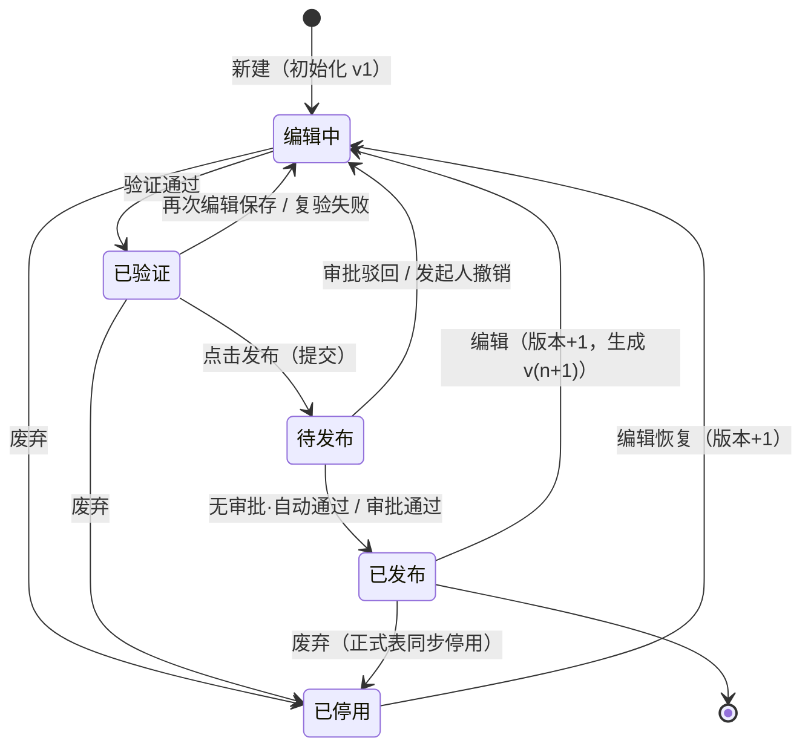
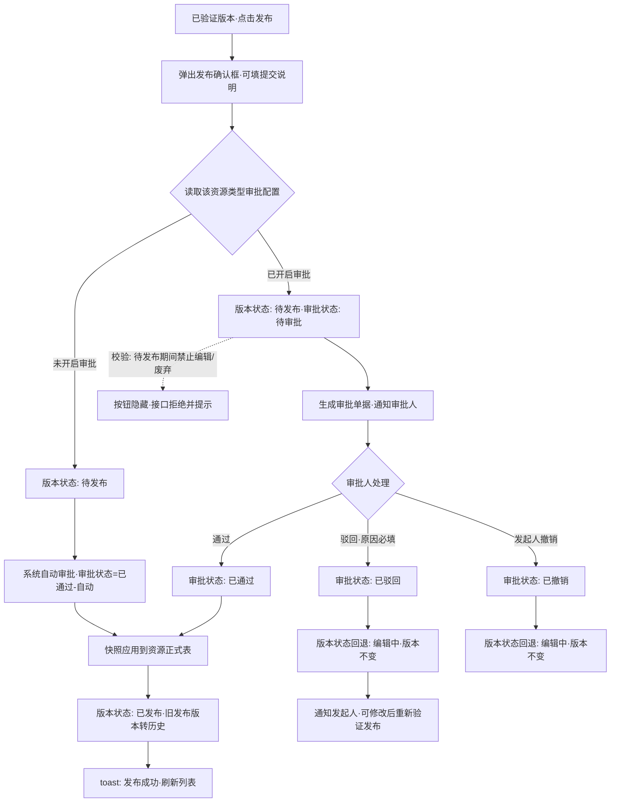
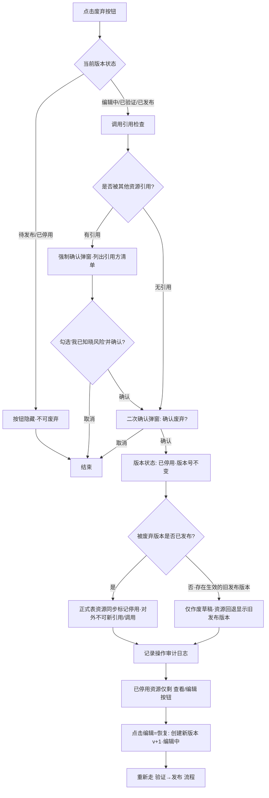

# PRD：本体资产统一版本管理与审批

| 项 | 内容 |
|---|---|
| 文档版本 | v0.1（评审稿） |
| 日期 | 2026-10-30 |
| 所属产品 | Prism 本体语义平台 |
| 关联文档 | [产品功能设计.md](./产品功能设计.md) §3.3 审批流程、§4 本体资产管理 |

---

## 1. 引言 / 概述

本体资产（对象类型、关联关系、共享属性、枚举类、值约束规则、动作、函数等）是 Prism 平台的核心生产资料。当前各资产的变更**直接生效、无版本留痕、无发布门禁**，存在以下问题：

- 误改已发布的对象类型后无法追溯、无法恢复到之前的定义；
- 任何有权限的用户改完即生效，缺乏"验证 → 提交 → 审批 → 发布"的质量门禁；
- 无法查看某个资产的历史演进（谁在什么时间发布了什么内容）；
- 审批中心（approval-config / approval-records）已有原型，但审批与资产版本状态没有打通，驳回后资产处于何种状态、能否继续编辑没有明确定义。

本需求为**所有本体资产提供一套统一的版本管理与审批框架**：

- **统一版本状态机**：编辑中 → 已验证 → 待发布 → 已发布 / 已停用，覆盖资源从新建到废弃的完整生命周期；
- **统一审批状态机**：待审批 → 已通过 / 已驳回 / 已撤销，审批配置决定发布是"自动通过"还是"人工单级审批"；
- **统一快照机制**：每个版本保存资源完整快照，编辑 / 验证针对快照进行，发布即把快照应用到资源正式表；
- **统一操作入口**：各资产列表页嵌入版本状态列与操作按钮（查看 / 编辑 / 验证 / 发布 / 废弃），另建独立的「版本管理」中心页统一查看空间内全部资源的版本记录与历史。

**MVP 范围**：首期仅**对象类型（Object Type）**接入本框架；框架按"可插拔资源类型"设计，后续关联关系、共享属性、枚举类、值约束规则、动作、函数逐个接入，不再重复开发版本与审批能力。

### 术语定义

| 术语 | 含义 |
|---|---|
| 资源正式表 | 存储资源**当前正式生效数据**的业务表。以对象类型为例，即未来的 `onto_object_type` 表；正式表数据 = 最新已发布版本的快照 |
| 资源版本（快照） | 资源在某个版本上的完整定义快照与版本状态、审批状态。所有资源共用一套版本存储（概念上为统一的资源版本表，具体设计见技术设计文档） |
| 当前活动版本 | 一个资源同一时刻**有且仅有一个**活动版本（版本表中最新的版本记录），列表页展示的版本号与状态均指活动版本 |
| 历史版本 | 已被更新版本取代的已发布版本，只读，可查看快照详情 |
| 审批配置 | 按资源类型配置"发布是否需要审批"及审批人（概念上为审批配置表），复用并扩展现有审批中心 |
| 审批记录 | 每次提交发布产生的审批单据与流转日志（概念上为审批记录表） |

> 注：本文只做功能与业务规则定义，**不含表结构 / 字段 / 接口设计**，四张表（资源版本表 `resource_version`、审批配置表 `resource_approval_config`、审批记录表 `resource_approval_record` 及各资源正式表）的详细设计由技术设计文档（tech-design）产出。

---

## 2. 目标

- 为对象类型提供完整的版本生命周期管理：新建初始化 v1，编辑 / 验证 / 发布 / 废弃全程留痕，版本号整数递增（v1、v2、v3…）。
- 发布动作受审批管控：审批配置可按资源类型开启 / 关闭审批；未开启时提交即自动发布，开启时须单级人工审批通过后自动发布。
- 已发布资源可安全演进：编辑已发布资源生成 v(n+1) 新版本，发布前旧版本持续生效，互不影响。
- 已停用资源可恢复：仅能通过"编辑"恢复，且版本号 +1，重新走完整发布流程。
- 提供空间级「版本管理」中心页，一屏查看当前空间内全部资源的版本记录、审批状态与历史快照。
- 版本与审批框架可插拔：新资产类型接入只需注册资源类型与快照序列化方式，不改动状态机与页面框架。

---

## 3. 用户故事

### US-001：统一版本框架与状态机（后端能力）
**描述：** 作为平台开发者，我需要一套与资源类型解耦的版本状态机与快照存储，以便对象类型（及后续资产）以统一方式管理生命周期。

**验收标准：**
- [ ] 实现五态版本状态机（编辑中 / 已验证 / 待发布 / 已发布 / 已停用）与四态审批状态机（待审批 / 已通过 / 已驳回 / 已撤销），全部流转符合 §4.1 规则表，非法流转被拒绝并返回明确错误提示
- [ ] 新建资源自动初始化版本 v1（编辑中）；版本号按资源维度整数递增，不复用、不回退
- [ ] 每次进入编辑保存后生成 / 更新当前活动版本快照；发布时快照在事务内应用到资源正式表
- [ ] 同一资源同一时刻仅存在一个活动版本（编辑中 / 已验证 / 待发布三者之一），旧已发布版本在新版本发布成功时转为历史版本
- [ ] 对象类型作为首个资源类型完成插拔注册，编译与单元测试通过

### US-002：对象类型列表页嵌入版本状态与操作按钮
**描述：** 作为本体建模员，我希望在对象类型列表直接看到每个类型的当前版本、版本状态与审批状态，并按状态执行操作，以便不离开建模页面就能完成生命周期管理。

**验收标准：**
- [ ] 对象类型列表新增「当前版本」「版本状态」「审批状态」三列，状态以彩色徽标展示
- [ ] 操作列按 §4.3 按钮显示矩阵渲染：查看（全状态）、编辑（待发布隐藏）、验证（已停用隐藏）、发布（仅已验证）、废弃（待发布与已停用隐藏）
- [ ] 「查看」打开资源正式表数据详情；「编辑」表单回显当前活动版本快照；「验证」校验当前活动版本快照
- [ ] 已发布且存在未发布新版本的对象类型，列表出现「有未发布变更」标识
- [ ] 类型检查 / lint 通过
- [ ] 使用 dev-browser 技能在浏览器中验证

### US-003：版本管理中心页
**描述：** 作为空间管理员，我希望有一个独立页面统一查看当前空间内所有资源的版本记录，以便集中掌握变更动态与发布情况。

**验收标准：**
- [ ] 新增页面 `docs/prototype/ontology/ontology-versions.html`，挂载于空间侧边栏「本体资产管理」分组，菜单名「版本管理」
- [ ] 列表展示：资源类型、资源名称、当前版本、版本状态、审批状态、最近更新人、最近更新时间、操作
- [ ] 支持按资源名称模糊搜索，按资源类型 / 版本状态 / 审批状态精确筛选，按更新时间范围筛选；默认按最近更新时间倒序，每页 20 条
- [ ] 操作列按钮遵循与 US-002 完全一致的显示矩阵，点击后行为一致
- [ ] 同步更新 `docs/prototype/assets/app.js` 的 `SPACE_NAV` 与 `docs/prd/产品功能设计.md` 映射表（三处同步硬约束）
- [ ] 使用 dev-browser 技能在浏览器中验证

### US-004：版本历史与快照查看
**描述：** 作为本体建模员，我希望查看某个资源的全部历史版本及其快照详情，以便追溯每次发布的定义内容与责任人。

**验收标准：**
- [ ] 在版本管理中心与对象类型列表均可打开某资源的「版本历史」抽屉：按版本号倒序展示版本号、版本状态、发布人、发布时间、提交说明
- [ ] 点击任一历史版本可查看该版本完整快照（只读详情，与查看正式数据同版式，顶部标注"历史版本 vN 快照，非当前生效内容"）
- [ ] 历史版本不提供编辑 / 发布 / 废弃入口（无回滚能力，见非目标）
- [ ] 使用 dev-browser 技能在浏览器中验证

### US-005：审批配置扩展（开启审批开关）
**描述：** 作为超级管理员，我希望在审批中心按资源类型开启或关闭发布审批，并指定单级审批人，以便按团队治理要求控制发布门禁。

**验收标准：**
- [ ] 审批中心 `approval-config.html` 资源类型列表每项增加「已开启审批 / 未开启审批」开关状态标识与开关操作
- [ ] 开启审批时弹出流程配置表单（复用现有原型）：作用范围（全局 / 工作空间级）、审批人（指定用户 ∪ 角色成员，单级）；唯一性约束沿用现有规则
- [ ] 关闭审批（删除流程）后，该资源类型提交发布走"自动通过 → 自动发布"，无需人工介入
- [ ] 审批配置变更实时生效：以**提交发布时刻**的配置为准判断是否需要审批
- [ ] 使用 dev-browser 技能在浏览器中验证

### US-006：发布审批流转与驳回 / 撤销处理
**描述：** 作为审批人 / 发起人，我希望提交发布后审批单据正确流转，驳回或撤销后资源回到可编辑状态，以便闭环处理变更。

**验收标准：**
- [ ] 已验证版本点击「发布」：无审批配置时，版本状态 已验证 → 待发布 →（系统自动审批，审批状态=已通过，标记"自动"）→ 已发布，全程一次点击完成
- [ ] 有审批配置时：版本状态 → 待发布，生成审批单据（审批状态=待审批），审批人收到站内通知
- [ ] 审批通过：审批状态 → 已通过，系统自动发布，版本状态 → 已发布，快照应用到正式表，发起人收到通知
- [ ] 审批驳回：驳回原因必填；审批状态 → 已驳回，版本状态回退 → 编辑中（版本号不变），发起人可修改后重新验证、重新发布，重新发布生成**新的审批单据**
- [ ] 发起人可在待审批期间撤销：审批状态 → 已撤销，版本状态回退 → 编辑中（版本号不变）
- [ ] 审批记录页（approval-records.html）单据详情可查看提交时的版本快照；「待办 / 已办 / 我发起的」可见性规则沿用现有定义
- [ ] 使用 dev-browser 技能在浏览器中验证

### US-007：废弃与恢复
**描述：** 作为空间管理员，我希望废弃不再使用的资源版本，并可在需要时通过编辑恢复，以便管理资产生命周期终点。

**验收标准：**
- [ ] 编辑中 / 已验证 / 已发布状态可废弃；待发布与已停用状态废弃按钮隐藏（§4.3）
- [ ] 废弃前执行引用检查：存在被其他资源引用时弹出强制确认弹窗并列出引用方清单，勾选"我已知晓风险"后方可执行
- [ ] 废弃后：版本状态 → 已停用，**版本号不变**；已发布版本被废弃时，正式表资源同步标记停用，对外不可被新引用 / 调用
- [ ] 已停用资源仅显示「查看」「编辑」：点击编辑创建新版本（版本号 +1，状态=编辑中），即"恢复"；恢复版本须重新走验证 → 发布流程方可再次生效
- [ ] 使用 dev-browser 技能在浏览器中验证

---

## 4. 业务逻辑说明

### 4.1 状态机与流转规则（核心）

#### 4.1.1 状态定义

**版本状态（5 个）：**

| 状态 | 含义 | 徽标色 |
|---|---|---|
| 编辑中 | 新建或修改后的草稿态，仅存在于版本快照，未影响正式表 | 蓝 |
| 已验证 | 快照已通过验证（结构完整性、命名规范、映射可达性等校验），具备提交发布条件 | 青 |
| 待发布 | 已提交发布，等待审批（或系统自动流转中）；此状态资源被锁定，不可编辑、不可废弃 | 橙 |
| 已发布 | 快照已应用到资源正式表，对外正式生效 | 绿 |
| 已停用 | 版本被废弃，不再生效；仅可查看与通过编辑恢复 | 灰 |

**审批状态（4 个，仅"提交发布"后产生）：**

| 状态 | 含义 | 徽标色 |
|---|---|---|
| 待审批 | 单据已提交，等待审批人处理 | 橙 |
| 已通过 | 审批人通过（或无审批配置时系统"自动通过"） | 绿 |
| 已驳回 | 审批人驳回，附驳回原因 | 红 |
| 已撤销 | 发起人在审批完成前主动撤回 | 灰 |

#### 4.1.2 流转规则总表

| # | 触发动作 | 前置版本状态 | 结果版本状态 | 审批状态变化 | 版本号变化 | 补充说明 |
|---|---|---|---|---|---|---|
| 1 | 新建 | —（资源不存在） | 编辑中 | 无 | 初始化 v1 | 保存成功即创建资源与首个版本快照 |
| 2 | 编辑保存 | 编辑中 / 已验证 | 编辑中 | 无 | 不变 | 已验证版本再编辑会退回编辑中，需重新验证 |
| 3 | 编辑保存 | 已发布 | 编辑中 | 无 | **+1**（生成 v(n+1) 新活动版本） | 正式表中 v(n) 持续生效，列表标注「有未发布变更」 |
| 4 | 编辑保存（恢复） | 已停用 | 编辑中 | 无 | **+1** | 已停用资源唯一出口；恢复后须重新走验证 → 发布 |
| 5 | 编辑 | 待发布 | — | — | — | **禁止**，按钮隐藏 |
| 6 | 验证通过 | 编辑中 | 已验证 | 无 | 不变 | 验证对象为当前活动版本快照 |
| 7 | 验证失败 | 编辑中 | 编辑中（保持） | 无 | 不变 | 输出失败报告，逐项列出问题 |
| 8 | 复验失败 | 已验证 | 编辑中（回退） | 无 | 不变 | 已验证版本复验不通过则退回编辑中 |
| 9 | 验证（复核） | 待发布 / 已发布 | 状态不变 | 无 | 不变 | 仅输出验证报告，供复核 / 审计，不产生状态流转 |
| 10 | 验证 | 已停用 | — | — | — | **禁止**，按钮隐藏 |
| 11 | 发布（无审批配置） | 已验证 | 待发布 → 已发布（系统连续流转） | 自动置为已通过（标记"自动"） | 不变 | 快照应用到正式表；若存在旧已发布版本则转为历史版本 |
| 12 | 发布（有审批配置） | 已验证 | 待发布 | 生成单据，置为待审批 | 不变 | 资源锁定编辑 / 废弃，等待审批 |
| 13 | 发布 | 编辑中 / 待发布 / 已发布 / 已停用 | — | — | — | **禁止**，按钮绝不展示 |
| 14 | 审批通过 | 待发布 | 已发布 | 待审批 → 已通过 | 不变 | 系统自动发布：快照应用到正式表，旧已发布版本转历史；通知发起人 |
| 15 | 审批驳回 | 待发布 | 编辑中（回退） | 待审批 → 已驳回 | 不变 | 驳回原因必填；通知发起人；修改后可重新验证、重新发布（生成新单据） |
| 16 | 发起人撤销 | 待审批期间的待发布 | 编辑中（回退） | 待审批 → 已撤销 | 不变 | 仅单据发起人在审批人处理前可撤销 |
| 17 | 废弃 | 编辑中 / 已验证 | 已停用 | 无 | 不变 | 未发布草稿直接作废；若资源存在生效的已发布版本，正式表不受影响（见 4.1.3-③） |
| 18 | 废弃 | 已发布 | 已停用 | 无 | 不变 | 正式表资源同步标记停用，对外不可被新引用 / 调用，详情仍可查看 |
| 19 | 废弃 | 待发布 / 已停用 | — | — | — | **禁止**，按钮隐藏（待发布须先撤销审批或等待审批结果） |

#### 4.1.3 版本模型补充规则

① **单一活动版本**：一个资源同一时刻仅有一个活动版本（编辑中 / 已验证 / 待发布之一）。列表页显示的"当前版本 + 状态"即活动版本。

② **已发布资源的并行演进**：编辑已发布资源 v(n) 会创建活动版本 v(n+1)。在 v(n+1) 发布成功前，正式表始终是 v(n) 的快照（对外持续生效）；v(n+1) 发布成功瞬间，正式表切换为 v(n+1) 快照，v(n) 转为历史版本。

③ **废弃未发布草稿**：若资源存在生效中的已发布版本 v(n)，废弃活动草稿 v(n+1)（编辑中 / 已验证）仅作废该草稿，v(n+1) 记录为已停用，资源当前版本回退显示为 v(n)（已发布），正式表不受影响；若资源从未发布过（如 v1 草稿），废弃即整个资源停用，列表标记已停用。

④ **审批配置判定时机**：以**点击发布的时刻**读取审批配置。发布后配置被修改 / 删除的，不影响在途单据，单据仍按原配置流转。

⑤ **历史版本只读**：历史版本与已停用版本仅可查看快照，不可编辑、不可重新发布（无回滚能力，恢复须从当前版本编辑派生新版本）。

### 4.2 业务流程图

#### 4.2.1 版本状态机

> 注：`已发布 --> 编辑中` 与 `已停用 --> 编辑中` 两条边均伴随版本号 +1（产生新活动版本）；`待发布` 状态不可编辑、不可废弃（锁定态）。

#### 4.2.2 提交发布流程（含审批分支）

#### 4.2.3 废弃与恢复流程

### 4.3 操作按钮显示矩阵（硬约束）

| 操作 | 编辑中 | 已验证 | 待发布 | 已发布 | 已停用 | 数据来源与说明 |
|---|:---:|:---:|:---:|:---:|:---:|---|
| 查看 | ✔ | ✔ | ✔ | ✔ | ✔ | **只查资源正式表**（当前正式生效数据）；从未发布过的资源查看其最新快照并标注"未发布" |
| 编辑 | ✔ | ✔ | ✘ 隐藏 | ✔（版本+1） | ✔（版本+1，即恢复） | 编辑表单回显**当前活动版本快照**（非正式表） |
| 验证 | ✔ | ✔ | ✔（复核，不改状态） | ✔（复核，不改状态） | ✘ 隐藏 | 验证对象为**当前活动版本快照**；编辑中→已验证的唯一通道 |
| 发布 | ✘ | ✔ | ✘ | ✘ | ✘ | **仅已验证状态展示，其余状态绝不允许展示**；点击后走 §4.2.2 流程 |
| 废弃 | ✔ | ✔ | ✘ 隐藏 | ✔ | ✘ 隐藏 | 已停用状态无需重复废弃，故隐藏（对"其余状态均可废弃"的收敛解释，见 §10-Q1） |
| 版本历史 | ✔ | ✔ | ✔ | ✔ | ✔ | 打开版本历史抽屉（所有状态均可追溯） |

按钮显示逻辑在**对象类型列表页、版本管理中心页**两处必须完全一致；后端接口须做同口径的状态校验（前端隐藏 + 后端拒绝双保险），非法操作返回业务错误提示（见 §4.6）。

### 4.4 原型图（@引用）

**已有原型（需改造）：**
- @docs/prototype/ontology/ontology-graph.html —— 对象类型列表嵌入「当前版本 / 版本状态 / 审批状态」列与操作按钮矩阵（待改造）
- @docs/prototype/approval/approval-config.html —— 资源类型增加「开启审批」开关（待改造）
- @docs/prototype/approval/approval-records.html —— 单据详情增加「查看版本快照」、我发起的列表增加「撤销」操作（待改造）

**待产出原型：**

| 页面名 | 路由 | 所属父菜单目录 | 说明 |
|---|---|---|---|
| 版本管理 | `docs/prototype/ontology/ontology-versions.html` | ontology（本体资产管理） | 空间级版本管理中心：版本记录列表 + 版本历史抽屉 + 快照查看 |

同步项（三处同步硬约束）：`assets/app.js` 的 `SPACE_NAV`「本体资产管理」分组新增 `{ id: 'ontology-versions', label: '版本管理' }`；`docs/prd/产品功能设计.md` §2.3 映射表与 §4 新增小节。

### 4.5 原型字段与交互说明

#### （a）版本管理中心 · 列表页

| 列名 | 字段来源 | 展示形式 | 排序 | 备注 |
|---|---|---|---|---|
| 资源类型 | resourceType | 图标 + 文本（◈ 对象类型…） | — | MVP 阶段仅"对象类型"，预留全部类型枚举 |
| 资源名称 | resourceName | 文本 + 链接（点击打开版本历史抽屉） | — | 超长省略，hover 显示全称；有未发布变更时名称后加橙色圆点标识 |
| 当前版本 | version | 文本（v1 / v2 …） | 支持 | 指当前活动版本 |
| 版本状态 | versionStatus | 彩色徽标（编辑中=蓝 / 已验证=青 / 待发布=橙 / 已发布=绿 / 已停用=灰） | — | — |
| 审批状态 | approvalStatus | 彩色徽标（待审批=橙 / 已通过=绿 / 已驳回=红 / 已撤销=灰） | — | 未提交过发布显示 "—" |
| 最近更新人 | updatedBy | 文本 | — | — |
| 最近更新时间 | updatedAt | YYYY-MM-DD HH:mm | 支持 | **默认倒序** |
| 操作 | — | 查看 / 编辑 / 验证 / 发布 / 废弃 / 版本历史 | — | 严格按 §4.3 矩阵显隐；权限点控制（如 `ontology:version:publish`） |

**搜索条件：**

| 搜索项 | 控件 | 搜索方式 | 说明 |
|---|---|---|---|
| 资源名称 | 输入框 | 模糊搜索（LIKE） | 支持中英文模糊匹配 |
| 资源类型 | 下拉框（多选） | IN 查询 | 全部 / 对象类型 /（预留其余类型） |
| 版本状态 | 下拉框（多选） | IN 查询 | 全部 / 编辑中 / 已验证 / 待发布 / 已发布 / 已停用 |
| 审批状态 | 下拉框 | 精确搜索（=） | 全部 / 待审批 / 已通过 / 已驳回 / 已撤销 |
| 更新时间 | 日期范围 RangePicker | 范围搜索（BETWEEN） | — |

搜索区交互：回车或点击「查询」触发；「重置」清空全部条件并重新查询；分页默认每页 20 条。

**展示形态**：不提供卡片 / 列表切换。理由：版本管理是高频运维操作场景，表格信息密度更优，且状态列 + 操作列需要并列对照。

#### （b）版本历史抽屉

从列表点击资源名称或「版本历史」打开，右侧抽屉（宽 720px）：

| 区域 | 内容 |
|---|---|
| 头部 | 资源类型图标 + 资源名称 + 正式表编码；右侧「查看正式数据」按钮 |
| 版本时间线 | 按版本号倒序的版本条目：版本号（当前活动版本标注"当前"徽标）、版本状态徽标、审批状态徽标、创建人 / 发布人、创建时间 / 发布时间、提交说明（发布时填写，超长省略） |
| 条目操作 | 「查看快照」（所有版本均有，打开只读快照详情弹窗）；历史版本与已停用版本**无**编辑 / 发布 / 废弃入口 |
| 快照详情弹窗 | 与资源查看详情同版式的只读表单；顶部橙色提示条："您正在查看历史版本 vN 快照，非当前生效内容" |

#### （c）发布确认弹窗

| 字段名 | 控件类型 | 是否必填 | 校验规则 | 默认值 | 备注 |
|---|---|---|---|---|---|
| 提交说明 | 文本域 Textarea | 否 | 最大 200 字符，显示字数统计 | 空 | 记入版本历史与审批单据 |
| 审批提示区 | 静态文本 | — | — | — | 有审批配置：显示"该资源类型已开启发布审批，提交后需 [审批人清单] 审批通过方可发布"；无审批配置：显示"该资源类型未开启审批，提交后将自动发布生效" |

底部按钮：右对齐「取消 | 确认发布」（主按钮）。弹窗宽度 480px。

#### （d）审批配置扩展（approval-config.html 改造）

资源类型列表项每行新增：

| 元素 | 形式 | 规则 |
|---|---|---|
| 审批开关状态 | 标签（已开启=绿 / 未开启=灰） | 展示该资源类型在当前作用域下是否已配置审批 |
| 开启审批 | 按钮 → 打开现有「新增审批流程」弹窗 | 表单字段沿用现有原型：资源类型（只读）、流程名称（选填，≤50 字符）、作用范围（单选：全局有效 / 工作空间内有效 + 空间下拉）、审批人·指定用户（多选 Checkbox）、审批人·按角色（多选 Checkbox）；审批人至少选择 1 个用户或 1 个角色，否则确定按钮置灰并提示"请至少选择一名审批人或一个审批角色" |
| 关闭审批 | 现有「删除流程」操作 + 二次确认 | 提示"关闭后该资源类型的发布将自动通过并立即生效，确认关闭吗？"；在途单据不受影响（§4.1.3-④） |

流程名称字段校验：选填；长度 0~50 字符；不允许纯空格。

#### （e）对象类型列表页嵌入改造（ontology-graph.html）

- 列表新增三列：「当前版本」（vN 文本）、「版本状态」（彩色徽标）、「审批状态」（彩色徽标，未提交过显示 "—"）。
- 操作列改造为 §4.3 矩阵按钮（查看 / 编辑 / 验证 / 发布 / 废弃 / 版本历史），超出 3 个时收纳到「更多」下拉。
- 已发布且存在未发布新版本的行，名称后展示橙色圆点 + tooltip "存在未发布变更 vN"。
- 对象类型新建 / 编辑弹窗本身字段规则不变（沿用本体图谱 PRD），仅保存行为接入版本框架：保存即写入当前活动版本快照。

### 4.6 交互提示说明

| 触发操作 | 提示类型 | 提示内容 | 后续动作 |
|---|---|---|---|
| 点击「发布」（已验证） | 发布确认弹窗 | 见 §4.5(c)，含审批 / 自动发布两种提示文案 | 确认后提交；成功 toast「发布申请已提交，等待审批」或「发布成功」，刷新列表 |
| 点击「废弃」（无引用） | 二次确认弹窗 | "确认废弃该资源的当前版本 vN 吗？废弃后版本状态变为已停用，仅可通过编辑（版本+1）恢复。"（已发布版本追加红字："该版本正在生效，废弃后资源将停用，对外不可被引用 / 调用。"） | 按钮「确认废弃」（危险色）/「取消」；确认后 toast，刷新列表 |
| 点击「废弃」（有引用） | 强制确认弹窗 | 先调用引用查询；弹窗展示："该资源被以下资源引用：[引用方类型 + 名称清单]，强制废弃将导致引用失效，请确认是否强制废弃？" + 勾选框"我已知晓风险" | 勾选后「确认废弃」按钮方可点击；执行后记录审计日志 |
| 审批「驳回」 | 弹窗表单 | 驳回原因必填，Textarea，5~200 字符，未填时确定按钮置灰，提示"请填写驳回原因" | 确认后单据置已驳回，资源回退编辑中，站内通知发起人 |
| 审批「通过」 | 二次确认弹窗 | "确认通过该发布申请吗？通过后系统将自动发布 vN 并立即生效。"（审批意见选填，≤200 字符） | 确认后自动发布，通知发起人 |
| 发起人「撤销」 | 二次确认弹窗 | "确认撤销该发布申请吗？撤销后资源回退为编辑中，需重新提交发布。" | 确认后单据置已撤销，资源回退编辑中 |
| 验证完成 | 结果通知 | 成功：toast「验证通过，可提交发布」，状态徽标变已验证；失败：弹出验证报告弹窗，逐项列出失败原因（校验项、位置、说明），状态保持 / 回退编辑中 | — |
| 待发布状态调用编辑 / 废弃接口 | 错误 toast | "该资源正在发布审批中，暂不可编辑 / 废弃；如需修改请先撤销发布申请" | 停留当前页 |
| 已停用状态调用验证接口 | 错误 toast | "已停用版本不可验证，请通过编辑恢复后再验证" | 停留当前页 |
| 编辑表单未保存离开 | 拦截提示 | "当前修改尚未保存，确认离开吗？" | 「确认离开」丢弃 /「取消」留在当前页 |
| 编辑已发布资源点击保存 | 二次确认弹窗 | "当前资源 vN 已发布生效，保存将创建新版本 v(N+1)（编辑中），发布前 vN 持续生效。确认保存吗？" | 确认后创建新版本并保存快照 |
| 发布 / 废弃 / 验证等长耗时操作 | Loading + 结果通知 | 按钮 loading 态"处理中…"，完成后成功 / 失败 toast | 失败展示后端业务错误信息，保留现场 |

---

## 5. 功能需求

**A. 统一版本框架**

- FR-1：系统必须为接入的每类资源维护版本记录：版本号（资源内整数递增，v1 起）、版本快照、版本状态、审批状态、创建人、创建时间、发布人、发布时间、提交说明。
- FR-2：新建资源保存成功时，系统必须初始化版本 v1，状态为编辑中。
- FR-3：系统必须保证每个资源同一时刻仅有一个活动版本（编辑中 / 已验证 / 待发布之一）。
- FR-4：编辑保存时，若当前状态为编辑中 / 已验证，版本号不变；若为已发布或已停用，系统必须创建版本号 +1 的新活动版本（编辑中）。
- FR-5：验证操作必须以当前活动版本快照为对象；编辑中验证通过后状态变更为已验证，验证失败保持编辑中并输出逐项失败报告；已验证版本复验失败必须回退编辑中；待发布 / 已发布状态验证仅输出报告不改变状态；已停用状态必须拒绝验证。
- FR-6：发布操作仅允许对已验证版本执行；发布时系统必须按提交时刻的审批配置判定走自动发布或人工审批。
- FR-7：发布成功（自动或审批通过）时，系统必须在事务内将版本快照应用到资源正式表，版本状态置为已发布，原已发布版本转为历史版本。
- FR-8：待发布状态期间，系统必须拒绝编辑与废弃请求（前后端双重拦截），并提示先撤销发布申请。
- FR-9：审批驳回时系统必须将版本状态回退为编辑中（版本号不变）、审批状态置为已驳回，并通知发起人；发起人撤销时同理置为已撤销。
- FR-10：废弃操作对编辑中 / 已验证 / 已发布状态开放；废弃后版本状态置为已停用且版本号不变；废弃已发布版本时必须同步停用正式表资源（对外不可被新引用 / 调用，详情仍可查看）。
- FR-11：废弃前系统必须执行引用检查；存在引用时必须展示引用方清单并要求勾选"我已知晓风险"后方可强制废弃。
- FR-12：已停用资源必须仅允许查看与编辑；编辑即恢复，创建版本号 +1 的新活动版本，重新走验证 → 发布流程。
- FR-13：所有状态流转、发布、废弃、审批动作必须写入操作审计日志（操作人、时间、前后状态、对象版本）。

**B. 对象类型列表页（嵌入式）**

- FR-14：对象类型列表必须新增「当前版本」「版本状态」「审批状态」三列，状态以 §4.1.1 徽标色展示。
- FR-15：操作列必须按 §4.3 矩阵渲染查看 / 编辑 / 验证 / 发布 / 废弃 / 版本历史按钮，并按权限点（如 `ontology:type:publish`、`ontology:version:discard`）控制显隐。
- FR-16：「查看」必须读取资源正式表数据；「编辑」表单必须回显当前活动版本快照；两者版式一致但数据来源不同。
- FR-17：已发布且存在未发布新版本的资源，列表必须展示「有未发布变更」标识及新版本号 tooltip。

**C. 版本管理中心页（新增 ontology/ontology-versions.html）**

- FR-18：新增空间级页面「版本管理」，挂载于侧边栏「本体资产管理」分组；数据范围为当前工作空间内全部已接入资源。
- FR-19：列表必须包含 §4.5(a) 定义的 8 列，默认按最近更新时间倒序，每页 20 条。
- FR-20：搜索必须支持：资源名称模糊搜索；资源类型 / 版本状态多选 IN 查询；审批状态精确查询；更新时间范围查询；「重置」清空条件重新查询。
- FR-21：操作列必须与对象类型列表页共用同一按钮矩阵与行为；点击资源名称或「版本历史」必须打开版本历史抽屉（§4.5(b)）。
- FR-22：版本历史抽屉必须按版本号倒序展示全部版本（含历史版本与已停用版本）及提交说明；任一版本可查看只读快照详情，快照页顶部必须标注"历史版本快照，非当前生效内容"（当前生效版本除外）。
- FR-23：版本管理中心不提供卡片视图（理由见 §4.5(a)）；不提供批量发布 / 批量废弃（见非目标）。

**D. 审批配置（扩展 approval-config.html）**

- FR-24：审批中心资源类型列表必须展示每类资源的审批开启状态（已开启 / 未开启）。
- FR-25：开启审批必须复用现有流程配置表单：作用范围（全局 / 工作空间级）、审批人 = 指定用户 ∪ 角色成员（动态计算），**单级审批**；审批人为空时不允许保存。
- FR-26：同一资源类型审批配置唯一性约束沿用现有规则（全局与空间级互斥、同空间同类型不可重复）。
- FR-27：关闭（删除）审批配置必须二次确认，并提示"关闭后发布将自动通过并立即生效"；配置变更仅影响此后提交的发布，不影响在途单据。

**E. 审批记录（扩展 approval-records.html）**

- FR-28：审批单据必须记录：资源类型、资源名称、版本号、提交人、提交说明、提交时间、审批人、审批动作、审批意见、处理时间、单据状态（待审批 / 已通过 / 已驳回 / 已撤销、自动通过标记）。
- FR-29：单据详情必须提供「查看版本快照」入口，展示提交发布时刻的版本快照（只读）。
- FR-30：「我发起的」列表中，待审批单据必须提供「撤销」操作（二次确认）；驳回必须填写原因（5~200 字符）。
- FR-31：审批提交 / 通过 / 驳回 / 撤销必须向相关人发送站内通知，沿用现有顶栏铃铛机制。

**F. 三处同步**

- FR-32：新增页面必须同步：`docs/prototype/assets/app.js` 的 `SPACE_NAV` 配置、`docs/prototype/ontology/ontology-versions.html` 原型页面、`docs/prd/产品功能设计.md` 章节与映射表。

---

## 6. 非目标（范围外）

- **版本对比（diff）**：不提供两个版本间的字段级差异对比视图。
- **一键回滚**：不支持从历史版本直接回滚；恢复历史内容的唯一途径是基于当前版本编辑（版本 +1）后重新发布。
- **多级审批 / 会签 / 或签 / 加签 / 转办**：审批仅为单级，审批人集合内任一人处理即完成。
- **其余资产类型接入**：关联关系、共享属性、枚举类、值约束规则、动作、函数本期不接入（框架预留插拔能力，逐个接入属后续迭代）。
- **数据资产版本管理**：数据源 / 数据集 / Pipeline 不在本框架范围内。
- **批量操作**：不提供批量发布、批量废弃、批量审批。
- **定时发布 / 灰度发布 / 发布窗口**：发布均为即时生效。
- **版本分支**：与已有「本体分支」（ontology-branching.html）能力不做整合，本框架是资源级线性版本。

---

## 7. 设计考量

- 状态徽标色板与现有原型 `assets/style.css` 的 Badge 体系保持一致：版本状态（编辑中=蓝、已验证=青、待发布=橙、已发布=绿、已停用=灰）、审批状态（待审批=橙、已通过=绿、已驳回=红、已撤销=灰）。
- 版本历史抽屉复用现有原型抽屉（drawer）组件版式；快照详情弹窗复用资源查看详情弹窗，仅追加历史版本提示条。
- 按钮显示矩阵建议由前端公共函数统一实现（输入版本状态，输出按钮集合），对象类型列表与版本管理中心共用，避免两处逻辑漂移。
- 审批中心两页面为**平台级全局菜单**，改造时保持现有信息架构，仅做增量。

## 8. 技术考量

- 概念上涉及四类存储：资源正式表（如 `onto_object_type`）、统一资源版本表（`resource_version`，快照建议 JSON 存储）、审批配置表（`resource_approval_config`）、审批记录表（`resource_approval_record`）。**具体表结构、字段、索引与接口设计由技术设计文档产出，不在本 PRD 范围内。**
- 版本框架须与资源类型解耦：资源类型注册（类型编码、名称、快照序列化 / 反序列化、验证器、发布应用器、引用检查器）后即可获得完整生命周期能力。
- 发布 = 快照应用到正式表，须保证事务一致性；审批通过触发的自动发布为异步动作时须有失败补偿与状态回置策略（技术设计明确）。
- 权限点纳入现有权限管理体系（菜单 → 按钮两级），新增按钮权限标识由技术设计统一定义。
- 引用检查依赖各资源类型的引用关系查询能力，对象类型首期至少覆盖：被关联关系引用、被共享属性关联、被动作 / 函数引用、被数据映射引用。

## 9. 成功指标

- 对象类型 100% 变更留痕：任意已发布内容可追溯到版本、发布人与发布时间。
- 开启审批的资源类型，未经审批的发布成功率为 0（不存在绕过路径）。
- 建模员在列表页 2 次点击内可完成"验证 → 发布提交"。
- 版本管理中心页列表查询 P95 响应 < 1s（单空间 1 万版本记录量级）。
- 按钮显示矩阵在两个页面的一致性检查通过率 100%（自动化测试覆盖 §4.3 全矩阵）。

## 10. 待解决问题

- **Q1（废弃按钮口径）**：原始规则为"待发布禁止废弃，其余状态均可"。本 PRD 将「已停用」状态也隐藏废弃按钮（重复废弃无意义），是否认可？
- **Q2（待发布 / 已发布状态的"验证"语义）**：本 PRD 定义为"复核，仅出报告不改状态"（§4.1.2-9）。若认为已发布状态无需验证入口，可收窄为仅 编辑中 / 已验证 / 待发布 展示。
- **Q3（从未发布资源的查看行为）**：编辑中 v1 的资源点「查看」时正式表无数据，本 PRD 定义为展示最新快照并标注"未发布"，是否认可？
- **Q4（废弃已发布资源的引用处置）**：强制废弃后被引用方（如关联关系）如何表现——引用悬空标红、还是连带阻止？本 PRD 仅要求列出引用清单并强制确认，连带策略需与「关联关系」PRD 对齐。
- **Q5（审批超时）**：待审批单据是否需要超时提醒 / 自动催办？本期未纳入。
- **Q6（提交说明必填性）**：发布提交说明当前为选填，是否对"已发布资源的再次发布"强制必填？
