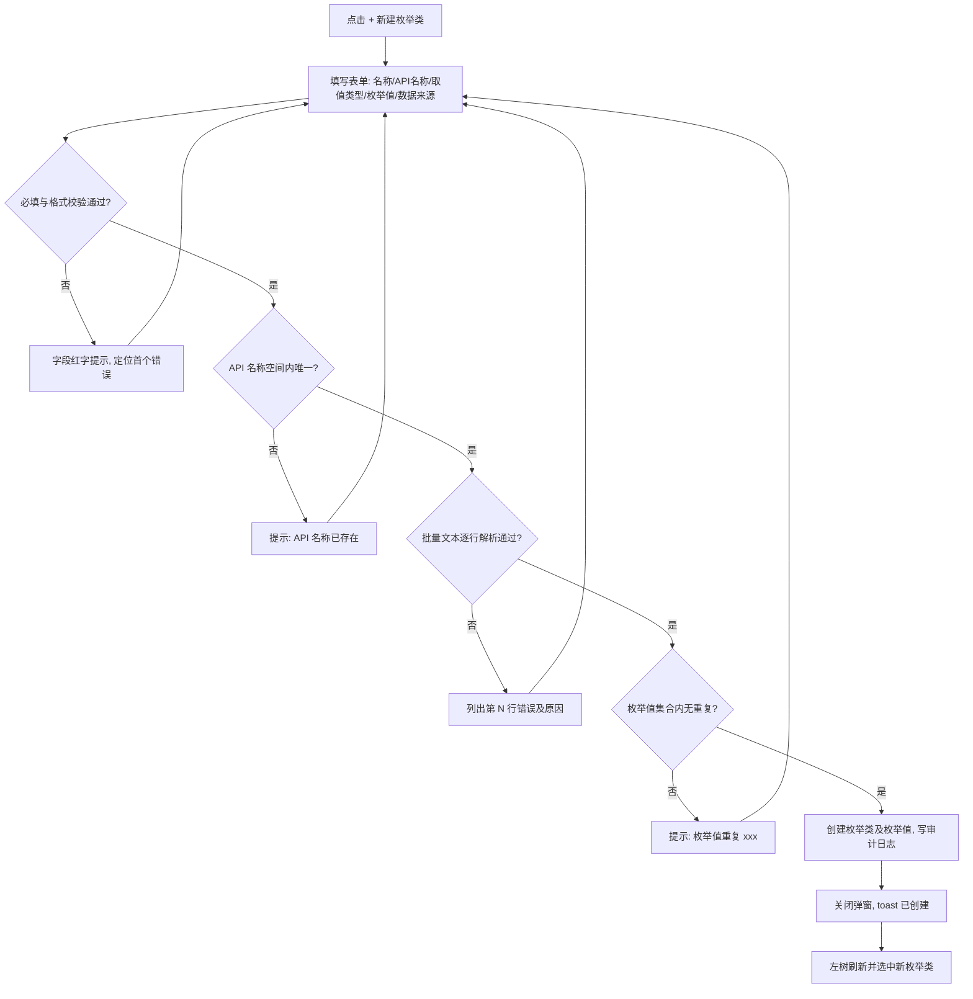
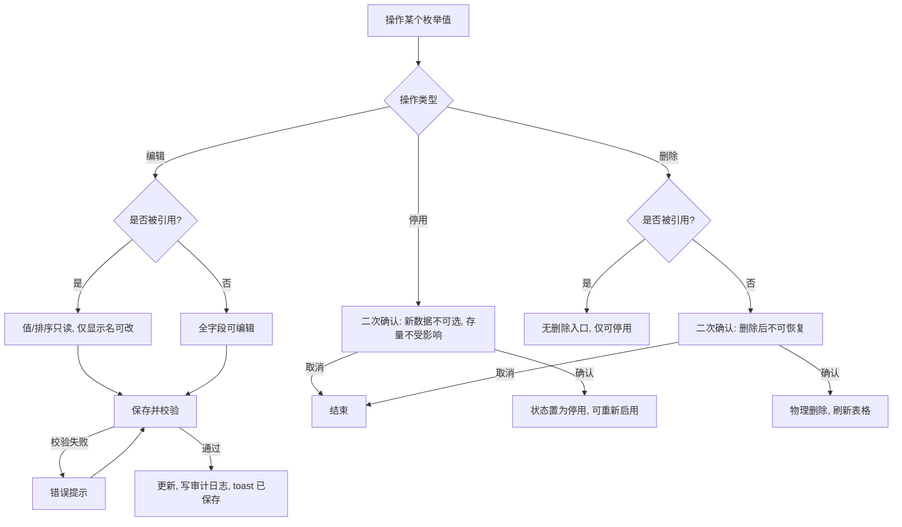
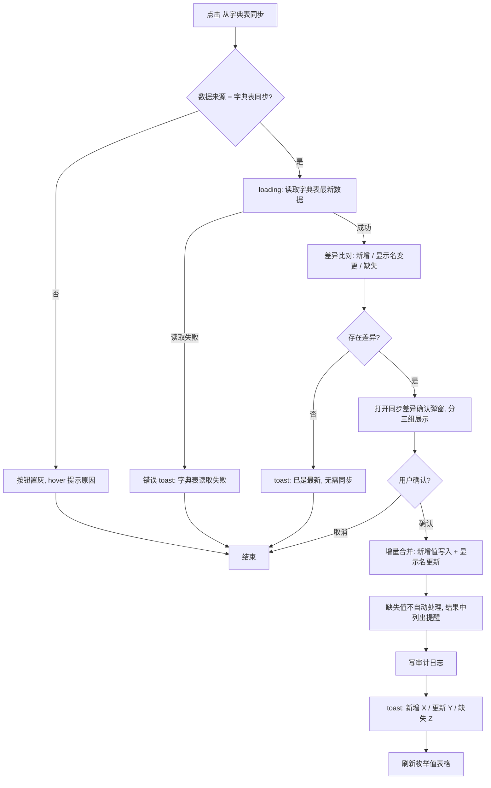
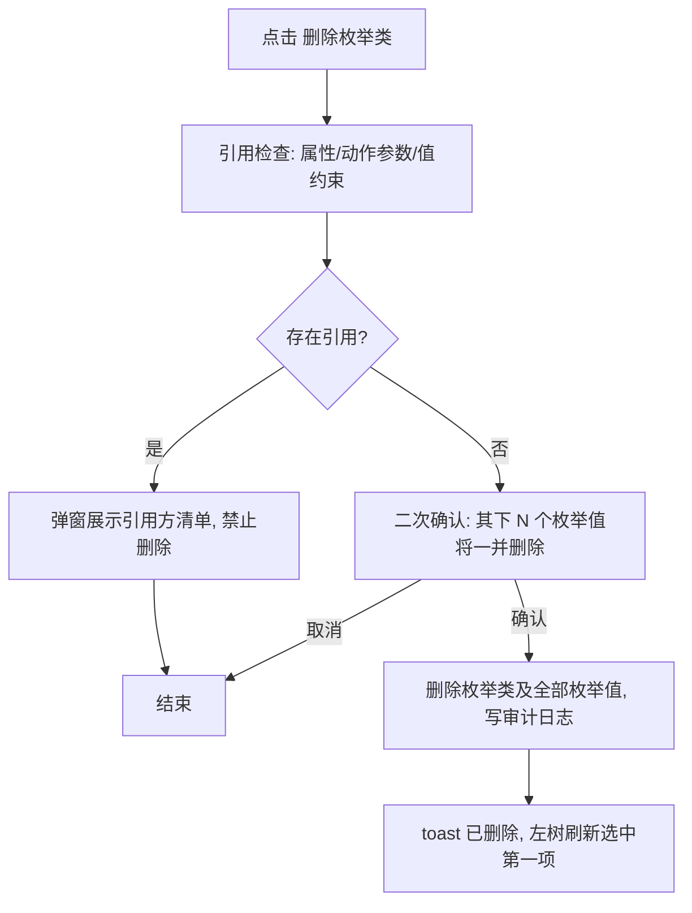

# PRD：枚举类管理（Enum Types）

> 所属模块：智能制造空间 → 本体资产管理 → 枚举类
> 原型页面：@docs/prototype/ontology/ontology-enums.html
> 上游文档：`docs/prd/产品功能设计.md` §4.4
> 版本：v1.0（MVP）｜日期：2026-10-30

---

## 1. 引言/概述

枚举类（Enum Type）是本体资产中用于定义**受限取值集合**的资产类型。对象类的属性（如 `Equipment.status`）、动作参数（Action Type 参数）与值约束在校验时引用枚举类，保证全空间内取值口径统一。

本功能为枚举类提供集中管理能力，包括：

- 枚举类的创建、编辑、删除；
- 枚举值的批量录入与逐条维护（新增 / 编辑 / 启用 / 停用 / 删除）；
- 引用关系展示（哪些属性在使用该枚举值）；
- 从数据集字典表**手动触发**同步枚举值。

## 2. 目标

- 空间管理员可在 1 个页面内完成枚举类全生命周期管理（创建 → 维护取值 → 停用/删除）。
- 枚举值被引用后有明确的保护规则：**可停用、可改显示名，禁止删除和修改值**，避免存量数据失效。
- 支持从字典表一键同步，消除手工双维护成本；同步前展示差异预览，用户确认后才落库。
- 新建枚举类支持批量文本录入（每行一个 `值 | 显示名 | 排序`），10 个枚举值录入时间 ≤ 30 秒。

## 3. 用户故事

### US-001：枚举类列表与树导航
**描述：** 作为空间管理员，我希望在左侧树中浏览全部枚举类并点击切换，以便快速定位要维护的枚举。

**验收标准：**
- [ ] 左侧卡片展示枚举类树，节点显示「枚举名称 + 枚举值数量徽标」
- [ ] 树顶部提供过滤输入框，按枚举名称 / API 名称模糊过滤（前端实时过滤）
- [ ] 点击节点后右侧详情区刷新为该枚举类的枚举值表格，选中态高亮
- [ ] 默认选中第一个枚举类
- [ ] 类型检查 / lint 通过
- [ ] 使用 dev-browser 技能在浏览器中验证

### US-002：新建枚举类
**描述：** 作为空间管理员，我希望通过弹窗一次性录入枚举类基本信息与全部枚举值，以便快速完成建模。

**验收标准：**
- [ ] 点击「+ 新建枚举类」弹出模态框，含：枚举名称、API 名称、取值类型、枚举值批量录入、数据来源
- [ ] 枚举值 textarea 支持每行 `值 | 显示名 | 排序`，排序可省略（默认取行号）
- [ ] 提交时完成全部校验（必填、格式、API 名称空间内唯一、枚举值不重复），校验失败逐行标红并给出原因
- [ ] 创建成功后关闭弹窗、toast「枚举类已创建」、左侧树刷新并选中新枚举类
- [ ] 类型检查 / lint 通过
- [ ] 使用 dev-browser 技能在浏览器中验证

### US-003：枚举值逐条维护（新增 / 编辑 / 启停 / 删除）
**描述：** 作为空间管理员，我希望在详情页对单个枚举值进行新增、编辑、启用/停用与删除，以便日常维护取值集合。

**验收标准：**
- [ ] 详情页「+ 枚举值」按钮打开单值表单（值、显示名、排序、启用开关）
- [ ] 编辑时：**被引用的枚举值**其「值」与「排序」锁定为只读，仅显示名可改；未被引用的枚举值全部字段可改
- [ ] 每行提供启用/停用开关，停用立即生效并二次确认
- [ ] 「停用」/「删除」按钮仅对未被引用的枚举值提供物理删除；被引用的枚举值操作列仅显示「编辑」「停用」
- [ ] 类型检查 / lint 通过
- [ ] 使用 dev-browser 技能在浏览器中验证

### US-004：引用关系展示
**描述：** 作为空间管理员，我希望看到每个枚举值被哪些属性引用，以便评估变更影响。

**验收标准：**
- [ ] 枚举值表格「使用该枚举的属性」列以标签形式展示引用方（如 `Equipment.status`），超过 3 个折叠为「+N」，hover 显示完整清单
- [ ] 点击引用标签可跳转到对应类的属性定义页（新标签页打开）
- [ ] 类型检查 / lint 通过
- [ ] 使用 dev-browser 技能在浏览器中验证

### US-005：从字典表手动同步
**描述：** 作为空间管理员，我希望对「字典表同步」来源的枚举类手动触发同步，以便枚举值跟随源字典表更新。

**验收标准：**
- [ ] 「从字典表同步」按钮仅对数据来源=「从数据集字典表同步」的枚举类可用，手工维护类置灰并 hover 提示原因
- [ ] 点击后先展示**差异预览弹窗**：新增值 / 显示名变更 / 源表已消失值三个分组
- [ ] 用户确认后增量合并：新增值自动添加、显示名变更自动更新；源表已消失的值**不自动删除或停用**，仅在结果中列出提醒
- [ ] 同步完成 toast 展示结果统计「新增 X 项 / 更新 Y 项 / 缺失 Z 项」
- [ ] 类型检查 / lint 通过
- [ ] 使用 dev-browser 技能在浏览器中验证

### US-006：编辑与删除枚举类
**描述：** 作为空间管理员，我希望修改枚举类的名称与数据来源，并在不再需要时删除整个枚举类。

**验收标准：**
- [ ] 编辑枚举类：可改「枚举名称」「数据来源」；「API 名称」「取值类型」创建后只读
- [ ] 删除枚举类前调用引用检查：被任何属性 / 动作参数 / 值约束引用时**禁止删除**，弹窗展示引用方清单
- [ ] 未被引用时弹二次确认「确认删除枚举类 {名称} 吗？其下 N 个枚举值将一并删除，删除后不可恢复。」
- [ ] 删除成功后左侧树刷新并自动选中第一项
- [ ] 类型检查 / lint 通过
- [ ] 使用 dev-browser 技能在浏览器中验证

## 4. 业务逻辑说明

### 4.1 业务流程文字说明

#### 流程一：新建枚举类

1. 用户点击页面右上角「+ 新建枚举类」→ 打开模态框（标题「新建枚举类」）。
2. 用户填写：枚举名称、API 名称、取值类型（默认 String）、枚举值批量文本、数据来源（默认手工维护）。
3. 点击「确定」，前端先行校验必填与格式 → 校验失败：对应字段下方红字提示，焦点定位到第一个错误字段，不提交。
4. API 名称失焦时调用查重校验（空间内唯一）→ 已存在：提示「API 名称已存在，请更换」，不提交。
5. 解析枚举值批量文本：逐行按 `值 | 显示名 | 排序` 拆分；空行忽略；排序缺省取行号；格式非法的行在 textarea 下方列出「第 N 行：{原因}」→ 存在错误行：不提交。
6. 校验枚举值集合内「值」不重复（大小写敏感比较）→ 重复：提示「枚举值重复：{值}」，不提交。
7. 提交后端创建：写入枚举类及其全部枚举值（默认全部启用），记录操作审计日志。
8. 成功：关闭弹窗、toast「枚举类已创建」、左侧树刷新并选中新枚举类、右侧加载其枚举值表格。
9. 失败（如并发下 API 名称撞名）：弹窗保持打开、保留已填内容、toast 展示后端业务错误信息。

#### 流程二：枚举值编辑与引用保护

1. 用户在枚举值表格点击某行「编辑」→ 打开单值编辑表单，数据回显。
2. 系统判断该枚举值是否被引用（被任一属性 / 动作参数 / 值约束使用）：
   - 被引用：「值」「排序」字段只读置灰，旁边提示「已被引用，不可修改」；仅「显示名」「启用」可改。
   - 未被引用：全部字段可改；「值」修改需通过格式与集合内唯一性校验。
3. 保存 → 校验通过后更新并记录审计日志 → toast「已保存」、刷新表格。
4. 停用操作：点击开关或「停用」按钮 → 二次确认「停用后，新数据不可再选择该枚举值；存量数据不受影响。确认停用？」→ 确认后该行开关置灰、状态标记停用；停用的枚举值可重新启用（启用无需确认）。
5. 删除操作：仅未被引用的枚举值展示「删除」按钮 → 二次确认「确认删除枚举值 {值} 吗？删除后不可恢复。」→ 确认后物理删除、刷新表格。被引用的枚举值不提供删除入口。

#### 流程三：从字典表手动同步

1. 前置条件：枚举类数据来源 = 「从数据集字典表同步」，且已绑定字典表（数据集 + 表 + 值列 + 显示名列，绑定配置在创建 / 编辑枚举类时选择）。
2. 用户点击「从字典表同步」→ 按钮进入 loading「同步中…」。
3. 系统读取字典表最新数据，与当前枚举值集合做差异比对，生成三组差异：
   - **新增值**：字典表存在、枚举类不存在；
   - **显示名变更**：两边都存在但显示名不同；
   - **缺失值**：枚举类存在、字典表已不存在。
4. 无任何差异 → toast「已是最新，无需同步」，流程结束。
5. 有差异 → 打开「同步差异确认」弹窗，按三组展示清单（缺失值组标注「不会自动处理，请人工确认是否停用」）。
6. 用户点击「取消」→ 关闭弹窗，不做任何变更；点击「确认同步」→ 执行增量合并：
   - 新增值写入（默认启用，排序取字典表行序衔接在现有最大值之后）；
   - 显示名变更的值更新显示名（含被引用的值——显示名允许修改，见流程二）；
   - 缺失值不做任何自动变更。
7. 记录审计日志（同步来源、差异统计、操作人）。
8. toast「同步完成：新增 X 项 / 更新 Y 项 / 缺失 Z 项」，刷新枚举值表格。
9. 字典表不可达 / 查询失败 → 错误 toast「字典表读取失败：{原因}」，枚举值保持不变。

#### 流程四：删除枚举类

1. 用户在枚举类详情头部「更多」菜单点击「删除」。
2. 系统调用引用检查：查询该枚举类被哪些属性 / 动作参数 / 值约束引用。
3. 存在引用 → 弹窗展示引用方清单「该枚举类被以下资源引用：[Equipment.status、WorkOrder.type …]，请先解除引用后再删除。」，仅提供「知道了」按钮，禁止删除。
4. 无引用 → 二次确认弹窗（文案见 US-006）→ 确认后删除枚举类及其全部枚举值，记录审计日志。
5. 成功：toast「已删除」、左侧树刷新并选中第一项、右侧加载新选中项。

### 4.2 业务流程图

#### 图 1：新建枚举类主流程

#### 图 2：枚举值编辑 / 停用 / 删除保护流程

#### 图 3：字典表手动同步流程

#### 图 4：删除枚举类流程

### 4.3 原型图

- @docs/prototype/ontology/ontology-enums.html （已产出：枚举类列表 + 详情 + 新建弹窗）

页面布局：左右双卡片。左卡片（固定宽 280px）为枚举类树；右卡片为选中枚举类的详情（头部：枚举名称 + API 名称徽标 + 数据来源徽标 + 操作按钮；主体：枚举值表格）。

### 4.4 原型图字段与交互说明

#### （a1）新建 / 编辑枚举类弹窗字段说明

弹窗宽度 640px，标题「新建枚举类」/「编辑枚举类」，底部按钮右对齐「取消 | 确定」。布局：第 1 行两列（枚举名称、API 名称），其余各行单列。

| 字段名 | 控件类型 | 是否必填 | 校验规则 | 默认值 | 备注 |
|--------|---------|---------|---------|--------|------|
| 枚举名称 | 输入框 Input | 是 | 长度 1~50 字符；不允许纯空格；同空间内唯一（失焦查重）；错误提示「枚举名称已存在」 | 空 | 中文/英文均可，如「运行状态」 |
| API 名称 | 输入框 Input（mono 字体） | 是 | 长度 2~64；**大写字母开头，仅允许大小写字母与数字（PascalCase）**，不允许下划线、`-`、`.`、空格与中文；**大小写敏感**；同空间内唯一（失焦查重）；错误提示「API 名称只能包含字母，且以大写字母开头」；**创建后不可修改**（编辑态只读） | 空 | 正例：`RunStatus`、`EquipmentType`；反例：`run_status`、`Run-Status`、`2Type` |
| 取值类型 | 下拉框 Select（单选） | 是 | 枚举：String / Integer；**创建后不可修改**（编辑态只读） | String | 决定枚举值的格式校验规则 |
| 枚举值 | 文本域 Textarea（mono，6 行） | 是（至少 1 个有效值） | 每行一个，格式 `值 \| 显示名 \| 排序`；排序可省略（默认取行号）；空行忽略；单行字段数或格式非法时提示「第 N 行：{原因}」；集合内「值」不可重复 | 空 | 仅新建态展示；编辑态枚举值走详情页逐条维护 |
| 数据来源 | 下拉框 Select（单选） | 是 | 枚举：手工维护 / 从数据集字典表同步 | 手工维护 | 选「字典表同步」时追加显示字典表绑定配置（数据集、表、值列、显示名列，均必填下拉） |

**枚举值单行解析规则：**

| 取值类型 | 值格式 | 显示名 | 排序 |
|---------|--------|--------|------|
| String | 1~64 字符；大写字母开头；仅大写字母 / 数字 / 下划线（如 `RUNNING`、`L1`、`FAULT_2`） | 1~50 字符，不允许纯空格 | 0~9999 整数，不允许小数 |
| Integer | 整数，范围 -2147483648 ~ 2147483647，无前导零（0 除外） | 同上 | 同上 |

#### （a2）枚举值新增 / 编辑表单字段说明（详情页单值表单，弹窗宽 480px）

| 字段名 | 控件类型 | 是否必填 | 校验规则 | 默认值 | 备注 |
|--------|---------|---------|---------|--------|------|
| 值 | 输入框 Input（mono） | 是 | 按枚举类「取值类型」套用 a1 解析规则；同枚举类内唯一（失焦查重）；**被引用的枚举值只读** | 空 | 创建后：被引用即锁定 |
| 显示名 | 输入框 Input | 是 | 1~50 字符，不允许纯空格 | 空 | 被引用时仍可修改 |
| 排序 | 数字输入 InputNumber | 是 | 0~9999，步长 1，不允许小数；同类内建议唯一（重复时按录入先后展示，不阻断） | 当前最大排序 +1 | **被引用的枚举值只读** |
| 启用 | 开关 Switch | 是 | 启用 / 停用 | 启用 | — |

#### （b）枚举值列表页说明

| 列名 | 字段来源 | 展示形式 | 排序 | 备注 |
|------|---------|---------|------|------|
| 枚举值 | value | mono 文本 | — | 如 `RUNNING` |
| 显示名 | displayName | 文本 | — | 如「运行中」 |
| 排序 | sort | 数字 | 默认升序 | — |
| 使用该枚举的属性 | references | 蓝色标签组 | — | 超过 3 个折叠「+N」，hover 全量；点击跳转类属性页 |
| 启用 | enabled | 开关 Switch | — | 停用需二次确认；停用行整行文字置灰 |
| 操作 | — | 按钮组 | — | 见下方操作列规则 |

**操作列规则：**

| 枚举值状态 | 可用操作 | 权限点 |
|-----------|---------|--------|
| 未被引用 | 编辑 / 删除 / 启用停用开关 | 枚举类编辑权限 |
| 被引用 | 编辑（值与排序只读）/ 启用停用开关；**无删除按钮** | 枚举类编辑权限 |
| 无编辑权限用户 | 全部操作隐藏，仅可查看 | — |

**展示形态说明：** 不提供卡片 / 列表视图切换。理由：枚举值为强结构化短字段数据，表格信息密度与批量浏览效率最优；枚举类维度的浏览由左侧树承担。

#### （c）搜索条件说明

| 搜索项 | 控件 | 搜索方式 | 说明 |
|--------|------|---------|------|
| 枚举类过滤（左树顶部） | 输入框 | 前端模糊匹配 | 匹配枚举名称或 API 名称，实时过滤树节点；无结果显示「暂无匹配」 |
| 枚举值关键字（右表格上方） | 输入框 | 模糊搜索（LIKE） | 同时匹配「值」与「显示名」；回车或点击查询触发 |
| 启用状态（右表格上方） | 下拉框 | 精确搜索（=） | 全部 / 启用 / 停用，默认全部 |

搜索区交互：「重置」清空条件并重新查询；枚举值表格默认全量展示（单类枚举值通常 ≤ 50 条），超过 100 条时启用分页，每页 20 条；左侧树不分页、按 API 名称升序。

### 4.5 交互提示说明

| 触发操作 | 提示类型 | 提示内容 | 后续动作 |
|---------|---------|---------|---------|
| 点击删除枚举类（无引用） | 二次确认弹窗 | 「确认删除枚举类 {名称} 吗？其下 {N} 个枚举值将一并删除，删除后不可恢复。」按钮：确认删除 / 取消 | 确认后删除，成功 toast「已删除」，左树刷新选中第一项 |
| 点击删除枚举类（有引用） | 阻断弹窗 | 「该枚举类被以下资源引用：{引用方清单}，请先解除引用后再删除。」按钮：知道了 | 仅关闭弹窗，不执行删除 |
| 点击删除枚举值（未被引用） | 二次确认弹窗 | 「确认删除枚举值 {值} 吗？删除后不可恢复。」按钮：确认删除 / 取消 | 确认后删除，toast「已删除」，刷新表格 |
| 停用枚举值 | 二次确认弹窗 | 「停用后，新数据不可再选择该枚举值；存量数据不受影响。确认停用？」按钮：确认停用 / 取消 | 确认后开关置灰、行文字置灰 |
| 启用已停用枚举值 | 无确认 | — | 直接启用并 toast「已启用」 |
| 编辑被引用的枚举值 | 表单内提示 | 「值」「排序」字段置灰，下方灰字「已被引用，不可修改」 | 仅可改显示名后保存 |
| 点击「从字典表同步」（手工维护类） | 按钮置灰 + tooltip | 「仅数据来源为字典表同步的枚举类支持此操作」 | 无 |
| 字典表同步差异确认 | 确认弹窗 | 标题「同步差异确认」，分组展示：新增值 {清单} / 显示名变更 {旧→新清单} / 源表已消失 {清单}（标注「不会自动处理」）；按钮：确认同步 / 取消 | 确认后增量合并并 toast 结果统计 |
| 字典表读取失败 | 错误 toast | 「字典表读取失败：{原因}」 | 枚举值保持不变 |
| 新建 / 编辑弹窗有改动未保存时点击取消或遮罩 | 拦截提示 | 「当前修改尚未保存，确认离开吗？」按钮：确认离开 / 继续编辑 | 确认离开则丢弃改动关闭弹窗 |
| API 名称 / 枚举名称查重失败 | 字段级错误 | 「API 名称已存在，请更换」 | 停留弹窗，保留已填内容 |
| 批量文本存在错误行 | 字段级错误 | 「第 {N} 行：{原因}」（多行逐条列出） | 停留弹窗，不提交 |
| 提交失败（后端业务错误） | 错误 toast | 展示后端返回的业务错误信息 | 停留当前页 / 弹窗，保留已填内容 |
| 字典表同步执行中 | Loading | 按钮 loading「同步中…」 | 完成后按结果 toast |

## 5. 功能需求

按页面功能清单维度组织：

**枚举类管理（左树 + 详情头部）**

- FR-1：系统必须在左侧树展示当前空间全部枚举类，节点显示枚举名称与枚举值数量，按 API 名称升序，默认选中第一项。
- FR-2：系统必须提供树顶部过滤框，按枚举名称 / API 名称前端模糊过滤。
- FR-3：系统必须支持通过「+ 新建枚举类」弹窗创建枚举类，字段与校验规则见 4.4(a1)；API 名称与枚举名称在空间内唯一，失焦触发查重。
- FR-4：系统必须支持编辑枚举类：可修改「枚举名称」「数据来源」（及字典表绑定配置）；「API 名称」「取值类型」创建后只读。
- FR-5：删除枚举类前系统必须执行引用检查；被属性 / 动作参数 / 值约束引用时禁止删除并展示引用方清单；未被引用时需二次确认，删除时级联删除其下全部枚举值。
- FR-6：枚举类的所有创建 / 编辑 / 删除 / 同步操作必须写入审计日志（操作人、时间、变更内容摘要）。

**枚举值管理（右侧表格）**

- FR-7：系统必须以表格展示选中枚举类的全部枚举值，列定义见 4.4(b)，默认按排序升序。
- FR-8：系统必须支持批量录入（仅新建枚举类时，textarea 每行 `值 | 显示名 | 排序`）与逐条录入 / 编辑（详情页单值表单）两种方式，解析与校验规则见 4.4(a1)(a2)。
- FR-9：当枚举值被引用时，系统必须禁止修改其「值」、禁止修改「排序」、禁止物理删除；允许修改「显示名」、允许停用。
- FR-10：当枚举值未被引用时，系统必须允许编辑全部字段与物理删除（删除需二次确认）。
- FR-11：系统必须支持枚举值启用 / 停用切换：停用需二次确认；停用后新数据不可选择该值，存量数据保留展示；停用值可重新启用。
- FR-12：系统必须在「使用该枚举的属性」列展示每个枚举值的引用方标签，超过 3 个折叠为「+N」，点击标签跳转对应类属性定义页。

**字典表同步**

- FR-13：系统必须仅对数据来源 =「从数据集字典表同步」的枚举类开放同步入口；手工维护类按钮置灰并提示原因。
- FR-14：同步必须由用户手动触发（不提供定时 / 实时自动同步）。
- FR-15：同步前系统必须展示差异预览（新增值 / 显示名变更 / 源表已消失值三组），用户确认后才执行合并。
- FR-16：同步执行必须为增量合并：新增值写入（默认启用、排序衔接现有最大值）、显示名变更更新；源表已消失的值不自动删除或停用，仅在结果 toast 中列出数量提醒。
- FR-17：字典表读取失败时，系统必须提示错误且不改变任何枚举值数据。

**查询与展示**

- FR-18：系统必须支持枚举值关键字模糊搜索（匹配值与显示名）与启用状态精确筛选；支持重置。
- FR-19：枚举值超过 100 条时系统必须分页展示，每页 20 条；100 条以内全量展示不分页。
- FR-20：本页面不提供卡片 / 列表视图切换（理由见 4.4(b)）。

**权限**

- FR-21：无枚举类编辑权限的用户进入本页必须为只读态：新建 / 编辑 / 删除 / 启停 / 同步入口全部隐藏。

## 6. 非目标（范围外）

- 不做枚举值的多语言显示名（i18n）。
- 不做枚举类版本管理与历史回溯（依赖平台统一审计即可）。
- 不做定时 / 事件驱动的字典表自动同步（仅手动触发）。
- 不做枚举值导入导出（Excel / CSV）。
- 不做跨空间枚举类复用与引用。
- 不做枚举值层级结构（树形枚举 / 父子值）。
- 不处理存量数据修复：枚举值停用 / 字典表缺失值的存量数据清洗不在本功能范围内。

## 7. 设计考量

- 遵循 `docs/prototype/assets/style.css` 现有设计语言：左树右表布局、badge / tag / switch 组件与「类与接口」页面保持一致。
- mono 字体用于所有 code 类字段（API 名称、枚举值），与原型一致。
- 引用标签跳转复用类详情页路由，避免新开发跳转组件。
- 原型页面已存在（ontology-enums.html），实现时以本 PRD 4.4 / 4.5 为准补齐：树过滤框、枚举值搜索区、差异确认弹窗、编辑枚举类入口（原型未含，需在详情头部「更多」菜单补充）。

## 8. 技术考量

- 引用检查需覆盖三类引用方：对象类属性、动作参数、值约束（枚举引用型）；删除与编辑锁定逻辑共用同一引用查询能力。
- 字典表同步依赖数据资产模块的数据集查询能力；字典表绑定配置（数据集 / 表 / 值列 / 显示名列）需读取数据集元数据。
- API 名称、枚举名称唯一性范围均为「当前工作空间」。
- 枚举值数量预期较小（单类 ≤ 数百），差异比对可在服务端内存完成。

## 9. 成功指标

- 新建含 10 个枚举值的枚举类，从点击按钮到创建成功 ≤ 30 秒。
- 被引用枚举值的误删除事故为 0（保护规则 100% 拦截）。
- 字典表同步场景下，双维护工作量降为 0（同步一次 ≤ 10 秒完成差异预览）。
- 页面首屏（左树 + 默认选中类枚举值）加载 ≤ 1 秒。

## 10. 待解决问题

- 字典表绑定的具体配置交互（选择数据集 → 表 → 列的级联下拉）是否需要单独原型页确认？
- 枚举值「排序」重复时是否需要阻断（当前设计为不阻断、按录入先后展示）？
- 停用枚举值后，引用它的动作在执行时的表现（报错 or 跳过校验）需与「动作管理」PRD 对齐。
- 引用标签跳转的目标页锚点（定位到具体属性行）待与类详情页实现方确认。
